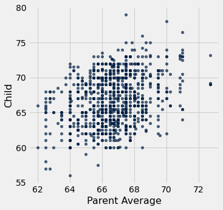
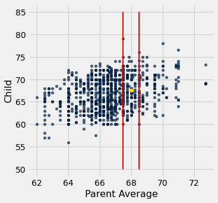
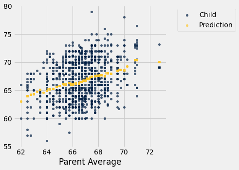
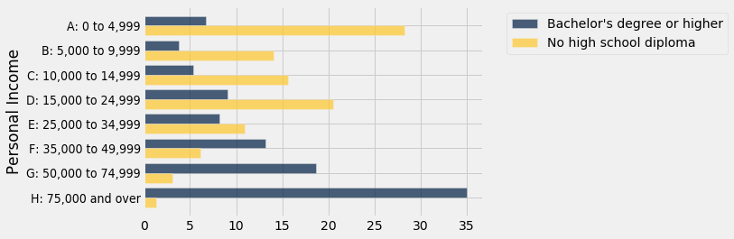
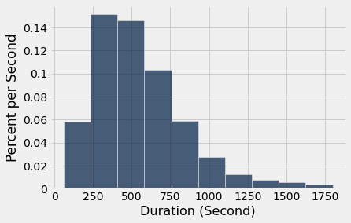
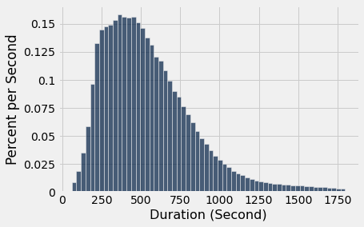

# Chapter 8: Functions and Tables

```python
from datascience import *
import matplotlib
path_data = '../../assets/data/'
matplotlib.use('Agg')
%matplotlib inline
import matplotlib.pyplot as plots
plots.style.use('fivethirtyeight')
import numpy as np
```

We are building up a useful inventory of techniques for identifying patterns and themes in a data set by using functions already available in Python. We will now explore a core feature of the Python programming language: function definition.

We have used functions extensively already in this text, but never defined a function of our own. The purpose of defining a function is to give a name to a computational process that may be applied multiple times. There are many situations in computing that require repeated computation. For example, it is often the case that we want to perform the same manipulation on every value in a column of a table.

**Defining a Function**

The definition of the `double` function below simply doubles a number.

```python
# Our first function definition

def double(x):
    """ Double x """
    return 2*x
```

We start any function definition by writing `def`.  Here is a breakdown of the other parts (the *syntax*) of this small function:

![The first line of the function is "def double(x)". "double(x)" is annotated as the signature. "double" is the name of the function and "x" is the first (and only) argument. The next line is indented and shows three double quotes surrounding "Double x". This is annotated as the documentation or docstring that describes what the function does. The following line is "return 2*x" and annotated as the body. The body is all the code that runs each time you call the function. Return tells Python what the value of each call to the function is: it's the value of the expression after return. Finally, the indendation of the docstring and the body is highlighted. This indentation tells Python that those lines are part of the body.](images/function_definition.jpg)

When we run the cell above, no particular number is doubled, and the code inside the body of `double` is not yet evaluated.  In this respect, our function is analogous to a *recipe*.  Each time we follow the instructions in a recipe, we need to start with ingredients.  Each time we want to use our function to double a number, we need to specify a number.

We can call `double` in exactly the same way we have called other functions. Each time we do that, the code in the body is executed, with the value of the argument given the name `x`.

```python
double(17)
```

*Output:*

```text
34
```

```python
double(-0.6/4)
```

*Output:*

```text
-0.3
```

The two expressions above are both *call expressions*. In the second one, the value of the expression `-0.6/4` is computed and then passed as the argument named `x` to the `double` function. Each call expresson results in the body of `double` being executed, but with a different value of `x`.

The body of `double` has only a single line:

`return 2*x`

Executing this *`return` statement* completes execution of the `double` function's body and computes the value of the call expression.

The argument to `double` can be any expression, as long as its value is a number.  For example, it can be a name.  The `double` function does not know or care how its argument is computed or stored; its only job is to execute its own body using the values of the arguments passed to it.

```python
any_name = 42
double(any_name)
```

*Output:*

```text
84
```

The argument can also be any value that can be doubled. For example, a whole array of numbers can be passed as an argument to `double`, and the result will be another array.

```python
double(make_array(3, 4, 5))
```

*Output:*

```text
array([ 6,  8, 10])
```

However, names that are defined inside a function, including arguments like `double`'s `x`, have only a fleeting existence.  They are defined only while the function is being called, and they are only accessible inside the body of the function. We can't refer to `x` outside the body of `double`. The technical terminology is that `x` has *local scope*.

Therefore the name `x` isn't recognized outside the body of the function, even though we have called `double` in the cells above.

```python
x
```

*Error:*

```text
---------------------------------------------------------------------------
NameError                                 Traceback (most recent call last)
<ipython-input-7-6fcf9dfbd479> in <module>
----> 1 x

NameError: name 'x' is not defined
```

**Docstrings.** Though `double` is relatively easy to understand, many functions perform complicated tasks and are difficult to use without explanation. (You may have discovered this yourself!) Therefore, a well-composed function has a name that evokes its behavior, as well as documentation.  In Python, this is called a *docstring* — a description of its behavior and expectations about its arguments. The docstring can also show example calls to the function, where the call is preceded by `>>>`.

A docstring can be any string, as long as it is the first thing in a function's body. Docstrings are typically defined using triple quotation marks at the start and end, which allows a string to span multiple lines. The first line is conventionally a complete but short description of the function, while following lines provide further guidance to future users of the function.

Here is a definition of a function called `percent` that takes two arguments. The definition includes a docstring.

```python
# A function with more than one argument

def percent(x, total):
    """Convert x to a percentage of total.
    
    More precisely, this function divides x by total,
    multiplies the result by 100, and rounds the result
    to two decimal places.
    
    >>> percent(4, 16)
    25.0
    >>> percent(1, 6)
    16.67
    """
    return round((x/total)*100, 2)
```

```python
percent(33, 200)
```

*Output:*

```text
16.5
```

Contrast the function `percent` defined above with the function `percents` defined below. The latter takes an array as its argument, and converts all the numbers in the array to percents out of the total of the values in the array. The percents are all rounded to two decimal places, this time replacing `round` by `np.round` because the argument is an array and not a number.

```python
def percents(counts):
    """Convert the values in array_x to percents out of the total of array_x."""
    total = counts.sum()
    return np.round((counts/total)*100, 2)
```

The function `percents` returns an array of percents that add up to 100 apart from rounding.

```python
some_array = make_array(7, 10, 4)
percents(some_array)
```

*Output:*

```text
array([33.33, 47.62, 19.05])
```

It is helpful to understand the steps Python takes to execute a function.  To facilitate this, we have put a function definition and a call to that function in the same cell below.

```python
def biggest_difference(array_x):
    """Find the biggest difference in absolute value between two adjacent elements of array_x."""
    diffs = np.diff(array_x)
    absolute_diffs = abs(diffs)
    return max(absolute_diffs)

some_numbers = make_array(2, 4, 5, 6, 4, -1, 1)
big_diff = biggest_difference(some_numbers)
print("The biggest difference is", big_diff)
```

*Output (stdout):*

```text
The biggest difference is 5
```

Here is what happens when we run that cell:

![The overall layout consists of the same code snippet repeated on the left, descriptive text boxes with callout lines pointing to specific parts of the code, and a "Names defined in scope" section on the right, which shows the state of variables at different stages. The code snippet starts by defining the biggest_difference function, which takes array_x as input and has the following docstring: ‘Find the biggest difference in absolute value between two adjacent elements of array_x.’ The first line of code annotation is ‘The function biggest_difference is defined.’ The next repetition of the code annotates the line following the end of the function with’ The array some_numbers is defined.’ and under ‘Names defined in scope’ now is ‘biggest_difference = <a function>’. The next annotation is for the next line ‘big_diff = biggest_difference(some_numbers)’ with ‘Our function is called. Before this line finishes, Python executes its body.’ some_numbers has been added to ’Names defined in scope.’ The next annotation goes back to the function body and states ‘The argument is given name array_x. The function’s first line (docstring) does nothing.’ And we see array_x now has the value of some_numbers. The next line of code after the docstring is ‘diffs = np.diff(array_x)’ with annotation ‘The array diffs is defined.’ The next line of code is ‘absolute_diffs = abs(diffs)’ with annotation ‘The array absolute_diffs is defined.’ and we see ‘diffs’ in the ‘Names defined in scope’ with the calculated values filled in the array. The next line of code is ’return max(absolute_diffs)’ with annotation ‘The value of max(absolute_diffs) is computed and becomes the value of the call biggest_difference(some_numbers)’ and ‘absolute_diffs’ added to ‘Names defined in scope.’ Finally, the annotation jumps back to the line after the function call with the annotation ‘The function call is done, so array_x, diffs, and absolute_diffs disappear. some_numbers reappears, and big_diff is defined as the value of the call. Finally the print statement happens.’](images/function_execution.jpg)

**Multiple Arguments**

There can be multiple ways to generalize an expression or block of code, and so a function can take multiple arguments that each determine different aspects of the result. For example, the `percents` function we defined previously rounded to two decimal places every time. The following two-argument definition allows different calls to round to different amounts.

```python
def percents(counts, decimal_places):
    """Convert the values in array_x to percents out of the total of array_x."""
    total = counts.sum()
    return np.round((counts/total)*100, decimal_places)

parts = make_array(2, 1, 4)
print("Rounded to 1 decimal place: ", percents(parts, 1))
print("Rounded to 2 decimal places:", percents(parts, 2))
print("Rounded to 3 decimal places:", percents(parts, 3))
```

*Output (stdout):*

```text
Rounded to 1 decimal place:  [28.6 14.3 57.1]
Rounded to 2 decimal places: [28.57 14.29 57.14]
Rounded to 3 decimal places: [28.571 14.286 57.143]
```

The flexibility of this new definition comes at a small price: each time the function is called, the number of decimal places must be specified. Default argument values allow a function to be called with a variable number of arguments; any argument that isn't specified in the call expression is given its default value, which is stated in the first line of the `def` statement. For example, in this final definition of `percents`, the optional argument `decimal_places` is given a default value of 2.

```python
def percents(counts, decimal_places=2):
    """Convert the values in array_x to percents out of the total of array_x."""
    total = counts.sum()
    return np.round((counts/total)*100, decimal_places)

parts = make_array(2, 1, 4)
print("Rounded to 1 decimal place:", percents(parts, 1))
print("Rounded to the default number of decimal places:", percents(parts))
```

*Output (stdout):*

```text
Rounded to 1 decimal place: [28.6 14.3 57.1]
Rounded to the default number of decimal places: [28.57 14.29 57.14]
```

**Note: Methods**

Functions are called by placing argument expressions in parentheses after the function name. Any function that is defined in isolation is called in this way. You have also seen examples of methods, which are like functions but are called using dot notation, such as `some_table.sort(some_label)`. The functions that you define will always be called using the function name first, passing in all of the arguments.

## 8.1 Applying a Function to a Column

We have seen many examples of creating new columns of tables by applying functions to existing columns or to other arrays. All of those functions took arrays as their arguments. But frequently we will want to convert the entries in a column by a function that doesn't take an array as its argument. For example, it might take just one number as its argument, as in the function `cut_off_at_100` defined below.

```python
from datascience import *
import matplotlib
path_data = '../../../assets/data/'
matplotlib.use('Agg')
%matplotlib inline
import matplotlib.pyplot as plots
plots.style.use('fivethirtyeight')
import numpy as np
```

```python
def cut_off_at_100(x):
    """The smaller of x and 100"""
    return min(x, 100)
```

```python
cut_off_at_100(17)
```

*Output:*

```text
17
```

```python
cut_off_at_100(117)
```

*Output:*

```text
100
```

```python
cut_off_at_100(100)
```

*Output:*

```text
100
```

The function `cut_off_at_100` simply returns its argument if the argument is less than or equal to 100. But if the argument is greater than 100, it returns 100.

In our earlier examples using Census data, we saw that the variable `AGE` had a value 100 that meant "100 years old or older". Cutting off ages at 100 in this manner is exactly what `cut_off_at_100` does.

To use this function on many ages at once, we will have to be able to *refer* to the function itself, without actually calling it.  Analogously, we might show a cake recipe to a chef and ask her to use it to bake 6 cakes.  In that scenario, we are not using the recipe to bake any cakes ourselves; our role is merely to refer the chef to the recipe.  Similarly, we can ask a table to call `cut_off_at_100` on 6 different numbers in a column.

First, we create the table `ages` with a column for people and one for their ages. For example, person `C` is 52 years old.

```python
ages = Table().with_columns(
    'Person', make_array('A', 'B', 'C', 'D', 'E', 'F'),
    'Age', make_array(17, 117, 52, 100, 6, 101)
)
ages
```

*Output:*

| Person | Age |
| --- | --- |
| A | 17 |
| B | 117 |
| C | 52 |
| D | 100 |
| E | 6 |
| F | 101 |

### `apply`

To cut off each of the ages at 100, we will use a new Table method. The `apply` method calls a function on each element of a column, forming a new array of return values. To indicate which function to call, just name it (without quotation marks or parentheses). The name of the column of input values is a string that must still appear within quotation marks.

```python
ages.apply(cut_off_at_100, 'Age')
```

*Output:*

```text
array([ 17, 100,  52, 100,   6, 100])
```

What we have done here is `apply` the function `cut_off_at_100` to each value in the `Age` column of the table `ages`. The output is the array of corresponding return values of the function. For example, 17 stayed 17, 117 became 100, 52 stayed 52, and so on.

This array, which has the same length as the original `Age` column of the `ages` table, can be used as the values in a new column called `Cut Off Age` alongside the existing `Person` and `Age` columns.

```python
ages.with_column(
    'Cut Off Age', ages.apply(cut_off_at_100, 'Age')
)
```

*Output:*

| Person | Age | Cut Off Age |
| --- | --- | --- |
| A | 17 | 17 |
| B | 117 | 100 |
| C | 52 | 52 |
| D | 100 | 100 |
| E | 6 | 6 |
| F | 101 | 100 |

### Functions as Values
We've seen that Python has many kinds of values.  For example, `6` is a number value, `"cake"` is a text value, `Table()` is an empty table, and `ages` is a name for a table value (since we defined it above).

In Python, every function, including `cut_off_at_100`, is also a value. It helps to think about recipes again. A recipe for cake is a real thing, distinct from cakes or ingredients, and you can give it a name like "Ani's cake recipe." When we defined `cut_off_at_100` with a `def` statement, we actually did two separate things: we created a function that cuts off numbers at 100, and we gave it the name `cut_off_at_100`.

We can refer to any function by writing its name, without the parentheses or arguments necessary to actually call it. We did this when we called `apply` above.  When we write a function's name by itself as the last line in a cell, Python produces a text representation of the function, just like it would print out a number or a string value.

```python
cut_off_at_100
```

*Output:*

```text
<function __main__.cut_off_at_100(x)>
```

Notice that we did not write `"cut_off_at_100"` with quotes (which is just a piece of text), or `cut_off_at_100()` (which is a function call, and an invalid one at that).  We simply wrote `cut_off_at_100` to refer to the function.

Just like we can define new names for other values, we can define new names for functions.  For example, suppose we want to refer to our function as `cut_off` instead of `cut_off_at_100`.  We can just write this:

```python
cut_off = cut_off_at_100
```

Now `cut_off` is a name for a function.  It's the same function as `cut_off_at_100`, so the printed value is exactly the same.

```python
cut_off
```

*Output:*

```text
<function __main__.cut_off_at_100(x)>
```

Let us see another application of `apply`.

### Example: Prediction

Data science is often used to make predictions about the future. If we are trying to predict an outcome for a particular individual – for example, how she will respond to a treatment, or whether he will buy a product – it is natural to base the prediction on the outcomes of other similar individuals.

The table below is adapted from a historical data set on the heights of parents and their adult children. Each row corresponds to one adult child. The variables are a numerical code for the family, the heights (in inches) of the father and mother, the number of children in the family, as well as the child's birth rank (1 = oldest), sex (coded only as "male" or "female"), and height in inches.

```python
# Data on heights of parents and their adult children
family_heights = Table.read_table(path_data + 'family_heights.csv').drop(3)
family_heights
```

*Output:*

| family | father | mother | children | childNum | sex | childHeight |
| --- | --- | --- | --- | --- | --- | --- |
| 1 | 78.5 | 67 | 4 | 1 | male | 73.2 |
| 1 | 78.5 | 67 | 4 | 2 | female | 69.2 |
| 1 | 78.5 | 67 | 4 | 3 | female | 69 |
| 1 | 78.5 | 67 | 4 | 4 | female | 69 |
| 2 | 75.5 | 66.5 | 4 | 1 | male | 73.5 |
| 2 | 75.5 | 66.5 | 4 | 2 | male | 72.5 |
| 2 | 75.5 | 66.5 | 4 | 3 | female | 65.5 |
| 2 | 75.5 | 66.5 | 4 | 4 | female | 65.5 |
| 3 | 75 | 64 | 2 | 1 | male | 71 |
| 3 | 75 | 64 | 2 | 2 | female | 68 |

A primary reason for collecting the data was to be able to predict the adult height of a child born to parents similar to those in the dataset. Let us try to do this, by using the simple average of the parents' height as the variable on which to base our prediction. 

This parent average height is our *predictor* variable. In the cell below, its values are in the array `parent_averages`.

The table `heights` consists of just the parent average heights and child heights. The scatter plot of the two variables shows a positive association as we would expect for these variables.

```python
parent_averages = (family_heights.column('father') + family_heights.column('mother'))/2
heights = Table().with_columns(
    'Parent Average', parent_averages,
    'Child', family_heights.column('childHeight')
)
heights
```

*Output:*

| Parent Average | Child |
| --- | --- |
| 72.75 | 73.2 |
| 72.75 | 69.2 |
| 72.75 | 69 |
| 72.75 | 69 |
| 71 | 73.5 |
| 71 | 72.5 |
| 71 | 65.5 |
| 71 | 65.5 |
| 69.5 | 71 |
| 69.5 | 68 |

```python
heights.scatter('Parent Average')
```



Now suppose the researchers encountered a new couple, similar to those in this dataset, and wondered how tall their child would be. What would be a good way for him to go about predicting the child's height, given that the parent average height was, say, 68 inches?

One reasonable approach would be to base the prediction on all the points that correspond to a parent average height of around 68 inches. The prediction equals the average child's height calculated from those points alone.

Let's execute this plan. For now we will just make a reasonable definition of what "around 68 inches" means, and work with that. Later in the course we will examine the consequences of such choices.

We will take "close" to mean "within half an inch". The figure below shows all the points corresponding to a parent average height between 67.5 inches and 68.5 inches. These are all the points in the strip between the red lines. Each of these points corresponds to one child; our prediction of the height of the new couple's child is the average height of all the children in the strip. That's represented by the gold dot.

Ignore the code, and just focus on understanding the mental process of arriving at that gold dot.

```python
heights.scatter('Parent Average')
plots.plot([67.5, 67.5], [50, 85], color='red', lw=2)
plots.plot([68.5, 68.5], [50, 85], color='red', lw=2)
plots.scatter(68, 67.62, color='gold', s=40);
```



In order to calculate exactly where the gold dot should be, we first need to indentify all the points in the strip. These correspond to the rows where `Parent Average` is between 67.5 inches and 68.5 inches.

```python
close_to_68 = heights.where('Parent Average', are.between(67.5, 68.5))
close_to_68
```

*Output:*

| Parent Average | Child |
| --- | --- |
| 68 | 74 |
| 68 | 70 |
| 68 | 68 |
| 68 | 67 |
| 68 | 67 |
| 68 | 66 |
| 68 | 63.5 |
| 68 | 63 |
| 67.5 | 65 |
| 68.1 | 62.7 |

The predicted height of a child who has a parent average height of 68 inches is the average height of the children in these rows. That's 67.62 inches.

```python
np.average(close_to_68.column('Child'))
```

*Output:*

```text
67.62
```

We now have a way to predict the height of a child given any value of the parent average height near those in our dataset. We can define a function `predict_child` that does this. The body of the function consists of the code in the two cells above, apart from choices of names.

```python
def predict_child(p_avg):
    """Predict the height of a child whose parents have a parent average height of p_avg.
    
    The prediction is the average height of the children whose parent average height is
    in the range p_avg plus or minus 0.5.
    """
    
    close_points = heights.where('Parent Average', are.between(p_avg-0.5, p_avg + 0.5))
    return np.average(close_points.column('Child'))
```

Given a parent average height of 68 inches, the function `predict_child` returns the same prediction (67.62 inches) as we got earlier. The advantage of defining the function is that we can easily change the value of the predictor and get a new prediction.

```python
predict_child(68)
```

*Output:*

```text
67.62
```

```python
predict_child(66)
```

*Output:*

```text
66.08640776699029
```

How good are these predictions? We can get a sense of this by comparing the predictions with the data that we already have. To do this, we first apply the function `predict_child` to the column of `Parent Average` heights, and collect the results in a new column labeled `Prediction`.

```python
# Apply predict_child to all the midparent heights

heights_with_predictions = heights.with_column(
    'Prediction', heights.apply(predict_child, 'Parent Average')
)
```

```python
heights_with_predictions
```

*Output:*

| Parent Average | Child | Prediction |
| --- | --- | --- |
| 72.75 | 73.2 | 70.1 |
| 72.75 | 69.2 | 70.1 |
| 72.75 | 69 | 70.1 |
| 72.75 | 69 | 70.1 |
| 71 | 73.5 | 70.4158 |
| 71 | 72.5 | 70.4158 |
| 71 | 65.5 | 70.4158 |
| 71 | 65.5 | 70.4158 |
| 69.5 | 71 | 68.5025 |
| 69.5 | 68 | 68.5025 |

To see where the predictions lie relative to the observed data, we can draw overlaid scatter plots with `Parent Average` as the common horizontal axis.

```python
heights_with_predictions.scatter('Parent Average')
```



The graph of gold dots is called a *graph of averages,* because each gold dot is the center of a vertical strip like the one we drew earlier. Each one provides a prediction of a child's height given the parent average height. For example, the scatter shows that for a parent average height of 65 inches, the predicted height of the child would be just above 65 inches, and indeed `predict_child(65)` evaluates to about 65.84.

```python
predict_child(65)
```

*Output:*

```text
65.83829787234043
```

Notice that the graph of averages roughly follows a straight line. This straight line is now called the *regression line* and is one of the most common methods of making predictions. The calculation that we have just done is very similar to the calculation that led to the development of the regression method, using the same data.

This example, like the one about John Snow's analysis of cholera deaths, shows how some of the fundamental concepts of modern data science have roots going back a long way. The method used here was a precursor to *nearest neighbor* prediction methods that now have powerful applications in diverse settings. The modern field of *machine learning* includes the automation of such methods to make predictions based on vast and rapidly evolving datasets.

## 8.2 Classifying by One Variable

Data scientists often need to classify individuals into groups according to shared features, and then identify some characteristics of the groups. For example, in the example using Galton's data on heights, we saw that it was useful to classify families according to the parents' midparent heights, and then find the average height of the children in each group.

This section is about classifying individuals into categories that are not numerical. We begin by recalling the basic use of `group`.

```python
from datascience import *
path_data = '../../../assets/data/'
import matplotlib
matplotlib.use('Agg')
%matplotlib inline
import matplotlib.pyplot as plots
plots.style.use('fivethirtyeight')
import numpy as np
```

### Counting the Number in Each Category
The `group` method with a single argument counts the number of rows for each category in a column. The result contains one row per unique value in the grouped column.

Here is a small table of data on ice cream cones. The `group` method can be used to list the distinct flavors and provide the counts of each flavor.

```python
cones = Table().with_columns(
    'Flavor', make_array('strawberry', 'chocolate', 'chocolate', 'strawberry', 'chocolate'),
    'Price', make_array(3.55, 4.75, 6.55, 5.25, 5.25)
)
cones
```

*Output:*

| Flavor | Price |
| --- | --- |
| strawberry | 3.55 |
| chocolate | 4.75 |
| chocolate | 6.55 |
| strawberry | 5.25 |
| chocolate | 5.25 |

```python
cones.group('Flavor')
```

*Output:*

| Flavor | count |
| --- | --- |
| chocolate | 3 |
| strawberry | 2 |

There are two distinct categories, chocolate and strawberry. The call to `group` creates a table of counts in each category. The column is called `count` by default, and contains the number of rows in each category.

Notice that this can all be worked out from just the `Flavor` column. The `Price` column has not been used.

But what if we wanted the total price of the cones of each different flavor? That's where the second argument of `group` comes in.

### Finding a Characteristic of Each Category
The optional second argument of `group` names the function that will be used to aggregate values in other columns for all of those rows. For instance, `sum` will sum up the prices in all rows that match each category. This result also contains one row per unique value in the grouped column, but it has the same number of columns as the original table.

To find the total price of each flavor, we call `group` again, with `Flavor` as its first argument as before. But this time there is a second argument: the function name `sum`.

```python
cones.group('Flavor', sum)
```

*Output:*

| Flavor | Price sum |
| --- | --- |
| chocolate | 16.55 |
| strawberry | 8.8 |

To create this new table, `group` has calculated the sum of the `Price` entries in all the rows corresponding to each distinct flavor. The prices in the three `chocolate` rows add up to $\$16.55$ (you can assume that price is being measured in dollars). The prices in the two `strawberry` rows have a total of $\$8.80$.

The label of the newly created "sum" column is `Price sum`, which is created by taking the label of the column being summed, and appending the word `sum`. 

Because `group` finds the `sum` of all columns other than the one with the categories, there is no need to specify that it has to `sum` the prices.

To see in more detail what `group` is doing, notice that you could have figured out the total prices yourself, not only by mental arithmetic but also using code. For example, to find the total price of all the chocolate cones, you could start by creating a new table consisting of only the chocolate cones, and then accessing the column of prices:

```python
cones.where('Flavor', are.equal_to('chocolate')).column('Price')
```

*Output:*

```text
array([4.75, 6.55, 5.25])
```

```python
sum(cones.where('Flavor', are.equal_to('chocolate')).column('Price'))
```

*Output:*

```text
16.55
```

This is what `group` is doing for each distinct value in `Flavor`.

```python
# For each distinct value in `Flavor, access all the rows
# and create an array of `Price`

cones_choc = cones.where('Flavor', are.equal_to('chocolate')).column('Price')
cones_strawb = cones.where('Flavor', are.equal_to('strawberry')).column('Price')

# Display the arrays in a table

grouped_cones = Table().with_columns(
    'Flavor', make_array('chocolate', 'strawberry'),
    'Array of All the Prices', make_array(cones_choc, cones_strawb)
)

# Append a column with the sum of the `Price` values in each array

price_totals = grouped_cones.with_column(
    'Sum of the Array', make_array(sum(cones_choc), sum(cones_strawb))
)
price_totals
```

*Output:*

| Flavor | Array of All the Prices | Sum of the Array |
| --- | --- | --- |
| chocolate | [4.75 6.55 5.25] | 16.55 |
| strawberry | [3.55 5.25] | 8.8 |

You can replace `sum` by any other functions that work on arrays. For example, you could use `max` to find the largest price in each category:

```python
cones.group('Flavor', max)
```

*Output:*

| Flavor | Price max |
| --- | --- |
| chocolate | 6.55 |
| strawberry | 5.25 |

Once again, `group` creates arrays of the prices in each `Flavor` category. But now it finds the `max` of each array:

```python
price_maxes = grouped_cones.with_column(
    'Max of the Array', make_array(max(cones_choc), max(cones_strawb))
)
price_maxes
```

*Output:*

| Flavor | Array of All the Prices | Max of the Array |
| --- | --- | --- |
| chocolate | [4.75 6.55 5.25] | 6.55 |
| strawberry | [3.55 5.25] | 5.25 |

Indeed, the original call to `group` with just one argument has the same effect as using `len` as the function and then cleaning up the table.

```python
lengths = grouped_cones.with_column(
    'Length of the Array', make_array(len(cones_choc), len(cones_strawb))
)
lengths
```

*Output:*

| Flavor | Array of All the Prices | Length of the Array |
| --- | --- | --- |
| chocolate | [4.75 6.55 5.25] | 3 |
| strawberry | [3.55 5.25] | 2 |

### Example: NBA Salaries
The table `nba` contains data on the 2015-2016 players in the National Basketball Association. We have examined these data earlier. Recall that salaries are measured in millions of dollars.

```python
nba1 = Table.read_table(path_data + 'nba_salaries.csv')
nba = nba1.relabeled("'15-'16 SALARY", 'SALARY')
nba
```

*Output:*

| PLAYER | POSITION | TEAM | SALARY |
| --- | --- | --- | --- |
| Paul Millsap | PF | Atlanta Hawks | 18.6717 |
| Al Horford | C | Atlanta Hawks | 12 |
| Tiago Splitter | C | Atlanta Hawks | 9.75625 |
| Jeff Teague | PG | Atlanta Hawks | 8 |
| Kyle Korver | SG | Atlanta Hawks | 5.74648 |
| Thabo Sefolosha | SF | Atlanta Hawks | 4 |
| Mike Scott | PF | Atlanta Hawks | 3.33333 |
| Kent Bazemore | SF | Atlanta Hawks | 2 |
| Dennis Schroder | PG | Atlanta Hawks | 1.7634 |
| Tim Hardaway Jr. | SG | Atlanta Hawks | 1.30452 |

**1.** How much money did each team pay for its players' salaries?

The only columns involved are `TEAM` and `SALARY`. We have to `group` the rows by `TEAM` and then `sum` the salaries of the groups.

```python
teams_and_money = nba.select('TEAM', 'SALARY')
teams_and_money.group('TEAM', sum)
```

*Output:*

| TEAM | SALARY sum |
| --- | --- |
| Atlanta Hawks | 69.5731 |
| Boston Celtics | 50.2855 |
| Brooklyn Nets | 57.307 |
| Charlotte Hornets | 84.1024 |
| Chicago Bulls | 78.8209 |
| Cleveland Cavaliers | 102.312 |
| Dallas Mavericks | 65.7626 |
| Denver Nuggets | 62.4294 |
| Detroit Pistons | 42.2118 |
| Golden State Warriors | 94.0851 |

**2.** How many NBA players were there in each of the five positions?

We have to classify by `POSITION`, and count. This can be done with just one argument to group:

```python
nba.group('POSITION')
```

*Output:*

| POSITION | count |
| --- | --- |
| C | 69 |
| PF | 85 |
| PG | 85 |
| SF | 82 |
| SG | 96 |

**3.** What was the average salary of the players at each of the five positions?

This time, we have to group by `POSITION` and take the mean of the salaries. For clarity, we will work with a table of just the positions and the salaries.

```python
positions_and_money = nba.select('POSITION', 'SALARY')
positions_and_money.group('POSITION', np.mean)
```

*Output:*

| POSITION | SALARY mean |
| --- | --- |
| C | 6.08291 |
| PF | 4.95134 |
| PG | 5.16549 |
| SF | 5.53267 |
| SG | 3.9882 |

Center was the most highly paid position, at an average of over 6 million dollars.

If we had not selected the two columns as our first step, `group` would not attempt to "average" the categorical columns in `nba`. (It is impossible to average two strings like "Atlanta Hawks" and "Boston Celtics".) It performs arithmetic only on numerical columns and leaves the rest blank.

```python
nba.group('POSITION', np.mean)
```

*Output:*

| POSITION | PLAYER mean | TEAM mean | SALARY mean |
| --- | --- | --- | --- |
| C |  |  | 6.08291 |
| PF |  |  | 4.95134 |
| PG |  |  | 5.16549 |
| SF |  |  | 5.53267 |
| SG |  |  | 3.9882 |

## 8.3 Cross-Classifying by More than One Variable

When individuals have multiple features, there are many different ways to classify them. For example, if we have a population of college students for each of whom we have recorded a major and the number of years in college, then the students could be classified by major, or by year, or by a combination of major and year.

The `group` method also allows us to classify individuals according to multiple variables. This is called *cross-classifying*.

```python
from datascience import *
path_data = '../../../assets/data/'
import numpy as np

import matplotlib
matplotlib.use('Agg')
%matplotlib inline
import matplotlib.pyplot as plots
plots.style.use('fivethirtyeight')
```

### Two Variables: Counting the Number in Each Paired Category
The table `more_cones` records the flavor, color, and price of six ice cream cones.

```python
more_cones = Table().with_columns(
    'Flavor', make_array('strawberry', 'chocolate', 'chocolate', 'strawberry', 'chocolate', 'bubblegum'),
    'Color', make_array('pink', 'light brown', 'dark brown', 'pink', 'dark brown', 'pink'),
    'Price', make_array(3.55, 4.75, 5.25, 5.25, 5.25, 4.75)
)

more_cones
```

*Output:*

| Flavor | Color | Price |
| --- | --- | --- |
| strawberry | pink | 3.55 |
| chocolate | light brown | 4.75 |
| chocolate | dark brown | 5.25 |
| strawberry | pink | 5.25 |
| chocolate | dark brown | 5.25 |
| bubblegum | pink | 4.75 |

We know how to use `group` to count the number of cones of each flavor:

```python
more_cones.group('Flavor')
```

*Output:*

| Flavor | count |
| --- | --- |
| bubblegum | 1 |
| chocolate | 3 |
| strawberry | 2 |

But now each cone has a color as well. To classify the cones by both flavor and color, we will pass a list of labels as an argument to `group`. The resulting table has one row for every *unique combination* of values that appear together in the grouped columns. As before, a single argument (a list, in this case, but an array would work too) gives row counts.

Although there are six cones, there are only four unique combinations of flavor and color. Two of the cones were dark brown chocolate, and two pink strawberry.

```python
more_cones.group(['Flavor', 'Color'])
```

*Output:*

| Flavor | Color | count |
| --- | --- | --- |
| bubblegum | pink | 1 |
| chocolate | dark brown | 2 |
| chocolate | light brown | 1 |
| strawberry | pink | 2 |

### Two Variables: Finding a Characteristic of Each Paired Category
A second argument aggregates all other columns that are not in the list of grouped columns.

```python
more_cones.group(['Flavor', 'Color'], sum)
```

*Output:*

| Flavor | Color | Price sum |
| --- | --- | --- |
| bubblegum | pink | 4.75 |
| chocolate | dark brown | 10.5 |
| chocolate | light brown | 4.75 |
| strawberry | pink | 8.8 |

**Three or More Variables.** You can use `group` to classify rows by three or more categorical variables. Just include them all in the list that is the first argument. But cross-classifying by multiple variables can become complex, as the number of distinct combinations of categories can be quite large.

### Pivot Tables: Rearranging the Output of `group`
Many uses of cross-classification involve just two categorical variables, like `Flavor` and `Color` in the example above. In these cases it is possible to display the results of the classification in a different kind of table, called a *pivot table*. Pivot tables, also known as *contingency tables*, make it easier to work with data that have been classified according to two variables.

Recall the use of `group` to count the number of cones in each paired category of flavor and color:

```python
more_cones.group(['Flavor', 'Color'])
```

*Output:*

| Flavor | Color | count |
| --- | --- | --- |
| bubblegum | pink | 1 |
| chocolate | dark brown | 2 |
| chocolate | light brown | 1 |
| strawberry | pink | 2 |

The same data can be displayed differenly using the Table method `pivot`. Ignore the code for a moment, and just examine the table of outcomes.

```python
more_cones.pivot('Flavor', 'Color')
```

*Output:*

| Color | bubblegum | chocolate | strawberry |
| --- | --- | --- | --- |
| dark brown | 0 | 2 | 0 |
| light brown | 0 | 1 | 0 |
| pink | 1 | 0 | 2 |

Notice how this table displays all nine possible pairs of flavor and color, including pairs like "dark brown bubblegum" that don't exist in our data. Notice also that the count in each pair appears in the body of the table: to find the number of light brown chocolate cones, run your eye along the row `light brown` until it meets the column `chocolate`.

The `group` method takes a list of two labels because it is flexible: it could take one or three or more. On the other hand, `pivot` always takes two column labels, one to determine the columns and one to determine the rows.

**`pivot`** 

The `pivot` method is closely related to the `group` method: it groups together rows that share a combination of values. It differs from `group` because it organizes the resulting values in a grid. The first argument to `pivot` is the label of a column that contains the values that will be used to form new columns in the result. The second argument is the label of a column used for the rows. The result gives the count of all rows of the original table that share the combination of column and row values.

Like `group`, `pivot` can be used with additional arguments to find characteristics of each paired category. An optional third argument called `values` indicates a column of values that will replace the counts in each cell of the grid. All of these values will not be displayed, however; the fourth argument `collect` indicates how to collect them all into one aggregated value to be displayed in the cell.

An example will help clarify this. Here is `pivot` being used to find the total price of the cones in each cell.

```python
more_cones.pivot('Flavor', 'Color', values='Price', collect=sum)
```

*Output:*

| Color | bubblegum | chocolate | strawberry |
| --- | --- | --- | --- |
| dark brown | 0 | 10.5 | 0 |
| light brown | 0 | 4.75 | 0 |
| pink | 4.75 | 0 | 8.8 |

And here is `group` doing the same thing.

```python
more_cones.group(['Flavor', 'Color'], sum)
```

*Output:*

| Flavor | Color | Price sum |
| --- | --- | --- |
| bubblegum | pink | 4.75 |
| chocolate | dark brown | 10.5 |
| chocolate | light brown | 4.75 |
| strawberry | pink | 8.8 |

Though the numbers in both tables are the same, table produced by `pivot` is easier to read and lends itself more easily to analysis. The advantage of `pivot` is that it places grouped values into adjacent columns, so that they can be combined and compared.

### Example: Education and Income of Californian Adults
The State of California's Open Data Portal is a rich source of information about the lives of Californians. It is our source of a [dataset](http://data.ca.gov/dataset/ca-educational-attainment-personal-income) on educational attainment and personal income among Californians over the years 2008 to 2014. The data are derived from the U.S. Census Current Population Survey.

For each year, the table records the `Population Count` of Californians in many different combinations of age, gender, educational attainment, and personal income. We will study only the data for the year 2014.

```python
full_table = Table.read_table(path_data + 'educ_inc.csv')
ca_2014 = full_table.where('Year', are.equal_to('1/1/14 0:00')).where('Age', are.not_equal_to('00 to 17'))
ca_2014
```

*Output:*

| Year | Age | Gender | Educational Attainment | Personal Income | Population Count |
| --- | --- | --- | --- | --- | --- |
| 1/1/14 0:00 | 18 to 64 | Female | No high school diploma | H: 75,000 and over | 2058 |
| 1/1/14 0:00 | 65 to 80+ | Male | No high school diploma | H: 75,000 and over | 2153 |
| 1/1/14 0:00 | 65 to 80+ | Female | No high school diploma | G: 50,000 to 74,999 | 4666 |
| 1/1/14 0:00 | 65 to 80+ | Female | High school or equivalent | H: 75,000 and over | 7122 |
| 1/1/14 0:00 | 65 to 80+ | Female | No high school diploma | F: 35,000 to 49,999 | 7261 |
| 1/1/14 0:00 | 65 to 80+ | Male | No high school diploma | G: 50,000 to 74,999 | 8569 |
| 1/1/14 0:00 | 18 to 64 | Female | No high school diploma | G: 50,000 to 74,999 | 14635 |
| 1/1/14 0:00 | 65 to 80+ | Male | No high school diploma | F: 35,000 to 49,999 | 15212 |
| 1/1/14 0:00 | 65 to 80+ | Male | College, less than 4-yr degree | B: 5,000 to 9,999 | 15423 |
| 1/1/14 0:00 | 65 to 80+ | Female | Bachelor's degree or higher | A: 0 to 4,999 | 15459 |

Each row of the table corresponds to a combination of age, gender, educational level, and income. There are 127 such combinations in all! 

As a first step it is a good idea to start with just one or two variables. We will focus on just one pair: educational attainment and personal income.

```python
educ_inc = ca_2014.select('Educational Attainment', 'Personal Income', 'Population Count')
educ_inc
```

*Output:*

| Educational Attainment | Personal Income | Population Count |
| --- | --- | --- |
| No high school diploma | H: 75,000 and over | 2058 |
| No high school diploma | H: 75,000 and over | 2153 |
| No high school diploma | G: 50,000 to 74,999 | 4666 |
| High school or equivalent | H: 75,000 and over | 7122 |
| No high school diploma | F: 35,000 to 49,999 | 7261 |
| No high school diploma | G: 50,000 to 74,999 | 8569 |
| No high school diploma | G: 50,000 to 74,999 | 14635 |
| No high school diploma | F: 35,000 to 49,999 | 15212 |
| College, less than 4-yr degree | B: 5,000 to 9,999 | 15423 |
| Bachelor's degree or higher | A: 0 to 4,999 | 15459 |

Let's start by looking at educational level alone. The categories of this variable have been subdivided by the different levels of income. So we will group the table by `Educational Attainment` and `sum` the `Population Count` in each category.

```python
education = educ_inc.select('Educational Attainment', 'Population Count')
educ_totals = education.group('Educational Attainment', sum)
educ_totals
```

*Output:*

| Educational Attainment | Population Count sum |
| --- | --- |
| Bachelor's degree or higher | 8525698 |
| College, less than 4-yr degree | 7775497 |
| High school or equivalent | 6294141 |
| No high school diploma | 4258277 |

There are only four categories of educational attainment. The counts are so large that is is more helpful to look at percents. For this, we will use the function `percents` that we defined in an earlier section. It converts an array of numbers to an array of percents out of the total in the input array.

```python
def percents(array_x):
    return np.round( (array_x/sum(array_x))*100, 2)
```

We now have the distribution of educational attainment among adult Californians. More than 30% have a Bachelor's degree or higher, while almost 16% lack a high school diploma.

```python
educ_distribution = educ_totals.with_column(
    'Population Percent', percents(educ_totals.column(1))
)
educ_distribution
```

*Output:*

| Educational Attainment | Population Count sum | Population Percent |
| --- | --- | --- |
| Bachelor's degree or higher | 8525698 | 31.75 |
| College, less than 4-yr degree | 7775497 | 28.96 |
| High school or equivalent | 6294141 | 23.44 |
| No high school diploma | 4258277 | 15.86 |

By using `pivot`, we can get a contingency table (a table of counts) of adult Californians cross-classified by `Educational Attainment` and `Personal Income`.

```python
totals = educ_inc.pivot('Educational Attainment', 'Personal Income', values='Population Count', collect=sum)
totals
```

*Output:*

| Personal Income | Bachelor's degree or higher | College, less than 4-yr degree | High school or equivalent | No high school diploma |
| --- | --- | --- | --- | --- |
| A: 0 to 4,999 | 575491 | 985011 | 1161873 | 1204529 |
| B: 5,000 to 9,999 | 326020 | 810641 | 626499 | 597039 |
| C: 10,000 to 14,999 | 452449 | 798596 | 692661 | 664607 |
| D: 15,000 to 24,999 | 773684 | 1345257 | 1252377 | 875498 |
| E: 25,000 to 34,999 | 693884 | 1091642 | 929218 | 464564 |
| F: 35,000 to 49,999 | 1122791 | 1112421 | 782804 | 260579 |
| G: 50,000 to 74,999 | 1594681 | 883826 | 525517 | 132516 |
| H: 75,000 and over | 2986698 | 748103 | 323192 | 58945 |

Here you see the power of `pivot` over other cross-classification methods. Each column of counts is a distribution of personal income at a specific level of educational attainment. Converting the counts to percents allows us to compare the four distributions.

```python
distributions = totals.select(0).with_columns(
    "Bachelor's degree or higher", percents(totals.column(1)),
    'College, less than 4-yr degree', percents(totals.column(2)),
    'High school or equivalent', percents(totals.column(3)),
    'No high school diploma', percents(totals.column(4))   
    )

distributions
```

*Output:*

| Personal Income | Bachelor's degree or higher | College, less than 4-yr degree | High school or equivalent | No high school diploma |
| --- | --- | --- | --- | --- |
| A: 0 to 4,999 | 6.75 | 12.67 | 18.46 | 28.29 |
| B: 5,000 to 9,999 | 3.82 | 10.43 | 9.95 | 14.02 |
| C: 10,000 to 14,999 | 5.31 | 10.27 | 11 | 15.61 |
| D: 15,000 to 24,999 | 9.07 | 17.3 | 19.9 | 20.56 |
| E: 25,000 to 34,999 | 8.14 | 14.04 | 14.76 | 10.91 |
| F: 35,000 to 49,999 | 13.17 | 14.31 | 12.44 | 6.12 |
| G: 50,000 to 74,999 | 18.7 | 11.37 | 8.35 | 3.11 |
| H: 75,000 and over | 35.03 | 9.62 | 5.13 | 1.38 |

At a glance, you can see that over 35% of those with Bachelor's degrees or higher had incomes of $\$75,000$ and over, whereas fewer than 10% of the people in the other education categories had that level of income. 

The bar chart below compares the personal income distributions of adult Californians who have no high school diploma with those who have completed a Bachelor's degree or higher. The difference in the distributions is striking. There is a clear positive association between educational attainment and personal income.

```python
distributions.select(0, 1, 4).barh(0)
```



## 8.4 Joining Tables by Columns

Often, data about the same individuals is maintained in more than one table. For example, one university office might have data about each student's time to completion of degree, while another has data about the student's tuition and financial aid.

To understand the students' experience, it may be helpful to put the two datasets together. If the data are in two tables, each with one row per student, then we would want to put the columns together, making sure to match the rows so that each student's information remains on a single row.

Let us do this in the context of a simple example, and then use the method with a larger dataset.

```python
from datascience import *
path_data = '../../../assets/data/'
import matplotlib
matplotlib.use('Agg')
%matplotlib inline
import matplotlib.pyplot as plots
plots.style.use('fivethirtyeight')
import numpy as np
```

The table `cones` is one we have encountered earlier. Now suppose each flavor of ice cream comes with a rating that is in a separate table.

```python
cones = Table().with_columns(
    'Flavor', make_array('strawberry', 'vanilla', 'chocolate', 'strawberry', 'chocolate'),
    'Price', make_array(3.55, 4.75, 6.55, 5.25, 5.75)
)
cones
```

*Output:*

| Flavor | Price |
| --- | --- |
| strawberry | 3.55 |
| vanilla | 4.75 |
| chocolate | 6.55 |
| strawberry | 5.25 |
| chocolate | 5.75 |

```python
ratings = Table().with_columns(
    'Kind', make_array('strawberry', 'chocolate', 'vanilla'),
    'Stars', make_array(2.5, 3.5, 4)
)
ratings
```

*Output:*

| Kind | Stars |
| --- | --- |
| strawberry | 2.5 |
| chocolate | 3.5 |
| vanilla | 4 |

Each of the tables has a column that contains ice cream flavors: `cones` has the column `Flavor`, and `ratings` has the column `Kind`. The entries in these columns can be used to link the two tables.

The method `join` creates a new table in which each cone in the `cones` table is augmented with the Stars information in the `ratings` table.  For each cone in `cones`, `join` finds a row in `ratings` whose `Kind` matches the cone's `Flavor`. We have to tell `join` to use those columns for matching.

```python
rated = cones.join('Flavor', ratings, 'Kind')
rated
```

*Output:*

| Flavor | Price | Stars |
| --- | --- | --- |
| chocolate | 6.55 | 3.5 |
| chocolate | 5.75 | 3.5 |
| strawberry | 3.55 | 2.5 |
| strawberry | 5.25 | 2.5 |
| vanilla | 4.75 | 4 |

Each cone now has not only its price but also the rating of its flavor.

In general, a call to `join` that augments a table (say `table1`) with information from another table (say `table2`) looks like this:

    table1.join(table1_column_for_joining, table2, table2_column_for_joining)

The new table `rated` allows us to work out the price per star, which you can think of as an informal measure of value. Low values are good – they mean that you are paying less for each rating star.

```python
rated.with_column('$/Star', rated.column('Price') / rated.column('Stars')).sort(3)
```

*Output:*

| Flavor | Price | Stars | $/Star |
| --- | --- | --- | --- |
| vanilla | 4.75 | 4 | 1.1875 |
| strawberry | 3.55 | 2.5 | 1.42 |
| chocolate | 5.75 | 3.5 | 1.64286 |
| chocolate | 6.55 | 3.5 | 1.87143 |
| strawberry | 5.25 | 2.5 | 2.1 |

Though strawberry has the lowest rating among the three flavors, the less expensive strawberry cone does well on this measure because it doesn't cost a lot per star.

**Side note.** Does the order we list the two tables matter? Let's try it.  As you see it, this changes the order that the columns appear in, and can potentially changes the order of the rows, but it doesn't make any fundamental difference.

```python
ratings.join('Kind', cones, 'Flavor')
```

*Output:*

| Kind | Stars | Price |
| --- | --- | --- |
| chocolate | 3.5 | 6.55 |
| chocolate | 3.5 | 5.75 |
| strawberry | 2.5 | 3.55 |
| strawberry | 2.5 | 5.25 |
| vanilla | 4 | 4.75 |

Also note that the join will only contain information about items that appear in both tables. Let's see an example. Suppose there is a table of reviews of some ice cream cones, and we have found the average review for each flavor.

```python
reviews = Table().with_columns(
    'Flavor', make_array('vanilla', 'chocolate', 'vanilla', 'chocolate'),
    'Stars', make_array(5, 3, 5, 4)
)
reviews
```

*Output:*

| Flavor | Stars |
| --- | --- |
| vanilla | 5 |
| chocolate | 3 |
| vanilla | 5 |
| chocolate | 4 |

```python
average_review = reviews.group('Flavor', np.average)
average_review
```

*Output:*

| Flavor | Stars average |
| --- | --- |
| chocolate | 3.5 |
| vanilla | 5 |

We can join `cones` and `average_review` by providing the labels of the columns by which to join.

```python
cones.join('Flavor', average_review, 'Flavor')
```

*Output:*

| Flavor | Price | Stars average |
| --- | --- | --- |
| chocolate | 6.55 | 3.5 |
| chocolate | 5.75 | 3.5 |
| vanilla | 4.75 | 5 |

Notice how the strawberry cones have disappeared. None of the reviews are for strawberry cones, so there is nothing to which the `strawberry` rows can be joined. This might be a problem, or it might not be - that depends on the analysis we are trying to perform with the joined table.

## 8.5 Bike Sharing in the Bay Area

We end this chapter by using all the methods we have learned to examine a new and large dataset. We will also introduce `map_table`, a powerful visualization tool.

The [Bay Area Bike Share](http://www.bayareabikeshare.com/) service published a [dataset](http://www.bayareabikeshare.com/open-data) describing every bicycle rental from September 2014 to August 2015 in their system. There were 354,152 rentals in all. The columns are:

- An ID for the rental
- Duration of the rental, in seconds
- Start date
- Name of the Start Station and code for Start Terminal
- Name of the End Station and code for End Terminal
- A serial number for the bike
- Subscriber type and zip code

```python
from datascience import *
%matplotlib inline
path_data = '../../../assets/data/'
import matplotlib.pyplot as plt
plt.style.use('fivethirtyeight')
import math
from scipy import stats
import numpy as np
import warnings
warnings.simplefilter(action='ignore', category=np.VisibleDeprecationWarning)
```

```python
trips = Table.read_table(path_data + 'trip.csv')
trips
```

*Output:*

| Trip ID | Duration | Start Date | Start Station | Start Terminal | End Date | End Station | End Terminal | Bike # | Subscriber Type | Zip Code |
| --- | --- | --- | --- | --- | --- | --- | --- | --- | --- | --- |
| 913460 | 765 | 8/31/2015 23:26 | Harry Bridges Plaza (Ferry Building) | 50 | 8/31/2015 23:39 | San Francisco Caltrain (Townsend at 4th) | 70 | 288 | Subscriber | 2139 |
| 913459 | 1036 | 8/31/2015 23:11 | San Antonio Shopping Center | 31 | 8/31/2015 23:28 | Mountain View City Hall | 27 | 35 | Subscriber | 95032 |
| 913455 | 307 | 8/31/2015 23:13 | Post at Kearny | 47 | 8/31/2015 23:18 | 2nd at South Park | 64 | 468 | Subscriber | 94107 |
| 913454 | 409 | 8/31/2015 23:10 | San Jose City Hall | 10 | 8/31/2015 23:17 | San Salvador at 1st | 8 | 68 | Subscriber | 95113 |
| 913453 | 789 | 8/31/2015 23:09 | Embarcadero at Folsom | 51 | 8/31/2015 23:22 | Embarcadero at Sansome | 60 | 487 | Customer | 9069 |
| 913452 | 293 | 8/31/2015 23:07 | Yerba Buena Center of the Arts (3rd @ Howard) | 68 | 8/31/2015 23:12 | San Francisco Caltrain (Townsend at 4th) | 70 | 538 | Subscriber | 94118 |
| 913451 | 896 | 8/31/2015 23:07 | Embarcadero at Folsom | 51 | 8/31/2015 23:22 | Embarcadero at Sansome | 60 | 363 | Customer | 92562 |
| 913450 | 255 | 8/31/2015 22:16 | Embarcadero at Sansome | 60 | 8/31/2015 22:20 | Steuart at Market | 74 | 470 | Subscriber | 94111 |
| 913449 | 126 | 8/31/2015 22:12 | Beale at Market | 56 | 8/31/2015 22:15 | Temporary Transbay Terminal (Howard at Beale) | 55 | 439 | Subscriber | 94130 |
| 913448 | 932 | 8/31/2015 21:57 | Post at Kearny | 47 | 8/31/2015 22:12 | South Van Ness at Market | 66 | 472 | Subscriber | 94702 |

We'll focus only on the *free trips*, which are trips that last less than 1800 seconds (half an hour). There is a charge for longer trips.

The histogram below shows that most of the trips took around 10 minutes (600 seconds) or so. Very few took near 30 minutes (1800 seconds), possibly because people try to return the bikes before the cutoff time so as not to have to pay.

```python
commute = trips.where('Duration', are.below(1800))
commute.hist('Duration', unit='Second')
```



We can get more detail by specifying a larger number of bins. But the overall shape doesn't change much.

```python
commute.hist('Duration', bins=60, unit='Second')
```



### Exploring the Data with `group` and `pivot`

We can use `group` to identify the most highly used Start Station:

```python
starts = commute.group('Start Station').sort('count', descending=True)
starts
```

*Output:*

| Start Station | count |
| --- | --- |
| San Francisco Caltrain (Townsend at 4th) | 25858 |
| San Francisco Caltrain 2 (330 Townsend) | 21523 |
| Harry Bridges Plaza (Ferry Building) | 15543 |
| Temporary Transbay Terminal (Howard at Beale) | 14298 |
| 2nd at Townsend | 13674 |
| Townsend at 7th | 13579 |
| Steuart at Market | 13215 |
| Embarcadero at Sansome | 12842 |
| Market at 10th | 11523 |
| Market at Sansome | 11023 |

The largest number of trips started at the Caltrain Station on Townsend and 4th in San Francisco. People take the train into the city, and then use a shared bike to get to their next destination.

The `group` method can also be used to classify the rentals by both Start Station and End Station.

```python
commute.group(['Start Station', 'End Station'])
```

*Output:*

| Start Station | End Station | count |
| --- | --- | --- |
| 2nd at Folsom | 2nd at Folsom | 54 |
| 2nd at Folsom | 2nd at South Park | 295 |
| 2nd at Folsom | 2nd at Townsend | 437 |
| 2nd at Folsom | 5th at Howard | 113 |
| 2nd at Folsom | Beale at Market | 127 |
| 2nd at Folsom | Broadway St at Battery St | 67 |
| 2nd at Folsom | Civic Center BART (7th at Market) | 47 |
| 2nd at Folsom | Clay at Battery | 240 |
| 2nd at Folsom | Commercial at Montgomery | 128 |
| 2nd at Folsom | Davis at Jackson | 28 |

Fifty-four trips both started and ended at the station on 2nd at Folsom. A much large number (437) were between 2nd at Folsom and 2nd at Townsend. 

The `pivot` method does the same classification but displays its results in a contingency table that shows all possible combinations of Start and End Stations, even though some of them didn't correspond to any trips. Remember that the first argument of a `pivot` statement specifies the column labels of the pivot table; the second argument labels the rows.

There is a train station as well as a Bay Area Rapid Transit (BART) station near Beale at Market, explaining the high number of trips that start and end there.

```python
commute.pivot('Start Station', 'End Station')
```

*Output:*

| End Station | 2nd at Folsom | 2nd at South Park | 2nd at Townsend | 5th at Howard | Adobe on Almaden | Arena Green / SAP Center | Beale at Market | Broadway St at Battery St | California Ave Caltrain Station | Castro Street and El Camino Real | Civic Center BART (7th at Market) | Clay at Battery | Commercial at Montgomery | Cowper at University | ... |
| --- | --- | --- | --- | --- | --- | --- | --- | --- | --- | --- | --- | --- | --- | --- | --- |
| 2nd at Folsom | 54 | 190 | 554 | 107 | 0 | 0 | 40 | 21 | 0 | 0 | 44 | 78 | 54 | 0 | ... |
| 2nd at South Park | 295 | 164 | 71 | 180 | 0 | 0 | 208 | 85 | 0 | 0 | 112 | 87 | 160 | 0 | ... |
| 2nd at Townsend | 437 | 151 | 185 | 92 | 0 | 0 | 608 | 350 | 0 | 0 | 80 | 329 | 168 | 0 | ... |
| 5th at Howard | 113 | 177 | 148 | 83 | 0 | 0 | 59 | 130 | 0 | 0 | 203 | 76 | 129 | 0 | ... |
| Adobe on Almaden | 0 | 0 | 0 | 0 | 11 | 4 | 0 | 0 | 0 | 0 | 0 | 0 | 0 | 0 | ... |
| Arena Green / SAP Center | 0 | 0 | 0 | 0 | 7 | 64 | 0 | 0 | 0 | 0 | 0 | 0 | 0 | 0 | ... |
| Beale at Market | 127 | 79 | 183 | 59 | 0 | 0 | 59 | 661 | 0 | 0 | 201 | 75 | 101 | 0 | ... |
| Broadway St at Battery St | 67 | 89 | 279 | 119 | 0 | 0 | 1022 | 110 | 0 | 0 | 62 | 283 | 226 | 0 | ... |
| California Ave Caltrain Station | 0 | 0 | 0 | 0 | 0 | 0 | 0 | 0 | 38 | 1 | 0 | 0 | 0 | 29 | ... |
| Castro Street and El Camino Real | 0 | 0 | 0 | 0 | 0 | 0 | 0 | 0 | 0 | 30 | 0 | 0 | 0 | 0 | ... |

_... 56 more columns_

We can also use `pivot` to find the shortest time of the rides between Start and End Stations. Here `pivot` has been given `Duration` as the optional `values` argument, and `min` as the function which to perform on the values in each cell.

```python
commute.pivot('Start Station', 'End Station', 'Duration', min)
```

*Output:*

| End Station | 2nd at Folsom | 2nd at South Park | 2nd at Townsend | 5th at Howard | Adobe on Almaden | Arena Green / SAP Center | Beale at Market | Broadway St at Battery St | California Ave Caltrain Station | Castro Street and El Camino Real | Civic Center BART (7th at Market) | Clay at Battery | Commercial at Montgomery | Cowper at University | ... |
| --- | --- | --- | --- | --- | --- | --- | --- | --- | --- | --- | --- | --- | --- | --- | --- |
| 2nd at Folsom | 61 | 97 | 164 | 268 | 0 | 0 | 271 | 407 | 0 | 0 | 483 | 329 | 306 | 0 | ... |
| 2nd at South Park | 61 | 60 | 77 | 86 | 0 | 0 | 78 | 345 | 0 | 0 | 290 | 188 | 171 | 0 | ... |
| 2nd at Townsend | 137 | 67 | 60 | 423 | 0 | 0 | 311 | 469 | 0 | 0 | 546 | 520 | 474 | 0 | ... |
| 5th at Howard | 215 | 300 | 384 | 68 | 0 | 0 | 357 | 530 | 0 | 0 | 179 | 412 | 364 | 0 | ... |
| Adobe on Almaden | 0 | 0 | 0 | 0 | 84 | 275 | 0 | 0 | 0 | 0 | 0 | 0 | 0 | 0 | ... |
| Arena Green / SAP Center | 0 | 0 | 0 | 0 | 305 | 62 | 0 | 0 | 0 | 0 | 0 | 0 | 0 | 0 | ... |
| Beale at Market | 219 | 343 | 417 | 387 | 0 | 0 | 60 | 155 | 0 | 0 | 343 | 122 | 153 | 0 | ... |
| Broadway St at Battery St | 351 | 424 | 499 | 555 | 0 | 0 | 195 | 62 | 0 | 0 | 520 | 90 | 129 | 0 | ... |
| California Ave Caltrain Station | 0 | 0 | 0 | 0 | 0 | 0 | 0 | 0 | 82 | 1645 | 0 | 0 | 0 | 628 | ... |
| Castro Street and El Camino Real | 0 | 0 | 0 | 0 | 0 | 0 | 0 | 0 | 0 | 74 | 0 | 0 | 0 | 0 | ... |

_... 56 more columns_

Someone had a very quick trip (271 seconds, or about 4.5 minutes) from Beale at Market to 2nd at Folsom, about five blocks away. There are no bike trips between the 2nd Avenue stations and Adobe on Almaden, because the latter is in a different city.

### Drawing Maps
The table `stations` contains geographical information about each bike station, including latitude, longitude, and a "landmark" which is the name of the city where the station is located.

```python
stations = Table.read_table(path_data + 'station.csv')
stations
```

*Output:*

| station_id | name | lat | long | dockcount | landmark | installation |
| --- | --- | --- | --- | --- | --- | --- |
| 2 | San Jose Diridon Caltrain Station | 37.3297 | -121.902 | 27 | San Jose | 8/6/2013 |
| 3 | San Jose Civic Center | 37.3307 | -121.889 | 15 | San Jose | 8/5/2013 |
| 4 | Santa Clara at Almaden | 37.334 | -121.895 | 11 | San Jose | 8/6/2013 |
| 5 | Adobe on Almaden | 37.3314 | -121.893 | 19 | San Jose | 8/5/2013 |
| 6 | San Pedro Square | 37.3367 | -121.894 | 15 | San Jose | 8/7/2013 |
| 7 | Paseo de San Antonio | 37.3338 | -121.887 | 15 | San Jose | 8/7/2013 |
| 8 | San Salvador at 1st | 37.3302 | -121.886 | 15 | San Jose | 8/5/2013 |
| 9 | Japantown | 37.3487 | -121.895 | 15 | San Jose | 8/5/2013 |
| 10 | San Jose City Hall | 37.3374 | -121.887 | 15 | San Jose | 8/6/2013 |
| 11 | MLK Library | 37.3359 | -121.886 | 19 | San Jose | 8/6/2013 |

We can draw a map of where the stations are located, using `Marker.map_table`. The function operates on a table, whose columns are (in order) latitude, longitude, and an optional identifier for each point.

```python
Marker.map_table(stations.select('lat', 'long', 'name').relabel('name', 'labels'))
```

*Output:*

Make this Notebook Trusted to load map: File -> Trust Notebook

The map is created using [OpenStreetMap](http://www.openstreetmap.org/#map=5/51.500/-0.100), which is an open online mapping system that you can use just as you would use Google Maps or any other online map. Zoom in to San Francisco to see how the stations are distributed. Click on a marker to see which station it is.

You can also represent points on a map by colored circles. Here is such a map of the San Francisco bike stations.

```python
sf = stations.where('landmark', are.equal_to('San Francisco'))
sf_map_data = sf.select('lat', 'long', 'name').relabel('name', 'labels')
Circle.map_table(sf_map_data, color='green')
```

*Output:*

Make this Notebook Trusted to load map: File -> Trust Notebook

### More Informative Maps: An Application of `join`
The bike stations are located in five different cities in the Bay Area. To distinguish the points by using a different color for each city, let's start by using group to identify all the cities and assign each one a color.

```python
cities = stations.group('landmark').relabeled('landmark', 'city')
cities
```

*Output:*

| city | count |
| --- | --- |
| Mountain View | 7 |
| Palo Alto | 5 |
| Redwood City | 7 |
| San Francisco | 35 |
| San Jose | 16 |

```python
colors = cities.with_column('color', make_array('blue', 'red', 'green', 'orange', 'purple'))
colors
```

*Output:*

| city | count | color |
| --- | --- | --- |
| Mountain View | 7 | blue |
| Palo Alto | 5 | red |
| Redwood City | 7 | green |
| San Francisco | 35 | orange |
| San Jose | 16 | purple |

Now we can join `stations` and `colors` by `landmark`, and then select the columns we need to draw a map.

```python
joined = stations.join('landmark', colors, 'city')
colored = joined.select('lat', 'long', 'name', 'color').relabel('name', 'labels')
Marker.map_table(colored)
```

*Output:*

Make this Notebook Trusted to load map: File -> Trust Notebook

Now the markers have five different colors for the five different cities.

To see where most of the bike rentals originate, let's identify the start stations:

```python
starts = commute.group('Start Station').sort('count', descending=True)
starts
```

*Output:*

| Start Station | count |
| --- | --- |
| San Francisco Caltrain (Townsend at 4th) | 25858 |
| San Francisco Caltrain 2 (330 Townsend) | 21523 |
| Harry Bridges Plaza (Ferry Building) | 15543 |
| Temporary Transbay Terminal (Howard at Beale) | 14298 |
| 2nd at Townsend | 13674 |
| Townsend at 7th | 13579 |
| Steuart at Market | 13215 |
| Embarcadero at Sansome | 12842 |
| Market at 10th | 11523 |
| Market at Sansome | 11023 |

We can include the geographical data needed to map these stations, by first joining `starts` with `stations`:

```python
station_starts = stations.join('name', starts, 'Start Station')
station_starts
```

*Output:*

| name | station_id | lat | long | dockcount | landmark | installation | count |
| --- | --- | --- | --- | --- | --- | --- | --- |
| 2nd at Folsom | 62 | 37.7853 | -122.396 | 19 | San Francisco | 8/22/2013 | 7841 |
| 2nd at South Park | 64 | 37.7823 | -122.393 | 15 | San Francisco | 8/22/2013 | 9274 |
| 2nd at Townsend | 61 | 37.7805 | -122.39 | 27 | San Francisco | 8/22/2013 | 13674 |
| 5th at Howard | 57 | 37.7818 | -122.405 | 15 | San Francisco | 8/21/2013 | 7394 |
| Adobe on Almaden | 5 | 37.3314 | -121.893 | 19 | San Jose | 8/5/2013 | 522 |
| Arena Green / SAP Center | 14 | 37.3327 | -121.9 | 19 | San Jose | 8/5/2013 | 590 |
| Beale at Market | 56 | 37.7923 | -122.397 | 19 | San Francisco | 8/20/2013 | 8135 |
| Broadway St at Battery St | 82 | 37.7985 | -122.401 | 15 | San Francisco | 1/22/2014 | 7460 |
| California Ave Caltrain Station | 36 | 37.4291 | -122.143 | 15 | Palo Alto | 8/14/2013 | 300 |
| Castro Street and El Camino Real | 32 | 37.386 | -122.084 | 11 | Mountain View | 12/31/2013 | 1137 |

Now we extract just the data needed for drawing our map, adding a color and an area to each station. The area is 0.3 times the count of the number of rentals starting at each station, where the constant 0.3 was chosen so that the circles would appear at an appropriate scale on the map.

```python
starts_map_data = station_starts.select('lat', 'long', 'name').with_columns(
    'colors', 'blue',
    'areas', station_starts.column('count') * 0.3
)
starts_map_data.show(3)
Circle.map_table(starts_map_data.relabel('name', 'labels'))
```

*Output:*

| lat | long | name | colors | areas |
| --- | --- | --- | --- | --- |
| 37.7853 | -122.396 | 2nd at Folsom | blue | 2352.3 |
| 37.7823 | -122.393 | 2nd at South Park | blue | 2782.2 |
| 37.7805 | -122.39 | 2nd at Townsend | blue | 4102.2 |

*Output:*

Make this Notebook Trusted to load map: File -> Trust Notebook

That huge blob in San Francisco shows that the eastern section of the city is the unrivaled capital of bike rentals in the Bay Area.
