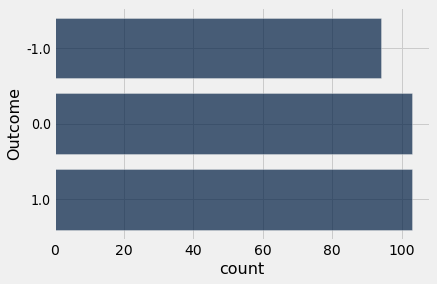
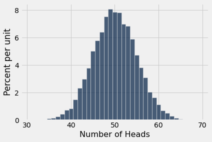
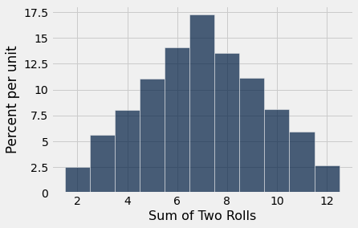
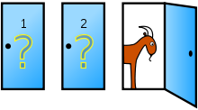
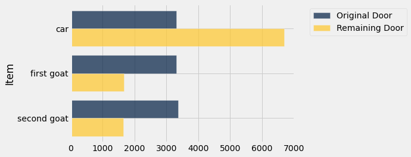
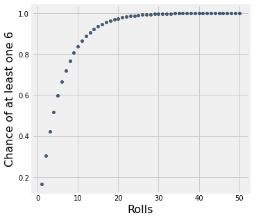

# Chapter 9: Randomness

In the previous chapters we developed skills needed to make insightful descriptions of data. Data scientists also have to be able to understand randomness. For example, they have to be able to assign individuals to treatment and control groups at random, and then try to say whether any observed differences in the outcomes of the two groups are simply due to the random assignment or genuinely due to the treatment.

In this chapter, we begin our analysis of randomness. To start off, we will use Python to make choices at random. In `numpy` there is a sub-module called `random` that contains many functions that involve random selection. One of these functions is called `choice`. It picks one item at random from an array, and it is equally likely to pick any of the items. The function call is `np.random.choice(array_name)`, where `array_name` is the name of the array from which to make the choice.

Thus the following code evaluates to `treatment` with chance 50%, and `control` with chance 50%.

```python
from datascience import *
path_data = '../../../assets/data/'
import numpy as np

import matplotlib
matplotlib.use('Agg')
%matplotlib inline
import matplotlib.pyplot as plots
plots.style.use('fivethirtyeight')
```

```python
two_groups = make_array('treatment', 'control')
np.random.choice(two_groups)
```

*Output:*

```text
'treatment'
```

The big difference between the code above and all the other code we have run thus far is that the code above doesn't always return the same value. It can return either `treatment` or `control`, and we don't know ahead of time which one it will pick. We can repeat the process by providing a second argument, the number of times to repeat the process.

```python
np.random.choice(two_groups, 10)
```

*Output:*

```text
array(['control', 'control', 'treatment', 'treatment', 'control',
       'control', 'control', 'control', 'control', 'control'], dtype='<U9')
```

A fundamental question about random events is whether or not they occur. For example:

- Did an individual get assigned to the treatment group, or not?
- Is a gambler going to win money, or not?
- Has a poll made an accurate prediction, or not?

Once the event has occurred, you can answer "yes" or "no" to all these questions. In programming, it is conventional to do this by labeling statements as True or False. For example, if an individual did get assigned to the treatment group, then the statement, "The individual was assigned to the treatment group" would be `True`. If not, it would be `False`.

**Booleans and Comparison**

In Python, Boolean values, named for the logician [George Boole](https://en.wikipedia.org/wiki/George_Boole), represent truth and take only two possible values: `True` and `False`. Whether problems involve randomness or not, Boolean values most often arise from comparison operators. Python includes a variety of operators that compare values. For example, `3` is larger than `1 + 1`.

```python
3 > 1 + 1
```

*Output:*

```text
True
```

The value `True` indicates that the comparison is valid; Python has confirmed this simple fact about the relationship between `3` and `1+1`. The full set of common comparison operators are listed below.

| Comparison         | Operator | True example | False Example |
|--------------------|----------|--------------|---------------|
| Less than          | <        | 2 < 3        | 2 < 2         |
| Greater than       | >        | 3 > 2        | 3 > 3         |
| Less than or equal | <=       | 2 <= 2       | 3 <= 2        |
| Greater or equal   | >=       | 3 >= 3       | 2 >= 3        |
| Equal              | ==       | 3 == 3       | 3 == 2        |
| Not equal          | !=       | 3 != 2       | 2 != 2        |

Notice the two equal signs `==` in the comparison to determine equality. This is necessary because Python already uses `=` to mean assignment to a name, as we have seen. It can't use the same symbol for a different purpose. Thus if you want to check whether 5 is equal to the 10/2, then you have to be careful: `5 = 10/2` returns an error message because Python assumes you are trying to assign the value of the expression 10/2 to a name that is the numeral 5. Instead, you must use `5 == 10/2`, which evaluates to `True`.

```python
5 = 10/2
```

*Error:*

```text
  File "<ipython-input-5-e8c755f5e450>", line 1
    5 = 10/2
            ^
SyntaxError: can't assign to literal
```

```python
5 == 10/2
```

*Output:*

```text
True
```

An expression can contain multiple comparisons, and they all must hold in order for the whole expression to be `True`. For example, we can express that `1+1` is between `1` and `3` using the following expression.

```python
1 < 1 + 1 < 3
```

*Output:*

```text
True
```

The average of two numbers is always between the smaller number and the larger number. We express this relationship for the numbers `x` and `y` below. You can try different values of `x` and `y` to confirm this relationship.

```python
x = 12
y = 5
min(x, y) <= (x+y)/2 <= max(x, y)
```

*Output:*

```text
True
```

**Comparing Strings**

Strings can also be compared, and their order is alphabetical. A shorter string is less than a longer string that begins with the shorter string.

```python
'Dog' > 'Catastrophe' > 'Cat'
```

*Output:*

```text
True
```

Let's return to random selection. Recall the array `two_groups` which consists of just two elements, `treatment` and `control`. To see whether a randomly assigned individual went to the treatment group, you can use a comparison:

```python
np.random.choice(two_groups) == 'treatment'
```

*Output:*

```text
True
```

As before, the random choice will not always be the same, so the result of the comparison won't always be the same either. It will depend on whether `treatment` or `control` was chosen. With any cell that involves random selection, it is a good idea to run the cell several times to get a sense of the variability in the result.

**Comparing an Array and a Value**

Recall that we can perform arithmetic operations on many numbers in an array at once.  For example, `make_array(0, 5, 2)*2` is equivalent to `make_array(0, 10, 4)`.  In similar fashion, if we compare an array and one value, each element of the array is compared to that value, and the comparison evaluates to an array of Booleans.

```python
tosses = make_array('Tails', 'Heads', 'Tails', 'Heads', 'Heads')
tosses == 'Heads'
```

*Output:*

```text
array([False,  True, False,  True,  True])
```

The `numpy` method `count_nonzero` evaluates to the number of non-zero (that is, `True`) elements of the array.

```python
np.count_nonzero(tosses == 'Heads')
```

*Output:*

```text
3
```

## 9.1 Conditional Statements

In many situations, actions and results depends on a specific set of conditions being satisfied. For example, individuals in randomized controlled trials receive the treatment if they have been assigned to the treatment group. A gambler makes money if she wins her bet. 

In this section we will learn how to describe such situations using code. A *conditional statement* is a multi-line statement that allows Python to choose among different alternatives based on the truth value of an expression. While conditional statements can appear anywhere, they appear most often within the body of a function in order to express alternative behavior depending on argument values.

A conditional statement always begins with an `if` header, which is a single line followed by an indented body. The body is only executed if the expression directly following `if` (called the *if expression*) evaluates to a true value. If the *if expression* evaluates to a false value, then the body of the `if` is skipped.

Let us start defining a function that returns the sign of a number.

```python
from datascience import *
path_data = '../../../assets/data/'
import matplotlib
matplotlib.use('Agg')
%matplotlib inline
import matplotlib.pyplot as plots
plots.style.use('fivethirtyeight')
import numpy as np
```

```python
def sign(x):
    
    if x > 0:
        return 'Positive'
```

```python
sign(3)
```

*Output:*

```text
'Positive'
```

This function returns the correct sign if the input is a positive number. But if the input is not a positive number, then the *if expression* evaluates to a false value, and so the `return` statement is skipped and the function call has no value.

```python
sign(-3)
```

So let us refine our function to return `Negative` if the input is a negative number. We can do this by adding an `elif` clause, where `elif` if Python's shorthand for the phrase "else, if".

```python
def sign(x):
    
    if x > 0:
        return 'Positive'
    
    elif x < 0:
        return 'Negative'
```

Now `sign` returns the correct answer when the input is -3:

```python
sign(-3)
```

*Output:*

```text
'Negative'
```

What if the input is 0? To deal with this case, we can add another `elif` clause:

```python
def sign(x):
    
    if x > 0:
        return 'Positive'
    
    elif x < 0:
        return 'Negative'
    
    elif x == 0:
        return 'Neither positive nor negative'
```

```python
sign(0)
```

*Output:*

```text
'Neither positive nor negative'
```

Equivalently, we can replace the final `elif` clause by an `else` clause, whose body will be executed only if all the previous comparisons are false; that is, if the input value is equal to 0.

```python
def sign(x):
    
    if x > 0:
        return 'Positive'
    
    elif x < 0:
        return 'Negative'
    
    else:
        return 'Neither positive nor negative'
```

```python
sign(0)
```

*Output:*

```text
'Neither positive nor negative'
```

### The General Form
A conditional statement can also have multiple clauses with multiple bodies, and only one of those bodies can ever be executed. The general format of a multi-clause conditional statement appears below.

    if <if expression>:
        <if body>
    elif <elif expression 0>:
        <elif body 0>
    elif <elif expression 1>:
        <elif body 1>
    ...
    else:
        <else body>
        
There is always exactly one `if` clause, but there can be any number of `elif` clauses. Python will evaluate the `if` and `elif` expressions in the headers in order until one is found that is a true value, then execute the corresponding body. The `else` clause is optional. When an `else` header is provided, its *else body* is executed only if none of the header expressions of the previous clauses are true. The `else` clause must always come at the end (or not at all).

### Example: Betting on a Die
Suppose I bet on a roll of a fair die. The rules of the game:

- If the die shows 1 spot or 2 spots, I lose a dollar.
- If the die shows 3 spots or 4 spots, I neither lose money nor gain money.
- If the die shows 5 spots or 6 spots, I gain a dollar.

We will now use conditional statements to define a function `one_bet` that takes the number of spots on the roll and returns my net gain.

```python
def one_bet(x):
    """Returns my net gain if the die shows x spots"""
    if x <= 2:
        return -1
    elif x <= 4:
        return 0
    elif x <= 6:
        return 1
```

Let's check that the function does the right thing for each different number of spots.

```python
one_bet(1), one_bet(2), one_bet(3), one_bet (4), one_bet(5), one_bet(6)
```

*Output:*

```text
(-1, -1, 0, 0, 1, 1)
```

As a review of how conditional statements work, let's see what `one_bet` does when the input is 3.

- First it evaluates the `if` expression, which is `3 <= 2` which is `False`. So `one_bet` doesn't execute the `if` body.
- Then it evaluates the first `elif` expression, which is `3 <= 4`, which is `True`. So `one_bet` executes the first `elif` body and returns 0.
- Once the body has been executed, the process is complete. The next `elif` expression is not evaluated.

If for some reason we use an input greater than 6, then the `if` expression evaluates to `False` as do both of the `elif` expressions. So `one_bet` does not execute the `if` body nor the two `elif` bodies, and there is no value when you make the call below.

```python
one_bet(17)
```

To play the game based on one roll of a die, you can use `np.random.choice` to generate the number of spots and then use that as the argument to `one_bet`. Run the cell a few times to see how the output changes.

```python
one_bet(np.random.choice(np.arange(1, 7)))
```

*Output:*

```text
-1
```

At this point it is natural to want to collect the results of all the bets so that we can analyze them. In the next section we develop a way to do this without running the cell over and over again.

## 9.2 Iteration

It is often the case in programming – especially when dealing with randomness – that we want to repeat a process multiple times. For example, recall the game of betting on one roll of a die with the following rules:

- If the die shows 1 or 2 spots, my net gain is -1 dollar.
- If the die shows 3 or 4 spots, my net gain is 0 dollars.
- If the die shows 5 or 6 spots, my net gain is 1 dollar.

The function `bet_on_one_roll` takes no argument. Each time it is called, it simulates one roll of a fair die and returns the net gain in dollars.

```python
from datascience import *
path_data = '../../../assets/data/'
import matplotlib
matplotlib.use('Agg')
%matplotlib inline
import matplotlib.pyplot as plots
plots.style.use('fivethirtyeight')
import numpy as np
```

```python
def bet_on_one_roll():
    """Returns my net gain on one bet"""
    x = np.random.choice(np.arange(1, 7))  # roll a die once and record the number of spots
    if x <= 2:
        return -1
    elif x <= 4:
        return 0
    elif x <= 6:
        return 1
```

Playing this game once is easy:

```python
bet_on_one_roll()
```

*Output:*

```text
0
```

To get a sense of how variable the results are, we have to play the game over and over again. We could run the cell repeatedly, but that's tedious, and if we wanted to do it a thousand times or a million times, forget it.  

A more automated solution is to use a `for` statement to loop over the contents of a sequence. This is called *iteration*. A `for` statement begins with the word `for`, followed by a name we want to give each item in the sequence, followed by the word `in`, and ending with an expression that evaluates to a sequence. The indented body of the `for` statement is executed once *for each item in that sequence*.

```python
for animal in make_array('cat', 'dog', 'rabbit'):
    print(animal)
```

*Output (stdout):*

```text
cat
dog
rabbit
```

It is helpful to write code that exactly replicates a `for` statement, without using the `for` statement.  This is called *unrolling* the loop.  

A `for` statement simple replicates the code inside it, but before each iteration, it assigns a new value from the given sequence to the name we chose.  For example, here is an unrolled version of the loop above.

```python
animal = make_array('cat', 'dog', 'rabbit').item(0)
print(animal)
animal = make_array('cat', 'dog', 'rabbit').item(1)
print(animal)
animal = make_array('cat', 'dog', 'rabbit').item(2)
print(animal)
```

*Output (stdout):*

```text
cat
dog
rabbit
```

Notice that the name `animal` is arbitrary, just like any name we assign with `=`.

Here we use a `for` statement in a more realistic way: we print the results of betting five times on the die as described earlier. This is called *simulating* the results of five bets. We use the word *simulating* to remind ourselves that we are not physically rolling dice and exchanging money but using Python to mimic the process.

To repeat a process `n` times, it is common to use the sequence `np.arange(n)` in the `for` statement. It is also common to use a very short name for each item. In our code we will use the name `i` to remind ourselves that it refers to an item.

```python
for i in np.arange(5):
    print(bet_on_one_roll())
```

*Output (stdout):*

```text
1
-1
-1
1
1
```

In this case, we simply perform exactly the same (random) action several times, so the code in the body of our `for` statement does not actually refer to `i`.

### Augmenting Arrays

While the `for` statement above does simulate the results of five bets, the results are simply printed and are not in a form that we can use for computation. Any array of results would be more useful. Thus a typical use of a `for` statement is to create an array of results, by augmenting the array each time.

The `append` method in `NumPy` helps us do this. The call `np.append(array_name, value)` evaluates to a new array that is `array_name` augmented by `value`. When you use `append`, keep in mind that all the entries of an array must have the same type.

```python
pets = make_array('Cat', 'Dog')
np.append(pets, 'Another Pet')
```

*Output:*

```text
array(['Cat', 'Dog', 'Another Pet'], dtype='<U11')
```

This keeps the array `pets` unchanged:

```python
pets
```

*Output:*

```text
array(['Cat', 'Dog'], dtype='<U3')
```

But often while using `for` loops it will be convenient to mutate an array – that is, change it – when augmenting it. This is done by assigning the augmented array to the same name as the original.

```python
pets = np.append(pets, 'Another Pet')
pets
```

*Output:*

```text
array(['Cat', 'Dog', 'Another Pet'], dtype='<U11')
```

### Example: Betting on 5 Rolls
We can now simulate five bets on the die and collect the results in an array that we will call the *collection array*. We will start out by creating an empty array for this, and then append the outcome of each bet. Notice that the body of the `for` loop contains two statements. Both statements are executed for each item in the given sequence.

```python
outcomes = make_array()

for i in np.arange(5):
    outcome_of_bet = bet_on_one_roll()
    outcomes = np.append(outcomes, outcome_of_bet)
    
outcomes
```

*Output:*

```text
array([-1., -1.,  1.,  1., -1.])
```

Let us rewrite the cell with the `for` statement unrolled:

```python
outcomes = make_array()

i = np.arange(5).item(0)
outcome_of_bet = bet_on_one_roll()
outcomes = np.append(outcomes, outcome_of_bet)

i = np.arange(5).item(1)
outcome_of_bet = bet_on_one_roll()
outcomes = np.append(outcomes, outcome_of_bet)

i = np.arange(5).item(2)
outcome_of_bet = bet_on_one_roll()
outcomes = np.append(outcomes, outcome_of_bet)

i = np.arange(5).item(3)
outcome_of_bet = bet_on_one_roll()
outcomes = np.append(outcomes, outcome_of_bet)

i = np.arange(5).item(4)
outcome_of_bet = bet_on_one_roll()
outcomes = np.append(outcomes, outcome_of_bet)

outcomes
```

*Output:*

```text
array([ 1.,  0.,  0., -1.,  1.])
```

The contents of the array are likely to be different from the array that we got by running the previous cell, but that is because of randomness in rolling the die. The process for creating the array is exactly the same.

By capturing the results in an array we have given ourselves the ability to use array methods to do computations. For example, we can use `np.count_nonzero` to count the number of times money changed hands.

```python
np.count_nonzero(outcomes)
```

*Output:*

```text
3
```

### Example: Betting on 300 Rolls
Iteration is a powerful technique. For example, we can see the variation in the results of 300 bets by running exactly the same code for 300 bets instead of five.

```python
outcomes = make_array()

for i in np.arange(300):
    outcome_of_bet = bet_on_one_roll()
    outcomes = np.append(outcomes, outcome_of_bet)
```

The array `outcomes` contains the results of all 300 bets.

```python
len(outcomes)
```

*Output:*

```text
300
```

To see how often the three different possible results appeared, we can use the array `outcomes` and `Table` methods.

```python
outcome_table = Table().with_column('Outcome', outcomes)
outcome_table.group('Outcome').barh(0)
```



Not surprisingly, each of the three outcomes -1, 0, and 1 appeared about 100 of the 300 times, give or take. We will examine the "give or take" amounts more closely in later chapters.

## 9.3 Simulation

Simulation is the process of using a computer to mimic a physical experiment. In this class, those experiments will almost invariably involve chance. 

We have seen how to simulate the results of tosses of a coin. The steps in that simulation were examples of the steps that will constitute every simulation we do in this course. In this section we will set out those steps and follow them in examples.

### The Process

**Step 1: What to Simulate**

Decide which quantity you want to simulate. For example, you might decide that you want to simulate the outcomes of tosses of a coin. Each simulated value will be a Head or a Tail.

**Step 2: Simulating One Value**

Figure out how to simulate *one* value of the quantity you specified in Step 1. In our example, you have to figure out how to simulate the outcome of *one* toss of a coin. If your quantity is more complicated, you might need several lines of code to come up with one simulated value. Typically, we will define a function that returns the simulated value.

**Step 3: Number of Repetitions**

Decide how many times you want to simulate the quantity. You will have to repeat the simulation in Step 2 that many times. In one of our earlier examples we had decided to simulate the outcomes of 1000 tosses of a coin, and so we needed 1000 repetitions of generating the outcome of a single toss.

**Step 4: Simulating Multiple Values**

Finally, put it all together as follows.

- Create an empty array in which to collect all the simulated values. We will call this the collection array.
- Create a "repetitions sequence," that is, a sequence whose length is the number of repetitions you specified in Step 3. For `n` repetitions we will almost always use the sequence `np.arange(n)`.
- Create a `for` loop. For each element of the repetitions sequence:
    - Simulate *one* value by using the function you wrote in Step 2.
    - Augment the collection array with this simulated value.
    
That's it! Once you have carried out the steps above, your simulation is done. The collection array contains all the simulated values. 

At this point you can use the collection array as you would any other array. You can count how many simulated values fall into a particular category, place the array in the column of a table and visualize the distribution of the simulated values, and so on.

```python
from datascience import *
path_data = '../../../assets/data/'
import matplotlib
matplotlib.use('Agg')
%matplotlib inline
import matplotlib.pyplot as plots
plots.style.use('fivethirtyeight')
import numpy as np
```

### Example: Number of Heads in 100 Tosses
It is natural to expect that in 100 tosses of a coin, there will be 50 heads, give or take a few. 

But how many is "a few"? What's the chance of getting exactly 50 heads? Questions like these matter in data science not only because they are about interesting aspects of randomness, but also because they can be used in analyzing experiments where assignments to treatment and control groups are decided by the toss of a coin.

In this example we will simulate the number of heads in 100 tosses of a coin. The histogram of our results will give us some insight into how many heads are likely.

Let's get started on the simulation, following the steps above.

**Step 1: What to Simulate**

The quantity we are going to simulate is the number of heads in 100 tosses. 

**Step 2: Simulating One Value**

We have to figure out how to make one set of 100 tosses and count the number of heads. Let's start by creating a coin.

```python
coin = make_array('Heads', 'Tails')
```

In our earlier example we used `np.random.choice` and a `for` loop to generate multiple tosses. But sets of coin tosses are needed so often in data science that `np.random.choice` simulates them for us if we include a second argument that is the number of times to toss.

Here are the results of 10 tosses.

```python
ten_tosses = np.random.choice(coin, 10)
ten_tosses
```

*Output:*

```text
array(['Heads', 'Tails', 'Heads', 'Tails', 'Tails', 'Heads', 'Tails',
       'Tails', 'Tails', 'Heads'], dtype='<U5')
```

We can count the number of heads by using `np.count_nonzero` as before:

```python
np.count_nonzero(ten_tosses == 'Heads')
```

*Output:*

```text
4
```

Our goal is to simulate the number of heads in 100 tosses, not 10. To do that we can just repeat the same code, replacing 10 by 100.

```python
outcomes = np.random.choice(coin, 100)
num_heads = np.count_nonzero(outcomes == 'Heads')
num_heads
```

*Output:*

```text
46
```

Since we will want to do this multiple times, let's define a function that returns the simulated value of the number of heads. We can do this using the code developed in the cell above.

```python
def one_simulated_value():
    outcomes = np.random.choice(coin, 100)
    return np.count_nonzero(outcomes == 'Heads')
```

**Step 3: Number of Repetitions**

How many repetitions we will use is up to us. The more we use, the more reliable our simulations will be, but the longer it will take to run the code. Python is pretty fast at tossing coins, so let's go for 20,000 repetitions. That means we are going to do the following 20,000 times:
- Toss a coin 100 times and count the number of heads.

That's a lot of tossing! It's good that we have Python to do it for us.

**Step 4: Simulating Multiple Values**

We are ready to create an array of 20,000 simulated values of the number of heads in 100 tosses of a coin.

```python
num_repetitions = 20000   # number of repetitions

heads = make_array() # empty collection array

for i in np.arange(num_repetitions):   # repeat the process num_repetitions times
    new_value = one_simulated_value()  # simulate one value using the function defined
    heads = np.append(heads, new_value) # augment the collection array with the simulated value

# That's it! The simulation is done.
```

Check that the array `heads` contains 20,000 entries, one for each repetition of the experiment.

```python
len(heads)
```

*Output:*

```text
20000
```

To get a sense of the variability in the number of heads in 100 tosses, we can collect the results in a table and draw a histogram.

```python
simulation_results = Table().with_columns(
    'Repetition', np.arange(1, num_repetitions + 1),
    'Number of Heads', heads
)
```

```python
simulation_results.show(3)
```

*Output:*

| Repetition | Number of Heads |
| --- | --- |
| 1 | 44 |
| 2 | 54 |
| 3 | 44 |

```python
simulation_results.hist('Number of Heads', bins = np.arange(30.5, 69.6, 1))
```



Each bin has width 1 and is centered at each value of the number of heads.

Not surprisingly, the histogram looks roughly symmetric around 50 heads. The height of the bar at 50 is about 8% per unit. Since each bin is 1 unit wide, this is the same as saying that about 8% of the repetitions produced exactly 50 heads. That's not a huge percent, but it's the largest compared to the percent at every other number of heads.

The histogram also shows that in almost all of the repetitions, the number of heads in 100 tosses was somewhere between 35 and 65. Indeed, the bulk of the repetitions produced numbers of heads in the range 45 to 55. 

While in theory it is *possible* that the number of heads can be anywhere between 0 and 100, the simulation shows that the range of *probable* values is much smaller.

This is an instance of a more general phenomenon about the variability in coin tossing, as we will see later in the course.

### Example: Moves in Monopoly ##

Each move in the game Monopoly is determined by the total number of spots of two rolls of a die. If you play Monopoly, what should you expect to get when you roll the die two times?

We can explore this by simulating the sum of two rolls of a die. We will run the simulation 10,000 times. Notice that in this paragraph we have completed Steps 1 and 3 of our simulation process.

Step 2 is the one in which we write a function to simulate the total number of spots in one pair of rolls. First, let's plan our code. We will create an array containing the numbers 1 through 6, draw two times from the array at random with replacement, and add the two numbers drawn.

```python
die = np.arange(1, 7)
sum(np.random.choice(die, 2))
```

*Output:*

```text
7
```

We can use the array `die` and the expression above to define a function that simulates one move in Monopoly.

```python
def one_simulated_move():
    return sum(np.random.choice(die, 2))
```

Now we can create an array of 10000 simulated Monopoly moves, by starting with an empty collection array and augmenting it by each new simulated move.

```python
num_repetitions = 10000

moves = make_array()
for i in np.arange(num_repetitions):
    new_move = one_simulated_move()
    moves = np.append(moves, new_move)
```

Here is a histogram of the results.

```python
results = Table().with_columns(
    'Repetition', np.arange(1, num_repetitions + 1),
    'Sum of Two Rolls', moves
)

results.hist('Sum of Two Rolls', bins = np.arange(1.5, 12.6, 1))
```



Seven is the most common value, with the frequencies falling off symmetrically on either side.

## 9.4 The Monty Hall Problem

This [problem](https://en.wikipedia.org/wiki/Monty_Hall_problem) has flummoxed many people over the years, [mathematicians included](https://web.archive.org/web/20140413131827/http://www.decisionsciences.org/DecisionLine/Vol30/30_1/vazs30_1.pdf). Let's see if we can work it out by simulation.

The setting is derived from a television game show called "Let's Make a Deal". Monty Hall hosted this show in the 1960's, and it has since led to a number of spin-offs. An exciting part of the show was that while the contestants had the chance to win great prizes, they might instead end up with "zonks" that were less desirable. This is the basis for what is now known as *the Monty Hall problem*.

The setting is a game show in which the contestant is faced with three closed doors. Behind one of the doors is a fancy car, and behind each of the other two there is a goat. The contestant doesn't know where the car is, and has to attempt to find it under the following rules.

- The contestant makes an initial choice, but that door isn't opened.
- At least one of the other two doors must have a goat behind it. Monty opens one of these doors to reveal a goat, displayed in all its glory in [Wikipedia](https://en.wikipedia.org/wiki/Monty_Hall_problem):



- There are two doors left, one of which was the contestant's original choice. One of the doors has the car behind it, and the other one has a goat. The contestant now gets to choose which of the two doors to open.

The contestant has a decision to make. Which door should she choose to open, if she wants the car? Should she stick with her initial choice, or switch to the other door? That is the Monty Hall problem.

```python
from datascience import *
path_data = '../../../assets/data/'
import matplotlib
matplotlib.use('Agg')
%matplotlib inline
import matplotlib.pyplot as plots
plots.style.use('fivethirtyeight')
import numpy as np
```

### The Solution

In any problem involving chances, the assumptions about randomness are important. It's reasonable to assume that there is a 1/3 chance that the contestant's initial choice is the door that has the car behind it. 

The solution to the problem is quite straightforward under this assumption, though the straightforward solution doesn't convince everyone. Here it is anyway.

- The chance that the car is behind the originally chosen door is 1/3.
- The car is behind either the originally chosen door or the door that remains. It can't be anywhere else.
- Therefore, the chance that the car is behind the door that remains is 2/3.
- Therefore, the contestant should switch.

That's it. End of story. 

Not convinced? Then let's simulate the game and see how the results turn out.

### Simulation ##
The simulation will be more complex that those we have done so far. Let's break it down.

**Step 1: What to Simulate**

For each play we will simulate what's behind all three doors:
- the one the contestant first picks
- the one that Monty opens
- the remaining door

So we will be keeping track of three quantitites, not just one.

**Step 2: Simulating One Play**

As is often the case in simulating a game, the bulk of the work consists of simulating one play of the game. This involves several pieces.

**The goats:** We start by setting up an array `goats` that contains unimaginative names for the two goats.

```python
goats = make_array('first goat', 'second goat')
```

To help Monty conduct the game, we are going to have to identify which goat is selected and which one is revealed behind the open door. The function `other_goat` takes one goat and returns the other.

```python
def other_goat(x):
    if x == 'first goat':
        return 'second goat'
    elif x == 'second goat':
        return 'first goat'
```

```python
other_goat('first goat'), other_goat('second goat'), other_goat('watermelon')
```

*Output:*

```text
('second goat', 'first goat', None)
```

The string `watermelon` is not the name of one of the goats, so when `watermelon` is the input then `other_goat` does nothing.

**The options:** The array `hidden_behind_doors` contains the three things that are
behind the doors.

```python
hidden_behind_doors = np.append(goats, 'car')
hidden_behind_doors
```

*Output:*

```text
array(['first goat', 'second goat', 'car'], dtype='<U11')
```

We are now ready to simulate one play. To do this, we will define a function `monty_hall_game` that takes no arguments. When the function is called, it plays Monty's game once and returns a list consisting of:

- the contestant's guess
- what Monty reveals when he opens a door
- what remains behind the other door

The game starts with the contestant choosing one door at random. In doing so, the contestant makes a random choice from among the first goat, the second goat, and the car.

If the contestant happens to pick one of the goats, then the other goat is revealed and the car is behind the remaining door.

If the contestant happens to pick the car, then Monty reveals one of the goats and the other goat is behind the remaining door.

```python
def monty_hall_game():
    """Return 
    [contestant's guess, what Monty reveals, what remains behind the other door]"""
    
    contestant_guess = np.random.choice(hidden_behind_doors)
    
    if contestant_guess == 'first goat':
        return [contestant_guess, 'second goat', 'car']
    
    if contestant_guess == 'second goat':
        return [contestant_guess, 'first goat', 'car']
    
    if contestant_guess == 'car':
        revealed = np.random.choice(goats)
        return [contestant_guess, revealed, other_goat(revealed)]
```

Let's play! Run the cell several times and see how the results change.

```python
monty_hall_game()
```

*Output:*

```text
['car', 'first goat', 'second goat']
```

**Step 3: Number of Repetitions**

To gauge the frequency with which the different results occur, we have to play the game many times and collect the results. Let's run 10,000 repetitions.

**Step 4: Simulating Multiple Repetitions**

It's time to run the whole simulation. But unlike our previous simulations in which each simulation produced a single value, in this example we simulate a list of three values each time. 

We will treat this simulated list as a row of a table. So instead of starting with an empty array and augmenting it with each new simulated value, we will start with an empty table and
augment the table with each new simulated row. Each row will contain the complete result of one play. 

One way to grow a table by adding a new row is to use the `append` method. If `my_table` is a table and `new_row` is a list containing the entries in a new row, then `my_table.append(new_row)` adds the new row to the bottom of `my_table`. 

Note that `append` does not create a new table. It changes `my_table` to have one more row than it did before.

We will start with a collection table `games` that has three empty columns. We can do this by just specifying a list of the column labels in the same order in which `monty_hall_game` returns the result of one game.

Now we can add 10,000 rows to `games`. Each row will represent the result of one play of Monty's game.

```python
# empty collection table
games = Table(['Guess', 'Revealed', 'Remaining'])

# Play the game 10000 times and 
# record the results in the table games

for i in np.arange(10000):
    games.append(monty_hall_game())
```

The simulation is done. Notice how short the code is. The majority of the work was done in simulating the outcome of one game.

```python
games.show(3)
```

*Output:*

| Guess | Revealed | Remaining |
| --- | --- | --- |
| first goat | second goat | car |
| first goat | second goat | car |
| car | first goat | second goat |

### Visualization

To see whether the contestant should stick with her original choice or switch, let's see how frequently the car is behind each of her two options.

It is no surprise that the three doors appear about equally often as the contestant's original guess.

```python
original_choice = games.group('Guess')
original_choice
```

*Output:*

| Guess | count |
| --- | --- |
| car | 3319 |
| first goat | 3311 |
| second goat | 3370 |

Once Monty has eliminated a goat, how often is the car behind the remaining door?

```python
remaining_door = games.group('Remaining')
remaining_door
```

*Output:*

| Remaining | count |
| --- | --- |
| car | 6681 |
| first goat | 1676 |
| second goat | 1643 |

As our earlier solution said, the car is behind the remaining door two-thirds of the time, to a pretty good approximation. The contestant is twice as likely to get the car if she switches than if she sticks with her original choice.

To see this graphically, we can join the two tables above and draw overlaid bar charts.

```python
joined = original_choice.join('Guess', remaining_door, 'Remaining')
combined = joined.relabeled(0, 'Item').relabeled(1, 'Original Door').relabeled(2, 'Remaining Door')
combined
```

*Output:*

| Item | Original Door | Remaining Door |
| --- | --- | --- |
| car | 3319 | 6681 |
| first goat | 3311 | 1676 |
| second goat | 3370 | 1643 |

```python
combined.barh(0)
```



Notice how the three blue bars are almost equal – the original choice is equally likely to be any of the three available items. But the gold bar corresponding to `Car` is twice as long as the blue. 

The simulation confirms that the contestant is twice as likely to win if she switches.

## 9.5 Finding Probabilities

Over the centuries, there has been considerable philosophical debate about what probabilities are. Some people think that probabilities are relative frequencies; others think they are long run relative frequencies; still others think that probabilities are a subjective measure of their own personal degree of uncertainty.

In this course, most probabilities will be relative frequencies, though many will have subjective interpretations. Regardless, the ways in which probabilities are calculated and combined are consistent across the different interpretations.

By convention, probabilities are numbers between 0 and 1, or, equivalently, 0% and 100%. Impossible events have probability 0. Events that are certain have probability 1.

Math is the main tool for finding probabilities exactly, though computers are useful for this purpose too. Simulation can provide excellent approximations, with high probability. In this section, we will informally develop a few simple rules that govern the calculation of probabilities. In subsequent sections we will return to simulations to approximate probabilities of complex events.

We will use the standard notation $P(\mbox{event})$ to denote the probability that "event" happens, and we will use the words "chance" and "probability" interchangeably.

```python
from datascience import *
path_data = '../../../assets/data/'
import numpy as np
import matplotlib.pyplot as plots
plots.style.use('fivethirtyeight')
%matplotlib inline
```

### When an Event Doesn't Happen
If the chance that event happens is 40%, then the chance that it doesn't happen is 60%. This natural calculation can be described in general as follows:

$$
P(\mbox{an event doesn't happen}) ~=~ 1 - P(\mbox{the event happens})
$$

### When All Outcomes are Equally Likely
If you are rolling an ordinary die, a natural assumption is that all six faces are equally likely. Under this assumption, the probabilities of how one roll comes out can be easily calculated as a ratio. For example, the chance that the die shows an even number is

$$
\frac{\mbox{number of even faces}}{\mbox{number of all faces}}
~=~ \frac{\#\{2, 4, 6\}}{\#\{1, 2, 3, 4, 5, 6\}}
~=~ \frac{3}{6}
$$

Similarly,

$$
P(\mbox{die shows a multiple of 3}) ~=~
\frac{\#\{3, 6\}}{\#\{1, 2, 3, 4, 5, 6\}}
~=~ \frac{2}{6}
$$

In general, **if all outcomes are equally likely**,

$$
P(\mbox{an event happens}) ~=~
\frac{\#\{\mbox{outcomes that make the event happen}\}}
{\#\{\mbox{all outcomes}\}}
$$

Not all random phenomena are as simple as one roll of a die. The two main rules of probability, developed below, allow mathematicians to find probabilities even in complex situations.

### When Two Events Must Both Happen
Suppose you have a box that contains three tickets: one red, one blue, and one green. Suppose you draw two tickets at random without replacement; that is, you shuffle the three tickets, draw one, shuffle the remaining two, and draw another from those two. What is the chance you get the green ticket first, followed by the red one?

There are six possible pairs of colors: RB, BR, RG, GR, BG, GB (we've abbreviated the names of each color to just its first letter). All of these are equally likely by the sampling scheme, and only one of them (GR) makes the event happen. So

$$
P(\mbox{green first, then red}) ~=~ 
\frac{\#\{\mbox{GR}\}}{\#\{\mbox{RB, BR, RG, GR, BG, GB}\}} ~=~ \frac{1}{6}
$$

But there is another way of arriving at the answer, by thinking about the event in two stages. First, the green ticket has to be drawn. That has chance $1/3$, which means that the green ticket is drawn first in about $1/3$ of all repetitions of the experiment. But that doesn't complete the event. *Among the 1/3 of repetitions when green is drawn first*, the red ticket has to be drawn next. That happens in about $1/2$ of those repetitions, and so:

$$
P(\mbox{green first, then red}) ~=~ \frac{1}{2} ~\mbox{of}~ \frac{1}{3}
~=~ \frac{1}{6}
$$

This calculation is usually written "in chronological order," as follows.

$$
P(\mbox{green first, then red}) ~=~ \frac{1}{3} ~\times~ \frac{1}{2}
~=~ \frac{1}{6}
$$

The factor of $1/2$ is called " the conditional chance that the red ticket appears second, given that the green ticket appeared first."

In general, we have the **multiplication rule**:

$$
P(\mbox{two events both happen})
~=~ P(\mbox{one event happens}) \times 
P(\mbox{the other event happens, given that the first one happened})
$$

Thus, when there are two conditions – one event must happen, as well as another – the chance is *a fraction of a fraction*, which is smaller than either of the two component fractions. The more conditions that have to be satisfied, the less likely they are to all be satisfied.

### When an Event Can Happen in Two Different Ways
Suppose instead we want the chance that one of the two tickets is green and the other red. This event doesn't specify the order in which the colors must appear. So they can appear in either order. 

A good way to tackle problems like this is to *partition* the event so that it can happen in exactly one of several different ways. The natural partition of "one green and one red" is: GR, RG. 

Each of GR and RG has chance $1/6$ by the calculation above. So you can calculate the chance of "one green and one red" by adding them up.

$$
P(\mbox{one green and one red}) ~=~ P(\mbox{GR}) + P(\mbox{RG}) ~=~ 
\frac{1}{6} + \frac{1}{6} ~=~ \frac{2}{6}
$$

In general, we have the **addition rule**:

$$
P(\mbox{an event happens}) ~=~
P(\mbox{first way it can happen}) + P(\mbox{second way it can happen}) ~~~
\mbox{}
$$

provided the event happens in exactly one of the two ways.

Thus, when an event can happen in one of two different ways, the chance that it happens is a sum of chances, and hence bigger than the chance of either of the individual ways.

The multiplication rule has a natural extension to more than two events, as we will see below. So also the addition rule has a natural extension to events that can happen in one of several different ways.

We end the section with examples that use combinations of all these rules.

### At Least One Success
Data scientists often work with random samples from populations. A question that sometimes arises is about the likelihood that a particular individual in the population is selected to be in the sample. To work out the chance, that individual is called a "success," and the problem is to find the chance that the sample contains a success.

To see how such chances might be calculated, we start with a simpler setting: tossing a coin two times.

If you toss a coin twice, there are four equally likely outcomes: HH, HT, TH, and TT. We have abbreviated "Heads" to H and "Tails" to T. The chance of getting at least one head in two tosses is therefore 3/4.

Another way of coming up with this answer is to work out what happens if you *don't* get at least one head. That is when both the tosses land tails. So

$$
P(\mbox{at least one head in two tosses}) ~=~ 1 - P(\mbox{both tails}) ~=~ 1 - \frac{1}{4}
~=~ \frac{3}{4}
$$

Notice also that 

$$
P(\mbox{both tails}) ~=~ \frac{1}{4} ~=~ \frac{1}{2} \cdot \frac{1}{2} ~=~ \left(\frac{1}{2}\right)^2
$$
by the multiplication rule.

These two observations allow us to find the chance of at least one head in any given number of tosses. For example,

$$
P(\mbox{at least one head in 17 tosses}) ~=~ 1 - P(\mbox{all 17 are tails})
~=~ 1 - \left(\frac{1}{2}\right)^{17}
$$

And now we are in a position to find the chance that the face with six spots comes up at least once in rolls of a die. 

For example,

$$
P(\mbox{a single roll is not 6}) ~=~ 1 - P(6)
~=~ \frac{5}{6}
$$

Therefore,

$$
P(\mbox{at least one 6 in two rolls}) ~=~ 1 - P(\mbox{both rolls are not 6})
~=~ 1 - \left(\frac{5}{6}\right)^2
$$

and

$$
P(\mbox{at least one 6 in 17 rolls})
~=~ 1 - \left(\frac{5}{6}\right)^{17}
$$

The table below shows these probabilities as the number of rolls increases from 1 to 50.

```python
rolls = np.arange(1, 51, 1)
results = Table().with_columns(
    'Rolls', rolls,
    'Chance of at least one 6', 1 - (5/6)**rolls
)
results
```

*Output:*

| Rolls | Chance of at least one 6 |
| --- | --- |
| 1 | 0.166667 |
| 2 | 0.305556 |
| 3 | 0.421296 |
| 4 | 0.517747 |
| 5 | 0.598122 |
| 6 | 0.665102 |
| 7 | 0.720918 |
| 8 | 0.767432 |
| 9 | 0.806193 |
| 10 | 0.838494 |

The chance that a 6 appears at least once rises rapidly as the number of rolls increases.

```python
results.scatter('Rolls')
```



In 50 rolls, you are almost certain to get at least one 6.

```python
results.where('Rolls', are.equal_to(50))
```

*Output:*

| Rolls | Chance of at least one 6 |
| --- | --- |
| 50 | 0.99989 |

Calculations like these can be used to find the chance that a particular individual is selected in a random sample. The exact calculation will depend on the sampling scheme. But what we have observed above can usually be generalized: increasing the size of the random sample increases the chance that an individual is selected.
