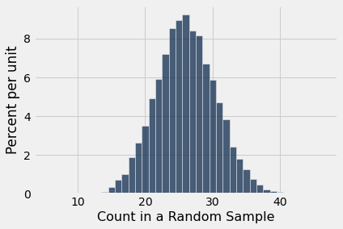
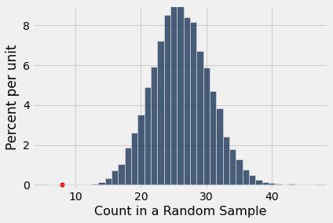
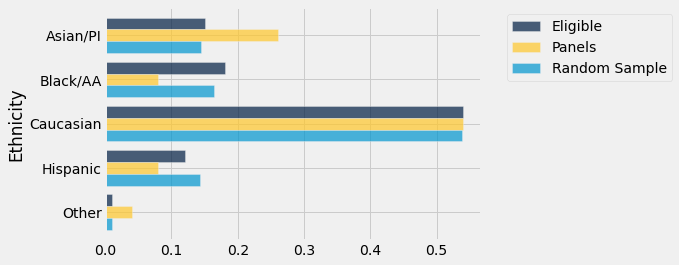
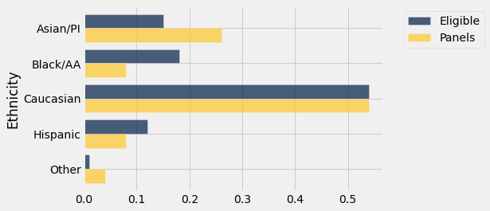
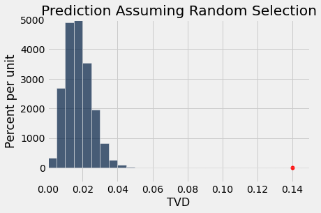
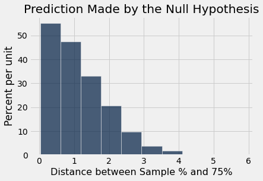
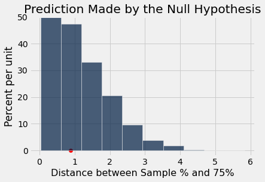
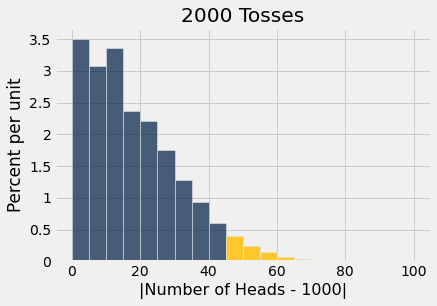

# Chapter 11: Testing Hypotheses

Data scientists are often faced with yes-no questions about the world. You have seen some examples of such questions in this course:

- Is chocolate good for you?
- Did water from the Broad Street pump cause cholera?
- Have the demographics in California changed over the past decade?

Whether we answer questions like these depends on the data we have. Census data about California can settle questions about demographics with hardly any uncertainty about the answer. We know that Broad Street pump water was contaminated by waste from cholera victims, so we can make a pretty good guess about whether it caused cholera. 

Whether chocolate or any other treatment is good for you will almost certainly have to be decided by medical experts, but an initial step consists of using data science to analyze data from studies and randomized experiments. 

In this chapter, we will try to answer such yes-no questions, basing our conclusions on random samples and empirical distributions.

## 11.1 Assessing a Model #

In data science, a *model* is a set of assumptions about data. Often, models include assumptions about chance processes used to generate data. 

Sometimes, data scientists have to decide whether or not a model is good. In this section we will discuss an example of making such a decision.

```python
from datascience import *
%matplotlib inline
path_data = '../../../../assets/data/'
import matplotlib.pyplot as plots
plots.style.use('fivethirtyeight')
import numpy as np
```

### Jury Selection ##

Data science can be a powerful tool for exposing racism and inequality in our society. This section is about a case where data provided evidence of racial bias in jury selection.

Amendment VI of the United States Constitution states that, "In all criminal prosecutions, the accused shall enjoy the right to a speedy and public trial, by an impartial jury of the State and district wherein the crime shall have been committed." 

One characteristic of an *impartial* jury is that it should be selected from a jury panel that is representative of the population of the relevant region. A jury panel is a group of people chosen to be prospective jurors. The final trial jury is selected from among them by deliberate inclusion or exclusion, and as a result can have any composition. But the larger panel from which the trial jurors are drawn must be representative of the population.

The question of whether a jury panel is indeed representative of a region's population has an important legal implication. If some group in the population was systematically underrepresented on the jury panel, that could raise a question about whether the jury was impartial and hence whether the defendant received due process.

That was the question in the Supreme Court case of Robert Swain, a Black man convicted in Talladega County, Alabama, in 1962. He appealed his indictment all the way to the U.S. Supreme Court on the grounds that Black people were systematically excluded from juries in Talladega County. The Supreme Court denied his appeal and Robert Swain was later sentenced to life imprisonment.

However, our analysis below shows that the data are not in agreement with conclusions drawn by the Court. On the contrary, the data point to bias in the jury selection process. This bias in the criminal justice system reflected the widespread prejudice and injustice prevalent against Black people at the time.

We will start by looking at the numerical details. At the time of the trial, only men aged 21 or more were eligible to serve on juries in Talladega County. In that population, 26% of the men were Black. As is common in jury trials, the jurors in the trial of Robert Swain were selected from a panel of people who were supposed to be representative of the population of eligible jurors. But only eight men among the panel of 100 men (that is, 8%) were Black.

As part of his appeal, Robert Swain questioned this discrepancy. Moreover, he pointed out that all Talladega County jury panels for the past 10 years had contained only a small percent of Black panelists. 

The U.S. Supreme Court reviewed the appeal and concluded, "the overall percentage disparity has been small." But was this assertion reasonable? If jury panelists were selected at random from the county's eligible population, there would be some chance variation. We wouldn't get exactly 26 Black panelists on every 100-person panel. But would we expect as few as eight?

The answer is no. We will establish that and then discuss some of the many biases involved.

### A Model of Random Selection ##

One view of the data – a model, in other words – is that the panel was selected at random and ended up with a small number of Black panelists just due to chance.

Since the panel was supposed to resemble the population of all eligible jurors, the model of random selection is important to assess. Let's see if it stands up to scrutiny.

The model specifies the details of a chance process. It says the data are like a random sample from a population in which 26% of the people are Black. We are in a good position to assess this model for the following reasons.

- We can simulate data based on the model. That is, we can simulate drawing at random from a population of whom 26% are Black. 
- Our simulation will show what a panel would be like ***if*** it were selected at random.
- We can then compare the results of the simulation with the composition of an actual jury panel. 
- If the results of our simulation are not consistent with the composition of the panel in the trial, that will be evidence against the model of random selection. Therefore, it will be evidence against the fairness of the trial. 

Let's go through the process step by step. 

### The Statistic ##
First, we have to choose a statistic to simulate. The statistic has to be able to help us decide between the model and alternative views about the data. The model says the panel was drawn at random from the eligible population. The alternative viewpoint is the case for Robert Swain, which is that the panel contained too few Black panelists to have been drawn at random. A natural statistic, then, is the number or *count* of Black panelists in the sample. Small values of the statistic will favor Robert Swain's viewpoint.

### Simulating the Statistic Under the Model ##
If the model were true, how big would the statistic typically be? To answer that, will simulate the statistic under the assumption of random selection and look at the distribution of the results.

#### Simulating One Value of the Statistic ###

We can use `sample_proportions` to simulate one value of the statistic. The sample size is 100, the size of the panel. The distribution from which we will sample is the distribution in the population of eligible jurors. Since 26% of them were Black, we will sample from the distribution specified by the proportions [0.26, 0.74].

```python
sample_size = 100
eligible_population = [0.26, 0.74]
```

The categories in the output array of `sample_proportions` are in the same order as in the input array. So the proportion of Black panelists in the random sample is `item(0)` of the output array. Run the cell below a few times to see how the sample proportion of Black jurors varies in a randomly selected panel. Do you see any values as low as 0.08?

```python
sample_proportions(sample_size, eligible_population).item(0)
```

*Output:*

```text
0.27
```

The count in each category is the sample size times the corresponding proportion. So we can just as easily simulate counts instead of proportions. 

Let's define a function that does this. The function will draw a panel at random and return the number of panelists who are Black.

```python
def one_simulated_count():
    return sample_size * sample_proportions(sample_size, eligible_population).item(0)
```

#### Simulating Multiple Values of the Statistic ###

The focus of our analysis is the variability in the counts. Let's generate 10,000 simulated values of the count and see how they vary. As usual, we will do this by using a `for` loop and collecting all the simulated counts in an array.

```python
counts = make_array()
repetitions = 10000
for i in np.arange(repetitions):
    counts = np.append(counts, one_simulated_count())
```

### The Prediction Under the Model of Random Selection ##
To interpret the results of our simulation, we can visualize the results in an empirical histogram of the simulated counts.

```python
Table().with_column(
    'Count in a Random Sample', counts
).hist(bins = np.arange(5.5, 46.6, 1))
```



The histogram shows us what the model of random selection predicts about our statistic, the number of Black panelists in the sample.

To generate each simulated count, we drew 100 times at random from a population in which 26% were Black. So, as you would expect, most of the simulated counts are around 26. They are not exactly 26: there is some variation. The counts range from about 15 to about 40.

### Comparing the Prediction and the Data ##
In the panel selected for the trial, there were eight Black panelists. The histogram of simulated counts is redrawn below with value eight shown as a red dot on the horizontal axis. The dot is very far out in the left hand tail of the histogram. Very few of the 10,000 counts simulated by random selection came out to be eight or less.

```python
Table().with_column(
    'Count in a Random Sample', counts
).hist(bins = np.arange(5.5, 46.6, 1))
plots.ylim(-0.002, 0.09)
plots.scatter(8, 0, color='red', s=30);
```



### Conclusion of the Data Analysis ##

The graph above is a visual display of bias in the selection process. It shows that if we select a panel of size 100 at random from the eligible population, we are very unlikely to get counts of Black panelists that are as low as the eight that were observed on the panel in the trial. 

This is evidence that the model of random selection of the jurors in the panel is not consistent with the data from the panel. While it is *possible* that the panel could have been generated by chance, our simulation demonstrates that it is hugely unlikely. 

The reality of the trial panel is very much at odds with the model's assumption of random selection from the eligible population. When the data and a model are inconsistent, the model is hard to justify. After all, the data are real. The model is just a set of assumptions. When assumptions are at odds with reality, we must question those assumptions. 

Therefore the most reasonable conclusion is that the assumption of random selection is unjustified for this jury panel. In other words, the most reasonable conclusion is that the jury panel was *not* selected by random sampling from the population of eligible jurors. Notwithstanding the opinion of the Supreme Court, the difference between 26% and 8% is not so small as to be explained well by chance alone.

### Statistical Bias ##

The analysis above provides quantitative evidence of unfairness in Robert Swain's trial. The data support his position that he was denied the impartial jury to which he was entitled by the U.S. Constitution. 

Additional data show that the exclusion of Black panelists was pervasive. The Supreme Court judgment, written in 1965, includes evidence provided by Robert Swain that "only 10 to 15% of ... jury panels drawn from the jury box since 1953 have been [Black], there having been only one case in which the percentage was as high as 23%." Look at where 10% and 15% lie on the horizontal axis of the histogram above. Values like that are also highly unlikely under random selection from the eligible population.

When a process produces errors that are systematically in one direction – such as the percentage of Black panelists always being lower than expected – then data scientists say the process is *biased*. Quantification of such bias is an important responsibility of data science. 

Arguments such as the one in this section are now more frequently presented in courts of law. In the 1960s, the Supreme Court looked at the data but drew the wrong conclusion that "the overall percentage disparity has been small." For the meaning of "small," it was wrong to rely on what simply seemed reasonable to the majority of the Court. Views on what was reasonable were not only purely subjective, they were also vulnerable to the influence of pervasive racial prejudice. If arguments in the case had included the quantitative analysis of this section, the Court might not have concluded that the percentage disparity was small.

### Racial Bias ##
The statistical bias in the selection process was born out of deep-seated racial bias in the legal system of the time. 

For example, the Supreme Court judgment says that Talladega County jury panels were selected from a jury roll of names that the jury commissioners acquired from "city directories, registration lists, club and church lists, conversations with other persons in the community, both white and [not white], and personal and business acquaintances." This process was clearly biased against Black people and in favor of people in the commissioners' social and professional circles. Such systematic exclusion of Black people from the jury rolls meant that very few Black people were selected for the jury panels.

Even when there were Black panelists, they typically did not make it into the final jury. Of the eight Black men on Robert Swain's jury panel, two were excused and six were eliminated by the prosecution in a process called a *peremptory challenge*. In this process, lawyers for both sides could exclude or *strike* a certain number of panelists without giving a reason. 

Arguing against the unfairness of peremptory challenges was a significant part of Robert Swain's appeal. He noted that "prosecutors have consistently and systematically exercised their strikes to prevent any and all [Black panelists] from serving on the [jury] itself." The Court acknowledged that there had never been a Black juror in any civil or criminal case in Talladega County. But it still denied the appeal.

Racial bias in the legal system derived from bias in society. Prejudice and injustice against Black people had been so prevalent for so long that in many parts of society it had become almost a normal way to think and act. As members of society, the Justices of the Supreme Court were not immune to this. The Court majority presented their decision as the most appropriate and logical interpretation of the law. But it was not. The Court's decision on peremptory challenges was eventually reversed after legal battles that lasted 20 years.

Robert Swain fought a criminal justice system that was stacked against him. Here, we have been able to expose just one aspect of the systemic bias and racism that he faced and that so many other Black people have fought against. For many, the fight continues to this day. We believe that data science can be a powerful ally.

### Further Reading ##

Robert Swain was represented in the U.S. Supreme Court by [Constance Baker Motley](https://en.wikipedia.org/wiki/Constance_Baker_Motley), the first African-American woman to argue a case in that Court. She argued 10 cases in the Supreme Court and lost only one – Robert Swain's case in 1965.

[Thurgood Marshall](https://en.wikipedia.org/wiki/Thurgood_Marshall), who in 1967 became the first African-American Supreme Court Justice, had studied the Court's decision in Robert Swain's case and pressed for eliminating peremptory challenges that were based on race alone. This was achieved in the 1986 Supreme Court case [Batson v. Kentucky](https://supreme.justia.com/cases/federal/us/476/79/).

But Marshall had concerns about the efficacy of the Batson decision. He anticipated that some legal teams would circumvent it by finding ostensibly race-neutral ways to exclude Black jurors. In his [opinion](https://supreme.justia.com/cases/federal/us/476/79/#tab-opinion-1956655) concurring with the majority of the Court, he recommended going further and banning peremptory challenges altogether. His concluding words were, "I applaud the Court's holding that the racially discriminatory use of peremptory challenges violates the Equal Protection Clause, and I join the Court's opinion. However, only by banning peremptories entirely can such discrimination be ended." Thurgood Marshall's concerns were prescient, as you will see in some of the readings below.

In 2013, Constance Baker Motley was posthumously awarded a [Congressional gold medal](https://www.congress.gov/bill/113th-congress/house-bill/3097/text?r=5&s=1) "in recognition of her enduring contributions and service to the United States." In support of the award, members of the House of Representatives wrote, "Constance Baker Motley's only loss before the United States Supreme Court was in Swain v. Alabama, 380 U.S. 202 (1965), a case in which the Court refused to proscribe race-based peremptory challenges in cases involving African-American defendants and which was later reversed in Batson v. Kentucky, 476 U.S. 79 (1986), on grounds that had been largely asserted by Constance Baker Motley in the Swain case." 

Thurgood Marshall and Constance Baker Motley had other connections. For example, as a student at Columbia Law School, Baker Motley worked as a law clerk for Marshall. Some years later she wrote the original complaint in the landmark civil rights case Brown v. Board of Education in Topeka, which was won by Thurgood Marshall in 1954.

The [NAACP Legal Defense and Educational Fund](https://www.naacpldf.org/) argued Robert [Swain's case](https://www.naacpldf.org/press-release/ldf-marks-anniversary-of-batson-decision-reaffirms-importance-of-impartial-jury-selection/) and later supported the Batson case.

In spite of the Batson decision, racial bias in jury selection persists. Legal scholar and Berkeley Law School alum [Richard L. Harris Jr.](https://www.thehistorymakers.org/biography/robert-lewis-harris) has provided a [detailed account](https://scholarship.law.wm.edu/cgi/viewcontent.cgi?article=1944&context=wmlr) of the biases that are perpetuated by peremptory challenges.  

In their 2020 report [Whitewashing the Jury Box](http://www.clrc.ca.gov/CRPC/Pub/Panelist_Materials/PM-20210325-Semel.pdf): How California Perpetuates the Discriminatory Exclusion of Black and Latinx Jurors,
[Professor Elisabeth Semel](https://www.law.berkeley.edu/our-faculty/faculty-profiles/elisabeth-semel/) and co-authors in the Berkeley Law Death Penalty Clinic describe how Thurgood Marshall's concerns about the effectiveness of the Batson ruling are justified by experience in Californian courts.  

The U.S. Supreme Court [judgment](https://supreme.justia.com/cases/federal/us/380/202/) in the case Swain v. Alabama can be distressing to read. We have included it because some excerpts are quoted in the section.

## 11.2 Multiple Categories

Whether jury panels are representative of the eligible population continues to be an important question. We will address it in the context of more recent panels than that of Robert Swain in the 1960s.

The general process of assessment will be the same as before. But this time we will consider panelists in multiple racial and ethnic categories, not just two. From a technical perspective, this will mean that we have to come up with a new statistic to simulate. Once we have simulated it and arrived at a conclusion, we will examine some of the underlying causes of the discrepancies that we observe.

```python
from datascience import *
%matplotlib inline
path_data = '../../../../data/'
import matplotlib.pyplot as plots
plots.style.use('fivethirtyeight')
import numpy as np
```

### Jury Selection in Alameda County

In 2010, the American Civil Liberties Union (ACLU) of Northern California presented a [report](https://www.aclunc.org/sites/default/files/racial_and_ethnic_disparities_in_alameda_county_jury_pools.pdf "ACLU_NC report") on jury selection in Alameda County, California. The report concluded that certain racial and ethnic groups are underrepresented among jury panelists in Alameda County, and suggested some reforms of the process by which eligible jurors are assigned to panels. In this section, we will analyze the data provided by the ACLU.

As you saw in the previous section, trial jurors are selected from a larger jury panel. By law, the jury panel is supposed to be representative of the population of eligible jurors. In California, the word "representative" is clearly defined as "selected at random." Section 197 of California's Code of Civil Procedure says, "All persons selected for jury service shall be selected at random, from a source or sources inclusive of a representative cross section of the population of the area served by the court."

Here "selected for jury service" means being selected to be on the jury panel.

### Composition of Panels in Alameda County

The focus of the study by the ACLU of Northern California was the racial and ethnic composition of jury panels in Alameda County. The ACLU compiled data on the composition of the jury panels in 11 felony trials in Alameda County in the years 2009 and 2010. In those panels, the total number of people who reported for jury service was 1453. The ACLU gathered demographic data on all of these prosepctive jurors, and compared those data with the composition of all eligible jurors in the county. 

The data are tabulated below in a table called ``jury``. In each category, the first numerical value is the proportion of all eligible juror candidates in that category. The second value is the proportion of people in that category among those who appeared for the process of selection into the jury.

The labels for the different categories are taken from the ACLU report, which says, "The category “other” includes people who identified as mixed race without identifying one primary racial identity, and individuals who did not identify a race or ethnicity." The label `Asian/PI` means "Asian or Pacific Islander." The label `Black/AA` means "Black or African-American."

```python
jury = Table().with_columns(
    'Ethnicity', make_array('Asian/PI', 'Black/AA', 'Caucasian', 'Hispanic', 'Other'),
    'Eligible', make_array(0.15, 0.18, 0.54, 0.12, 0.01),
    'Panels', make_array(0.26, 0.08, 0.54, 0.08, 0.04)
)

jury
```

*Output:*

| Ethnicity | Eligible | Panels |
| --- | --- | --- |
| Asian/PI | 0.15 | 0.26 |
| Black/AA | 0.18 | 0.08 |
| Caucasian | 0.54 | 0.54 |
| Hispanic | 0.12 | 0.08 |
| Other | 0.01 | 0.04 |

Some ethnicities are overrepresented and some are underrepresented on the jury panels in the study. In particular, panelists in the Black/AA and Hispanic categories are underrepresented. 

A bar chart is helpful for visualizing the differences.

```python
jury.barh('Ethnicity')
```


### Comparison with Panels Selected at Random
What if we select a random sample of 1,453 people from the population of eligible jurors? Will the distribution of their ethnicities look like the distribution of the panels above?

We can answer these questions by using `sample_proportions` and augmenting the `jury` table with a column of the proportions in our sample.

**Technical note.** Random samples of prospective jurors would be selected without replacement. However, when the size of a sample is small relative to the size of the population, sampling without replacement resembles sampling with replacement; the proportions in the population don't change much between draws. The population of eligible jurors in Alameda County is over a million, and compared to that, a sample size of about 1500 is quite small. We will therefore sample with replacement.

In the cell below, we sample at random 1453 times from the distribution of eligible jurors, and display the distribution of the random sample along with the distributions of the eligible jurors and the panel in the data.

```python
eligible_population = jury.column('Eligible')
sample_distribution = sample_proportions(1453, eligible_population)
panels_and_sample = jury.with_column('Random Sample', sample_distribution)
panels_and_sample
```

*Output:*

| Ethnicity | Eligible | Panels | Random Sample |
| --- | --- | --- | --- |
| Asian/PI | 0.15 | 0.26 | 0.14384 |
| Black/AA | 0.18 | 0.08 | 0.163799 |
| Caucasian | 0.54 | 0.54 | 0.538197 |
| Hispanic | 0.12 | 0.08 | 0.143152 |
| Other | 0.01 | 0.04 | 0.0110117 |

The distribution of the random sample is quite close to the distribution of the eligible population, unlike the distribution of the panels. As always, it helps to visualize.

```python
panels_and_sample.barh('Ethnicity')
```



The bar chart shows that the distribution of the random sample resembles the eligible population but the distribution of the panels does not.

To assess whether this observation is particular to one random sample or more general, we can  simulate multiple panels under the model of random selection and see what the simulations predict. But we won't be able to look at thousands of bar charts like the one above. We need a statistic that will help us assess whether or not the model or random selection is supported by the data.

### A New Statistic: The Distance between Two Distributions
We know how to measure how different two numbers are: if the numbers are $x$ and $y$, the distance between them is $\vert x-y \vert$. Now we have to quantify the distance between two distributions. For example, we have to measure the distance between the blue and gold distributions below.

```python
jury.barh('Ethnicity')
```



For this we will compute a quantity called the *total variation distance* between two distributions. The calculation is as an extension of how we find the distance between two numbers.

To compute the total variation distance, we first find the difference between the two proportions in each category.

```python
# Augment the table with a column of differences between proportions

jury_with_diffs = jury.with_column(
    'Difference', jury.column('Panels') - jury.column('Eligible')
)
jury_with_diffs
```

*Output:*

| Ethnicity | Eligible | Panels | Difference |
| --- | --- | --- | --- |
| Asian/PI | 0.15 | 0.26 | 0.11 |
| Black/AA | 0.18 | 0.08 | -0.1 |
| Caucasian | 0.54 | 0.54 | 0 |
| Hispanic | 0.12 | 0.08 | -0.04 |
| Other | 0.01 | 0.04 | 0.03 |

Take a look at the column `Difference` and notice that the sum of its entries is 0: the positive entries add up to 0.14, exactly canceling the total of the negative entries which is -0.14. 

This is numerical evidence of the fact that in the bar chart, the gold bars exceed the blue bars by exactly as much as the blue bars exceed the gold. The proportions in each of the two columns ``Panels`` and ``Eligible`` add up to 1, and so the give-and-take between their entries must add up to 0. 

To avoid the cancellation, we drop the negative signs and then add all the entries. But this gives us two times the total of the positive entries (equivalently, two times the total of the negative entries, with the sign removed). We don't need that doubling, so we divide the sum by 2.

```python
jury_with_diffs = jury_with_diffs.with_column(
    'Absolute Difference', np.abs(jury_with_diffs.column('Difference'))
)

jury_with_diffs
```

*Output:*

| Ethnicity | Eligible | Panels | Difference | Absolute Difference |
| --- | --- | --- | --- | --- |
| Asian/PI | 0.15 | 0.26 | 0.11 | 0.11 |
| Black/AA | 0.18 | 0.08 | -0.1 | 0.1 |
| Caucasian | 0.54 | 0.54 | 0 | 0 |
| Hispanic | 0.12 | 0.08 | -0.04 | 0.04 |
| Other | 0.01 | 0.04 | 0.03 | 0.03 |

```python
jury_with_diffs.column('Absolute Difference').sum() / 2
```

*Output:*

```text
0.14
```

This quantity 0.14 is the *total variation distance* (TVD) between the distribution of ethnicities in the eligible juror population and the distribution in the panels.

In general, the total variation distance between two distributions measures how close the distributions are. The larger the TVD, the more different the two distributions appear.

**Technical Note:** We could have obtained the same result by just adding the positive differences. But our method of including all the absolute differences eliminates the need to keep track of which differences are positive and which are not.

We will use the total variation distance between distributions as the statistic to simulate under the assumption of random selection. Large values of the distance will be evidence against random selection.

### Simulating the Statistic Under the Model
To see how the TVD varies across random samples, we will simulate it repeatedly under the model of random selection from the eligible population.

Let's organize our calculation. Since we are going to be computing total variation distance repeatedly, we will first write a function that computes it for two given distributions.

The function `total_variation_distance` takes two arrays containing the distributions to compare, and returns the TVD between them.

```python
def total_variation_distance(distribution_1, distribution_2):
    return sum(np.abs(distribution_1 - distribution_2)) / 2
```

This function will help us calculate our statistic in each repetition of the simulation. But first let's check that it gives the right answer when we use it to compute the distance between the blue (eligible) and gold (panels) distributions above. These are the distribution in the ACLU study.

```python
total_variation_distance(jury.column('Panels'), jury.column('Eligible'))
```

*Output:*

```text
0.14
```

This agrees with the value that we computed directly without using the function.

In the cell below we use the function to compute the TVD between the distributions of the eligible jurors and one random sample. Recall that `eligible_population` is the array containing the distribution of the eligible jurors, and that our sample size is 1453.

In the first line, we use `sample_proportions` to generate a random sample from the eligible population. In the next line we use `total_variation_distance` to compute the TVD between the distributions in the random sample and the eligible population.

```python
sample_distribution = sample_proportions(1453, eligible_population)
total_variation_distance(sample_distribution, eligible_population)
```

*Output:*

```text
0.018265657260839632
```

Run the cell a few times and notice that the distances are quite a bit smaller than 0.14, the distance between the distribution of the panels and the eligible jurors.

We are now ready to run a simulation to assess the model of random selection.

#### Simulating One Value of the Statistic
In the same way that we start every simulation, let's define a function `one_simulated_tvd` that returns one simulated value of the total variation distance under the hypothesis of random selection. 

The code in the body of the definition is based on the cell above.

```python
# Simulate one simulated value of 
# the total variation distance between
# the distribution of a sample selected at random
# and the distribution of the eligible population

def one_simulated_tvd():
    sample_distribution = sample_proportions(1453, eligible_population)
    return total_variation_distance(sample_distribution, eligible_population)
```

#### Simulating Multiple Values of the Statistic
Now we can apply the familiar process of using a `for` loop to create an array consisting of 5000 such distances.

```python
tvds = make_array()
repetitions = 5000
for i in np.arange(repetitions):
    tvds = np.append(tvds, one_simulated_tvd())
```

### Assessing the Model of Random Selection

Here is the empirical histogram of the simulated distances. It shows that if you draw 1453 panelists at random from the pool of eligible candidates, then the distance between the distributions of the panelists and the eligible population is rarely more than about 0.05.

The panels in the study, however, were not quite so similar to the eligible population. The total variation distance between the panels and the population was 0.14, shown as the red dot on the horizontal axis. It is far beyond the tail of the histogram and does not look at all like a typical distance between the distributions of a random sample and the eligible population.

```python
Table().with_column('TVD', tvds).hist(bins=np.arange(0, 0.2, 0.005))

# Plotting parameters; you can ignore this code
plots.title('Prediction Assuming Random Selection')
plots.xlim(0, 0.15)
plots.ylim(-5, 50)
plots.scatter(0.14, 0, color='red', s=30);
```



The simulation shows that the composition of the panels in the ACLU study is not consistent with the model of random selection. Our analysis supports the ACLU's conclusion that the panels were not representative of the distribution provided for the eligible jurors.

### Reasons for the Bias
As with most such analyses, ours doesn't say *why* the distributions are different. But those reasons are important to understand. If jury panels don't represent the population of eligible jurors, that can have a major effect on due process and the fairness of jury trials.

The ACLU report discusses several possible reasons for the discrepancies and suggests some remedies. Some are purely practical but have a big impact. For example, while we can take for granted the high quality of random sampling in Python, the panel selection used other software. The ACLU's examination revealed that the software didn't work well, contributing to biased selection. Using better software is a clear remedy.

More significantly, Alameda County jury panels are not selected from the entire eligible population. The [website](http://www.alameda.courts.ca.gov/pages.aspx/faqs) of the Superior Court of Alameda County says, "The objective of the court is to provide an accurate cross-section of the county's population. The names of jurors are selected at random from everyone who is a registered voter and/or has a driver's license or identification card issued by the Department of Motor Vehicles."

This process excludes eligible jurors who are not on those lists. Having state-issued ID or being registered to vote is most likely associated with income and hence also with race and ethnicity due to historical bias against Black and Hispanic communities. This leads to underrepresentation of those groups on the panels.

Those on the list have to be reached in order to inform them of their jury summons. But people in under-resourced communities don't always have fixed addresses. Out-of-date address records, lack of cross-checking with other lists such as those of the utilities, and so on can all contribute to biased selection.

Once reached, the potential panelists still have to be able to appear. The first day of jury service is not compensated, and compensation for subsequent days is \$15 per day. While employers are required by law to excuse employees who have jury duty, they are not required to provide compensation, and some employers don't. In a region as expensive as the Bay Area, this can become a reason for panelists not to respond to jury summons. Though jurors can be excused for severe economic hardship, even the process of requesting to be excused can be out of reach for some jurors. Across the Bay, city leaders in San Francisco are attempting to reduce this form of bias by piloting a [program](https://sftreasurer.org/new-ca-bill-pilots-higher-compensation-low-income-jurors-san-francisco) that provides compensation of \$100 per day to low-income jurors.

### Data Quality
We have developed a technique that helps us decide whether one distribution looks like a random sample from another. But we should examine our data sources to better understand exactly what we can conclude from our analysis. Good data science includes a thoughtful examination of how the data were gathered. 

**Eligible Jurors.** It is important to keep in mind that not everyone is eligible to serve on a jury. On its [website](http://www.alameda.courts.ca.gov/pages.aspx/jury-duty-overview), the Superior Court of Alameda County says, "You may be called to serve if you are 18 years old, a U.S. citizen and a resident of the county or district where summoned. You must be able to understand English, and be physically and mentally capable of serving. In addition, you must not have served as any kind of juror in the past 12 months, nor have been convicted of a felony."

Though the Census is a natural source of demographic information, the Census doesn't collect data on all these categories. Thus the ACLU had to obtain the demographics of eligible jurors in some other way. 

What they used was a set of estimates that had been developed by a San Diego State University professor for an Alameda County trial in 2002. Those estimates were based on the 2000 Census and also took into account the criteria required for eligibility as a juror.

So we have to keep in mind that the distribution that we used for the eligible population is itself an estimate and is therefore subject to error. Moreover, as the ACLU noted, using estimates based on the 2000 Census for populations in 2010 might not be accurate due to the changing demographics in California.

Thus the distribution used for the population of eligible jurors might not be accurate.

**Panels.** It is not clear from the report exactly how the 1453 panelists were classified into the different ethnic categories. The report says only that "attorneys ... cooperated in collecting jury pool data". 

Significant social, cultural, and political factors affect who gets classified or self-classifies into each ethnic category. It is also not clear if the definitions of those categories in the panels were the same as those used in the estimates of the distribution of eligible jurors. This raises questions about the correspondence between the two distributions being compared.

Moreover, the data on panelists was obtained from those who reported for service. As we have discussed, not all panelists do so. The reasons for not reporting are associated with race and ethnicity, and disproportionately affect panelists from under-resourced communities. 

Responding to jury summons is required by law. But as the ACLU noted, at the time of the study Alameda County did not have an effective process for following up on prospective jurors who had been called but had failed to appear. The ACLU recommended the creation of "a failure to appear program that requires, at a minimum, the issuance of a second notice to prospective jurors." 

Indeed, following up on non-respondents would reduce bias. For our analysis, we must acknowledge that we don't have the data needed to fill in the demographic information for panelists who were selected but did not report for service.

### Conclusion

Because of the discussion above, it is important for us to be precise about what we can conclude from our analysis.

- We can conclude that the distribution provided for the panelists who reported for service does not look like a random sample from the estimated distribution in the eligible population.

Our discussion, like the discussion in the ACLU report, sets out reasons for some of the differences observed between the two distributions and for why summoned panelists might nor report. Almost all the reasons have their roots in historical racial bias in society, and are examples of the lasting negative consequences of that bias.

## 11.3 Decisions and Uncertainty

The statistical and computational methodology that we developed for assessing models about jury selection fit into a general framework of decision making called *statistical tests of hypotheses*. Using statistical tests as a way of making decisions is standard in many fields and has a standard terminology. 

In this section we will describe the general sequence of the steps used in statistical tests, along with some terminology. 

Though our example is from the biological sciences, you will see that the statistical and computational steps in the process are consistent with the corresponding steps in our analyses of data from the legal system. However, the biological data are about plants, not human beings and injustice. So the context and interpretation of the calculations below are far more simple.

```python
from datascience import *
%matplotlib inline
path_data = '../../../assets/data/'
import matplotlib.pyplot as plots
plots.style.use('fivethirtyeight')
import numpy as np
```

[Gregor Mendel](https://en.wikipedia.org/wiki/Gregor_Mendel) (1822-1884) was an Austrian monk who is widely recognized as the founder of the modern field of genetics. Mendel performed careful and large-scale experiments on plants to come up with fundamental laws of genetics. 

Many of his experiments were on varieties of pea plants. He formulated sets of assumptions about each variety; these were his models. He then tested the validity of his models by growing the plants and gathering data.

For pea plants of a particular variety, Mendel proposed the following model.

### Mendel's Model ##
For every plant, there is a 75% chance that it will have purple flowers, and a 25% chance that the flowers will be white, regardless of the colors in all the other plants.

To see whether his model was valid, Mendel grew 929 pea plants of this variety. Among these 929 plants, 705 had purple flowers.

We will use these data to perform a test of hypotheses and see if Mendel's model looks good.

### Step 1: The Hypotheses

All statistical tests attempt to choose between two views of the world. Specifically, the choice is between two views about how the data were generated. These two views are called *hypotheses*.

**The null hypothesis.** This is a clearly defined model about chances. It says that the data were generated at random under clearly specified assumptions about the randomness. The word "null" reinforces the idea that if the data look different from what the null hypothesis predicts, the difference is due to *nothing* but chance.

From a practical perspective, **the null hypothesis is a hypothesis under which you can simulate data.**

In the example about Mendel's model for the colors of pea plants, the null hypothesis is that the assumptions of his model are good: each plant has a 75% chance of having purple flowers, independent of all other plants. 

Under this hypothesis, we can simulate random samples by using `sample_proportions`. 

**The alternative hypothesis.** This says that some reason other than chance made the data differ from the predictions of the model in the null hypothesis.

In the example about Mendel's plants, the alternative hypothesis is simply that his model isn't good. 

Keep in mind that the alternative doesn't say how or why the model isn't good. It just says the model isn't good.

### Step 2: The Test Statistic

In order to decide between the two hypothesis, we must choose a statistic that we can use to make the decision. This is called the **test statistic**.

We will be comparing two categorical distributions: the one in Mendel's model and the one we will get in our random sample. We want to see if these two distributions are close to each other or far apart. So a natural test statistic is the total variation distance (TVD) developed in the previous section. 

It turns out that with just two categories, the TVD is rather simple and easy to interpret. Let's look at an example. Mendel's model says that the "purple, white" distribution is [0.75, 0.25]. Suppose the distribution in our sample came out to be [0.7, 0.3].

Because there are only two categories, something interesting happens when we calculate the TVD. First notice that

$$
\vert 0.7 - 0.75 \vert = 0.05 = \vert 0.3 - 0.25 \vert
$$

So the TVD is

$$
\frac{1}{2}\Big( \vert 0.7 - 0.75 \vert + \vert 0.3 - 0.25 \vert \Big) = 0.05 
= \vert 0.7 - 0.75 \vert
$$

That's just the distance between the two proportions of purple-flowering plants. It is also just the distance between the two proportions of white-flowering plants.

By a bit of math that we won't do here, this is true whenever there are just two categories: the TVD is equal to the distance between the two proportions in one category.

So a perfectly fine test statistic would be the distance between the sample proportion of purple plants and 0.75 which is the corresponding proportion in Mendel's model.

Since percents are easier to interpret than proportions, we will work with percents instead.

Our test statistic will be the distance between the sample percent of purple plants and 75% which is the corresponding percent in Mendel's model.

$$
\Big\vert \text{sample percent of purple-flowering plants} - 75 \Big\vert
$$

This test statistic is a *distance* between the two distributions. It makes sense and is easy to use. A sample percent of around 75% will be consistent with the model, but percents much bigger or much less than 75 will make you think that the model isn't good. Therefore, small values of the distance will make you lean towards the null hypothesis. Big values of the statistic will make you lean towards the alternative.

To choose a test statistic in other situations, look at the alternative hypothesis. What values of the statistic will make you think that the alternative hypothesis is a better choice than the null? 
- If the answer is "big values," you have a good choice of statistic. 
- So also if the answer is "small values." 
- But if the answer is "both big values and small values," we recommend that you look again at your statistic. See if using a distance instead of a difference can change the answer to just "big values".

#### Observed Value of the Test Statistic ###
The *observed value of the test statistic* is the value of the statistic you get from the data in the study, not a simulated value. Among Mendel's 929 plants, 705 had purple flowers. The observed value of the test statistic was therefore

```python
observed_statistic = abs ( 100 * (705 / 929) - 75)
observed_statistic
```

*Output:*

```text
0.8880516684607045
```

### Step 3: The Distribution of the Test Statistic, Under the Null Hypothesis

The main computational aspect of a test of hypotheses is figuring out what the model in the null hypothesis predicts. Specifically, we have to figure out *what the values of the test statistic might be if the null hypothesis were true*. 

The test statistic is simulated based on the assumptions of the model in the null hypothesis. That model involves chance, so the statistic comes out differently when you simulate it multiple times.

By simulating the statistic repeatedly, we get a good sense of its possible values and which ones are more likely than others. In other words, we get a good approximation to the probability distribution of the statistic, as predicted by the model in the null hypothesis.

As with all distributions, it is very useful to visualize this distribution by a histogram, as we have done in our previous examples. Let's go through the entire process here.

We will start by assigning some known quantities to names.

```python
mendel_proportions = make_array(0.75, 0.25)
mendel_proportion_purple = mendel_proportions.item(0)
sample_size = 929
```

Next, we will define a function that returns one simulated value of the test statistic. Then we will use a `for` loop to collect 10,000 simulated values in an array.

```python
def one_simulated_distance():
    sample_proportion_purple = sample_proportions(929, mendel_proportions).item(0)
    return 100 * abs(sample_proportion_purple - mendel_proportion_purple)
```

```python
repetitions = 10000
distances = make_array()
for i in np.arange(repetitions):
    distances = np.append(distances, one_simulated_distance())
```

Now we can draw the histogram of these values. This is the histogram of the *distribution of the test statistic predicted by the null hypothesis*.

```python
Table().with_column(
    'Distance between Sample % and 75%', distances
).hist()
plots.title('Prediction Made by the Null Hypothesis');
```



Look on the horizontal axis to see the typical values of the distance, as predicted by the model. They are rather small. For example, a high proportion of the distances are in the range 0 to 1, meaning that for a high proportion of the samples, the percent of purple-flowering plants is in the range 75% $\pm$ 1%. That is, the sample percent is in the range 74% to 76%.

Also note that this prediction was made using Mendel's model only, not the proportions observed by Mendel in the plants that he grew. It is time now to compare the predictions and Mendel's observation.

### Step 4. The Conclusion of the Test

The choice between the null and alternative hypotheses depends on the comparison between what you computed in Steps 2 and 3: the observed value of the test statistic and its distribution as predicted by the null hypothesis. 

If the two are not consistent with each other, then the data do not support the null hypothesis. In other words, the alternative hypothesis is better supported by the data. We say that the test *rejects* the null hypothesis.

If the two are consistent with each other, then the observed test statistic is in line with what the null hypothesis predicts. In other words, the null hypothesis is better supported by the data. We say that the data are *consistent with* the null hypothesis.

In our example, the observed value of the test statistic is about 0.89, as computed in Step 2 above. Just by eye, locate roughly where 0.89 is on the horizontal axis of the histogram. You will see that it is clearly in the heart of the distribution predicted by Mendel's model.

The cell below redraws the histogram with the observed value plotted on the horizontal axis.

```python
Table().with_column(
    'Distance between Sample % and 75%', distances
).hist()
plots.ylim(-0.02, 0.5)
plots.title('Prediction Made by the Null Hypothesis')
plots.scatter(observed_statistic, 0, color='red', s=40);
```



The observed statistic is like a typical distance predicted by the null hypothesis. The null hypothesis is Mendel's model. So our test concludes that the data are consistent with Mendel's model.

Based on our data, Mendel's model looks good.

### The Meaning of "Consistent"

In all of our examples of assessing models there has been no doubt about whether the data were consistent with the model's predictions. They were either very far from what the model predicted, as in the examples about jury panels, or similar to what the model predicted, as in the example about Mendel's model.

But outcomes are not always so clear cut. How far is "far"? Exactly what should "similar" mean? While these questions don't have universal answers, there are some guidelines and conventions that you can follow. 

But first, it is important to understand that whether the observed test statistic is consistent with its predicted distribution under the null hypothesis is a matter of subjective opinion and judgment. We recommend that you provide your judgment along with the value of the test statistic and a graph of its predicted distribution under the null. That will allow your readers to make their own judgment about whether the two are consistent.

In the example above, the judgment is clear. But suppose someone grew another 929 plants of some related variety and wanted to see if Mendel's model worked for plants of that variety too. What would you conclude if their observed distance came out to be 3.2 as shown below?

```python
different_observed_statistic = 3.2
Table().with_column(
    'Distance between Sample % and 75%', distances
).hist()
plots.ylim(-0.02, 0.5)
plots.title('Prediction Made by the Null Hypothesis')
plots.scatter(different_observed_statistic, 0, color='red', s=40);
```


Is the observation based on the new variety of plants consistent with the predictions in the histogram, or not? 

Now the answer is not so clear. It depends on whether you think the red dot is too far from the bulk of the predicted values to be consistent with the prediction based on Mendel's model.

### Conventional Cut-offs and the P-value
If you don't want to use your own judgment, there are conventions that you can follow. These conventions tell us how far out into the tails is conventionally considered "too far". 

The conventions are based on the area in the tail, **starting at the observed statistic (the red dot) and looking in the direction that makes us lean toward the alternative.** In this example that's the right side, because big distances favor the alternative which says that the model isn't good. 

If the area of the tail is small, the observed statistic is far away from the values most commonly predicted by the null hypothesis.

Remember that in a histogram, area represents percent. To find the area in the tail, we have to find the percent of distances that were greater than or equal to 3.2, where the red dot is. The array `distances` contains the averages for all 10,000 repetitions of random sampling under Mendel's model, and `different_observed_statistic` is 3.2.

```python
np.count_nonzero(distances >= different_observed_statistic) / repetitions
```

*Output:*

```text
0.0243
```

About 2.4% of the distances simulated under Mendel's model were 3.2 or greater. By the law of averages, we can conclude that if Mendel's model were correct for these new plants, then there is about a 2.4% chance that the test statistic would be 3.2 or more.

That doesn't seem like a big chance. If Mendel's model is true for these plants, something quite unlikely has happened. This idea gives rise to the conventions.

#### The p-Value ##

This chance has an impressive name. It is called the *observed significance level* of the test. That's a mouthful, and so it is commonly called the *p-value* of the test. 

**Definition:** The p-value of a test is the chance, based on the model in the null hypothesis, that the test statistic will be equal to the observed value in the sample or even further in the direction that supports the alternative.

If a p-value is small, that means the tail beyond the observed statistic is small and so the observed statistic is far away from what the null predicts. This implies that the data support the alternative hypothesis more than they support the null.  

How small is "small"? According to the conventions:

- If the p-value is less than 5%, it is considered small and the result is called "statistically significant."

- If the p-value is even smaller – less than 1% – the result is called "highly statistically significant."

By this convention, our p-value of 2.4% is considered small. So the conventional conclusion would be to reject the null hypothesis and say that Mendel's model does not look good for the new plants. Formally, the result of the test is statistically significant.

When you make a conclusion in this way, we recommend that you don't just say whether or not the result is statistically significant. Along with your conclusion, provide the observed statistic and the p-value as well, so that readers can use their own judgment.

### Historical Note on the Conventions

The determination of statistical significance, as defined above, has become standard in statistical analyses in all fields of application. When a convention is so universally followed, it is interesting to examine how it arose. 

The method of statistical testing – choosing between hypotheses based on data in random samples – was developed by Sir Ronald Fisher in the early 20th century. Sir Ronald might have set the convention for statistical significance somewhat unwittingly, in the following statement in his 1925 book *Statistical Methods for Research Workers*. About the 5% level, he wrote, "It is convenient to take this point as a limit in judging whether a deviation is to be considered significant or not."

What was "convenient" for Sir Ronald became a cutoff that has acquired the status of a universal constant. No matter that Sir Ronald himself made the point that the value was his personal choice from among many: in an article in 1926, he wrote, "If one in twenty does not seem high enough odds, we may, if we prefer it draw the line at one in fifty (the 2 percent point), or one in a hundred (the 1 percent point). Personally, the author prefers to set a low standard of significance at the 5 percent point ..."

Fisher knew that "low" is a matter of judgment and has no unique definition. We suggest that you too keep this in mind. Provide your data, make your judgment, and explain why you made it.

Whether you use a conventional cutoff or your own judgment, it is important to keep the following points in mind.

- Always provide the observed value of the test statistic and the p-value, so that readers can decide whether or not they think the p-value is small.
- Don't look to defy convention only when the conventionally derived result is not to your liking.
- Even if a test concludes that the data don't support the chance model in the null hypothesis, it typically doesn't explain *why* the model doesn't work. Don't make causal conclusions without further analysis, unless you are running a randomized controlled trial. We will analyze those in a later section.

## 11.4 Error Probabilities

In the process by which we decide which of two hypotheses is better supported by our data, the final step involves a judgment about the consistency of the data and the null hypothesis. While this step results in a good decision a vast majority of the time, it can sometimes lead us astray. The reason is chance variation. For example, even when the null hypothesis is true, chance variation might cause the sample to look quite different from what the null hypothesis predicts.

```python
from datascience import *
%matplotlib inline
import matplotlib.pyplot as plots
plots.style.use('fivethirtyeight')
import numpy as np
```

### Wrong Conclusions

If you are testing a null hypothesis against the alternative that the null hypothesis isn't true, then there are four ways of classifying reality and the result of the test.

|     | Test Favors the Null | Test Favors the Alternative |
|----:|:-----------------------|:------------------------|
|**Null is True**| Correct result | Error |
|**Alternative is True**| Error | Correct result |

In two out of the four cells of this table, the test result is wrong. One type of error occurs if the test favors the alternative hypothesis when in fact the null hypothesis is true. The other type of error occurs if the test favors the null hypothesis when in fact the alternative hypothesis is true.

Since the null hypothesis is a completely specified chance model, the first type of error has a chance that we can estimate. The answer turns out to be essentially the cutoff that we use for the p-value. Let's see how.

### The Chance of an Error
Suppose you want to test whether a coin is fair or not. Then the hypotheses are:

**Null:** The coin is fair. That is, the results are like draws made at random with replacement from *Heads, Tails*.

**Alternative:** The coin is not fair.

Suppose you are going to test this hypothesis based on 2000 tosses of the coin. You would expect a fair coin to land heads 1000 times out of 2000, so a reasonable test statistic to use is

$$
\text{test statistic} ~ = ~ \Big\vert ~ \text{number of heads} - 1000 ~ \Big\vert
$$

Small values of this statistic favor the null hypothesis, and large values favor the alternative.

We have simulated this statistic under the null hypothesis many times, and drawn its empirical distribution.



The area to the right of 45, colored gold, is just under 5%.

```python
np.count_nonzero(statistics >= 45) / repetitions
```

*Output:*

```text
0.04654
```

Large values of the test statistic favor the alternative. So if you wanted to use a 5% cutoff for the p-value, your decision rule would be to conclude that the coin is unfair if the test statistic comes out to be 45 or more. 

However, as the figure shows, a fair coin can produce test statistics with values 45 or more. In fact it does so with chance approximately 5%.

Summary: *If the coin is fair* and our test uses a 5% cutoff for deciding whether it is fair or not, then there is about a 5% chance that the test will wrongly conclude that the coin is unfair.

### The Cutoff for the p-value is an Error Probability
The example above is a special case of a general fact:

**If you use a $p$% cutoff for the p-value, and the null hypothesis happens to be true, then there is about a $p$% chance that your test will conclude that the alternative is true.**

Here is the table of the four possible reality/test outcomes again. Probabilities in the top row are computed under the assumption that the null hypothesis is true. The p-value is the probability of the error shown in red.

|     | Test Favors the Null | Test Favors the Alternative |
|----:|:-----------------------|:------------------------|
|**Null is True**| Correct result | <p style="color:red;"><b>Error</b></p> |
|**Alternative is True**| Error | Correct result |

#### Controlling for the Error ###
The 1% cutoff is therefore more conservative than 5%. With the 1% cutoff there is less chance of concluding "alternative" if the null happens to be true. For this reason, randomized controlled trials of medical treatments usually use 1% as the cutoff for deciding between the following two hypotheses:

**Null:** The treatment has no effect; the observed differences between the outcomes of the treatment and control groups of patients are due to randomization.

**Alternative:** The treatment has an effect.

The idea is to control the chance of concluding that the treatment does something if in fact it does nothing. This reduces the risk of giving patients a useless treatment.

Still, even if you set the cutoff to be as low as 1%, and the treatment does nothing, there is about a 1% chance of concluding that the treatment does something. This is due to chance variation. There is a small chance that data from random samples end up leading you astray. The advantage of random sampling is that you can find that chance.

### Data Snooping and p-Hacking
The discussion above implies that if each of 100 different research groups runs a separate randomized controlled experiment about the effect of a treatment that in fact has no effect, and each experiment uses a 1% cutoff for the p-value, then by chance variation, one of the experiments is expected to wrongly conclude that the treatment does have an effect.

Unfortunately, that could be the one that gets published. This is why it is important that experiments be *replicated*. That is, other researchers ought to be able to carry out the experiment and see if they get similar results.

It is not uncommon for researchers to test multiple hypotheses using the same data. For example, in a randomized controlled trial about the effect of a drug, researchers might test whether the drug has an effect on various different diseases. 

Now suppose the drug has no effect on anything. Just by chance variation, a small percent of the tests might conclude that it does have an effect. So, when you read a study that uses tests of hypotheses and concludes that a treatment has an effect, always ask how many different effects were tested before the researchers found the one that was reported.

If the researchers ran multiple different tests before finding one that gave a "highly statistically significant" result, use the result with caution. The study could be marred by *data snooping*, which essentially means torturing the data into making a false confession. This is sometimes also called *p-hacking*.

In such a situation, one way to validate the reported result is by replicating the experiment and testing for that particular effect alone. If it comes out significant again, that will validate the original conclusion.

### Technical Note: The Other Kind of Error
There is, of course, another kind of error: concluding that the treatment does nothing when in fact it does something. Discussions of that error are outside the scope of this course. Just be aware that life isn't easy: if you set up your test to reduce one of the two errors, you almost always increase the other one.
