# Chapter 13: Estimation

In the previous chapter we began to develop ways of inferential thinking. In particular, we learned how to use data to decide between two hypotheses about the world. But often we just want to know how big something is. 

For example, in an earlier chapter we investigated how many warplanes the enemy might have. In an election year, we might want to know what percent of voters favor a particular candidate. To assess the current economy, we might be interested in the median annual income of households in the United States.

In this chapter, we will develop a way to *estimate* an unknown *parameter*. Remember that a parameter is a numerical value associated with a population.  

To figure out the value of a parameter, we need data. If we have the relevant data for the entire population, we can simply calculate the parameter. 

But if the population is very large – for example, if it consists of all the households in the United States – then it might be too expensive and time-consuming to gather data from the entire population. In such situations, data scientists rely on sampling at random from the population. 

This leads to a question of inference: How to make justifiable conclusions about the unknown parameter, based on the data in the random sample? We will answer this question by using inferential thinking.

A statistic based on a random sample can be a reasonable estimate of an unknown parameter in the population. For example, you might want to use the median annual income of sampled households as an estimate of the median annual income of all households in the U.S.

But the value of any statistic depends on the sample, and the sample is based on random draws. So every time data scientists come up with an estimate based on a random sample, they are faced with a question:

**"How different could this estimate have been, if the sample had come out differently?"**

In this chapter you will learn one way of answering this question. The answer will give you the tools to estimate a numerical parameter and quantify the amount of error in your estimate.

We will start with a preliminary about percentiles. The most famous percentile is the median, often used in summaries of income data. Other percentiles will be important in the method of estimation that we are about to develop. So we will start by defining percentiles carefully.

## 13.1 Percentiles

Numerical data can be sorted in increasing or decreasing order. Thus the values of a numerical data set have a *rank order*. A percentile is the value at a particular rank.

For example, if your score on a test is on the 95th percentile, a common interpretation is that only 5% of the scores were higher than yours. The median is the 50th percentile; it is commonly assumed that 50% the values in a data set are above the median.

But some care is required in giving percentiles a precise definition that works for all ranks and all lists. To see why, consider an extreme example where all the students in a class score 75 on a test. Then 75 is a natural candidate for the median, but it's not true that 50% of the scores are above 75. Also, 75 is an equally natural candidate for the 95th percentile or the 25th or any other percentile. Ties – that is, equal data values – have to be taken into account when defining percentiles.

You also have to be careful about exactly how far up the list to go when the relevant index isn't clear. For example, what should be the 87th percentile of a collection of 10 values? The 8th value of the sorted collection, or the 9th, or somewhere in between?

In this section, we will give a definition that works consistently for all ranks and all lists.

```python
from datascience import *
%matplotlib inline
path_data = '../../../assets/data/'
import matplotlib.pyplot as plt
plt.style.use('fivethirtyeight')
import numpy as np
```

### A Numerical Example
Before giving a general definition of all percentiles, we will define the 80th percentile of a collection of values to be the smallest value in the collection that is at least as large as 80% of all of the values.

For example, let's consider the sizes of the five largest continents – Africa, Antarctica, Asia, North America, and South America – rounded to the nearest million square miles.

```python
sizes = make_array(12, 17, 6, 9, 7)
```

The 80th percentile is the smallest value that is at least as large as 80% of the elements of `sizes`, that is, four-fifths of the five elements. That's 12:

```python
np.sort(sizes)
```

*Output:*

```text
array([ 6,  7,  9, 12, 17])
```

The 80th percentile is a value on the list, namely 12. You can see that 80% of the values are less than or equal to it, and that it is the smallest value on the list for which this is true.

Analogously, the 70th percentile is the smallest value in the collection that is at least as large as 70% of the elements of `sizes`. Now 70% of 5 elements is "3.5 elements", so the 70th percentile is the 4th element on the list. That's 12, the same as the 80th percentile for these data.

### The `percentile` function
The `percentile` function takes two arguments: a rank between 0 and 100, and an array. It returns the corresponding percentile of the array.

```python
percentile(70, sizes)
```

*Output:*

```text
12
```

#### The General Definition ###

Let $p$ be a number between 0 and 100. The $p$th percentile of a collection is the smallest value in the collection that is at least as large as p% of all the values.

By this definition, any percentile between 0 and 100 can be computed for any collection of values, and it is always an element of the collection. 

In practical terms, suppose there are $n$ elements in the collection. To find the $p$th percentile:
- Sort the collection in increasing order.
- Find p% of n: $(p/100) \times n$. Call that $k$.
- If $k$ is an integer, take the $k$th element of the sorted collection.
- If $k$ is not an integer, round it up to the next integer, and take that element of the sorted collection.

#### Example ###
The table `scores_and_sections` contains one row for each student in a class of 359 students. The columns are the student's discussion section and midterm score.

```python
scores_and_sections = Table.read_table(path_data + 'scores_by_section.csv')
scores_and_sections
```

*Output:*

| Section | Midterm |
| --- | --- |
| 1 | 22 |
| 2 | 12 |
| 2 | 23 |
| 2 | 14 |
| 1 | 20 |
| 3 | 25 |
| 4 | 19 |
| 1 | 24 |
| 5 | 8 |
| 6 | 14 |

```python
scores_and_sections.select('Midterm').hist(bins=np.arange(-0.5, 25.6, 1))
```

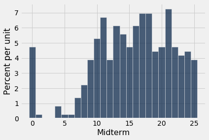

What was the 85th percentile of the scores? To use the `percentile` function, create an array `scores` containing the midterm scores, and find the 85th percentile:

```python
scores = scores_and_sections.column(1)
```

```python
percentile(85, scores)
```

*Output:*

```text
22
```

According to the percentile function, the 85th percentile was 22. To check that this is consistent with our new definition, let's apply the definition directly.

First, put the scores in increasing order:

```python
sorted_scores = np.sort(scores_and_sections.column(1))
```

There are 359 scores in the array. So next, find 85% of 359, which is 305.15.

```python
0.85 * 359
```

*Output:*

```text
305.15
```

That's not an integer. By our definition, the 85th percentile is the 306th element of `sorted_scores`, which, by Python's indexing convention, is item 305 of the array.

```python
# The 306th element of the sorted array

sorted_scores.item(305)
```

*Output:*

```text
22
```

That's the same as the answer we got by using `percentile`. In future, we will just use `percentile`.

### Quartiles
The *first quartile* of a numercial collection is the 25th percentile. The terminology arises from *the first quarter*. The second quartile is the median, and the third quartile is the 75th percentile.

For our `scores` data, those values are:

```python
percentile(25, scores)
```

*Output:*

```text
11
```

```python
percentile(50, scores)
```

*Output:*

```text
16
```

```python
percentile(75, scores)
```

*Output:*

```text
20
```

Distributions of scores are sometimes summarized by the "middle 50%" interval, between the first and third quartiles.

## 13.2 The Bootstrap

A data scientist is using the data in a random sample to estimate an unknown parameter. She uses the sample to calculate the value of a statistic that she will use as her estimate. 

Once she has calculated the observed value of her statistic, she could just present it as her estimate and go on her merry way. But she's a data scientist. She knows that her random sample is just one of numerous possible random samples, and thus her estimate is just one of numerous plausible estimates. 

By how much could those estimates vary? To answer this, it appears as though she needs to draw another sample from the population, and compute a new estimate based on the new sample. But she doesn't have the resources to go back to the population and draw another sample.

It looks as though the data scientist is stuck.

Fortunately, a brilliant idea called *the bootstrap* can help her out. Since it is not feasible to generate new samples from the population, the bootstrap generates new random samples by a method called *resampling*: the new samples are drawn at random *from the original sample*.

```python
from datascience import *
%matplotlib inline
path_data = '../../../assets/data/'
import matplotlib.pyplot as plots
plots.style.use('fivethirtyeight')
import numpy as np
```

In this section, we will see how and why the bootstrap works. In the rest of the chapter, we will use the bootstrap for inference.

### Employee Compensation in the City of San Francisco
[SF OpenData](https://data.sfgov.org) is a website where the City and County of San Francisco make some of their data publicly available. One of the data sets contains compensation data for employees of the City. These include medical professionals at City-run hospitals, police officers, fire fighters, transportation workers, elected officials, and all other employees of the City. 

Compensation data for the calendar year 2019 are in the table `sf2019`.

```python
sf2019 = Table.read_table(path_data + 'san_francisco_2019.csv')
```

```python
sf2019.show(3)
```

*Output:*

| Organization Group | Department | Job Family | Job | Salary | Overtime | Benefits | Total Compensation |
| --- | --- | --- | --- | --- | --- | --- | --- |
| Public Protection | Adult Probation | Information Systems | IS Trainer-Journey | 91332 | 0 | 40059 | 131391 |
| Public Protection | Adult Probation | Information Systems | IS Engineer-Assistant | 123241 | 0 | 49279 | 172520 |
| Public Protection | Adult Probation | Information Systems | IS Business Analyst-Senior | 115715 | 0 | 46752 | 162468 |

There is one row for each of over 44,500 employees. There are numerous columns containing information about City departmental affiliation and details of the different parts of the employee's compensation package. Here is the row corresponding to London Breed, the Mayor of San Francisco in 2019.

```python
sf2019.where('Job', 'Mayor')
```

*Output:*

| Organization Group | Department | Job Family | Job | Salary | Overtime | Benefits | Total Compensation |
| --- | --- | --- | --- | --- | --- | --- | --- |
| General Administration & Finance | Mayor | Administrative & Mgmt (Unrep) | Mayor | 342974 | 0 | 98012 | 440987 |

We are going to study the final column, `Total Compensation`. That's the employee's salary plus the City's contribution towards their retirement and benefit plans.

Financial packages in a calendar year can sometimes be hard to understand as they depend on the date of hire, whether the employee is changing jobs within the City, and so on. For example, the lowest values in the `Total Compensation` column look a little strange.

```python
sf2019.sort('Total Compensation')
```

*Output:*

| Organization Group | Department | Job Family | Job | Salary | Overtime | Benefits | Total Compensation |
| --- | --- | --- | --- | --- | --- | --- | --- |
| Public Protection | Adult Probation | Probation & Parole | Deputy Probation Officer | 0 | 0 | 0 | 0 |
| Public Protection | Fire Department | Clerical, Secretarial & Steno | Senior Clerk Typist | 0 | 0 | 0 | 0 |
| Public Protection | Juvenile Court | Correction & Detention | Counselor, Juvenile Hall PERS | 0 | 0 | 0 | 0 |
| Public Protection | Police | Clerical, Secretarial & Steno | Clerk Typist | 0 | 0 | 0 | 0 |
| Public Protection | Sheriff | Correction & Detention | Deputy Sheriff | 0 | 0 | 0 | 0 |
| Public Works, Transportation & Commerce | Airport Commission | Sub-Professional Engineering | StdntDsgn Train2/Arch/Eng/Plng | 0 | 0 | 0 | 0 |
| Public Works, Transportation & Commerce | Airport Commission | Clerical, Secretarial & Steno | Executive Secretary 1 | 0 | 0 | 0 | 0 |
| Public Works, Transportation & Commerce | Airport Commission | Payroll, Billing & Accounting | Senior Account Clerk | 0 | 0 | 0 | 0 |
| Public Works, Transportation & Commerce | Airport Commission | Housekeeping & Laundry | Custodian | 0 | 0 | 0 | 0 |
| Public Works, Transportation & Commerce | Airport Commission | Housekeeping & Laundry | Custodian | 0 | 0 | 0 | 0 |

For clarity of interpretation, we will focus our attention on those who had roughly the equivalent of a half-time job or more for the whole year. At a minimum wage of about 15 dollars per hour, and 20 hours per week for 52 weeks, that's a salary of over 15,000 dollars.

```python
sf2019 = sf2019.where('Salary', are.above(15000))
```

```python
sf2019.num_rows
```

*Output:*

```text
37103
```

### Population and Parameter
Let this table of just over 37,000 rows be our population. Here is a histogram of the total compensations for the employees in this table.

```python
sf_bins = np.arange(0, 726000, 25000)
sf2019.select('Total Compensation').hist(bins=sf_bins)
```

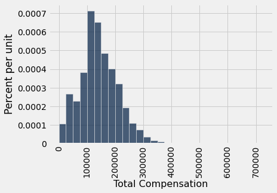

While most of the values are below 300,000 dollars, a few are quite a bit higher. For example, the total compensation of the Chief Investment Officer was over 700,000 dollars. That is why the horizontal axis stretches quite far to the right of the visible bars.

```python
sf2019.sort('Total Compensation', descending=True).show(2)
```

*Output:*

| Organization Group | Department | Job Family | Job | Salary | Overtime | Benefits | Total Compensation |
| --- | --- | --- | --- | --- | --- | --- | --- |
| General Administration & Finance | Retirement Services | Administrative & Mgmt (Unrep) | Chief Investment Officer | 577633 | 0 | 146398 | 724031 |
| General Administration & Finance | Retirement Services | Unassigned | Managing Director | 483072 | 0 | 134879 | 617951 |

Suppose the parameter in which we are interested is the median of the total compensations.

Since we have the luxury of having all of the data from the population, we can simply calculate the parameter:

```python
pop_median = percentile(50, sf2019.column('Total Compensation'))
pop_median
```

*Output:*

```text
135747.0
```

The median total compensation of all the employees was 135,747 dollars. 

From a practical perspective, there is no reason for us to draw a sample to estimate this parameter since we simply know its value. But in this section we are going to pretend we don't know the value, and see how well we can estimate it based on a random sample. 

In later sections, we will come down to earth and work in situations where the parameter is unknown. For now, we are all-knowing.

### A Random Sample and an Estimate
Let us draw a sample of 500 employees at random without replacement, and let the median total compensation of the sampled employees serve as our estimate of the parameter.

```python
our_sample = sf2019.sample(500, with_replacement=False)
our_sample.select('Total Compensation').hist(bins=sf_bins)
```

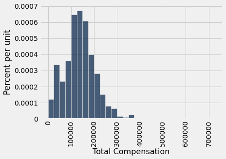

```python
est_median = percentile(50, our_sample.column('Total Compensation'))
est_median
```

*Output:*

```text
136835.0
```

The sample size is large. By the law of averages, the distribution of the sample resembles that of the population. Consequently the sample median is quite comparable to the population median, though of course it is not exactly the same.

So now we have one estimate of the parameter. But had the sample come out differently, the estimate would have had a different value. We would like to be able to quantify the amount by which the estimate could vary across samples. That measure of variability will help us measure how accurately we can estimate the parameter.

To see how different the estimate would be if the sample had come out differently, we could just draw another sample from the population. But that would be cheating. We are trying to mimic real life, in which we won't have all the population data at hand.

Somehow, we have to get another random sample *without sampling again from the population*.

### The Bootstrap: Resampling from the Sample

What we do have is a large random sample from the population. As we know, a large random sample is likely to resemble the population from which it is drawn. This observation allows data scientists to *lift themselves up by their own bootstraps*: the sampling procedure can be replicated by *sampling from the sample*. 

Here are the steps of *the bootstrap method* for generating another random sample that resembles the population:

- **Treat the original sample as if it were the population.**
- **Draw from the sample, at random with replacement, the same number of times as the original sample size**. 

It is important to resample the same number of times as the original sample size. The reason is that the variability of an estimate depends on the size of the sample. Since our original sample consisted of 500 employees, our sample median was based on 500 values. To see how different the sample could have been, we have to compare it to the median of other samples of size 500.

If we drew 500 times at random *without* replacement from our sample of size 500, we would just get the same sample back. By drawing *with* replacement, we create the possibility for the new samples to be different from the original, because some employees might be drawn more than once and others not at all.

### Why the Bootstrap Works

Why is this a good idea? By the law of averages, the distribution of the original sample is likely to resemble the population, and the distributions of all the "resamples" are likely to resemble the original sample. So the distributions of all the resamples are likely to resemble the population as well. 


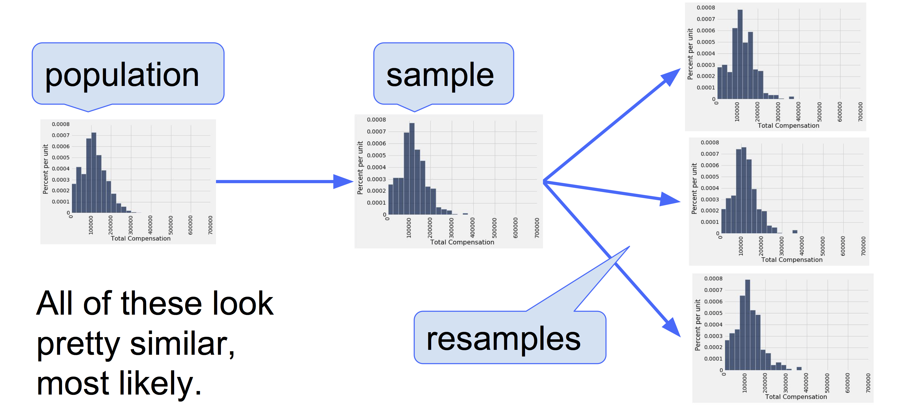

### A Resampled Median
Recall that the `sample` method draws rows from a table with replacement by default, and when it is used without specifying a sample size, by default the sample size equals the number of rows of the table. That's perfect for the bootstrap! Here is one new sample drawn from the original sample, and the corresponding sample median.

```python
resample_1 = our_sample.sample()
```

```python
resample_1.select('Total Compensation').hist(bins=sf_bins)
```

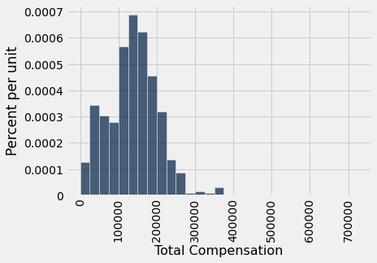

```python
resampled_median_1 = percentile(50, resample_1.column('Total Compensation'))
resampled_median_1
```

*Output:*

```text
141793.0
```

This value is an estimate of the population median.

By resampling again and again, we can get many such estimates, and hence an empirical distribution of the estimates.

```python
resample_2 = our_sample.sample()
resampled_median_2 = percentile(50, resample_2.column('Total Compensation'))
resampled_median_2
```

*Output:*

```text
135880.0
```

Let us collect this code and define a function `one_bootstrap_median` that returns one bootstrapped median of total compensation, based on bootstrapping the original random sample that we called `our_sample`.

```python
def one_bootstrap_median():
    resampled_table = our_sample.sample()
    bootstrapped_median = percentile(50, resampled_table.column('Total Compensation'))
    return bootstrapped_median
```

Run the cell below a few times to see how the bootstrapped medians vary. Remember that each of them is an estimate of the population median.

```python
one_bootstrap_median()
```

*Output:*

```text
132175.0
```

### Bootstrap Empirical Distribution of the Sample Median

We can now repeat the bootstrap process multiple times by running a `for` loop as usual. In each iteration, we will call the function `one_bootstrap_median` to generate one value of the bootstrapped median based on our original sample `our_sample`. Then we will append the bootstrapped median to the collection array `bstrap_medians`.

Since we are asking for 5000 repetitions, the code might take a while to run. It has a lot of resampling to do!

```python
num_repetitions = 5000
bstrap_medians = make_array()
for i in np.arange(num_repetitions):
    bstrap_medians = np.append (bstrap_medians, one_bootstrap_median())
```

Here is an empirical histogram of the 5000 bootstrapped medians. The green dot is the population parameter: it is the median of the entire population, which is what we are trying to estimate. In this example we happen to know its value, but we did not use it in the bootstrap process.

```python
resampled_medians = Table().with_column('Bootstrap Sample Median', bstrap_medians)
median_bins=np.arange(120000, 160000, 2000)
resampled_medians.hist(bins = median_bins)

# Plotting parameters; you can ignore this code
parameter_green = '#32CD32'
plots.ylim(-0.000005, 0.00014)
plots.scatter(pop_median, 0, color=parameter_green, s=40, zorder=2);
```

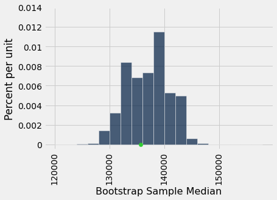

It is important to remember that the green dot is fixed: it is 135,747 dollars, the population median. The empirical histogram is the result of random draws, and will be situated randomly relative to the green dot. 

Remember also that the point of all these computations is to estimate the population median, which is the green dot. Our estimates are all the randomly generated sampled medians whose histogram you see above. We want the set of these estimates to contain the parameter. If it doesn't, then the estimates are off.

### Do the Estimates Capture the Parameter?

How often does the empirical histogram of the resampled medians sit firmly over the green dot, and not just brush the dot with its tails or not cover it at all? To answer this, we must define "sit firmly". Let's take that to mean "the middle 95% of the resampled medians contains the green dot". 

Here are the two ends of the "middle 95%" interval of resampled medians:

```python
left = percentile(2.5, bstrap_medians)
left
```

*Output:*

```text
129524.0
```

```python
right = percentile(97.5, bstrap_medians)
right
```

*Output:*

```text
143446.0
```

The population median of 135,747 dollars is between these two numbers. The interval and the population median are shown on the histogram below.

```python
resampled_medians.hist(bins = median_bins)

# Plotting parameters; you can ignore this code
plots.ylim(-0.000005, 0.00014)
plots.plot([left, right], [0, 0], color='yellow', lw=3, zorder=1)
plots.scatter(pop_median, 0, color=parameter_green, s=40, zorder=2);
```

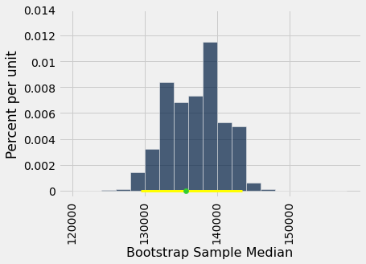

The "middle 95%" interval of estimates captured the parameter in our example. But was that a fluke? 

To see how frequently the interval contains the parameter, we have to run the entire process over and over again. Specifically, we will replicate the following process 100 times:

- Draw an original random sample of size 500 from the population.
- Carry out 5000 replications of the bootstrap process and generate the "middle 95%" interval of resampled medians.

We will end up with 100 intervals, and count how many of them contain the population median.

**Spoiler alert:** The statistical theory of the bootstrap says that the number should be around 95. It may be in the low 90s or high 90s, but we don't expect it to be much farther off 95 than that.

We will start by writing a function `bootstrap_median` that takes two arguments: the name of the table containing the original random sample, and the number of bootstrap samples to draw. It returns an array of bootstrapped medians, one from each bootstrap sample.

```python
def bootstrap_median(original_sample, num_repetitions):
    medians = make_array()
    for i in np.arange(num_repetitions):
        new_bstrap_sample = original_sample.sample()
        new_bstrap_median = percentile(50, new_bstrap_sample.column('Total Compensation'))
        medians = np.append(medians, new_bstrap_median)
    return medians
```

Now we will write a `for` loop that calls this function 100 times and collects the "middle 95%" of the bootstrapped medians each time. 

The cell below will take several minutes to run since it has to perform 100 replications of sampling 500 times at random from the table and generating 5000 bootstrapped samples.

```python
# THE BIG SIMULATION: This one takes several minutes.

# Generate 100 intervals and put the endpoints in the table intervals

left_ends = make_array()
right_ends = make_array()

for i in np.arange(100):
    original_sample = sf2019.sample(500, with_replacement=False)
    medians = bootstrap_median(original_sample, 5000)
    left_ends = np.append(left_ends, percentile(2.5, medians))
    right_ends = np.append(right_ends, percentile(97.5, medians))

intervals = Table().with_columns(
    'Left', left_ends,
    'Right', right_ends
)
```

For each of the 100 replications of the entire process, we get one interval of estimates of the median.

```python
intervals
```

*Output:*

| Left | Right |
| --- | --- |
| 125093 | 139379 |
| 129925 | 140757 |
| 133955 | 146369 |
| 129335 | 140847 |
| 132756 | 145429 |
| 130167 | 143200 |
| 125935 | 138491 |
| 131092 | 142472 |
| 128509 | 140462 |
| 131270 | 145998 |

The good intervals are those that contain the parameter we are trying to estimate. Typically the parameter is unknown, but in this section we happen to know what the parameter is.

```python
pop_median
```

*Output:*

```text
135747.0
```

How many of the 100 intervals contain the population median? That's the number of intervals where the left end is below the population median and the right end is above.

```python
intervals.where(
    'Left', are.below(pop_median)).where(
    'Right', are.above(pop_median)).num_rows
```

*Output:*

```text
93
```

It takes many minutes to construct all the intervals, but try it again if you have the patience. Most likely, about 95 of the 100 intervals will be good ones: they will contain the parameter.

It's hard to show you all the intervals on the horizontal axis as they have large overlaps – after all, they are all trying to estimate the same parameter. The graphic below shows each interval on the same axes by stacking them vertically. The vertical axis is simply the number of the replication from which the interval was generated.

The green line is where the parameter is. It has a fixed position since the parameter is fixed.

Good intervals cover the parameter. There are approximately 95 of these, typically. 

If an interval doesn't cover the parameter, it's a dud. The duds are the ones where you can see "daylight" around the green line. There are very few of them – about 5 out of 100, typically – but they do happen. 

Any method based on sampling has the possibility of being off. The beauty of methods based on random sampling is that we can quantify how often they are likely to be off.

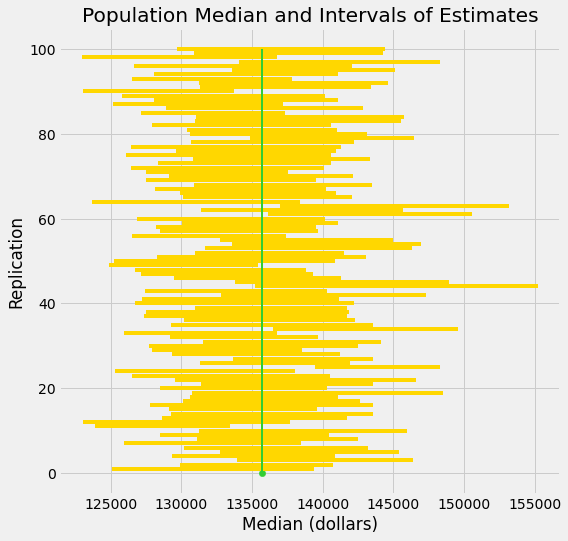

To summarize what the simulation shows, suppose you are estimating the population median by the following process: 

- Draw a large random sample from the population.
- Bootstrap your random sample and get an estimate from the new random sample. 
- Repeat the above bootstrap step thousands of times, and get thousands of estimates.
- Pick off the "middle 95%" interval of all the estimates.

That gives you one interval of estimates. If 99 other people repeat **the entire process**, starting with a new random sample each time, then you will end up with 100 such intervals. About 95 of these 100 intervals will contain the population parameter.

In other words, this process of estimation captures the parameter about 95% of the time. 

You can replace 95% by a different value, as long as it's not 100. Suppose you replace 95% by 80% and keep the sample size fixed at 500. Then your intervals of estimates will be shorter than those we simulated here, because the "middle 80%" is a smaller range than the "middle 95%". If you keep repeating this process, only about 80% of your intervals will contain the parameter.

## 13.3 Confidence Intervals

We have developed a method for estimating a parameter by using random sampling and the bootstrap. Our method produces an interval of estimates, to account for chance variability in the random sample. By providing an interval of estimates instead of just one estimate, we give ourselves some wiggle room.

In the previous example we saw that our process of estimation produced a good interval about 95% of the time, a "good" interval being one that contains the parameter. We say that we are *95% confident* that the process results in a good interval. Our interval of estimates is called a *95% confidence interval* for the parameter, and 95% is called the *confidence level* of the interval.

The method is called the *bootstrap percentile method* because the interval is formed by picking off two percentiles of the bootstrapped estimates.

The situation in the previous example was a bit unusual. Because we happened to know the value of the parameter, we were able to check whether an interval was good or a dud, and this in turn helped us to see that our process of estimation captured the parameter about 95 out of every 100 times we used it.

But usually, data scientists don't know the value of the parameter. That is the reason they want to estimate it in the first place. In such situations, they provide an interval of estimates for the unknown parameter by using methods like the one we have developed. Because of statistical theory and demonstrations like the one we have seen, data scientists can be confident that their process of generating the interval results in a good interval a known percent of the time.

```python
from datascience import *
%matplotlib inline
path_data = '../../../assets/data/'
import matplotlib.pyplot as plots
plots.style.use('fivethirtyeight')
import numpy as np
```

### Estimating a Population Median

We will now use the bootstrap method to estimate an unknown population median. You have encountered the dataset before. It comes from a sample of newborns in a large hospital system. we will treat it as if it were a simple random sample though the sampling was done in multiple stages. [Stat Labs](https://www.stat.berkeley.edu/~statlabs/) by Deborah Nolan and Terry Speed has details about a larger dataset from which this set is drawn. 

The table `births` contains the following variables for mother-baby pairs: the baby's birth weight in ounces, the number of gestational days (the number of days the mother was pregnant), the mother's age in completed years, the mother's height in inches, pregnancy weight in pounds, and whether or not the mother smoked during pregnancy.

```python
births = Table.read_table(path_data + 'baby.csv')
```

```python
births.show(3)
```

*Output:*

| Birth Weight | Gestational Days | Maternal Age | Maternal Height | Maternal Pregnancy Weight | Maternal Smoker |
| --- | --- | --- | --- | --- | --- |
| 120 | 284 | 27 | 62 | 100 | False |
| 113 | 282 | 33 | 64 | 135 | False |
| 128 | 279 | 28 | 64 | 115 | True |

Birth weight is an important factor in the health of a newborn infant. Smaller babies tend to need more medical care in their first days than larger newborns. It is therefore helpful to have an estimate of birth weight before the baby is born. One way to do this is to examine the relationship between birth weight and the number of gestational days. 

A simple measure of this relationship is the ratio of birth weight to the number of gestational days. The table `ratios` contains the first two columns of `baby`, as well as a column of the ratios. The first entry in that column was calculated as follows:

$$
\frac{120~\mbox{ounces}}{284~\mbox{days}} ~\approx ~ 0.4225~ \mbox{ounces per day}
$$

```python
ratios = births.select('Birth Weight', 'Gestational Days').with_columns(
    'Ratio BW:GD', births.column('Birth Weight')/births.column('Gestational Days')
)
```

```python
ratios
```

*Output:*

| Birth Weight | Gestational Days | Ratio BW:GD |
| --- | --- | --- |
| 120 | 284 | 0.422535 |
| 113 | 282 | 0.400709 |
| 128 | 279 | 0.458781 |
| 108 | 282 | 0.382979 |
| 136 | 286 | 0.475524 |
| 138 | 244 | 0.565574 |
| 132 | 245 | 0.538776 |
| 120 | 289 | 0.415225 |
| 143 | 299 | 0.478261 |
| 140 | 351 | 0.39886 |

Here is a histogram of the ratios.

```python
ratios.select('Ratio BW:GD').hist()
```

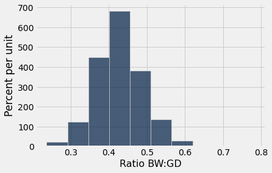

At first glance the histogram looks quite symmetric, with the density at its maximum over the interval 0.4 ounces per day to 0.45 ounces per day. But a closer look reveals that some of the ratios were quite large by comparison. The maximum value of the ratios was just over 0.78 ounces per day, almost double the typical value.

```python
ratios.sort('Ratio BW:GD', descending=True).take(0)
```

*Output:*

| Birth Weight | Gestational Days | Ratio BW:GD |
| --- | --- | --- |
| 116 | 148 | 0.783784 |

The median gives a sense of the typical ratio because it is unaffected by the very large or very small ratios. The median ratio in the sample is about 0.429 ounces per day.

```python
percentile(50, ratios.column(2))
```

*Output:*

```text
0.42907801418439717
```

But what was the median in the population? We don't know, so we will estimate it. 

Our method will be exactly the same as in the previous section. We will bootstrap the sample 5,000 times resulting in 5,000 estimates of the median. Our 95% confidence interval will be the "middle 95%" of all of our estimates.

#### Constructing a Bootstrap Confidence Interval 

We will start by defining a function `one_bootstrap_median`. It will bootstrap the sample and return one the median ratio in the bootstrapped sample.

```python
def one_bootstrap_median():
    resample = ratios.sample()
    return percentile(50, resample.column('Ratio BW:GD'))
```

Run the cell below to see how the bootstrapped ratios vary. Remember that each of them is an estimate of the unknown ratio in the population.

```python
one_bootstrap_median()
```

*Output:*

```text
0.43010752688172044
```

Now we can use a `for` loop to generate 5000 bootstrapped medians.

```python
# Generate medians from 5000 bootstrap samples
num_repetitions = 5000
bstrap_medians = make_array()
for i in np.arange(num_repetitions):
    bstrap_medians = np.append(bstrap_medians, one_bootstrap_median())
```

```python
# Get the endpoints of the 95% confidence interval
left = percentile(2.5, bstrap_medians)
right = percentile(97.5, bstrap_medians)

make_array(left, right)
```

*Output:*

```text
array([0.42545455, 0.43272727])
```

The 95% confidence interval goes from about 0.425 ounces per day to about 0.433 ounces per day. We are estimating the median "birth weight to gestational days" ratio in the population is somewhere in the interval 0.425 ounces per day to 0.433 ounces per day.

The estimate of 0.429 based on the original sample happens to be half-way in between the two ends of the interval, though that need not be true in general.

To visualize our results, let us draw the empirical histogram of our bootstrapped medians and place the confidence interval on the horizontal axis.

```python
resampled_medians = Table().with_columns(
    'Bootstrap Sample Median', bstrap_medians
)
resampled_medians.hist(bins=15)
plots.plot([left, right], [0, 0], color='yellow', lw=8);
```

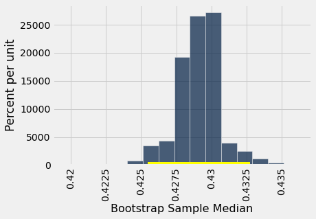

This histogram and interval resembles those we drew in the previous section, with one big difference – there is no green dot showing where the parameter is. We don't know where that dot should be, or whether it is even in the interval.

We just have an interval of estimates. It is a 95% confidence interval of estimates, because the process that generates it produces a good interval about 95% of the time. That certainly beats guessing the ratio at random!

Keep in mind that this interval is an approximate 95% confidence interval. There are many approximations involved in its computation. The approximation is not bad, but it is not exact.

### Estimating a Population Average
What we have done for medians can be done for averages as well. Suppose we want to estimate the average age of the mothers in the population. A natural estimate is the average age of the mothers in the sample. Here is the distribution of their ages, and their average age which was about 27.2 years.

```python
births.select('Maternal Age').hist()
```


```python
np.average(births.column('Maternal Age'))
```

*Output:*

```text
27.228279386712096
```

What was the average age of the mothers in the population? We don't know the value of this parameter.

Let's estimate the unknown parameter by the bootstrap method. To do this, we will adapt the code for `bootstrap_median` to instead define the function `bootstrap_mean`. The code is the same except that the statistics are means (that is, averages) instead of medians, and are collected in an array called `bstrap_means` instead of `bstrap_medians`.

```python
def one_bootstrap_mean():
    resample = births.sample()
    return np.average(resample.column('Maternal Age'))
```

```python
# Generate means from 5000 bootstrap samples
num_repetitions = 5000
bstrap_means = make_array()
for i in np.arange(num_repetitions):
    bstrap_means = np.append(bstrap_means, one_bootstrap_mean())
```

```python
# Get the endpoints of the 95% confidence interval
left = percentile(2.5, bstrap_means)
right = percentile(97.5, bstrap_means)

make_array(left, right)
```

*Output:*

```text
array([26.90630324, 27.55962521])
```

The 95% confidence interval goes from about 26.9 years to about 27.6 years. That is, we are estimating that the average age of the mothers in the population is somewhere in the interval 26.9 years to 27.6 years. 

Notice how close the two ends are to the average of about 27.2 years in the original sample. The sample size is very large – 1,174 mothers – and so the sample averages don't vary much. We will explore this observation further in the next chapter.

The empirical histogram of the 5,000 bootstrapped mean ages is shown below, along with the 95% confidence interval for the population mean age.

```python
resampled_means = Table().with_columns(
    'Bootstrap Sample Mean', bstrap_means
)
resampled_means.hist(bins=15)
plots.plot([left, right], [0, 0], color='yellow', lw=8);
```

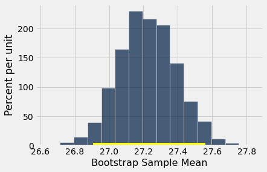

Once again, the average of the original sample (27.23 years) is close to the center of the interval. That's not very surprising, because each bootstrapped sample is drawn from that same original sample. The averages of the bootstrapped samples are about symmetrically distributed on either side of the average of the sample from which they were drawn.

Notice also that the empirical histogram of the resampled means has roughly a symmetric bell shape, even though the histogram of the sampled ages was not symmetric at all:

```python
births.select('Maternal Age').hist()
```

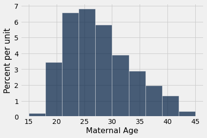

This is a consequence of the Central Limit Theorem of probability and statistics. In later sections, we will see what the theorem says.

### An 80% Confidence Interval
You can use the bootstrapped sample means to construct an interval of any level of confidence. For example, to construct an 80% confidence interval for the mean age in the population, you would take the "middle 80%" of the resampled means. So you would want 10% of the distribution in each of the two tails, and hence the endpoints would be the 10th and 90th percentiles of the resampled means.

```python
left_80 = percentile(10, bstrap_means)
right_80 = percentile(90, bstrap_means)
make_array(left_80, right_80)
```

*Output:*

```text
array([27.01277683, 27.44293015])
```

```python
resampled_means.hist(bins=15)
plots.plot([left_80, right_80], [0, 0], color='yellow', lw=8);
```

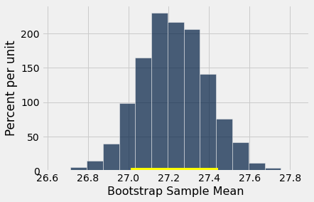

This 80% confidence interval is much shorter than the 95% confidence interval. It only goes from about 27.0 years to about 27.4 years. While that's a tight set of estimates, you know that this process only produces a good interval about 80% of the time. 

The earlier process produced a wider interval but we had more confidence in the process that generated it.

To get a narrow confidence interval at a high level of confidence, you'll have to start with a larger sample. We'll see why in the next chapter.

### Estimating a Population Proportion
In the sample, 39% of the mothers smoked during pregnancy.

```python
births.where('Maternal Smoker', are.equal_to(True)).num_rows / births.num_rows
```

*Output:*

```text
0.3909710391822828
```

Remember that a proportion is an average of zeros and ones. So the proportion of mothers who smoked could also be calculated using array operations as follows.

```python
smoking = births.column('Maternal Smoker')
np.count_nonzero(smoking) / len(smoking)
```

*Output:*

```text
0.3909710391822828
```

What percent of mothers in the population smoked during pregnancy? This is an unknown parameter which we can estimate by a bootstrap confidence interval. The steps are analogous to those we took to estimate the population median and mean.

In a process that is now familiar, will start by defining a function `one_bootstrap_proportion` that bootstraps the sample and returns the proportion of smokers in the bootstrapped sample. Then we will call the function multiple times using a `for` loop, and get the 2.5th perentile and 97.5th percentiles of the bootstrapped proportions.

```python
def one_bootstrap_proportion():
    resample = births.sample()
    smoking = resample.column('Maternal Smoker')
    return np.count_nonzero(smoking) / len(smoking)
```

```python
# Generate proportions from 5000 bootstrap samples
bstrap_proportions = make_array()
num_repetitions = 5000
for i in np.arange(num_repetitions):
    bstrap_proportions = np.append(bstrap_proportions, one_bootstrap_proportion())
```

```python
# Get the endpoints of the 95% confidence interval
left = percentile(2.5, bstrap_proportions)
right = percentile(97.5, bstrap_proportions)

make_array(left, right)
```

*Output:*

```text
array([0.36286201, 0.41908007])
```

The confidence interval goes from about 36% to about 42%.

```python
resampled_proportions = Table().with_columns(
    'Bootstrap Sample Proportion', bstrap_proportions
)
resampled_proportions.hist(bins=15)
plots.plot([left, right], [0, 0], color='yellow', lw=8);
```

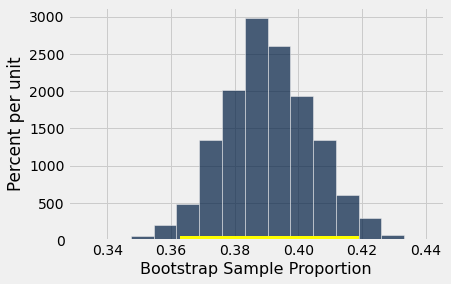

### Care in Using the Bootstrap Percentile Method
The bootstrap is an elegant and powerful method. Before using it, it is important to keep some points in mind.

- Start with a large random sample. If you don't, the method might not work. Its success is based on large random samples (and hence also resamples from the sample) resembling the population. The Law of Averages says that this is likely to be true provided the random sample is large.

- To approximate the probability distribution of a statistic, it is a good idea to replicate the resampling procedure as many times as possible. A few thousand replications will result in decent approximations to the distribution of sample median, especially if the distribution of the population has one peak and is fairly symmetric. We used 5,000 replications in our examples but would recommend 10,000 in general.

- The bootstrap percentile method works well for estimating the population median or mean based on a large random sample. However, it has limitations, as do all methods of estimation. For example, it is *not* expected to do well in the following situations.
    - The goal is to estimate the minimum or maximum value in the population, or a very low or very high percentile, or parameters that are greatly influenced by rare elements of the population.
    - The probability distribution of the statistic is not roughly bell shaped.
    - The original sample is very small, say less than 10 or 15.

## 13.4 Using Confidence Intervals

A confidence interval has a single purpose – to estimate an unknown parameter based on data in a random sample. In the last section, we said that the interval (36%, 42%) was an approximate 95% confidence interval for the percent of smokers among mothers in the population. That was a formal way of saying that by our estimate, the percent of smokers among the mothers in the population was somewhere between 36% and 42%, and that our process of estimation is correct about 95% of the time.

It is important to resist the impulse to use confidence intervals for other purposes. For example, recall that we calculated the interval (26.9 years, 27.6 years) as an approximate 95% confidence interval for the average age of mothers in the population. A dismayingly common misuse of the interval is to conclude that about 95% of the women were between 26.9 years and 27.6 years old. You don't need to know much about confidence intervals to see that this can't be right – you wouldn't expect 95% of mothers to all be within a few months of each other in age. Indeed, the histogram of the sampled ages shows quite a bit of variation.

```python
from datascience import *
%matplotlib inline
path_data = '../../../assets/data/'
import matplotlib.pyplot as plots
plots.style.use('fivethirtyeight')
import numpy as np
```

```python
births = Table.read_table(path_data + 'baby.csv')
```

```python
births.select('Maternal Age').hist()
```


A small percent of the sampled ages are in the (26.9, 27.6) interval, and you would expect a similar small percent in the population. The interval just estimates one number: the *average* of all the ages in the population.

However, estimating a parameter by confidence intervals does have an important use besides just telling us roughly how big the parameter is.

### Using a Confidence Interval to Test Hypotheses
Our approximate 95% confidence interval for the average age in the population goes from 26.9 years to 27.6 years. Suppose someone wants to test the following hypotheses:

**Null hypothesis:** The average age in the population is 30 years.

**Alternative hypothesis:** The average age in the population is not 30 years.

Then, if you were using the 5% cutoff for the p-value, you would reject the null hypothesis. This is because 30 is not in the 95% confidence interval for the population average. At the 5% level of significance, 30 is not a plausible value for the population average.

This use of confidence intervals is the result of a *duality* between confidence intervals and tests: if you are testing whether or not the population mean is a particular value *x*, and you use the 5% cutoff for the p-value, then you will reject the null hypothesis if *x* is not in your 95% confidence interval for the mean. 

This can be established by statistical theory. In practice, it just boils down to checking whether or not the value specified in the null hypothesis lies in the confidence interval.

If you were using the 1% cutoff for the P-value, you would have to check if the value specified in the null hypothesis lies in a 99% confidence interval for the population mean.

To a rough approximation, these statements are also true for population proportions, provided the sample is large.

While we now have a way of using confidence intervals to test a particular kind of hypothesis, you might wonder about the value of testing whether or not the average age in a population is equal to 30. Indeed, the value isn't clear. But there are some situations in which a test of this kind of hypothesis is both natural and useful.

### Comparing Baseline and Post-Treatment Scores

We will study this in the context of data that are a subset of the information gathered in a randomized controlled trial about treatments for Hodgkin's disease. Hodgkin's disease is a cancer that typically affects young people. The disease is curable but the treatment can be very harsh. The purpose of the trial was to come up with dosage that would cure the cancer but minimize the adverse effects on the patients. 

This table ``hodgkins`` contains data on the effect that the treatment had on the lungs of 22 patients. The columns are:

- Height in cm
- A measure of radiation to the mantle (neck, chest, under arms)
- A measure of chemotherapy
- A score of the health of the lungs at baseline, that is, at the start of the treatment; higher scores correspond to more healthy lungs
- The same score of the health of the lungs, 15 months after treatment

```python
hodgkins = Table.read_table(path_data + 'hodgkins.csv')
```

```python
hodgkins.show(3)
```

*Output:*

| height | rad | chemo | base | month15 |
| --- | --- | --- | --- | --- |
| 164 | 679 | 180 | 160.57 | 87.77 |
| 168 | 311 | 180 | 98.24 | 67.62 |
| 173 | 388 | 239 | 129.04 | 133.33 |

We will compare the baseline and 15-month scores. As each row corresponds to one patient, we say that the sample of baseline scores and the sample of 15-month scores are *paired* - they are not just two sets of 22 values each, but 22 pairs of values, one for each patient.

At a glance, you can see that the 15-month scores tend to be lower than the baseline scores – the sampled patients' lungs seem to be doing worse 15 months after the treatment. This is confirmed by the mostly positive values in the column `drop`, the amount by which the score dropped from baseline to 15 months.

```python
hodgkins = hodgkins.with_columns(
    'drop', hodgkins.column('base') - hodgkins.column('month15')
)
```

```python
hodgkins
```

*Output:*

| height | rad | chemo | base | month15 | drop |
| --- | --- | --- | --- | --- | --- |
| 164 | 679 | 180 | 160.57 | 87.77 | 72.8 |
| 168 | 311 | 180 | 98.24 | 67.62 | 30.62 |
| 173 | 388 | 239 | 129.04 | 133.33 | -4.29 |
| 157 | 370 | 168 | 85.41 | 81.28 | 4.13 |
| 160 | 468 | 151 | 67.94 | 79.26 | -11.32 |
| 170 | 341 | 96 | 150.51 | 80.97 | 69.54 |
| 163 | 453 | 134 | 129.88 | 69.24 | 60.64 |
| 175 | 529 | 264 | 87.45 | 56.48 | 30.97 |
| 185 | 392 | 240 | 149.84 | 106.99 | 42.85 |
| 178 | 479 | 216 | 92.24 | 73.43 | 18.81 |

```python
hodgkins.select('drop').hist(bins=np.arange(-20, 81, 20))
```

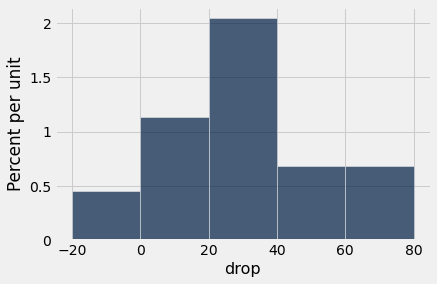

```python
np.average(hodgkins.column('drop'))
```

*Output:*

```text
28.615909090909096
```

In the sample, the average drop is about 28.6. But could this be the result of chance variation? The data are from a random sample. Could it be that in the entire population of patients, the average drop is just 0?

To answer this, we can set up two hypotheses:

**Null hypothesis:** In the population, the average drop is 0.

**Alternative hypothesis:** In the population, the average drop is not 0.

To test this hypothesis with a 1% cutoff for the p-value, let's construct an approximate 99% confidence interval for the average drop in the population.

```python
def one_bootstrap_mean():
    resample = hodgkins.sample()
    return np.average(resample.column('drop'))
```

```python
# Generate 10,000 bootstrap means
num_repetitions = 10000
bstrap_means = make_array()
for i in np.arange(num_repetitions):
    bstrap_means = np.append(bstrap_means, one_bootstrap_mean())
```

```python
# Get the endpoints of the 99% confidence interval
left = percentile(0.5, bstrap_means)
right = percentile(99.5, bstrap_means)

make_array(left, right)
```

*Output:*

```text
array([17.46863636, 40.97681818])
```

```python
resampled_means = Table().with_columns(
    'Bootstrap Sample Mean', bstrap_means
)
resampled_means.hist()
plots.plot([left, right], [0, 0], color='yellow', lw=8);
```

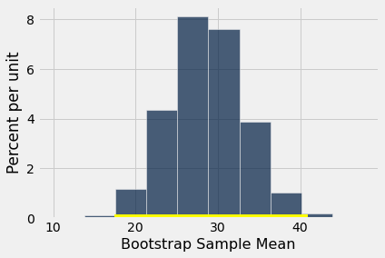

The 99% confidence interval for the average drop in the population goes from about 17 to about 40. The interval doesn't contain 0. So we reject the null hypothesis.

But notice that we have done better than simply concluding that the average drop in the population isn't 0. We have estimated how big the average drop is. That's a more useful result than just saying, "It's not 0."

**A note on accuracy:** Our confidence interval is quite wide, for two main reasons:
- The confidence level is high (99%).
- The sample size is relatively small compared to those in our earlier examples.

In the next chapter, we will examine how the sample size affects accuracy. We will also examine how the empirical distributions of sample means so often come out bell shaped even though the distributions of the underlying data are not bell shaped at all.

### Endnote ##
The terminology of a field usually comes from the leading researchers in that field. [Brad Efron](https://en.wikipedia.org/wiki/Bradley_Efron), who first proposed the bootstrap technique, used a term that has [American origins](https://en.wikipedia.org/wiki/Bootstrapping). Not to be outdone, Chinese statisticians have [proposed their own method](http://econpapers.repec.org/article/eeestapro/v_3a37_3ay_3a1998_3ai_3a4_3ap_3a321-329.htm).
