# Chapter 14: Why the Mean Matters

In this course we have studied several different statistics, including total variation distance, the maximum, the median, and also the mean. Under clear assumptions about randomness, we have drawn empirical distributions of all of these statistics. Some, like the maximum and the total variation distance, have distributions that are clearly skewed in one direction or the other. But the empirical distribution of the sample mean has almost always turned out close to bell-shaped, regardless of the population being studied.

If a property of random samples is true *regardless of the population,* it becomes a powerful tool for inference because we rarely know much about the data in the entire population. The distribution of the mean of a large random sample falls into this category of properties. That is why random sample means are extensively used in data science.

In this chapter, we will study means and what we can say about them with only minimal assumptions about the underlying populations. Question that we will address include:

- What exactly does the mean measure?
- How close to the mean are most of the data?
- How is the sample size related to the variability of the sample mean?
- Why do empirical distributions of random sample means come out bell shaped?
- How can we use sample means effectively for inference?

## 14.1 Properties of the Mean

In this course, we have used the words "average" and "mean" interchangeably, and will continue to do so. The definition of the mean will be familiar to you from your high school days or even earlier.

**Definition.** The *average* or *mean* of a collection of numbers is the sum of all the elements of the collection, divided by the number of elements in the collection.

The methods `np.average` and `np.mean` return the mean of an array.

```python
from datascience import *
%matplotlib inline
path_data = '../../../assets/data/'
import matplotlib.pyplot as plots
plots.style.use('fivethirtyeight')
import pylab as pl
import numpy as np
```

```python
not_symmetric = make_array(2, 3, 3, 9)
```

```python
np.average(not_symmetric)
```

*Output:*

```text
4.25
```

```python
np.mean(not_symmetric)
```

*Output:*

```text
4.25
```

### Basic Properties

The definition and the example above point to some properties of the mean.

- It need not be an element of the collection.
- It need not be an integer even if all the elements of the collection are integers.
- It is somewhere between the smallest and largest values in the collection.
- It need not be halfway between the two extremes; it is not in general true that half the elements in a collection are above the mean.
- If the collection consists of values of a variable measured in specified units, then the mean has the same units too.

We will now study some other properties that are helpful in understanding the mean and its relation to other statistics.

### The Mean is a "Smoother"

You can think of taking the mean as an "equalizing" or "smoothing" operation. For example, imagine the entries in `not_symmetric` above as the dollars in the pockets of four different people. To get the mean, you first put all of the money into one big pot and then divide it evenly among the four people. They had started out with different amounts of money in their pockets (\$2, \$3, \$3, and \$9), but now each person has \$4.25, the mean amount.

### Proportions are Means
If a collection consists only of ones and zeroes, then the sum of the collection is the number of ones in it, and the mean of the collection is the proportion of ones.

```python
zero_one = make_array(1, 1, 1, 0)
sum(zero_one)
```

*Output:*

```text
3
```

```python
np.mean(zero_one)
```

*Output:*

```text
0.75
```

You can replace 1 by the Boolean `True` and 0 by `False`:

```python
np.mean(make_array(True, True, True, False))
```

*Output:*

```text
0.75
```

Because proportions are a special case of means, results about random sample means apply to random sample proportions as well.

### The Mean and the Histogram
The mean of the collection {2, 3, 3, 9} is 4.25, which is not the "halfway point" of the data. So then what does the mean measure?

To see this, notice that the mean can be calculated in different ways.

$$\begin{align*}
\mbox{mean} ~ &=~ 4.25 \\ \\
&=~ \frac{2 + 3 + 3 + 9}{4} \\ \\
&=~ 2 \cdot \frac{1}{4} ~~ + ~~ 3 \cdot \frac{1}{4} ~~ + ~~ 3 \cdot \frac{1}{4} ~~ + ~~ 9 \cdot \frac{1}{4} \\ \\
&=~ 2 \cdot \frac{1}{4} ~~ + ~~ 3 \cdot \frac{2}{4} ~~ + ~~ 9 \cdot \frac{1}{4} \\ \\
&=~ 2 \cdot 0.25 ~~ + ~~ 3 \cdot 0.5 ~~ + ~~ 9 \cdot 0.25
\end{align*}$$

The last expression is an example of a general fact: when we calculate the mean, each distinct value in the collection is *weighted* by the proportion of times it appears in the collection.

This has an important consequence. The mean of a collection depends only on the distinct values and their proportions, not on the number of elements in the collection. In other words, the mean of a collection depends only on the distribution of values in the collection.

Therefore, **if two collections have the same distribution, then they have the same mean.**

For example, here is another collection that has the same distribution as `not_symmetric` and hence the same mean.

```python
not_symmetric
```

*Output:*

```text
array([2, 3, 3, 9])
```

```python
same_distribution = make_array(2, 2, 3, 3, 3, 3, 9, 9)
np.mean(same_distribution)
```

*Output:*

```text
4.25
```

The mean is a physical attribute of the histogram of the distribution. Here is the histogram of the distribution of `not_symmetric` or equivalently the distribution of `same_distribution`.

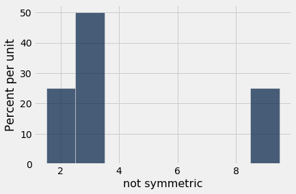

Imagine the histogram as a figure made out of cardboard attached to a wire that runs along the horizontal axis, and imagine the bars as weights attached at the values 2, 3, and 9. Suppose you try to balance this figure on a point on the wire. If the point is near 2, the figure will tip over to the right. If the point is near 9, the figure will tip over to the left. Somewhere in between is the point where the figure will balance; that point is the 4.25, the mean.

**The mean is the center of gravity or balance point of the histogram.**

To understand why that is, it helps to know some physics. The center of gravity is calculated exactly as we calculated the mean, by using the distinct values weighted by their proportions.

Because the mean is a balance point, it is sometimes displayed as a *fulcrum* or triangle at the base of the histogram.

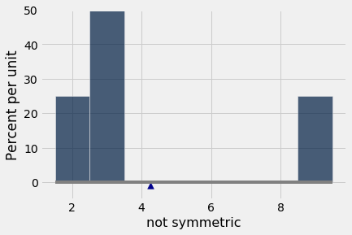

### The Mean and the Median

If a student's score on a test is below average, does that imply that the student is in the bottom half of the class on that test?

Happily for the student, the answer is, "Not necessarily." The reason has to do with the relation between the average, which is the balance point of the histogram, and the median, which is the "half-way point" of the data.

The relationship is easy to see in a simple example. Here is a histogram of the collection {2, 3, 3, 4} which is in the array `symmetric`. The distribution is symmetric about 3. The mean and the median are both equal to 3.

```python
symmetric = make_array(2, 3, 3, 4)
```

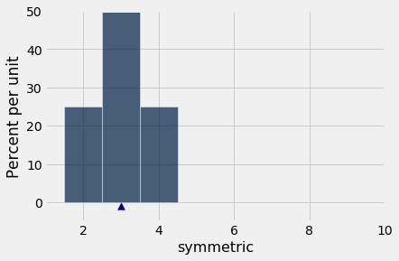

```python
np.mean(symmetric)
```

*Output:*

```text
3.0
```

```python
percentile(50, symmetric)
```

*Output:*

```text
3
```

In general, **for symmetric distributions, the mean and the median are equal.**

What if the distribution is not symmetric? Let's compare `symmetric` and `not_symmetric`.

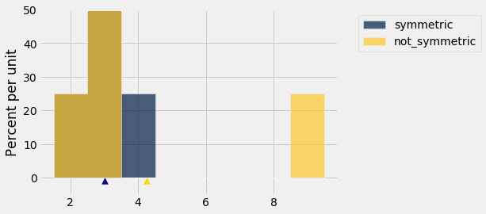

The blue histogram represents the original `symmetric` distribution. The gold histogram of `not_symmetric` starts out the same as the blue at the left end, but its rightmost bar has slid over to the value 9. The brown part is where the two histograms overlap.

The median and mean of the blue distribution are both equal to 3. The median of the gold distribution is also equal to 3, though the right half is distributed differently from the left. 

But the mean of the gold distribution is not 3: the gold histogram would not balance at 3. The balance point has shifted to the right, to 4.25.

In the gold distribution, 3 out of 4 entries (75%) are below average. The student with a below average score can therefore take heart. He or she might be in the majority of the class.

In general, **if the histogram has a tail on one side (the formal term is "skewed"), then the mean is pulled away from the median in the direction of the tail.**

#### Example ###
The table `sf2015` contains salary and benefits data for San Francisco City employees in 2015. As before, we will restrict our analysis to those who had the equivalent of at least half-time employment for the year.

```python
sf2015 = Table.read_table(path_data + 'san_francisco_2015.csv').where('Salaries', are.above(10000))
```

As we saw earlier, the highest compensation was above \$600,000 but the vast majority of employees had compensations below \$300,000.

```python
sf2015.select('Total Compensation').hist(bins = np.arange(10000, 700000, 25000))
```

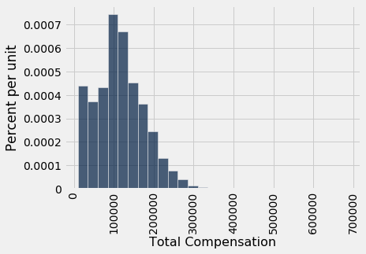

This histogram is skewed to the right; it has a right-hand tail. 

The mean gets pulled away from the median in the direction of the tail. So we expect the mean compensation to be larger than the median, and that is indeed the case.

```python
compensation = sf2015.column('Total Compensation')
percentile(50, compensation)
```

*Output:*

```text
110305.79
```

```python
np.mean(compensation)
```

*Output:*

```text
114725.98411824222
```

Distributions of incomes of large populations tend to be right skewed. When the bulk of a population has middle to low incomes, but a very small proportion has very high incomes, the histogram has a long, thin tail to the right. 

The mean income is affected by this tail: the farther the tail stretches to the right, the larger the mean becomes. But the median is not affected by values at the extremes of the distribution. That is why economists often summarize income distributions by the median instead of the mean.

## 14.2 Variability

The mean tells us where a histogram balances. But in almost every histogram we have seen, the values spread out on both sides of the mean. How far from the mean can they be? To answer this question, we will develop a measure of variability about the mean.

We will start by describing how to calculate the measure. Then we will see why it is a good measure to calculate.

```python
from datascience import *
%matplotlib inline
path_data = '../../../assets/data/'
import matplotlib.pyplot as plots
plots.style.use('fivethirtyeight')
import numpy as np
```

### The Rough Size of Deviations from Average
For simplicity, we will begin our calculations in the context of a simple array `any_numbers` consisting of just four values. As you will see, our method will extend easily to any other array of values.

```python
any_numbers = make_array(1, 2, 2, 10)
```

The goal is to measure roughly how far off the numbers are from their average. To do this, we first need the average:

```python
# Step 1. The average.

mean = np.mean(any_numbers)
mean
```

*Output:*

```text
3.75
```

Next, let's find out how far each value is from the mean. These are called the *deviations from the average*. A "deviation from average" is just a value minus the average. The table `calculation_steps` displays the results.

```python
# Step 2. The deviations from average.

deviations = any_numbers - mean
calculation_steps = Table().with_columns(
        'Value', any_numbers,
        'Deviation from Average', deviations
        )
calculation_steps
```

*Output:*

| Value | Deviation from Average |
| --- | --- |
| 1 | -2.75 |
| 2 | -1.75 |
| 2 | -1.75 |
| 10 | 6.25 |

Some of the deviations are negative; those correspond to values that are below average. Positive deviations correspond to above-average values.

To calculate roughly how big the deviations are, it is natural to compute the mean of the deviations. But something interesting happens when all the deviations are added together:

```python
sum(deviations)
```

*Output:*

```text
0.0
```

The positive deviations exactly cancel out the negative ones. This is true of all lists of numbers, no matter what the histogram of the list looks like: **the sum of the deviations from average is zero.** 

Since the sum of the deviations is 0, the mean of the deviations will be 0 as well:

```python
np.mean(deviations)
```

*Output:*

```text
0.0
```

Because of this, the mean of the deviations is not a useful measure of the size of the deviations. What we really want to know is roughly how big the deviations are, regardless of whether they are positive or negative. So we need a way to eliminate the signs of the deviations.

There are two time-honored ways of losing signs: the absolute value, and the square. It turns out that taking the square constructs a measure with extremely powerful properties, some of which we will study in this course.

So let's eliminate the signs by squaring all the deviations. Then we will take the mean of the squares:

```python
# Step 3. The squared deviations from average

squared_deviations = deviations ** 2
calculation_steps = calculation_steps.with_column(
   'Squared Deviations from Average', squared_deviations
    )
calculation_steps
```

*Output:*

| Value | Deviation from Average | Squared Deviations from Average |
| --- | --- | --- |
| 1 | -2.75 | 7.5625 |
| 2 | -1.75 | 3.0625 |
| 2 | -1.75 | 3.0625 |
| 10 | 6.25 | 39.0625 |

```python
# Step 4. Variance = the mean squared deviation from average

variance = np.mean(squared_deviations)
variance
```

*Output:*

```text
13.1875
```

**Variance:** The mean squared deviation calculated above is called the *variance* of the values. 

While the variance does give us an idea of spread, it is not on the same scale as the original variable as its units are the square of the original. This makes interpretation very difficult. 

So we return to the original scale by taking the positive square root of the variance:

```python
# Step 5.
# Standard Deviation:    root mean squared deviation from average
# Steps of calculation:   5    4      3       2             1

sd = variance ** 0.5
sd
```

*Output:*

```text
3.6314597615834874
```

### Standard Deviation

The quantity that we have just computed is called the *standard deviation* of the list, and is abbreviated as SD. It measures roughly how far the numbers on the list are from their average.

**Definition.** The SD of a list is defined as the *root mean square of deviations from average*. That's a mouthful. But read it from right to left and you have the sequence of steps in the calculation.

**Computation.** The five steps described above result in the SD. You can also use the function ``np.std`` to compute the SD of values in an array:

```python
np.std(any_numbers)
```

*Output:*

```text
3.6314597615834874
```

### Working with the SD

To see what we can learn from the SD, let's move to a more interesting dataset than `any_numbers`. The table `nba13` contains data on the players in the National Basketball Association (NBA) in 2013. For each player, the table records the position at which the player usually played, his height in inches, his weight in pounds, and his age in years.

```python
nba13 = Table.read_table(path_data + 'nba2013.csv')
nba13
```

*Output:*

| Name | Position | Height | Weight | Age in 2013 |
| --- | --- | --- | --- | --- |
| DeQuan Jones | Guard | 80 | 221 | 23 |
| Darius Miller | Guard | 80 | 235 | 23 |
| Trevor Ariza | Guard | 80 | 210 | 28 |
| James Jones | Guard | 80 | 215 | 32 |
| Wesley Johnson | Guard | 79 | 215 | 26 |
| Klay Thompson | Guard | 79 | 205 | 23 |
| Thabo Sefolosha | Guard | 79 | 215 | 29 |
| Chase Budinger | Guard | 79 | 218 | 25 |
| Kevin Martin | Guard | 79 | 185 | 30 |
| Evan Fournier | Guard | 79 | 206 | 20 |

Here is a histogram of the players' heights.

```python
nba13.select('Height').hist(bins=np.arange(68, 88, 1))
```

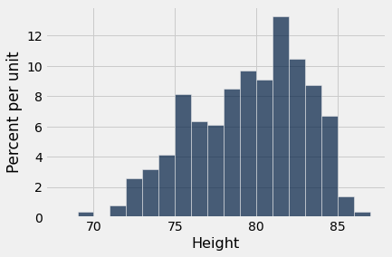

It is no surprise that NBA players are tall! Their average height is just over 79 inches (6'7"), about 10 inches taller than the average height of men in the United States.

```python
mean_height = np.mean(nba13.column('Height'))
mean_height
```

*Output:*

```text
79.06534653465347
```

About how far off are the players' heights from the average? This is measured by the SD of the heights, which is about 3.45 inches.

```python
sd_height = np.std(nba13.column('Height'))
sd_height
```

*Output:*

```text
3.4505971830275546
```

The towering center Hasheem Thabeet of the Oklahoma City Thunder was the tallest player at a height of 87 inches.

```python
nba13.sort('Height', descending=True).show(3)
```

*Output:*

| Name | Position | Height | Weight | Age in 2013 |
| --- | --- | --- | --- | --- |
| Hasheem Thabeet | Center | 87 | 263 | 26 |
| Roy Hibbert | Center | 86 | 278 | 26 |
| Alex Len | Center | 85 | 255 | 20 |

Thabeet was about 8 inches above the average height.

```python
87 - mean_height
```

*Output:*

```text
7.934653465346528
```

That's a deviation from average, and it is about 2.3 times the standard deviation:

```python
(87 - mean_height)/sd_height
```

*Output:*

```text
2.2995015194397923
```

In other words, the height of the tallest player was about 2.3 SDs above average.

At 69 inches tall, Isaiah Thomas was one of the two shortest NBA players in 2013. His height was about 2.9 SDs below average.

```python
nba13.sort('Height').show(3)
```

*Output:*

| Name | Position | Height | Weight | Age in 2013 |
| --- | --- | --- | --- | --- |
| Isaiah Thomas | Guard | 69 | 185 | 24 |
| Nate Robinson | Guard | 69 | 180 | 29 |
| John Lucas III | Guard | 71 | 157 | 30 |

```python
(69 - mean_height)/sd_height
```

*Output:*

```text
-2.9169868288775844
```

What we have observed is that the tallest and shortest players were both just a few SDs away from the average height. This is an example of why the SD is a useful measure of spread. No matter what the shape of the histogram, the average and the SD together tell you a lot about where the histogram is situated on the number line.

### First main reason for measuring spread by the SD

**Informal statement.** In all numerical data sets, the bulk of the entries are within the range "average $\pm$ a few SDs".

For now, resist the desire to know exactly what fuzzy words like "bulk" and "few" mean. We wil make them precise later in this section. Let's just examine the statement in the context of some more examples.

We have already seen that *all* of the heights of the NBA players were in the range "average $\pm$ 3 SDs". 

What about the ages? Here is a histogram of the distribution, along with the mean and SD of the ages.

```python
nba13.select('Age in 2013').hist(bins=np.arange(15, 45, 1))
```

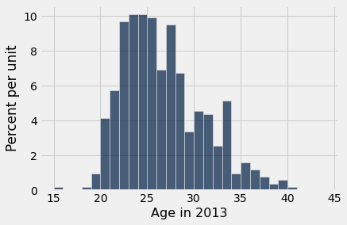

```python
ages = nba13.column('Age in 2013')
mean_age = np.mean(ages)
sd_age = np.std(ages)
mean_age, sd_age
```

*Output:*

```text
(26.19009900990099, 4.321200441720307)
```

The average age was just over 26 years, and the SD was about 4.3 years.

How far off were the ages from the average? Just as we did with the heights, let's look at an example.

Juwan Howard was the oldest player, at 40.

```python
nba13.sort('Age in 2013', descending=True).show(3)
```

*Output:*

| Name | Position | Height | Weight | Age in 2013 |
| --- | --- | --- | --- | --- |
| Juwan Howard | Forward | 81 | 250 | 40 |
| Steve Nash | Guard | 75 | 178 | 39 |
| Derek Fisher | Guard | 73 | 210 | 39 |

Howard's age was about 3.2 SDs above average.

```python
(40 - mean_age)/sd_age
```

*Output:*

```text
3.1958482778922357
```

What we have observed for the heights and ages is true in great generality. For *all* lists, the bulk of the entries are no more than 2 or 3 SDs away from the average.

### Chebychev's Bounds
The Russian mathematician [Pafnuty Chebychev](https://en.wikipedia.org/wiki/Pafnuty_Chebyshev) (1821-1894) proved a result that makes our rough statements precise.

**For all lists, and all numbers $z$, the proportion of entries that are in the range
"average $\pm z$ SDs" is at least $1 - \frac{1}{z^2}$.**

It is important to note that the result gives a bound, not an exact value or an approximation.

What makes the result powerful is that it is true for all lists – all distributions, no matter how irregular. 

Specifically, it says that for every list:

- the proportion in the range "average $\pm$ 2 SDs" is **at least 1 - 1/4 = 0.75**

- the proportion in the range "average $\pm$ 3 SDs" is **at least 1 - 1/9 $\approx$ 0.89**

- the proportion in the range "average $\pm$ 4.5 SDs" is **at least 1 - 1/$\boldsymbol{4.5^2}$ $\approx$ 0.95**

As we noted above, Chebychev's result gives a lower bound, not an exact answer or an approximation. For example, the percent of entries in the range "average $\pm ~2$ SDs" might be quite a bit larger than 75%. But it cannot be smaller.

### Standard units

In the calculations above, the quantity $z$ measures *standard units*, the number of standard deviations above average.

Some values of standard units are negative, corresponding to original values that are below average. Other values of standard units are positive. But no matter what the distribution of the list looks like, Chebychev's bounds imply that standard units will typically be in the (-5, 5) range.

To convert a value to standard units, first find how far it is from average, and then compare that deviation with the standard deviation.

$$
z ~=~ \frac{\mbox{value }-\mbox{ average}}{\mbox{SD}}
$$

As we will see, standard units are frequently used in data analysis. So it is useful to define a function that converts an array of numbers to standard units.

```python
def standard_units(numbers_array):
    "Convert any array of numbers to standard units."
    return (numbers_array - np.mean(numbers_array))/np.std(numbers_array)
```

### Example
As we saw in an earlier section, the table `united` contains a column `Delay` consisting of the departure delay times, in minutes, of over thousands of United Airlines flights in the summer of 2015. We will create a new column called `Delay (Standard Units)` by applying the function `standard_units` to the column of delay times. This allows us to see all the delay times in minutes as well as their corresponding values in standard units.

```python
united = Table.read_table(path_data + 'united_summer2015.csv')
united = united.with_column(
    'Delay (Standard Units)', standard_units(united.column('Delay'))
)
united
```

*Output:*

| Date | Flight Number | Destination | Delay | Delay (Standard Units) |
| --- | --- | --- | --- | --- |
| 6/1/15 | 73 | HNL | 257 | 6.08766 |
| 6/1/15 | 217 | EWR | 28 | 0.287279 |
| 6/1/15 | 237 | STL | -3 | -0.497924 |
| 6/1/15 | 250 | SAN | 0 | -0.421937 |
| 6/1/15 | 267 | PHL | 64 | 1.19913 |
| 6/1/15 | 273 | SEA | -6 | -0.573912 |
| 6/1/15 | 278 | SEA | -8 | -0.62457 |
| 6/1/15 | 292 | EWR | 12 | -0.117987 |
| 6/1/15 | 300 | HNL | 20 | 0.0846461 |
| 6/1/15 | 317 | IND | -10 | -0.675228 |

The standard units that we can see are consistent with what we expect based on Chebychev's bounds. Most are of quite small size; only one is above 6.

But something rather alarming happens when we sort the delay times from highest to lowest. The standard units that we can see are extremely high!

```python
united.sort('Delay', descending=True)
```

*Output:*

| Date | Flight Number | Destination | Delay | Delay (Standard Units) |
| --- | --- | --- | --- | --- |
| 6/21/15 | 1964 | SEA | 580 | 14.269 |
| 6/22/15 | 300 | HNL | 537 | 13.1798 |
| 6/21/15 | 1149 | IAD | 508 | 12.4453 |
| 6/20/15 | 353 | ORD | 505 | 12.3693 |
| 8/23/15 | 1589 | ORD | 458 | 11.1788 |
| 7/23/15 | 1960 | LAX | 438 | 10.6722 |
| 6/23/15 | 1606 | ORD | 430 | 10.4696 |
| 6/4/15 | 1743 | LAX | 408 | 9.91236 |
| 6/17/15 | 1122 | HNL | 405 | 9.83637 |
| 7/27/15 | 572 | ORD | 385 | 9.32979 |

What this shows is that it is possible for data to be many SDs above average (and for flights to be delayed by almost 10 hours). The highest value of delay is more than 14 in standard units. 

However, the proportion of these extreme values is small, and Chebychev's bounds still hold true. For example, let us calculate the percent of delay times that are in the range "average $\pm$ 3 SDs". This is the same as the percent of times for which the standard units are in the range (-3, 3). That is about 98%, as computed below, consistent with Chebychev's bound of "at least 89%".

```python
within_3_sd = united.where('Delay (Standard Units)', are.between(-3, 3))
within_3_sd.num_rows/united.num_rows
```

*Output:*

```text
0.9790235081374322
```

The histogram of delay times is shown below, with the horizontal axis in standard units. By the table above, the right hand tail continues all the way out to $z=14.27$ standard units (580 minutes). The area of the histogram outside the range $z=-3$ to $z=3$ is about 2%, put together in tiny little bits that are mostly invisible in the histogram.

```python
united.hist('Delay (Standard Units)', bins=np.arange(-5, 15.5, 0.5))
plots.xticks(np.arange(-6, 17, 3));
```

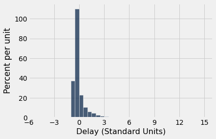

## 14.3 The SD and the Normal Curve

We know that the mean is the balance point of the histogram. Unlike the mean, the SD is usually not easy to identify by looking at the histogram. 

However, there is one shape of distribution for which the SD is almost as clearly identifiable as the mean. That is the bell-shaped disribution. This section examines that shape, as it appears frequently in probability histograms and also in some histograms of data.

```python
from datascience import *
%matplotlib inline
path_data = '../../../assets/data/'
import matplotlib.pyplot as plots
plots.style.use('fivethirtyeight')
import math
import numpy as np
```

### A Roughly Bell-Shaped Histogram of Data
Let us look at the distribution of heights of mothers in our familiar sample of 1,174 mother-newborn pairs. The mothers' heights have a mean of 64 inches and an SD of 2.5 inches. Unlike the heights of the basketball players, the mothers' heights are distributed fairly symmetrically about the mean in a bell-shaped curve.

```python
baby = Table.read_table(path_data + 'baby.csv')
```

```python
heights = baby.column('Maternal Height')
mean_height = np.round(np.mean(heights), 1)
mean_height
```

*Output:*

```text
64.0
```

```python
sd_height = np.round(np.std(heights), 1)
sd_height
```

*Output:*

```text
2.5
```

```python
baby.hist('Maternal Height', bins=np.arange(55.5, 72.5, 1), unit='inch')
positions = np.arange(-3, 3.1, 1)*sd_height + mean_height
plots.xticks(positions);
```

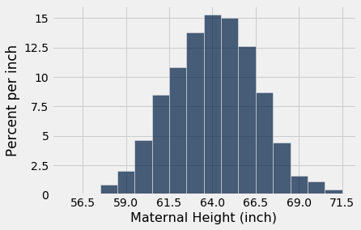

The last two lines of code in the cell above change the labeling of the horizontal axis. Now, the labels correspond to "average $\pm$ $z$ SDs" for $z = 0, \pm 1, \pm 2$, and $\pm 3$. Because of the shape of the distribution, the "center" has an unambiguous meaning and is clearly visible at 64.

### How to Spot the SD on a Bell Shaped Curve

To see how the SD is related to the curve, start at the top of the curve and look towards the right. Notice that there is a place where the curve changes from looking like an "upside-down cup" to a "right-way-up cup"; formally, the curve has a point of inflection. That point is one SD above average. It is the point $z=1$, which is "average plus 1 SD" = 66.5 inches.

Symmetrically on the left-hand side of the mean, the point of inflection is at $z=-1$, that is, "average minus 1 SD" = 61.5 inches. 

In general, **for bell-shaped distributions, the SD is the distance between the mean and the points of inflection on either side.**

### The standard normal curve

All the bell-shaped histograms that we have seen look essentially the same apart from the labels on the axes. Indeed, there is really just one basic curve from which all of these curves can be drawn just by relabeling the axes appropriately. 

To draw that basic curve, we will use the units into which we can convert every list: standard units. The resulting curve is therefore called the *standard normal curve*.

The standard normal curve has an impressive equation. But for now, it is best to think of it as a smoothed outline of a histogram of a variable that has been measured in standard units and has a bell-shaped distribution.

$$
\phi(z) = {\frac{1}{\sqrt{2 \pi}}} e^{-\frac{1}{2}z^2}, ~~ -\infty < z < \infty
$$

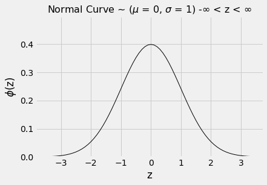

As always when you examine a new histogram, start by looking at the horizontal axis. On the horizontal axis of the standard normal curve, the values are standard units. 

Here are some properties of the curve. Some are apparent by observation, and others require a considerable amount of mathematics to establish.

- The total area under the curve is 1. So you can think of it as a histogram drawn to the density scale.

- The curve is symmetric about 0. So if a variable has this distribution, its mean and median are both 0.

- The points of inflection of the curve are at -1 and +1. 

- If a variable has this distribution, its SD is 1. The normal curve is one of the very few distributions that has an SD so clearly identifiable on the histogram.

Since we are thinking of the curve as a smoothed histogram, we will want to represent proportions of the total amount of data by areas under the curve. 

Areas under smooth curves are often found by calculus, using a method called integration. It is a fact of mathematics, however, that the standard normal curve cannot be integrated in any of the usual ways of calculus. 

Therefore, areas under the curve have to be approximated. That is why almost all statistics textbooks carry tables of areas under the normal curve. It is also why all statistical systems, including a module of Python, include methods that provide excellent approximations to those areas.

```python
from scipy import stats
```

### The standard normal "cdf"

The fundamental function for finding areas under the normal curve is `stats.norm.cdf`. It takes a numerical argument and returns all the area under the curve to the left of that number. Formally, it is called the "cumulative distribution function" of the standard normal curve. That rather unwieldy mouthful is abbreviated as cdf.

Let us use this function to find the area to the left of $z=1$ under the standard normal curve.

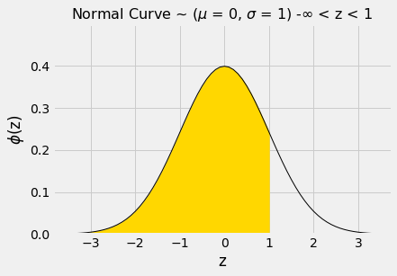

The numerical value of the shaded area can be found by calling `stats.norm.cdf`.

```python
stats.norm.cdf(1)
```

*Output:*

```text
0.8413447460685429
```

That's about 84%. We can now use the symmetry of the curve and the fact that the total area under the curve is 1 to find other areas. 

The area to the right of $z=1$ is about 100% - 84% = 16%.

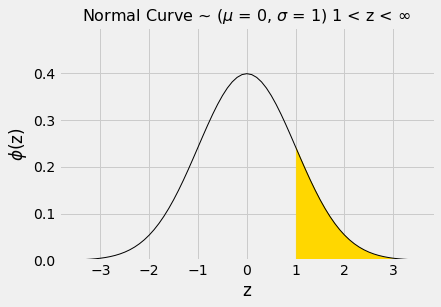

```python
1 - stats.norm.cdf(1)
```

*Output:*

```text
0.15865525393145707
```

The area between $z=-1$ and $z=1$ can be computed in several different ways.  It is the gold area under the curve below.

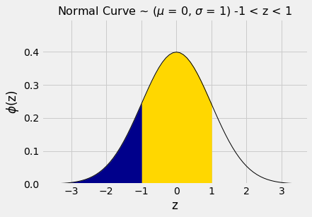

For example, we could calculate the area as "100% - two equal tails", which works out to roughly 100% - 2x16% = 68%.

Or we could note that the area between $z=1$ and $z=-1$ is equal to all the area to the left of $z=1$, minus all the area to the left of $z=-1$.

```python
stats.norm.cdf(1) - stats.norm.cdf(-1)
```

*Output:*

```text
0.6826894921370859
```

By a similar calculation, we see that the area between $-2$ and 2 is about 95%.

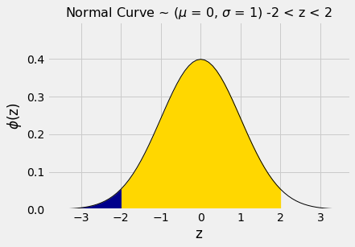

```python
stats.norm.cdf(2) - stats.norm.cdf(-2)
```

*Output:*

```text
0.9544997361036416
```

In other words, if a histogram is roughly bell shaped, the proportion of data in the range "average $\pm$ 2 SDs" is about 95%. 

That is quite a bit more than Chebychev's lower bound of 75%. Chebychev's bound is weaker because it has to work for all distributions. If we know that a distribution is normal, we have good approximations to the proportions, not just bounds.

The table below compares what we know about all distributions and about normal distributions. Notice that when $z=1$, Chebychev's bound is correct but not illuminating.

| Percent in Range    | All Distributions: Bound   | Normal Distribution: Approximation |
| :---------------    | :------------------------  | :--------------------------------- |
| average $\pm$ 1 SD  | at least 0%                | about 68%                          |
| average $\pm$ 2 SDs | at least 75%               | about 95%                          |
| average $\pm$ 3 SDs | at least 88.888...%        | about 99.73%                       |

## 14.4 The Central Limit Theorem

Very few of the data histograms that we have seen in this course have been bell shaped. When we have come across a bell shaped distribution, it has almost invariably been an empirical histogram of a statistic based on a random sample.

The examples below show two very different situations in which an approximate bell shape appears in such histograms.

```python
from datascience import *
%matplotlib inline
path_data = '../../../assets/data/'
import matplotlib.pyplot as plots
plots.style.use('fivethirtyeight')
import math
import numpy as np
from scipy import stats
```

### Net Gain in Roulette
In an earlier section, the bell appeared as the rough shape of the total amount of money we would make if we placed the same bet repeatedly on different spins of a roulette wheel.

```python
wheel
```

*Output:*

| Pocket | Color |
| --- | --- |
| 0 | green |
| 00 | green |
| 1 | red |
| 2 | black |
| 3 | red |
| 4 | black |
| 5 | red |
| 6 | black |
| 7 | red |
| 8 | black |

Recall that the bet on red pays even money, 1 to 1. We defined the function `red_winnings` that returns the net winnings on one \$1 bet on red. Specifically, the function takes a color as its argument and returns 1 if the color is red. For all other colors it returns -1.

```python
def red_winnings(color):
    if color == 'red':
        return 1
    else:
        return -1
```

The table `red` shows each pocket's winnings on red.

```python
red = wheel.with_column(
    'Winnings: Red', wheel.apply(red_winnings, 'Color')
    )
red
```

*Output:*

| Pocket | Color | Winnings: Red |
| --- | --- | --- |
| 0 | green | -1 |
| 00 | green | -1 |
| 1 | red | 1 |
| 2 | black | -1 |
| 3 | red | 1 |
| 4 | black | -1 |
| 5 | red | 1 |
| 6 | black | -1 |
| 7 | red | 1 |
| 8 | black | -1 |

Your net gain on one bet is one random draw from the `Winnings: Red` column. There is an 18/38 chance making \$1, and a 20/38 chance of making -\$1. This probability distribution is shown in the histogram below.

```python
red.select('Winnings: Red').hist(bins=np.arange(-1.5, 1.6, 1))
```

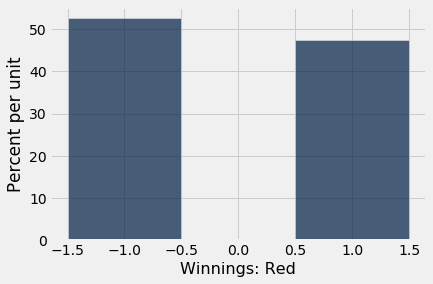

Now suppose you bet many times on red. Your net winnings will be the sum of many draws made at random with replacement from the distribution above.

It will take a bit of math to list all the possible values of your net winnings along with all of their chances. We won't do that; instead, we will approximate the probability distribution by simulation, as we have done all along in this course. 

The code below simulates your net gain if you bet \$1 on red on 400 different spins of the roulette wheel.

```python
num_bets = 400
repetitions = 10000

net_gain_red = make_array()

for i in np.arange(repetitions):
    spins = red.sample(num_bets)
    new_net_gain_red = spins.column('Winnings: Red').sum()
    net_gain_red = np.append(net_gain_red, new_net_gain_red)


results = Table().with_column(
    'Net Gain on Red', net_gain_red
    )
```

```python
results.hist(bins=np.arange(-80, 50, 6))
```

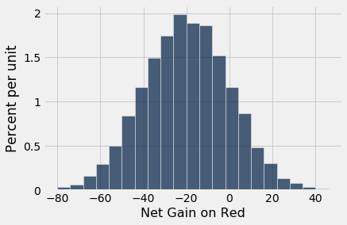

That's a roughly bell shaped histogram, even though the distribution we are drawing from is nowhere near bell shaped.

**Center.** The distribution is centered near -20 dollars, roughly. To see why, note that your winnings will be \$1 on about 18/38 of the bets, and -$1 on the remaining 20/38. So your average winnings per dollar bet will be roughly -5.26 cents:

```python
average_per_bet = 1*(18/38) + (-1)*(20/38)
average_per_bet
```

*Output:*

```text
-0.05263157894736842
```

So in 400 bets you expect that your net gain will be about -\$21:

```python
400 * average_per_bet
```

*Output:*

```text
-21.052631578947366
```

For confirmation, we can compute the mean of the 10,000 simulated net gains:

```python
np.mean(results.column(0))
```

*Output:*

```text
-20.9586
```

**Spread.** Run your eye along the curve starting at the center and notice that the point of inflection is near 0. On a bell shaped curve, the SD is the distance from the center to a point of inflection. The center is roughly -\$20, which means that the SD of the distribution is around \$20.

In the next section we will see where the \$20 comes from. For now, let's confirm our observation by simply calculating the SD of the 10,000 simulated net gains:

```python
np.std(results.column(0))
```

*Output:*

```text
20.029115957525438
```

**Summary.** The net gain in 400 bets is the sum of the 400 amounts won on each individual bet. The probability distribution of that sum is approximately normal, with an average and an SD that we can approximate.

### Average Flight Delay
The table `united` contains data on departure delays of 13,825 United Airlines domestic flights out of San Francisco airport in the summer of 2015. As we have seen before, the distribution of delays has a long right-hand tail.

```python
united = Table.read_table(path_data + 'united_summer2015.csv')
```

```python
united.select('Delay').hist(bins=np.arange(-20, 300, 10))
```

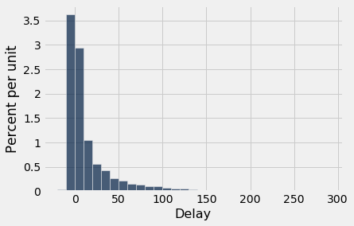

The mean delay was about 16.6 minutes and the SD was about 39.5 minutes. Notice how large the SD is, compared to the mean. Those large deviations on the right have an effect, even though they are a very small proportion of the data.

```python
mean_delay = np.mean(united.column('Delay'))
sd_delay = np.std(united.column('Delay'))

mean_delay, sd_delay
```

*Output:*

```text
(16.658155515370705, 39.480199851609314)
```

Now suppose we sampled 400 delays at random with replacement. You could sample without replacement if you like, but the results would be very similar to with-replacement sampling. If you sample a few hundred out of 13,825 without replacement, you hardly change the population each time you pull out a value.

In the sample, what could the average delay be? We expect it to be around 16 or 17, because that's the population average; but it is likely to be somewhat off. Let's see what we get by sampling. We'll work with the table `delay` that only contains the column of delays.

```python
delay = united.select('Delay')
```

```python
np.mean(delay.sample(400).column('Delay'))
```

*Output:*

```text
15.59
```

The sample average varies according to how the sample comes out, so we will simulate the sampling process repeatedly and draw the empirical histogram of the sample average. That will be an approximation to the probability histogram of the sample average.

```python
sample_size = 400
repetitions = 10000

means = make_array()

for i in np.arange(repetitions):
    sample = delay.sample(sample_size)
    new_mean = np.mean(sample.column('Delay'))
    means = np.append(means, new_mean)

results = Table().with_column(
    'Sample Mean', means
)
```

```python
results.hist(bins=np.arange(10, 25, 0.5))
```

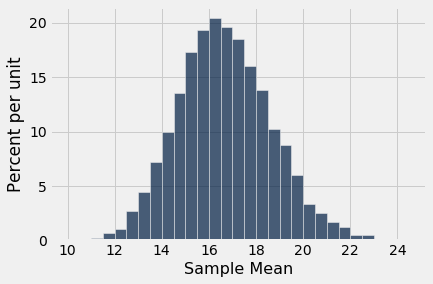

Once again, we see a rough bell shape, even though we are drawing from a very skewed distribution. The bell is centered somewhere between 16 ad 17, as we expect.

### Central Limit Theorem

The reason why the bell shape appears in such settings is a remarkable result of probability theory called the **Central Limit Theorem**. 

**The Central Limit Theorem says that the probability distribution of the sum or average of a large random sample drawn with replacement will be roughly normal, *regardless of the distribution of the population from which the sample is drawn*.**

As we noted when we were studying Chebychev's bounds, results that can be applied to random samples *regardless of the distribution of the population* are very powerful, because in data science we rarely know the distribution of the population.

The Central Limit Theorem makes it possible to make inferences with very little knowledge about the population, provided we have a large random sample. That is why it is central to the field of statistical inference.

### Proportion of Purple Flowers
Recall Mendel's probability model for the colors of the flowers of a species of pea plant. The model says that the flower colors of the plants are like draws made at random with replacement from {Purple, Purple, Purple, White}.

In a large sample of plants, about what proportion will have purple flowers? We would expect the answer to be about 0.75, the proportion purple in the model. And, because proportions are means, the Central Limit Theorem says that the distribution of the sample proportion of purple plants is roughly normal.

We can confirm this by simulation. Let's simulate the proportion of purple-flowered plants in a sample of 200 plants.

```python
colors = make_array('Purple', 'Purple', 'Purple', 'White')

model = Table().with_column('Color', colors)

model
```

*Output:*

| Color |
| --- |
| Purple |
| Purple |
| Purple |
| White |

```python
props = make_array()

num_plants = 200
repetitions = 10000

for i in np.arange(repetitions):
    sample = model.sample(num_plants)
    new_prop = np.count_nonzero(sample.column('Color') == 'Purple')/num_plants
    props = np.append(props, new_prop)
    
results = Table().with_column('Sample Proportion: 200', props)
```

```python
results.hist(bins=np.arange(0.65, 0.85, 0.01))
```

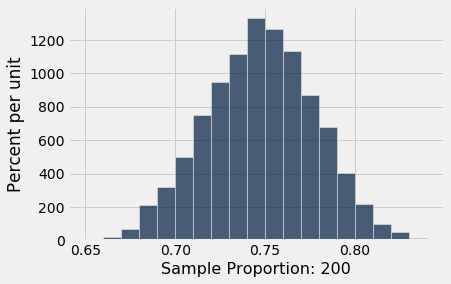

There's that normal curve again, as predicted by the Central Limit Theorem, centered at around 0.75 just as you would expect.

How would this distribution change if we increased the sample size? Let's run the code again with a sample size of 800, and collect the results of simulations in the same table in which we collected simulations based on a sample size of 200. We will keep the number of `repetitions` the same as before so that the two columns have the same length.

```python
props2 = make_array()

num_plants = 800

for i in np.arange(repetitions):
    sample = model.sample(num_plants)
    new_prop = np.count_nonzero(sample.column('Color') == 'Purple')/num_plants
    props2 = np.append(props2, new_prop)
    
results = results.with_column('Sample Proportion: 800', props2)
```

```python
results.hist(bins=np.arange(0.65, 0.85, 0.01))
```

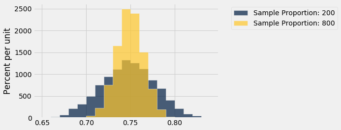

Both distributions are approximately normal but one is narrower than the other. The proportions based on a sample size of 800 are more tightly clustered around 0.75 than those from a sample size of 200. Increasing the sample size has decreased the variability in the sample proportion.

This should not be surprising.  We have leaned many times on the intuition that a larger sample size generally reduces the variability of a statistic.  However, in the case of a sample average, we can *quantify* the relationship between sample size and variability.

Exactly how does the sample size affect the variability of a sample average or proportion? That is the question we will examine in the next section.

## 14.5 The Variability of the Sample Mean

By the Central Limit Theorem, the probability distribution of the mean of a large random sample is roughly normal. The bell curve is centered at the population mean. Some of the sample means are higher, and some lower, but the deviations from the population mean are roughly symmetric on either side, as we have seen repeatedly. Formally, probability theory shows that the sample mean is an *unbiased* estimate of the population mean.

In our simulations, we also noticed that the means of larger samples tend to be more tightly clustered around the population mean than means of smaller samples. In this section, we will quantify the variability of the sample mean and develop a relation between the variability and the sample size.

```python
from datascience import *
import numpy as np
path_data = '../../../assets/data/'
%matplotlib inline
import matplotlib.pyplot as plots
plots.style.use('fivethirtyeight')
```

Let's start with our table of flight delays. The mean delay is about 16.7 minutes, and the distribution of delays is skewed to the right.

```python
united = Table.read_table(path_data + 'united_summer2015.csv')
delay = united.select('Delay')
```

```python
pop_mean = np.mean(delay.column('Delay'))
pop_mean
```

*Output:*

```text
16.658155515370705
```

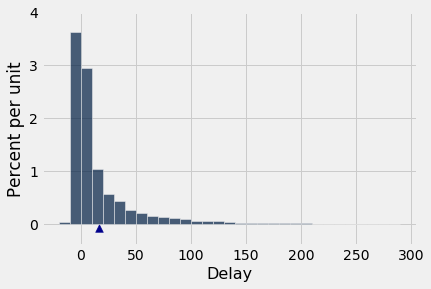

Now let's take random samples and look at the probability distribution of the sample mean. As usual, we will use simulation to get an empirical approximation to this distribution.

We will define a function `simulate_sample_mean` to do this, because we are going to vary the sample size later. The arguments are the name of the table, the label of the column containing the variable, the sample size, and the number of simulations.

```python
"""Empirical distribution of random sample means"""

def simulate_sample_mean(table, label, sample_size, repetitions):
    
    means = make_array()

    for i in range(repetitions):
        new_sample = table.sample(sample_size)
        new_sample_mean = np.mean(new_sample.column(label))
        means = np.append(means, new_sample_mean)

    sample_means = Table().with_column('Sample Means', means)
    
    # Display empirical histogram and print all relevant quantities
    sample_means.hist(bins=20)
    plots.xlabel('Sample Means')
    plots.title('Sample Size ' + str(sample_size))
    print("Sample size: ", sample_size)
    print("Population mean:", np.mean(table.column(label)))
    print("Average of sample means: ", np.mean(means))
    print("Population SD:", np.std(table.column(label)))
    print("SD of sample means:", np.std(means))
```

Let us simulate the mean of a random sample of 100 delays, then of 400 delays, and finally of 625 delays. We will perform 10,000 repetitions of each of these process. The `xlim` and `ylim` lines set the axes consistently in all the plots for ease of comparison. You can just ignore those two lines of code in each cell.

```python
simulate_sample_mean(delay, 'Delay', 100, 10000)
plots.xlim(5, 35)
plots.ylim(0, 0.25);
```

*Output (stdout):*

```text
Sample size:  100
Population mean: 16.658155515370705
Average of sample means:  16.672836
Population SD: 39.480199851609314
SD of sample means: 3.92467202924066
```

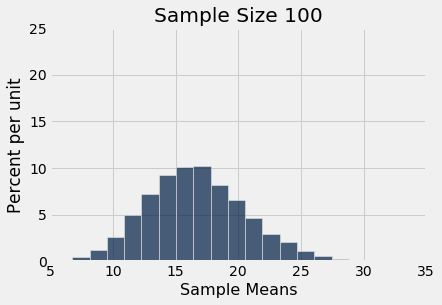

```python
simulate_sample_mean(delay, 'Delay', 400, 10000)
plots.xlim(5, 35)
plots.ylim(0, 0.25);
```

*Output (stdout):*

```text
Sample size:  400
Population mean: 16.658155515370705
Average of sample means:  16.678091499999997
Population SD: 39.480199851609314
SD of sample means: 1.9474592014668113
```

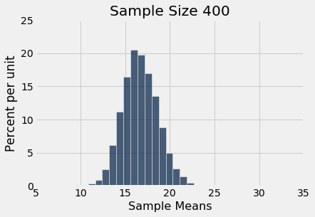

```python
simulate_sample_mean(delay, 'Delay', 625, 10000)
plots.xlim(5, 35)
plots.ylim(0, 0.25);
```

*Output (stdout):*

```text
Sample size:  625
Population mean: 16.658155515370705
Average of sample means:  16.649224
Population SD: 39.480199851609314
SD of sample means: 1.5883338034053167
```

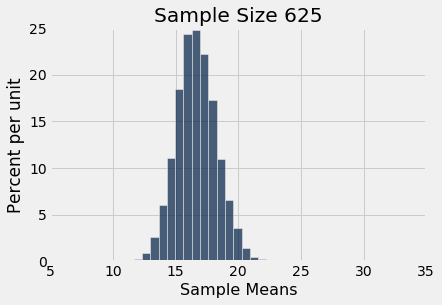

You can see the Central Limit Theorem in action – the histograms of the sample means are roughly normal, even though the histogram of the delays themselves is far from normal.

You can also see that each of the three histograms of the sample means is centered very close to the population mean. In each case, the "average of sample means" is very close to 16.66 minutes, the population mean. Both values are provided in the printout above each histogram. As expected, the sample mean is an unbiased estimate of the population mean.

### The SD of All the Sample Means

You can also see that the histograms get narrower, and hence taller, as the sample size increases. We have seen that before, but now we will pay closer attention to the measure of spread.

The SD of the population of all delays is about 40 minutes.

```python
pop_sd = np.std(delay.column('Delay'))
pop_sd
```

*Output:*

```text
39.480199851609314
```

Take a look at the SDs in the sample mean histograms above. In all three of them, the SD of the population of delays is about 40 minutes, because all the samples were taken from the same population.

Now look at the SD of all 10,000 sample means, when the sample size is 100. That SD is about one-tenth of the population SD. When the sample size is 400, the SD of all the sample means is about one-twentieth of the population SD. When the sample size is 625, the SD of the sample means is about one-twentyfifth of the population SD.

It seems like a good idea to compare the SD of the empirical distribution of the sample means to the quantity "population SD divided by the square root of the sample size."

Here are the numerical values. For each sample size in the first column, 10,000 random samples of that size were drawn, and the 10,000 sample means were calculated. The second column contains the SD of those 10,000 sample means. The third column contains the result of the calculation "population SD divided by the square root of the sample size."

The cell takes a while to run, as it's a large simulation. But you'll soon see that it's worth the wait.

```python
repetitions = 10000
sample_sizes = np.arange(25, 626, 25)

sd_means = make_array()

for n in sample_sizes:
    means = make_array()
    for i in np.arange(repetitions):
        means = np.append(means, np.mean(delay.sample(n).column('Delay')))
    sd_means = np.append(sd_means, np.std(means))

sd_comparison = Table().with_columns(
    'Sample Size n', sample_sizes,
    'SD of 10,000 Sample Means', sd_means,
    'pop_sd/sqrt(n)', pop_sd/np.sqrt(sample_sizes)
)
```

```python
sd_comparison
```

*Output:*

| Sample Size n | SD of 10,000 Sample Means | pop_sd/sqrt(n) |
| --- | --- | --- |
| 25 | 7.94482 | 7.89604 |
| 50 | 5.6131 | 5.58334 |
| 75 | 4.57417 | 4.55878 |
| 100 | 3.98687 | 3.94802 |
| 125 | 3.49769 | 3.53122 |
| 150 | 3.22776 | 3.22354 |
| 175 | 3.00675 | 2.98442 |
| 200 | 2.77764 | 2.79167 |
| 225 | 2.64268 | 2.63201 |
| 250 | 2.49447 | 2.49695 |

The values in the second and third columns are very close. If we plot each of those columns with the sample size on the horizontal axis, the two graphs are essentially indistinguishable.

```python
sd_comparison.plot('Sample Size n')
```

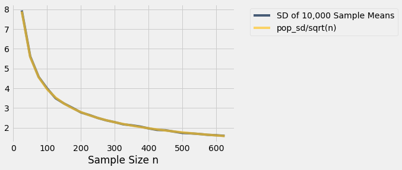

There really are two curves there. But they are so close to each other that it looks as though there is just one.

What we are seeing is an instance of a general result. Remember that the graph above is based on 10,000 replications for each sample size. But there are many more than 10,000 samples of each size. The probability distribution of the sample mean is based on the means of *all possible samples* of a fixed size.

**Fix a sample size.** If the samples are drawn at random with replacement from the population, then

$$
{\mbox{SD of all possible sample means}} ~=~
\frac{\mbox{Population SD}}{\sqrt{\mbox{sample size}}}
$$

This is the standard deviation of the averages of all the possible samples that could be drawn. **It measures roughly how far off the sample means are from the population mean.**

### The Central Limit Theorem for the Sample Mean
If you draw a large random sample with replacement from a population, then, regardless of the distribution of the population, the probability distribution of the sample mean is roughly normal, centered at the population mean, with an SD equal to the population SD divided by the square root of the sample size.

### The Accuracy of the Sample Mean
The SD of all possible sample means measures how variable the sample mean can be. As such, it is taken as a measure of the accuracy of the sample mean as an estimate of the population mean. The smaller the SD, the more accurate the estimate.

The formula shows that:
- The population size doesn't affect the accuracy of the sample mean. The population size doesn't appear anywhere in the formula.
- The population SD is a constant; it's the same for every sample drawn from the population. The sample size can be varied. Because the sample size appears in the denominator, the variability of the sample mean *decreases* as the sample size increases, and hence the accuracy increases.

### The Square Root Law
From the table of SD comparisons, you can see that the SD of the means of random samples of 25 flight delays is about 8 minutes. If you multiply the sample size by 4, you'll get samples of size 100. The SD of the means of all of those samples is about 4 minutes. That's smaller than 8 minutes, but it's not 4 times as small; it's only 2 times as small. That's because the sample size in the denominator has a square root over it. The sample size increased by a factor of 4, but the SD went down by a factor of $2 = \sqrt{4}$. In other words, the accuracy went up by a factor of $2 = \sqrt{4}$.

In general, when you multiply the sample size by a factor, the accuracy of the sample mean goes up by the square root of that factor.

So to increase accuracy by a factor of 10, you have to multiply sample size by a factor of 100. Accuracy doesn't come cheap!

## 14.6 Choosing a Sample Size

Candidate A is contesting an election. A polling organization wants to estimate the proportion of voters who will vote for her. Let's suppose that they plan to take a simple random sample of voters, though in reality their method of sampling would be more complex. How can they decide how large their sample should be, to get a desired level of accuracy?

We are now in a position to answer this question, after making a few assumptions:
- The population of voters is very large and that therefore we can just as well assume that the random sample will be drawn with replacement.
- The polling organization will make its estimate by constructing an approximate 95% confidence interval for the percent of voters who will vote for Candidate A.
- The desired level of accuracy is that the width of the interval should be no more than 1%. That's pretty accurate! For example, the confidence interval (33.2%, 34%) would be fine but (33.2%, 35%) would not.

We will work with the sample proportion of voters for Candidate A. Recall that a proportion is a mean, when the values in the population are only 0 (the type of individual you are not counting) or 1 (the type of individual you are counting).

```python
from datascience import *
import numpy as np
path_data = '../../../../data/'
%matplotlib inline
import matplotlib.pyplot as plots
plots.style.use('fivethirtyeight')
```

### Width of Confidence Interval
If we had a random sample, we could go about using the bootstrap to construct a confidence interval for the percent of voters for Candidate A. But we don't have a sample yet – we are trying to find out how big the sample has to be so that our confidence interval is as narrow as we want it to be.

In situations like this, it helps to see what theory predicts.

The Central Limit Theorem says that the probabilities for the sample proportion are roughly normally distributed, centered at the population proportion of 1's, with an SD equal to the SD of the population of 0's and 1's divided by the square root of the sample size.

So the confidence interval will still be the "middle 95%" of a normal distribution, even though we can't pick off the ends as the 2.5th and 97.5th percentiles of bootstrapped proportions. 

Is there another way to find how wide the interval would be? Yes, because we know that for normally distributed variables, the interval "center $\pm$ 2 SDs" contains 95% of the data.

The confidence interval will stretch for 2 SDs of the sample proportion, on either side of the center. So the width of the interval will be 4 SDs of the sample proportion.

We are willing to tolerate a width of 1% = 0.01. So, using the formula developed in the last section, 

$$
4 \times \frac{\mbox{SD of the 0-1 population}}{\sqrt{\mbox{sample size}}}
~ \le ~ 0.01
$$

So

$$
\sqrt{\mbox{sample size}} ~ \ge ~ 4 \times \frac{\mbox{SD of the 0-1 population}}{0.01}
$$

### The SD of a collection of 0's and 1's
If we knew the SD of the population, we'd be done. We could calculate the square root of the sample size, and then take the square to get the sample size. But we don't know the SD of the population. The population consists of 1 for each voter for Candidate A, and 0 for all other voters, and *we don't know what proportion of each kind there are.* That's what we're trying to estimate.

So are we stuck? No, because we can *bound* the SD of the population. Here are histograms of two such distributions, one for an equal proportion of 1's and 0's, and one with 90% 1's and 10% 0's. Which one has the bigger SD?

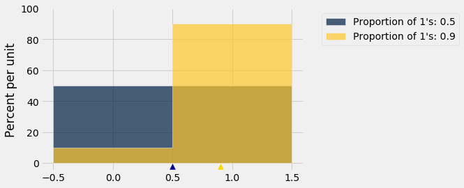

Remember that the possible values in the population are only 0 and 1.

The blue histogram (50% 1's and 50% 0's) has more spread than the gold. The mean is 0.5. Half the deviations from mean are equal to 0.5 and the other half equal to -0.5, so the SD is 0.5.

In the gold histogram, all of the area is being squished up around 1, leading to less spread. 90% of the deviations are small: 0.1. The other 10% are -0.9 which is large, but overall the spread is smaller than in the blue histogram.

The same observation would hold if we varied the proportion of 1's or let the proportion of 0's be larger than the proportion of 1's. Let's check this by calculating the SDs of populations of 10 elements that only consist of 0's and 1's, in varying proportions. The function `np.ones` is useful for this. It takes a positive integer as its argument and returns an array consisting of that many 1's.

```python
sd = make_array()
for i in np.arange(1, 10, 1):
    # Create an array of i 1's and (10-i) 0's
    population = np.append(np.ones(i), 1-np.ones(10-i))
    sd = np.append(sd, np.std(population))
    
zero_one_sds = Table().with_columns(
    "Population Proportion of 1's", np.arange(0.1, 1, 0.1),
    "Population SD", sd
)

zero_one_sds
```

*Output:*

| Population Proportion of 1's | Population SD |
| --- | --- |
| 0.1 | 0.3 |
| 0.2 | 0.4 |
| 0.3 | 0.458258 |
| 0.4 | 0.489898 |
| 0.5 | 0.5 |
| 0.6 | 0.489898 |
| 0.7 | 0.458258 |
| 0.8 | 0.4 |
| 0.9 | 0.3 |

Not surprisingly, the SD of a population with 10% 1's and 90% 0's is the same as that of a population with 90% 1's and 10% 0's. That's because you switch the bars of one histogram to get the other; there is no change in spread.

More importantly for our purposes, the SD increases as the proportion of 1's increases, until the proportion of 1's is 0.5; then it starts to decrease symmetrically.

```python
zero_one_sds.scatter("Population Proportion of 1's")
```

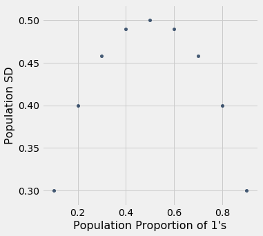

**Summary:** The SD of a population of 1's and 0's is at most 0.5. That's the value of the SD when 50% of the population is coded 1 and the other 50% are coded 0.

### The Sample Size
We know that 

$$
\sqrt{\mbox{sample size}} ~ \ge ~ 4 \times \frac{\mbox{SD of the 0-1 population}}{0.01}
$$

and that the SD of the 0-1 population is at most 0.5, regardless of the proportion of 1's in the population. So it is safe to take

$$
\sqrt{\mbox{sample size}} ~ \ge ~ 4 \times \frac{0.5}{0.01} ~=~ 200
$$

So the sample size should be at least $200^2 = 40,000$. That's an enormous sample! But that's what you need if you want to guarantee great accuracy with high confidence no matter what the population looks like.
