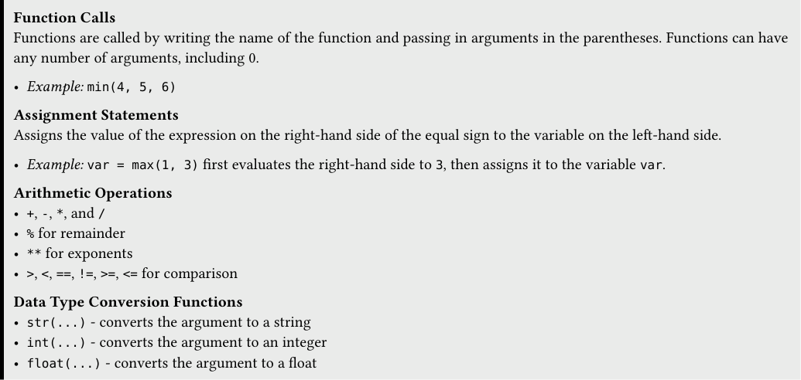
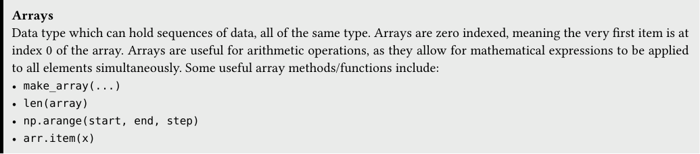
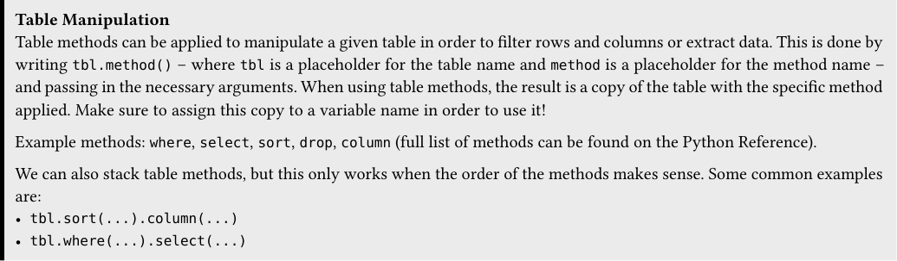
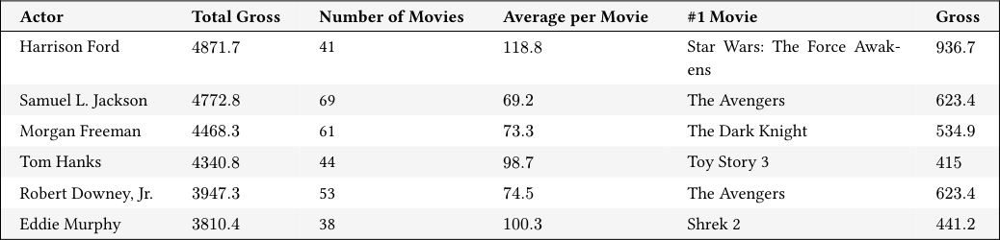

# Tutoring 01 Data C8 Spring 2026

## Page 1

## Expressions, Data Types & Arrays

Tutoring 01

Data C8: Foundations of Data Science UC Berkeley, Spring 2026

### 1. Expressions and Data Types

Function Calls Functions are called by writing the name of the function and passing in arguments in the parentheses. Functions can have any number of arguments, including 0.

- Example: min(4, 5, 6)

Assignment Statements Assigns the value of the expression on the right-hand side of the equal sign to the variable on the left-hand side.

- Example: var = max(1, 3) first evaluates the right-hand side to 3, then assigns it to the variable var.

Arithmetic Operations - +, -, *, and / - % for remainder - ** for exponents - >, <, ==, !=, >=, <= for comparison

Data Type Conversion Functions - str(...) - converts the argument to a string - int(...) - converts the argument to an integer - float(...) - converts the argument to a float

#### Practice Problems

#### (a) Evaluate the following lines of code. What would Python output?

#### i. str(8) + str(24)

#### ii. abs(1 - (4 ** 2))

#### iii. min(10 * 2, 10 - 3, 10 / 10)

#### iv. int('4') * 6

#### v. (7 % 3) > 1

- Assume the variable name eight has been assigned to the string '8'. Using only this string, any string methods, arithmetic,

and any type conversion functions (int, str, etc.), print the square of 88.

## Page 2

### 2. Arrays

Arrays Data type which can hold sequences of data, all of the same type. Arrays are zero indexed, meaning the very first item is at index 0 of the array. Arrays are useful for arithmetic operations, as they allow for mathematical expressions to be applied to all elements simultaneously. Some useful array methods/functions include: - make_array(...) - len(array) - np.arange(start, end, step) - arr.item(x)

#### Practice Problems

- Write a line of code that creates an array of the first 10 multiples of 3 (starting at 3). There may be more than one way to

achieve this.

- Assume shopping is an array of dollar amounts spent in a store (before tax) by 5 different customers at the Cal student store.

Write a line of code to answer the following questions.

#### i. What is the total amount spent by all five customers?

#### ii. What was the largest amount spent by any one customer?

#### iii. Assume tax is 10 percent on all items. How much did each customer spend after tax?

iv. What was the absolute difference between Person 1’s spending before tax, and Person 5’s spending after tax?

#### (c) Suppose we have an array of strings called str_arr.

#### i. Find the length of the array.

#### ii. Find the length of the third string in this array.

Data C8 Spring 2026 Tutoring 01 | 2

## Page 3

### 3. Tables

Table Manipulation Table methods can be applied to manipulate a given table in order to filter rows and columns or extract data. This is done by writing tbl.method() – where tbl is a placeholder for the table name and method is a placeholder for the method name – and passing in the necessary arguments. When using table methods, the result is a copy of the table with the specific method applied. Make sure to assign this copy to a variable name in order to use it!

Example methods: where, select, sort, drop, column (full list of methods can be found on the Python Reference).

We can also stack table methods, but this only works when the order of the methods makes sense. Some common examples are: - tbl.sort(...).column(...) - tbl.where(...).select(...)

#### Practice Problems Assume all imports are completed. Pay close attention to all the syntax, as it is difficult to learn at first. Feel free to ask your tutor any questions you have!

For the first part, we are just going to focus on the actors table. A random subset of rows is shown below:

#### Actor Total Gross Number of Movies Average per Movie #1 Movie Gross

Harrison Ford 4871.7 41 118.8 Star Wars: The Force Awak­ ens

936.7

Samuel L. Jackson 4772.8 69 69.2 The Avengers 623.4

Morgan Freeman 4468.3 61 73.3 The Dark Knight 534.9

Tom Hanks 4340.8 44 98.7 Toy Story 3 415

Robert Downey, Jr. 3947.3 53 74.5 The Avengers 623.4

Eddie Murphy 3810.4 38 100.3 Shrek 2 441.2

- Write a line of code that evaluates to a copy of the actors table sorted from highest to lowest number of movies.

- Now, write a line of code to find the actor who has made the most movies. The line should evaluate to just the name as a

string, not a table. Hint: Use your answer to the previous problem!

- What is Henry Cavill’s #1 movie? Write a line of code that evaluates to the name of the movie as a string. You may assume

that Henry Cavill is in the actors table.

- Write a line of code that evaluates to a table consisting of only the Actor column where the elements in the Actor column

are the names of actors who have at least 40 movies and have a total gross below 3000.

Data C8 Spring 2026 Tutoring 01 | 3
