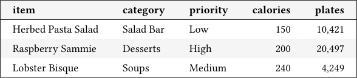
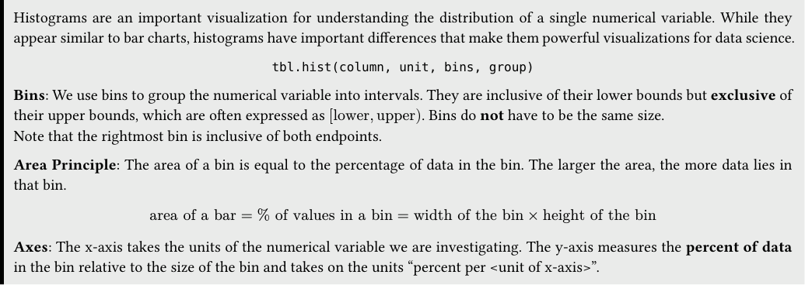
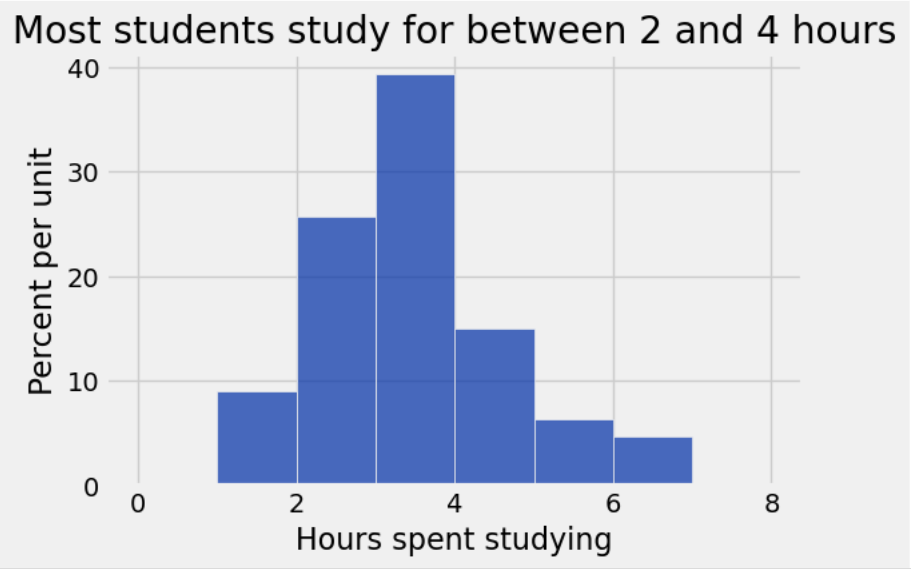
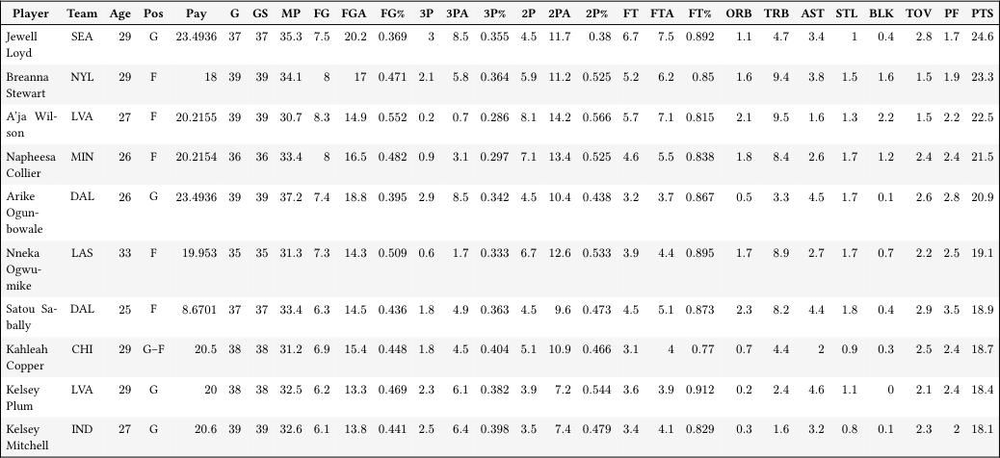
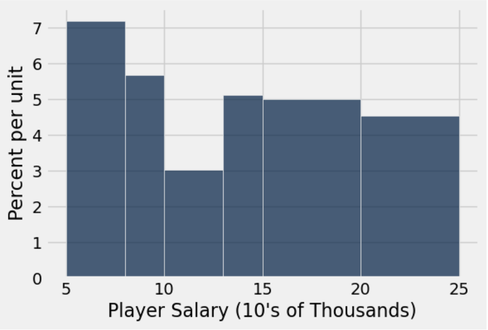
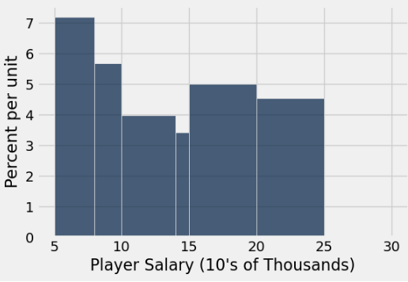

# Tutoring 02 Data C8 Spring 2026

## Page 1

## Visualizations

Tutoring 02

Data C8: Foundations of Data Science UC Berkeley, Spring 2026

### 1. Nutrition

Line Plot: A line plot is often used to study chronological trends and patterns. - The x-values have a clear, sequential order (for example time). - tbl.plot(x_column, y_column) and tbl.plot(x_column)

Scatter Plot: A scatter plot visualizes the relation between two numerical variables, helping us identify associations. - The data does not need to be sequential. - tbl.scatter(x_column, y_column)

Bar Chart: A bar chart is a way of visualizing categorical distributions. - It displays a bar for each category, equally spaced and equally wide. - tbl.barh(categories) and tbl.barh(categories, values)

Practice Problems Aditya, a Nutrition Science major, is studying the nutrition in the campus dining halls. He randomly samples 500 items served at Crossroads and makes a table menu that contains one row for each sampled item. Here are the first few rows:

#### item category priority calories plates

Herbed Pasta Salad Salad Bar Low 150 10,421

Raspberry Sammie Desserts High 200 20,497

Lobster Bisque Soups Medium 240 4,249

The menu table contains five columns:

- item (string): name of the item on the menu
- category (string): the food category of the item
- priority (string): the priority that Cal Dining puts on making the item ('Low', 'Medium' or 'High')
- calories (int): number of calories per plate
- plates (int): number of plates served to students in the month

Aditya wants to answer the following questions. Choose which kind of visualization would be the best choice to answer it.

#### (a) Are there more soup items than salad bar items?

Line Graph

Histogram

Bar Chart

Scatterplot

#### (b) Do dessert items tend to be of high priority or low priority?

Line Graph

Histogram

Bar Chart

Scatterplot

## Page 2

- How do the distributions of calories per plate vary between the high priority and low priority desserts?

Line Graph

Histogram

Bar Chart

Scatterplot

#### (d) Is there an association between calories per plate and the number of plates served?

Line Graph

Histogram

Bar Chart

Scatterplot

Data C8 Spring 2026 Tutoring 02 | 2

## Page 3

### 2. Histograms

Histograms are an important visualization for understanding the distribution of a single numerical variable. While they appear similar to bar charts, histograms have important differences that make them powerful visualizations for data science.

tbl.hist(column, unit, bins, group)

Bins: We use bins to group the numerical variable into intervals. They are inclusive of their lower bounds but exclusive of their upper bounds, which are often expressed as [lower, upper). Bins do not have to be the same size. Note that the rightmost bin is inclusive of both endpoints.

Area Principle: The area of a bin is equal to the percentage of data in the bin. The larger the area, the more data lies in that bin.

area of a bar = % of values in a bin = width of the bin × height of the bin

Axes: The x-axis takes the units of the numerical variable we are investigating. The y-axis measures the percent of data in the bin relative to the size of the bin and takes on the units “percent per <unit of x-axis>”.

#### Practice Problems (a) Suppose you are interested in the number of hours, on average, that UC Berkeley students spend studying a day. You survey

300 random UC Berkeley students, record the number of hours they spend studying, and plot a histogram with the data. The histogram is shown below:

#### i. What percentage of students studied between two and three hours a day?

#### ii. How many students studied between three and four hours a day?

iii. Suppose you created a new bin for students who studied between three and five hours a day. What would be the height

of the new bar?

Data C8 Spring 2026 Tutoring 02 | 3

## Page 4

Throughout this section, we will focus on the following table: wnba. It describes the total statistics of 88 of the highest-paid WNBA players for the 2023 regular season. Salary and age data were sourced from spotrac and the statistics from basketball- reference. We have provided all the data, but we will only use the “Age” column for now. There is one row for each player, and the first few rows of the table look like this:

Player Team Age Pos Pay G GS MP FG FGA FG% 3P 3PA 3P% 2P 2PA 2P% FT FTA FT% ORB TRB AST STL BLK TOV PF PTS

Jewell Loyd

SEA 29 G 23.4936 37 37 35.3 7.5 20.2 0.369 3 8.5 0.355 4.5 11.7 0.38 6.7 7.5 0.892 1.1 4.7 3.4 1 0.4 2.8 1.7 24.6

Breanna Stewart

NYL 29 F 18 39 39 34.1 8 17 0.471 2.1 5.8 0.364 5.9 11.2 0.525 5.2 6.2 0.85 1.6 9.4 3.8 1.5 1.6 1.5 1.9 23.3

A’ja Wil­ son

LVA 27 F 20.2155 39 39 30.7 8.3 14.9 0.552 0.2 0.7 0.286 8.1 14.2 0.566 5.7 7.1 0.815 2.1 9.5 1.6 1.3 2.2 1.5 2.2 22.5

Napheesa Collier

MIN 26 F 20.2154 36 36 33.4 8 16.5 0.482 0.9 3.1 0.297 7.1 13.4 0.525 4.6 5.5 0.838 1.8 8.4 2.6 1.7 1.2 2.4 2.4 21.5

Arike Ogun­ bowale

DAL 26 G 23.4936 39 39 37.2 7.4 18.8 0.395 2.9 8.5 0.342 4.5 10.4 0.438 3.2 3.7 0.867 0.5 3.3 4.5 1.7 0.1 2.6 2.8 20.9

Nneka Ogwu­ mike

LAS 33 F 19.953 35 35 31.3 7.3 14.3 0.509 0.6 1.7 0.333 6.7 12.6 0.533 3.9 4.4 0.895 1.7 8.9 2.7 1.7 0.7 2.2 2.5 19.1

Satou Sa­ bally

DAL 25 F 8.6701 37 37 33.4 6.3 14.5 0.436 1.8 4.9 0.363 4.5 9.6 0.473 4.5 5.1 0.873 2.3 8.2 4.4 1.8 0.4 2.9 3.5 18.9

Kahleah Copper

CHI 29 G–F 20.5 38 38 31.2 6.9 15.4 0.448 1.8 4.5 0.404 5.1 10.9 0.466 3.1 4 0.77 0.7 4.4 2 0.9 0.3 2.5 2.4 18.7

Kelsey Plum

LVA 29 G 20 38 38 32.5 6.2 13.3 0.469 2.3 6.1 0.382 3.9 7.2 0.544 3.6 3.9 0.912 0.2 2.4 4.6 1.1 0 2.1 2.4 18.4

Kelsey Mitchell

IND 27 G 20.6 39 39 32.6 6.1 13.8 0.441 2.5 6.4 0.398 3.5 7.4 0.479 3.4 4.1 0.829 0.3 1.6 3.2 0.8 0.1 2.3 2 18.1

### (b) i. The youngest WNBA player in the 2023 season was 21 years old. The oldest player that season was 41 years old. Create

### age_bins and assign it to an array of equally spaced bin values that cover all ages of WNBA players with a bin width of 2.

### ii. Write a line of code to create a histogram of the Age column using the age_bins array and the wnba table.

### Question Continues ⟶

### Data C8 Spring 2026 Tutoring 02 | 4

## Page 5

#### (c) Let’s now view the histogram below generated from the wnba table with the following code

wnba.hist("Pay", bins = make_array(5, 8, 10, 13, 15, 20, 25))

Assume that all the players are represented in the histogram and that the units for the salary data are in 10s of thousands of dollars. Answer the following questions or write “Cannot answer”. If you cannot answer the question, explain why.

#### i. Can we find the total number of players who make 150 000 dollars or more?

#### ii. How many players make between 140 000 and 150 000 dollars?

- Assume we have this second histogram generated using different bins bins = make_array(5, 8, 10, 14, 15, 20, 25). If

you wrote “Cannot answer” for anything above, are you able to answer it now? If you are able to answer it, how would you do so?

Data C8 Spring 2026 Tutoring 02 | 5
