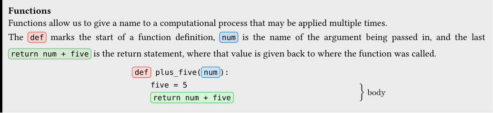
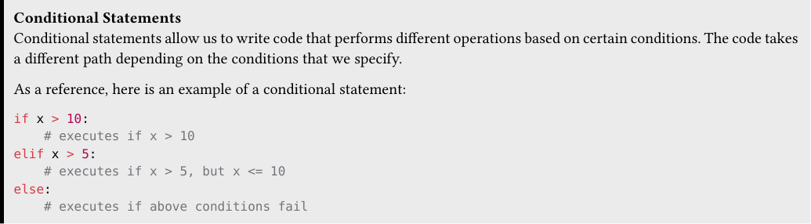
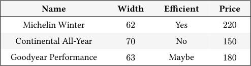
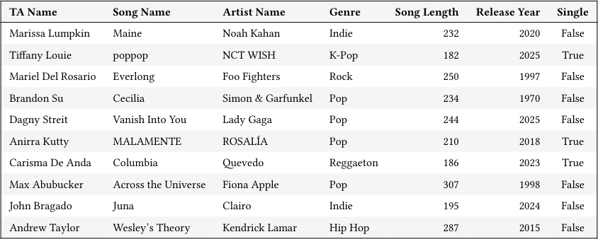

# Tutoring 03 Data C8 Spring 2026

## Page 1

## Functions & Conditionals

Tutoring 03

Data C8: Foundations of Data Science UC Berkeley, Spring 2026

### 1. Statistical Functions

Functions Functions allow us to give a name to a computational process that may be applied multiple times.

The def marks the start of a function definition, num is the name of the argument being passed in, and the last

return num + five is the return statement, where that value is given back to where the function was called.

def plus_five( num ):

five = 5

} body return num + five

#### Practice Problems

- Saleh is trying to define a function called calculate_mean, but he is not sure how to get started. Help him out by filling in

the following code. It should take in an array of numbers and return the average of the numbers in the array. Do not use the

np.mean or np.average functions!

def calculate_mean(array):

sum_of_array = ______________________________________________ num_elements = ______________________________________________ return ______________________________________________________

- He also defined calculate_statistics. Think about what the function does, and answer the questions below.

def calculate_statistics(array, multiplier): largest_num = max(array) smallest_num = min(array) array_average = calculate_mean(array) stats_array = make_array(largest_num, smallest_num, array_average) final_array = stats_array * multiplier return final_array

Suppose you execute the line of code below in a blank cell. Answer the questions below.

statistics = calculate_statistics(make_array(5, 10, 15, 20), 2)

- Trace through the function call. What are the variables largest_num, array_average and stats_array assigned to?

ii. What does the function return? What is its type? What is the value of statistics.item(1)? What is its type?

iii. After the line of code is executed, what would happen if we tried to print out the value of largest_num by calling

print(largest_num)?

## Page 2

### 2. Tiered Tires

Conditional Statements Conditional statements allow us to write code that performs different operations based on certain conditions. The code takes a different path depending on the conditions that we specify.

As a reference, here is an example of a conditional statement:

if x > 10: # executes if x > 10 elif x > 5: # executes if x > 5, but x <= 10 else: # executes if above conditions fail

#### Practice Problems Alex got a flat tire. He wants to use data to inform his purchase of a new one. He has access to the tires table which contains the following data:

- name (string): The name of the tire
- width (int): The width of the tire in inches
- efficient (string): Indicates whether a tire is efficient (Yes), not efficient (No), or has uncertain efficiency (Maybe)
- price (int): Pre-tax price in dollars

#### Name Width Efficient Price

Michelin Winter 62 Yes 220

Continental All-Year 70 No 150

Goodyear Performance 63 Maybe 180

... (147 rows omitted)

- The tax rate on tires is 9%. To encourage the purchase of efficient tires, the government implemented a tax policy:

- efficient tires (“Yes”) are fully tax-exempt (0% tax);
- uncertain efficiency tires (“Maybe”) are partially taxed at 5%;
- non-efficient tires (“No”) are fully taxed at 9%.

Write a function tax_calc(price, efficiency) that applies the correct tax rate based on the efficiency category.

def tax_calc(price, efficiency):

- Alex now wants to compute the post-tax price for each tire and update the Price column in the tires table. Help him

complete the code below.

post_tax = tires.________________(_____________________, ______________________, ______________________)

tires = tires.with_column(_______________________, _______________________)

Data C8 Spring 2026 Tutoring 03 | 2

## Page 3

### 3. Musical Groups

John is trying to broaden his music knowledge so he collects his TA’s favorite songs in a table songs that contains one row for each TA. A sample of the table is below:

#### TA Name Song Name Artist Name Genre Song Length Release Year Single

Marissa Lumpkin Maine Noah Kahan Indie 232 2020 False

Tiffany Louie poppop NCT WISH K-Pop 182 2025 True

Mariel Del Rosario Everlong Foo Fighters Rock 250 1997 False

Brandon Su Cecilia Simon & Garfunkel Pop 234 1970 False

Dagny Streit Vanish Into You Lady Gaga Pop 244 2025 False

Anirra Kutty MALAMENTE ROSALÍA Pop 210 2018 True

Carisma De Anda Columbia Quevedo Reggaeton 186 2023 True

Max Abubucker Across the Universe Fiona Apple Pop 307 1998 False

John Bragado Juna Clairo Indie 195 2024 False

Andrew Taylor Wesley’s Theory Kendrick Lamar Hip Hop 287 2015 False

The table contains 7 columns. A few columns are described below:

- Song Length (int): the length of the song in seconds.
- Single (boolean): True if the song was a single and False otherwise.

#### Practice Problems

- John is curious if there are more singles or songs that were released as part of albums in the data set. Help John by computing

a new table that contains two columns: Single, which indicates if a song is a single or not, and count, which counts the number of songs in the table that fit that category.

___________________________________________

- John realized that to learn songs as fast as possible, he should prioritize genres that have shorter songs on average.

Compute the number of genres in the data set that have an average song length less than 250 seconds. Note: Pay attention to the column name Song Length average.

genre_group = songs.__________________(_____________________________, _________________________________)

genre_group.__________________("Song Length average", ________________________________).________________

- John now wants to analyze how song lengths vary between singles and non-singles for each genre. Help him create a new

#### table showing the average song length for each combination of Single and Genre.

Write two separate lines of code that are two separate ways to create such a table.

- ______________________________________________________________________________________________________

ii. ______________________________________________________________________________________________________

Data C8 Spring 2026 Tutoring 03 | 3
