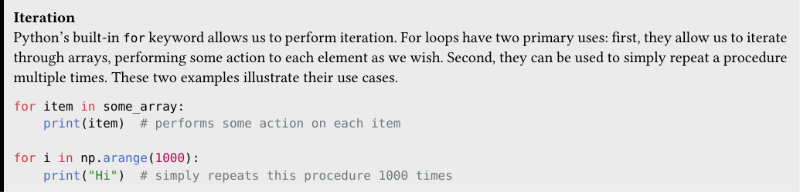
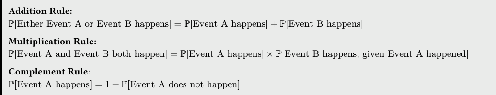

# Tutoring 04 Data C8 Spring 2026

## Page 1

## Iteration & Probability

Tutoring 04

Data C8: Foundations of Data Science UC Berkeley, Spring 2026

### 1. Iteration

Iteration Python’s built-in for keyword allows us to perform iteration. For loops have two primary uses: first, they allow us to iterate through arrays, performing some action to each element as we wish. Second, they can be used to simply repeat a procedure multiple times. These two examples illustrate their use cases.

for item in some_array: print(item) # performs some action on each item

for i in np.arange(1000): print("Hi") # simply repeats this procedure 1000 times

#### Practice Problems (a) The for loop statement below stores the length of each name in names in a new array called lengths.

lengths = make_array() names = make_array("Anirra", "Chase", "Aralyn", "Dan")

for name in names: lengths = np.append(lengths, len(name))

- For each iteration of the for loop below, fill in the value of name as well as what the array lengths looks like after that

iteration is fully executed.

Iteration 1: name = ________________ lengths = ______________________________

Iteration 2: name = ________________ lengths = ______________________________

Iteration 3: name = ________________ lengths = ______________________________

Iteration 4: name = ________________ lengths = ______________________________

Iteration 1: name = "Anirra" lengths = array([6.]) Iteration 2: name = "Chase" lengths = array([6., 5.]) Iteration 3: name = "Aralyn" lengths = array([6., 5., 6.]) Iteration 4: name = "Dan" lengths = array([6., 5., 6., 3.])

Note: Appending integers to an empty array converts them to floats.

ii. We now decide to only store the name if the length of that name is greater than 5. Fill in the following for loop statement.

What does longer evaluate to after the loop executes?

longer = make_array()

for name in __________________________:

if ____________________________________:

longer = _________________________________

## Page 2

longer = make_array() for name in names: if len(name) > 5: longer = np.append(longer, name)

longer would contain the names Anirra and Aralyn. longer = array(["Anirra", "Aralyn"])

iii. Finally, look at this last for loop below. What values does i take on throughout? How is i used differently to the way

name is used in the previous for loops? What is the value of counter after the for loop stops running?

counter = 0 for i in np.arange(1000): counter = counter + 1

i takes on values that go from 0 to 999. In the first iteration, i takes on the value of 0, in the second, it takes on the value of 1, and so on. The way i is used here is different than the way name was used in the previous for loop, since we cared about the value that name took on throughout the for loop. For this for loop, we do not really care about i — we simply want to repeat a line of code 1000 times. After the for loop stops running, counter has the value 1000. We’ll use for loops like the one above many times throughout this course for the purpose of simulating!

Data C8 Spring 2026 Tutoring 04 | 2

## Page 3

- Some people on the Data 8 staff love to go get tacos on Tuesdays! Suppose that a group of five staff members go to get

tacos on a random Tuesday. Although they usually order separately, this time they decide to order together and split the bill afterwards. The tacos array contains the number of tacos each staff member ordered. In order to make splitting the bill easier, we would like to calculate an array called proportions, which is the proportion of tacos that each staff member ordered relative to the total amount.

Example: If the tacos array looked like array([1, 2, 3, 2, 2]), then proportions would look like array([0.1, 0.2,

0.3, 0.2, 0.2]). This is found by dividing each of the elements in tacos by the total number of tacos ordered, or the sum of tacos.

- Your friend Prakrat recently learned about for loops, and decides to use one to calculate the proportions array. However,

there are some issues with his code! Find all the errors that Prakrat made (Hint: there are 3). What would the code output if executed as is, and how would you fix it?

tacos = make_array(1, 3, 4, 4, 2) total = sum(tacos)

for num_tacos in tacos: proportions = make_array() prop = taco / total np.append(proportions, prop)

print(proportions)

Error 1: The code creates a new proportions array for each iteration of the for loop, instead of appending to the same

proportions array! In order to keep appending to the same array, the proportions = make_array() line will need to come before (or above) the for loop.

Error 2: For each iteration of the for loop, the placeholder num_tacos is taking on a single value in the tacos array. However, in the body of the for loop we don’t use num_tacos; instead, we are using taco which is not defined. Be consistent with variable and placeholder names! In this case, we need to either make them both num_tacos or both taco.

Error 3: This code appends to the proportions array for each iteration of the for loop, but does not re-assign it back to the proportions array. Therefore, it will not keep track of values that were previously appended to it. After the for loop is done running, the proportions array will be empty.

The correct code would be as follows:

tacos = make_array(1, 3, 4, 4, 2) total = sum(tacos) proportions = make_array()

for num_tacos in tacos: prop = num_tacos / total proportions = np.append(proportions, prop)

print(proportions)

#### ii. Now, fill in the blank to repeat the same process, this time only using array arithmetic.

proportions = __________________________________________________ print(proportions)

proportions = tacos / sum(tacos) print(proportions)

Data C8 Spring 2026 Tutoring 04 | 3

## Page 4

Notice how much shorter the code is using array arithmetic! Although for loops are extremely powerful, they do not always provide the easiest or most appropriate solution to a given problem. Just because you can use a for loop doesn’t always mean you should use one. This also goes to show how useful arrays can be!

Data C8 Spring 2026 Tutoring 04 | 4

## Page 5

### 2. Probability

#### Addition Rule: ℙ[Either Event A or Event B happens] = ℙ[Event A happens] + ℙ[Event B happens]

Multiplication Rule: ℙ[Event A and Event B both happen] = ℙ[Event A happens] × ℙ[Event B happens, given Event A happened]

#### Complement Rule: ℙ[Event A happens] = 1 −ℙ[Event A does not happen]

#### Practice Problems (a) Marissa loves collecting stickers from Berkeley Data Science classes to decorate her computer and water bottle! She finds a

stash of 8 Data 8 stickers, 4 Data 100 stickers, and 2 Data 140 stickers in a box in Evans B6! She can take 1 sticker out of the box at a time, each with an equal probability of being chosen.

- Marissa picks 2 stickers without replacement. What is the probability that she draws a Data 8 and a Data 100 sticker?

( 8

14 ⋅4 1. + ( 4 14 ⋅8 1. = 2 ⋅8 14 ⋅4 13 = 32 91

Marissa leaves all of those stickers in Evans B6 and goes to Evans 458. She finds a new stash of only four stickers, including one Data 8 sticker, one Data 100 sticker, one Data 102 sticker, and one Data 140 sticker!

ii. Suppose Marissa randomly picks 4 stickers with replacement. What is the probability that Marissa picks four unique

stickers?

On the first draw, you can pick any of the four stickers. On the second pick you can only pick 3 of the 4 stickers to get a unique sticker, and so on. Therefore,

ℙ[Picking four unique stickers, with replacement] = 4

4 ⋅3 4 ⋅2 4 ⋅1 4 = 9.375%.

iii. Suppose this time Marissa picks without replacement. What is the probability that Marissa picks four unique stickers?

Write down the explicit probabilities, then interpret this probability intuitively.

ℙ[Picking four unique stickers, without replacement] = 4

4 ⋅3 3 ⋅2 2 ⋅1 1 = 1

Intuitively, since we have one of each sticker, and we do not put the stickers back, every new sticker will be unique, and hence this event is certain to occur (w.p. 1).

iv. Suppose Marissa randomly picks 4 stickers with replacement. What is the probability that Marissa picks the Data 8 sticker

at least once?

We can use the complement rule to calculate the chance by calculating

1 −ℙ[Data 8 sticker is not picked]

In order to not pick the Data 8 sticker, you have to pick either the Data 100 sticker, the Data 102 sticker, or the Data 140 sticker on all four draws. This probability is equivalent for all draws since you are sampling with replacement. Therefore,

ℙ[Data 8 sticker is not picked] = 3

4 ⋅3 4 ⋅3 4 ⋅3 4

4 = 68.36%

⟹ℙ[at least one Data 8 sticker is picked] = 1 −(3

4)

Data C8 Spring 2026 Tutoring 04 | 5
