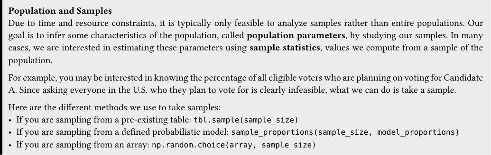
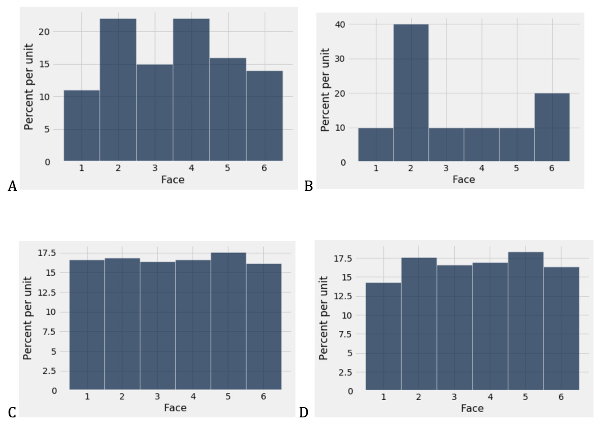
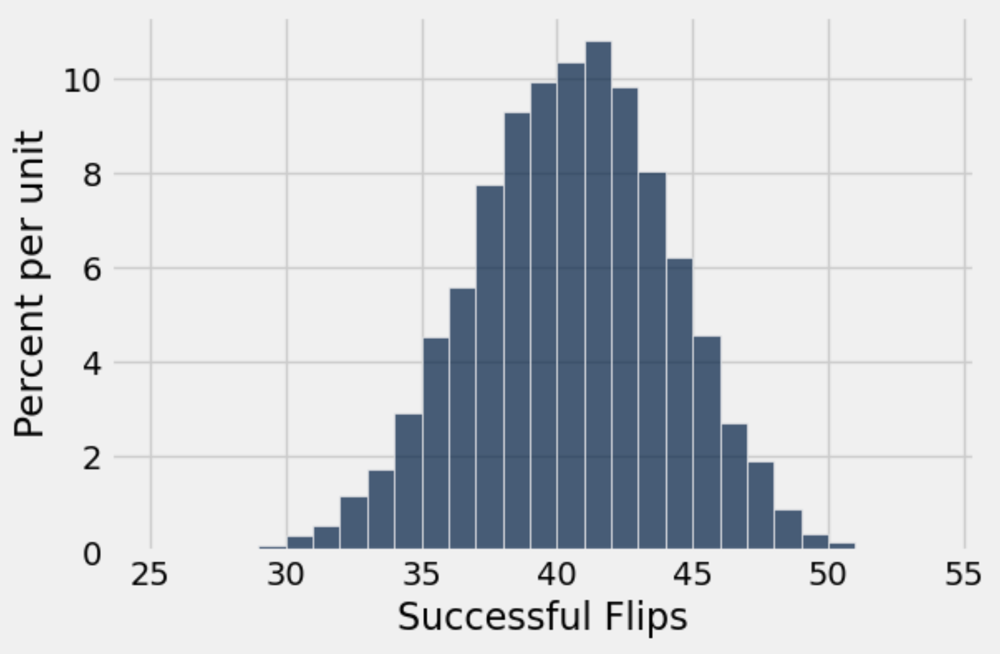
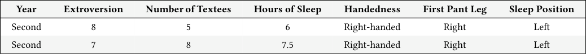
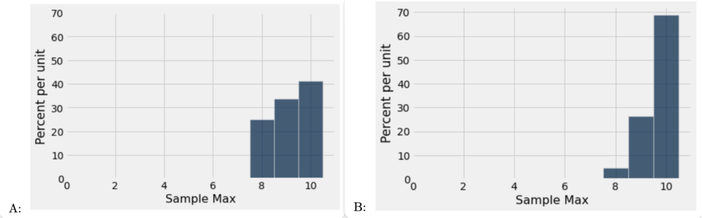

# Tutoring 05 Data C8 Spring 2026

## Page 1

## Sampling & Hypothesis Testing

Tutoring 05

Data C8: Foundations of Data Science UC Berkeley, Spring 2026

### 1. Sampling

Population and Samples Due to time and resource constraints, it is typically only feasible to analyze samples rather than entire populations. Our goal is to infer some characteristics of the population, called population parameters, by studying our samples. In many cases, we are interested in estimating these parameters using sample statistics, values we compute from a sample of the population.

For example, you may be interested in knowing the percentage of all eligible voters who are planning on voting for Candidate - Since asking everyone in the U.S. who they plan to vote for is clearly infeasible, what we can do is take a sample.

Here are the different methods we use to take samples: - If you are sampling from a pre-existing table: tbl.sample(sample_size) - If you are sampling from a defined probabilistic model: sample_proportions(sample_size, model_proportions) - If you are sampling from an array: np.random.choice(array, sample_size)

#### Practice Problems

- Let’s use the example of rolling a fair die. Is rolling a die sampling with replacement or without replacement?

- Calculate the probability of rolling a 5. Is this an empirical or a theoretical probability? Is there a relationship between

the two?

- Suppose that we have a table called dice, which has one column Side and contains the values 1 through 6. Complete the

function roll_die, which takes in no arguments and uses the dice table to simulate rolling a fair die once. Hint: the function should return an integer between 1 and 6.

def roll_die():

_____________________________________

- Simulate rolling a fair die 10 times and store the results in an array called simulated_rolls, using roll_die().

simulated_rolls = make_array()

for i in ____________________________:

face = ________________________________ simulated_rolls = ______________________________

## Page 2

- We have generated histograms of simulated rolls for samples of size 10, 100, 1000, and 10,000. Which histograms correspond

to which sample sizes, and why? Do these histograms show a theoretical or empirical distribution?

#### A B C D

Data C8 Spring 2026 Tutoring 05 | 2

## Page 3

## 2. Hypothesis Testing

#### (a) Suppose your friend Lena is into bottle flipping, and she lets you try out the best bottle in her collection. According to Lena,

#### her best bottle lands right side up with a 2/3 chance and lands on its side with a 1/3 chance. You flip the bottle 60 times and observe a successful bottle flip 45 times.

#### Does the bottle that you are flipping seem consistent with Lena’s model? Why or why not?

#### (b) Complete the function flip_bottle, which takes in no arguments and randomly flips the bottle described above 60 times.

#### The function should return the number of successful bottle flips out of the 60 flips. Refer to the Reference Sheet if you need a refresher on sample_proportions!

def flip_bottle():

probabilities = ____________________________________________________________________________________ empirical_props = __________________________________________________________________________________ prop_flipped = _____________________________________________________________________________________ return _____________________________________________________________________________________________

#### (c) Complete the code below to simulate the experiment described above 10000 times, and record the number of bottles flipped

#### in each of these experiments in an array called bottles_flipped.

trials = ________________________________________

bottles_flipped = _______________________________

for i in _________________________________________________________:

one_experiment = _______________________________________________________ _________________ = ____________________(_________________________________________________________) Table().with_column("Successful Flips", bottles_flipped) .hist("Successful Flips", bins=np.arange(25, 60, 1))

#### (d) Suppose you performed the simulation and plotted a histogram of bottles_flipped. The histogram is shown below. Was

#### observing 45 successful bottle flips consistent with the model you simulated under?

#### Data C8 Spring 2026 Tutoring 05 | 3

## Page 4

### 3. Welcome

The table welcome_tbl contains the results of the Fall 2021 Data 8 welcome survey. The first two rows are shown below. Each row corresponds to a student. In the column Extroversion, each student scored themselves on a scale of 1 (not extroverted) to 10 (extremely extroverted).

(Fall 2021 Midterm Question 8)

#### Year Extroversion Number of Textees Hours of Sleep Handedness First Pant Leg Sleep Position

Second 8 5 6 Right-handed Right Left

Second 7 8 7.5 Right-handed Right Left

- Complete the code below to define a function max_extroversion that takes sample_size as its argument. The function

should sample sample_size many times at random without replacement from all the students, and return the maximum extroversion score among the sampled students.

def max_extroversion(________________________):

sampled_students = ______________________________________________

_________________________________________________________________

- We decide to simulate 10,000 values of maximum extroversion score, drawing random samples of size 25 without replacement.

Complete the code below so the last line evaluates to an array of 10,000 simulated values from all students. Your code should use the max_extroversion function that you defined above.

repetitions = ______________________

sim_vals = _________________________

for ______________________ in ______________________:

________________________________________________________________ ________________________________________________________________

- A student mistypes the sample size in the previous question to be 55 instead of 25. One of the histograms below shows the

distribution of the maximum values simulated by this student. The other shows the distribution of the maximum values that you simulated using a sample size of 25. Which is which? Why?

Data C8 Spring 2026 Tutoring 05 | 4
