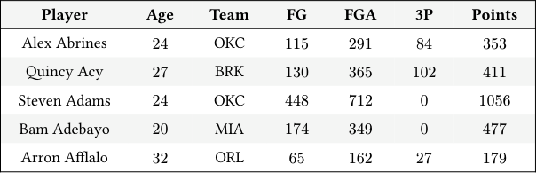
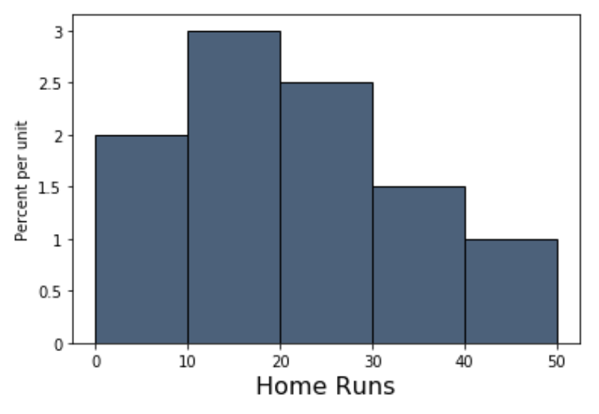

# Tutoring 06 Data C8 Spring 2026

## Page 1

## Midterm Review

Tutoring 06

Data C8: Foundations of Data Science UC Berkeley, Spring 2026

This midterm review worksheet has 75 total points, and you may treat it as a practice exam. Your tutor will not cover all questions, so we suggest you attempt the rest of the questions after section to review all topics on the worksheet. 1. [15.0 points] Table Manipulation

The nba table contains data from the 2017-2018 season for every active player. Each row represents a subset of one player’s statistics over the whole season. In this table, percentages are expressed as decimals. Some rows of the table are shown below:

#### Player Age Team FG FGA 3P Points

Alex Abrines 24 OKC 115 291 84 353

Quincy Acy 27 BRK 130 365 102 411

Steven Adams 24 OKC 448 712 0 1056

Bam Adebayo 20 MIA 174 349 0 477

Arron Afflalo 32 ORL 65 162 27 179

... (535 rows omitted)

- [6.0 pts] Effective field goal percentage, or eFG%, is a basketball statistic commonly used to measure a player’s shooting skill.

Calculate eFG% using the formula

FG + 0.5 ⋅3𝑃

FGA

and add it as a new column to the nba table, assigning the result to nba_efg.

numerator = nba.________________(________________) + __________ * nba.________________(________________)

denominator = _________________._________________(_________________)

nba_efg = nba.___________________________(__________, numerator / denominator)

- [4.0 pts] Find the name of the team with the lowest average eFG%. Your final expression should evaluate to a string.

by_team = nba_efg.___________(__________________, __________________)

by_team.sort("eFG% mean")._________________(_________________).__________________(________)

- [3.0 pts] What proportion of points were scored by players who had an eFG% above 60%? The variable prop should be

assigned to your final proportion.

above60 = ________________(nba_efg.________________(____________________).________________)

prop = above60 / ____________________________________

- [2.0 pts] Assign age_vs_team to a table where the rows are unique values of the Age column and the columns are unique

values of the Team column. The values of the table should correspond to the average eFG% for each age, team pair.

age_vs_team = nba_efg.________________________________________________________________

## Page 2

### 2. [10.0 points] Functions

Suppose you have a table called dinners, which contains a row for every dinner eaten at a given restaurant for a week. The

dinners table contains the following columns:

- Day (string): Which day of the week the dinner was eaten
- Subtotal (float): Cost of the dinner without tips.

- [2.0 pts] Assume that every customer at the restaurant tips 20% for their bill. Define a function called compute_tip that

takes in a total bill and calculates the corresponding amount in tips.

- [4.0 pts] Add a new column to the table called Tip that is the 20% tip for each bill in the Subtotal column. Then, name the

resulting table dinners_with_tip. Use the function you defined above.

tips = dinners.______________________________(_________________________________________)

dinners_with_tip = dinners.________________________________(____________________________________)

- [4.0 pts] Write code to calculate the day of the week with the lowest average subtotal (not including tip).

by_day = dinners.____________________________(______________________________________)

by_day.sort(_______________________________).__________________(____________________________).item(0)

Data C8 Spring 2026 Tutoring 06 | 2

## Page 3

### 3. [10.0 points] Histograms

The following is a histogram of the number of home runs hit by MLB players in the 2019 season.

Answer the following questions using the histogram above. If it is not possible to compute the answer, write “Not Possible” and explain why you cannot calculate the answer.

- [2.0 pts] Find the percent of players who hit between 10 and 20 (not inclusive) home runs in 2019.

#### (b) [2.0 pts] Find the number of players who hit 30 or more home runs in 2019.

#### (c) [2.0 pts] What percent of players hit at least 20 home runs?

#### (d) [2.0 pts] What percent of players hit between 25 and 30 home runs?

- [2.0 pts] Suppose that we’re able to obtain more information, allowing us to split the [10, 20) bin into two bins: a [10, 15) bin

and a [15, 20) bin. We find that 20% of players hit between 10 and 15 home runs. What is the height of this new [15, 20) bin?

Data C8 Spring 2026 Tutoring 06 | 3

## Page 4

### 4. [10.0 points] Simulation

- [6.0 pts] Suppose a broken candy machine dispenses sweet candy 99% of the time and sour candy otherwise. What is the

chance you find at least 1 sour candy in 50 candies dispensed randomly from the machine? We can estimate this probability by simulating asking the candy machine for 50 candies 5000 times, and calculating the proportion of times we get at least one sour candy.

Let candies be an array where the first element is the probability of picking a sweet candy, and the second element is the probability of picking sour candy. Fill in the following code to estimate the probability of finding at least 1 sour candy in 50 candies dispensed. The last line of code should evaluate to your estimate.

candies = make_array(0.99, 0.01)

sour = ______________________________

for i in ________________________________:

simulated_props = __________________________________________________ sour_prop = ________________________________________________ if ________________________________________: ________________________________________ ______________________________ / 5000

- [4.0 pts] What is the exact probability of finding at least 1 sour candy in 50 candies dispensed from the broken candy

machine?

Data C8 Spring 2026 Tutoring 06 | 4

## Page 5

### 5. [10.0 points] Probability

Your good friend Max is playing with a fair 6-sided die.

- [2.5 pts] Max rolls the die 10 times and rolls a 6 every time. What is the probability of that event occurring?

- [2.5 pts] Max rolls the die twice. What is the probability he rolls a 1 on the first roll and a 2 on the second roll?

#### (c) [2.5 pts] Max rolls the die twice again. What is the probability he rolls a 1 and a 2?

- [2.5 pts] Suppose Max rolls the die 5 times. What is the probability that he rolls at least one 3?

Data C8 Spring 2026 Tutoring 06 | 5

## Page 6

### 6. [20.0 points] Hypothesis Testing

Your friend Simone rolls a die 10 times and rolls 7 sixes, 2 fours, and 1 two. You suspect that Simone is using an unfair die and want to conduct a hypothesis test to check this.

#### (a) [3.0 pts] Specify the null and alternative hypotheses.

- [3.0 pts] What test statistic would you choose? What is the difference between the observed test statistic and the simulated

test statistic? What do we use the test statistic for? Explain your answers.

#### (c) [3.0 pts] Calculate the observed test statistic and assign it to observed_stat.

fair_die = make_array(____________________________________________________________)

simone_die = ______________________________________________________________________

observed_stat = ___________________________________________________________________

- [2.0 pts] Fill in the code below to define a function that simulates rolling the fair die 10 times and returns its simulated

statistic.

def calculate_stat(): fair_die = make_array(1/6, 1/6, 1/6, 1/6, 1/6, 1/6) simulated_dist = ________________________________ stat = _________________________________________ return stat

- [5.0 pts] Fill in the code below to simulate 10000 test statistics and generate the following histogram.

test_stats = ________________________________________

for i in __________________________________________:

one_stat = __________________________________________________ _____________________ = ____________________________________________________________ Table().with_columns(________________________________________________).hist(__________________________)

#### (f) [2.0 pts] Fill in the code below to calculate the p-value.

p_value = _________________________(_______________________________________________) / _______________

- [2.0 pts] If the p-value turns out to be 0.004 and we’ve set a 𝑝-value cutoff of 5%, what conclusion would we draw from

this test?

Data C8 Spring 2026 Tutoring 06 | 6
