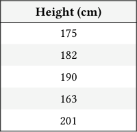
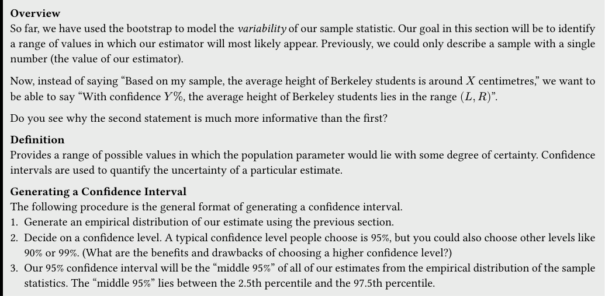
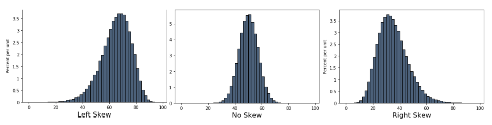
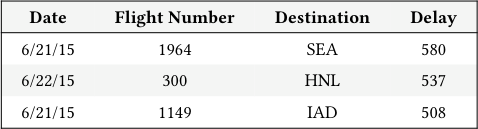

# Tutoring 07 Data C8 Spring 2026

## Page 1

## Confidence Intervals & The Bootstrap

Tutoring 07

Data C8: Foundations of Data Science UC Berkeley, Spring 2026

### 1. Bootstrap

Practice Problems Suppose we have a sample of the heights of 100 UC Berkeley students contained in a table heights, drawn as a simple random sample from all UC Berkeley students. We would like to estimate the median height of the UC Berkeley student population. To do so, we will use the median height in our sample as our estimate.

#### Height (cm)

175

182

190

163

201

... (95 rows omitted)

- Identify the parameter and statistic for this particular experiment. Which of these two quantities is random?

- Parameter: the median height of all Berkeley students (the population), this is not random. - Statistic: the median height of the 100 students in our sample, which is random because it is a function of the sample that is itself random.

- We would like to use the bootstrap method to generate an empirical distribution of our statistic. Fill in the code such that

estimates contains 10,000 bootstrapped sample statistics after the code is run.

estimates = ________________________________

for i in ________________________________:

bootstrap_heights = ________________________________ bootstrap_estimate = ________________________________ estimates = ________________________________

estimates = make_array()

for i in np.arange(10000): bootstrap_heights = heights.sample(100, with_replacement=True).column("Height (cm)") bootstrap_estimate = percentile(50, bootstrap_heights) estimates = np.append(estimates, bootstrap_estimate)

## Page 2

### 2. Confidence Intervals

Overview So far, we have used the bootstrap to model the variability of our sample statistic. Our goal in this section will be to identify a range of values in which our estimator will most likely appear. Previously, we could only describe a sample with a single number (the value of our estimator).

Now, instead of saying “Based on my sample, the average height of Berkeley students is around 𝑋 centimetres,” we want to be able to say “With confidence 𝑌%, the average height of Berkeley students lies in the range (𝐿, 𝑅)”.

Do you see why the second statement is much more informative than the first?

Definition Provides a range of possible values in which the population parameter would lie with some degree of certainty. Confidence intervals are used to quantify the uncertainty of a particular estimate.

Generating a Confidence Interval The following procedure is the general format of generating a confidence interval. 1. Generate an empirical distribution of our estimate using the previous section. 1. Decide on a confidence level. A typical confidence level people choose is 95%, but you could also choose other levels like 90% or 99%. (What are the benefits and drawbacks of choosing a higher confidence level?) 1. Our 95% confidence interval will be the “middle 95%” of all of our estimates from the empirical distribution of the sample statistics. The “middle 95%” lies between the 2.5th percentile and the 97.5th percentile.

#### Practice Problems

- Suppose that we picked our confidence level to be 80%. What would the lower and upper bounds of the confidence interval

be in terms of percentiles? Derive a formula to calculate the lower and upper bounds for a general 𝑛% confidence interval.

We would want to capture the middle 80% of the data, so the lower bound would be the 10th percentile and the upper bound would be the 90th percentile.

More generally, for an n% confidence interval the bounds in terms of percentiles would be:

(100 −𝑛

2 th percentile, 100 −(100 −𝑛 2 )th percentile)

- Tonight is the Monster Mash. We’re trying to determine the median spookiness level of ghosts. We are given a sample of

ghosts in the form of a one column table called spooky_sample that contains 200 numbers. Each number describes how spooky a ghost is on a scale from 0 to 10. You can assume that the sample is a large simple random sample from the population of all ghosts. Fill in the code below to create a function that returns a 95% confidence interval as a 2-item array for the median spookiness level in the population of ghosts. Note that reps is the number of iterations we would like to use for making the confidence interval.

def spooky_ci(spooky_sample, reps):

medians = ________________________________ for i in ________________________________: resample = ________________________________ resample_median = ________________________________ medians = ________________________________ left_end = ________________________________

Data C8 Spring 2026 Tutoring 07 | 2

## Page 3

right_end = ________________________________ return ________________________________

def spooky_ci(spooky_sample, reps): medians = make_array() for i in np.arange(reps): resample = spooky_sample.sample() resample_median = percentile(50, resample.column(0)) medians = np.append(medians, resample_median) left_end = percentile(2.5, medians) right_end = percentile(97.5, medians) return make_array(left_end, right_end)

#### (c) If we were to run the above function once, how many confidence intervals do we generate?

1.

Though we use a for loop to iterate through reps number of times, this is only to construct one single confidence interval. To produce many different confidence intervals, we would need different samples from the original population, and not bootstraps.

- If we run the function you wrote above multiple times, will it always return the same interval? Why or why not?

The intervals will probably be similar but will not necessarily be the same! The reason is that the empirical distribution we generate every time is random (comprised of many random samples) and as a result, the interval calculated is itself random!

#### (e) Answer the following questions or explain why they cannot be answered.

#### i. What percent of the population will be contained in the confidence interval?

We cannot make an assessment on the amount of the population in the confidence interval. We use our confidence interval to estimate a population parameter, not to make any other statements about the individuals in the population.

ii. What is the probability that the interval we have calculated already contains the population median spookiness level?

We cannot say anything about the probability that the interval contains the population median. The parameter is fixed, and once we calculate the confidence interval that is fixed as well. At that point, there is no randomness involved, and the confidence interval either contains or doesn’t contain the parameter. We have confidence in the process of constructing a confidence interval, not the interval itself once it has been created.

iii. If we were to draw 1000 new samples from the population and generate a 95% CI for each sample, how many intervals

would we expect to contain the population parameter?

We would expect around 95 percent (or 950) of them to contain the parameter. Remember that the confidence level has to do with the process of creating a confidence interval that contains the population parameter. If we repeat the same procedure for creating a 95% CI many times, we would expect around 95% of them to contain the parameter!

Data C8 Spring 2026 Tutoring 07 | 3

## Page 4

### 3. Mean and Median

Mean/Average (of a collection of elements): sum of all the elements divided by the total number of elements in the collection. Note that proportions are a special case of means.

𝜇= mean = sum of elements number of elements

#### Median: the 50th percentile of a collection of numbers. It is the “middle” element.

Mean vs. Median The median is always the midpoint of the data, while the mean is affected by the magnitude of the data points. For example, if the data is concentrated to the right with fewer values on the left, the mean is dragged to the left by those tail values.

#### Skew: how asymmetric the distribution is. A left-skew means the tail skews to the left.

#### Practice Problems

- Suppose a set of numbers has a mean value of 15 and a median value of 20. Is the distribution of the values in the data skewed

left or skewed right?

The data are skewed left because the low values in the data (at left) pull the mean below the median.

#### (b) Suppose you have an array containing three 18s, seven 11s, and a 74.

#### i. Write a Python expression to calculate the mean of the array. How does the 74 affect the mean?

mean = (3*18 + 7*11 + 74) / (3 + 7 + 1).

Since it is much greater than the other numbers in the array, it increases the mean.

#### ii. Now, suppose we replace the 74 with 350. How does this affect the mean? How about the median?

The mean increases further, since 350 is extremely large compared to the rest of the values. However, the median stays the same since it still remained as the largest number in the array.

Data C8 Spring 2026 Tutoring 07 | 4

## Page 5

### 4. Variability

![Reference panel deriving standard deviation for data \[2, 4, 6, 8, 10\]: mean 6, deviations \[-4, -2, 0, 2, 4\], squared deviations \[16, 4, 0, 4, 16\], variance 8, and SD sqrt(8). It also defines standard units as z = (value - mean) / SD.](images/tut07-sol_page005_vector001.png)

#### Standard Deviation: Root mean squared deviation from the average

Assume we have an array of numbers:

data = make_array(2, 4, 6, 8, 10)

1. Find the average of the distribution.

average = np.mean(data) # 6

1. Find the difference (i.e. the deviation) between each number in the distribution and the average.

differences = data - average # array([-4, -2, 0, 2, 4])

1. Square each difference (so there are no negatives).

squared_differences = differences ** 2 # array([16, 4, 0, 4, 16])

1. Take the mean of all the squared differences. (Variance)

mean_squared_differences = np.mean(squared_differences) # 8

1. Take the square root of that mean. (Standard Deviation)

root_mean_squared_differences = np.sqrt(mean_squared_differences) # sqrt(8)

If it is clearer, here’s the compact form (pay attention to parentheses!):

np.sqrt(np.mean((data - np.mean(data)) ** 2))

Alternatively, you can also use np.std(array) to calculate the standard deviation!

#### Standard Units: Number of Standard Deviations Above the Mean

To convert a value to standard units (a unitless measure), first find how far it is from the average of the distribution, and then compare that deviation with the standard deviation of the distribution.

𝑧= value −mean standard deviation = 𝑥−𝜇

𝜎

#### Practice Problems (a) Write code to convert the delay times in column Delay from the united table to standard units. Name the array of converted

times delay_standard.

#### Date Flight Number Destination Delay

6/21/15 1964 SEA 580

6/22/15 300 HNL 537

6/21/15 1149 IAD 508

... (many rows omitted)

delays = united.column("Delay")

________________________________________________________________________________________________________

avg = np.mean(delays)

________________________________________________________________________________________________________

sd = np.std(delays)

________________________________________________________________________________________________________

delay_standard = (delays - avg) / sd

________________________________________________________________________________________________________

Data C8 Spring 2026 Tutoring 07 | 5
