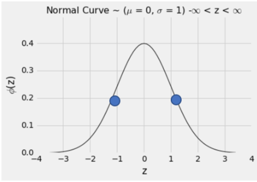
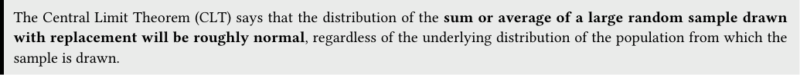
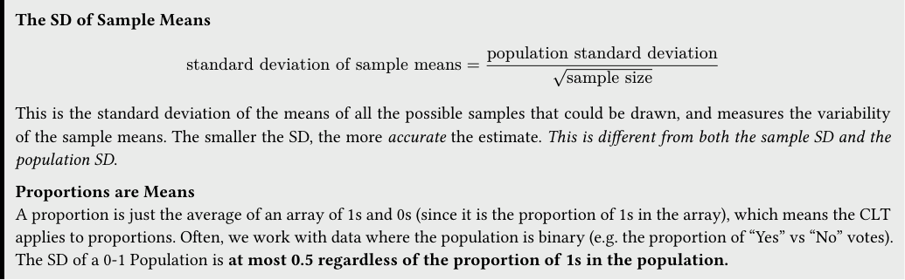
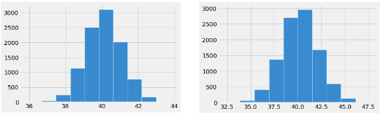
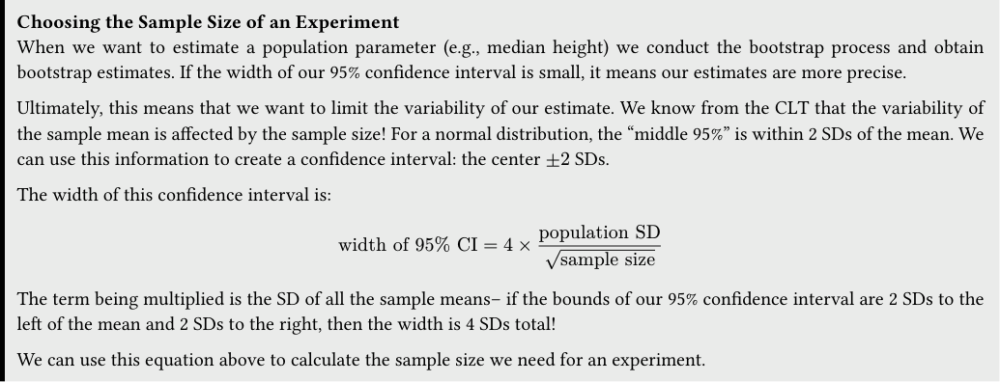

# Tutoring 08 Data C8 Spring 2026

## Page 1

## The Normal Distribution

Tutoring 08

Data C8: Foundations of Data Science UC Berkeley, Spring 2026

### 1. The Normal Distribution

This is a normal distribution curve, with a few important properties: - The total area under the curve is 100% - The curve is symmetric about the mean. The mean and median are equal - The points of inflection of the curve are at ±1 standard deviations away from the mean

A standard normal distribution curve has mean 0 and standard deviation 1.

#### Chebyshev and Normal Bounds

The left table uses Chebyshev’s inequality to calculate the proportion of values that fall within 𝑘 SDs of the mean. Chebyshev’s bound works for all distributions, which is why it is a weaker bound, since it does not assume any properties of the underlying distribution.

The right shows more specific bounds for the normal distribution. It provides much more information than the Chebyshev bounds, since it assumes knowledge of the underlying distribution.

#### Range Proportion in Range [Chebyshev]

#### Range Proportion in Range [Normal]

mean ± 1 SDs ≥1 −1 (0%)

mean ± 1 SDs ≈68%

mean ± 2 SDs ≥1 − 1

4 (75%)

mean ± 2 SDs ≈95%

mean ± 3 SDs ≥1 − 1

9 (88.8%)

mean ± 3 SDs ≈99.7%

mean ± 4 SDs ≥1 − 1

16 (93.75%)

mean ± 4 SDs ≈99.99%

#### Practice Problems

#### (a) Discuss what it means for the Chebyshev bound for mean ± 1 SDs to be greater than or equal to 0.

- Suppose vehicle speeds on a highway are normally distributed with mean 90 mph and SD 10 mph. Using the table above,

what is the approximate probability that a randomly chosen car is going more than 100 mph?

## Page 2

### 2. The Central Limit Theorem

The Central Limit Theorem (CLT) says that the distribution of the sum or average of a large random sample drawn with replacement will be roughly normal, regardless of the underlying distribution of the population from which the sample is drawn.

Practice Problems Suppose you simulate the proportion of purple-flowered plants in a sample of 200 plants (from Mendel’s 75% purple- and 25% white-flower plant population) using sample_proportions 1000 times. Then, you plotted the distribution of the proportion of purple-flowered plants from each of the 1000 trials.

#### (a) What would this distribution look like? Where would the distribution be centered?

#### (b) What would it look like if we conducted 10000 trials instead?

- Does the initial distribution of the population have an effect on the shape of the distribution of the sample mean? If yes,

what is its effect? If no, explain why not.

Data C8 Spring 2026 Tutoring 08 | 2

## Page 3

### 3. Variability of the Sample Mean

#### The SD of Sample Means

standard deviation of sample means = population standard deviation √sample size

This is the standard deviation of the means of all the possible samples that could be drawn, and measures the variability of the sample means. The smaller the SD, the more accurate the estimate. This is different from both the sample SD and the population SD.

Proportions are Means A proportion is just the average of an array of 1s and 0s (since it is the proportion of 1s in the array), which means the CLT applies to proportions. Often, we work with data where the population is binary (e.g. the proportion of “Yes” vs “No” votes). The SD of a 0-1 Population is at most 0.5 regardless of the proportion of 1s in the population.

#### Practice Problems

- Suppose we sample repeatedly from the population. If we increase the sample size, what happens to the distribution of the

sample mean? Does it become narrower or wider? Where is it centered?

- If you had a sample size of 100, but wanted to increase accuracy by a factor of 4, what should the new sample size be?

- Briefly state the difference between the sample SD and the SD of sample means. Which one of these is affected by the

sample size?

- Suppose we have a sample with a mean of 40 and an SD of 10. Which one of the histograms below is more likely an empirical

distribution of the means of 10000 bootstrap resamples, each of size 100, from the sample?

- Fill in the blank: Based on the sample from the previous question, there is a ________% chance that the next resampled

mean (i.e., resample from the sample and compute the mean) lies within the range [38, 42].

- Suppose a redwood forest has trees whose average height is 200 feet with an SD of 30 feet. A random sample with replacement

of 400 trees is taken. Fill in the blank: There is roughly a 68% chance that the average height of the sample lies within the range 200 plus or minus ___________.

Data C8 Spring 2026 Tutoring 08 | 3

## Page 4

### 4. Designing Experiments

Choosing the Sample Size of an Experiment When we want to estimate a population parameter (e.g., median height) we conduct the bootstrap process and obtain bootstrap estimates. If the width of our 95% confidence interval is small, it means our estimates are more precise.

Ultimately, this means that we want to limit the variability of our estimate. We know from the CLT that the variability of the sample mean is affected by the sample size! For a normal distribution, the “middle 95%” is within 2 SDs of the mean. We can use this information to create a confidence interval: the center ±2 SDs.

The width of this confidence interval is:

width of 95% CI = 4 × population SD √sample size

The term being multiplied is the SD of all the sample means– if the bounds of our 95% confidence interval are 2 SDs to the left of the mean and 2 SDs to the right, then the width is 4 SDs total!

We can use this equation above to calculate the sample size we need for an experiment.

Practice Problems Let’s say you want to poll the population of UC Berkeley students to ask whether they like pineapple on pizza. You can only take a sample, but you want to estimate the population proportion of students who like pineapple on their pizza. Let’s say you need your estimate to have a confidence interval width of at most 0.05.

- Suppose the population SD of the proportion of students who like pineapple on pizza is 0.1. What sample size do you need

#### to achieve a 95% confidence interval width of at most 0.05?

- Suppose you do not know the population SD of the students who like pineapple on their pizza. Would it still be possible to

calculate the minimum sample size needed? If so, what sample size would you need to obtain a 95% confidence interval of width at most 0.05?

Data C8 Spring 2026 Tutoring 08 | 4
