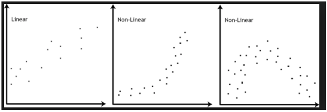
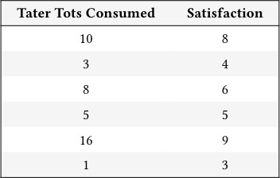
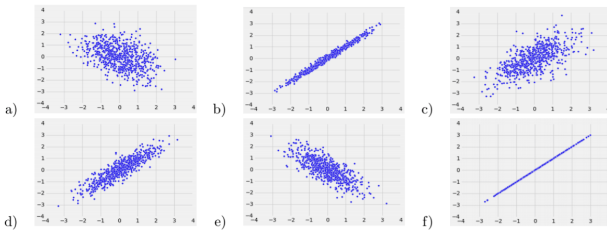
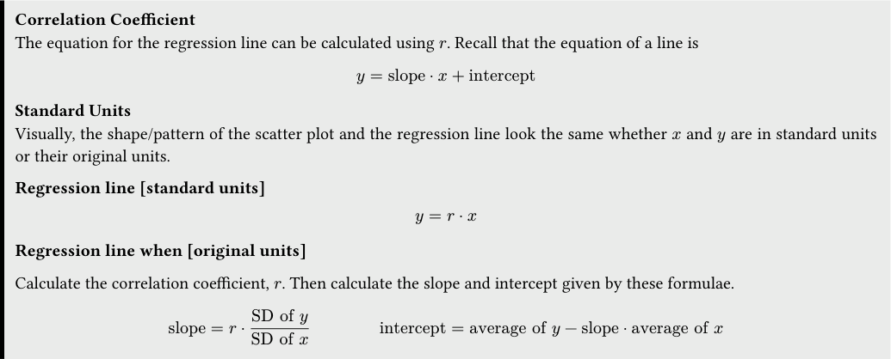
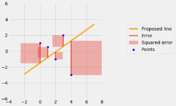

# Tutoring 09 Data C8 Spring 2026

## Page 1

## Correlation & Regression

Tutoring 09

Data C8: Foundations of Data Science UC Berkeley, Spring 2026

### 1. Correlation

Association Refers to any relationship between two variables. It does not have to be linear. For instance, in the plots below, all of them show an association, but only the first graph demonstrates a linear association.

Correlation Denotes a linear association between two variables. The correlation coefficient 𝑟, is a number between −1 and 1 that measures the strength and direction of the linear relationship between two variables.

- Strength: how clustered the scatter plot is around a straight line. If the plot is highly clustered, the absolute value of 𝑟is closer to 1. - Direction: if 𝑦 tends to increase as 𝑥 increases, 𝑟 is positive. If 𝑦 tends to decrease as 𝑥 increases, 𝑟 is negative.

Formula for 𝑟 - The average of the product of 𝑥 and 𝑦 when both variables are measured in standard units. - 𝑟 is a number without units because it is computed with standard units, which also has no units. - Remember, standard units allow us to quantify the relationship between two variables on different units and scales. - 𝑟 is unaffected by switching the axes. This is because it is the average of products of standard units; 𝑥⋅𝑦= 𝑦⋅𝑥. More intuitively, since correlation is a measure of spread around a line, switching the axes won’t change the spread around the line.

Practice Problems The following table, taters, depicts the number of tater tots a person has eaten, along with a number that quantifies their satisfaction, which is a number that goes from 0 to 10.

#### Tater Tots Consumed Satisfaction

10 8

3 4

8 6

5 5

16 9

1 3

(...94 rows omitted)

## Page 2

- First, complete the function su that takes in an array of numbers and outputs the array in standard units. Then, calculate the

#### correlation coefficient between Tater Tots Consumed and Satisfaction and assign it to r.

def su(array):

return ____________________________________________

consumed_su = __________________________________________

satisfaction_su = __________________________________________

r = __________________________________________

def su(array): return (array - np.mean(array)) / np.std(array)

consumed_su = su(taters.column("Tater Tots Consumed")) satisfaction_su = su(taters.column("Satisfaction")) r = np.mean(consumed_su * satisfaction_su)

- Suppose that we find the correlation coefficient, 𝑟, to be equal to 0.743. What can you conclude about the association between

the number of tater tots consumed and a person’s satisfaction?

The value of 𝑟 suggests that Tater Tots Consumed and Satisfaction has a fairly strong positive linear relationship. More tater tots consumed is associated with a greater satisfaction, but consuming more tots does not necessarily cause increased levels of satisfaction. From 𝑟 alone we are not able to determine the existence or absence of a causal relationship. Correlation is not causation!

#### (c) A high value of 𝑟 shows that a change in 𝑥 causes a change in 𝑦.

True

False

False. Correlation only measures the strength and direction of a linear relationship between two variables, and it alone does not imply causation. There could be confounding factors — other variables influencing both 𝑥 and 𝑦 — that may be affecting what we see in our data and the value of 𝑟.

#### (d) If we switch the axes of a plot, the correlation coefficient will not change.

True

False

True, the correlation coefficient is not affected by which variable is deemed 𝑥 and which one is 𝑦. We can swap the axes of the plot, and the correlation coefficient would remain the same.

#### (e) Answer the following questions about the plots below.

Data C8 Spring 2026 Tutoring 09 | 2

## Page 3

- Order the scatter plots above from least correlated to most correlated (in terms of the absolute value of 𝑟).

(Least) _________________________________________________________________________________________ (Most)

A, C, E, D, B, F

#### ii. Which plots show positive correlation? Which show negative correlation?

Positive: ________________________________________ Negative: ________________________________________

Positive: B, C, D, and F.

Negative: A and E.

### 2. Regression

Correlation Coefficient The equation for the regression line can be calculated using 𝑟. Recall that the equation of a line is

𝑦= slope ⋅𝑥+ intercept

Standard Units Visually, the shape/pattern of the scatter plot and the regression line look the same whether 𝑥 and 𝑦 are in standard units or their original units.

#### Regression line [standard units]

𝑦= 𝑟⋅𝑥

#### Regression line when [original units]

Calculate the correlation coefficient, 𝑟. Then calculate the slope and intercept given by these formulae.

slope = 𝑟⋅ SD of 𝑦

SD of 𝑥 intercept = average of 𝑦−slope ⋅average of 𝑥

Practice Problems The top100 table contains the 100 most streamed songs on Spotify in 2023. The energy column represents the song’s perceived energy level as a percentage, and the danceability column represents (as a percentage) how suitable the song is for dancing.

Data C8 Spring 2026 Tutoring 09 | 3

## Page 4

Here are some statistics regarding the two columns: - The energy column has: - a mean of 64 - a standard deviation of 16. - The danceability column has: - a mean of 66 - a standard deviation of 14.5. - The correlation between energy and danceability is 0.3.

- Write an equation for the regression line of the data in the top100 table, with the intention of predicting an unseen

#### danceability percentage given an observed energy percentage. Feel free to use a calculator!

slope = 𝑟⋅ SD of danceability

SD of energy = 0.3 ⋅(14.5

16 ) ≈0.272

intercept = average of danceability −slope ⋅average of energy = 66 −0.272 ⋅64 ≈48.59

y = 0.272x + 48.59

- Using the regression line, what would we predict the danceability to be for a song that had an energy of 90?

0.272 ⋅90 + 48.59 = 73.07

- Suppose that we also calculate our regression line in standard units. Would it be appropriate to use this regression line to

#### predict a danceabillity for which our observed energy (in standard units) is −2? Explain.

Yes! Although it would not be possible to observe a negative value for energy in original units (since it is a percentage), it is definitely possible to observe a value of −2 in standard units. Remember, standard units simply expresses each data point according to the number of standard deviations it is above its mean! If we convert −2 back to original units, we get

64 −2 ⋅(16) = 32

which is completely valid to use the regression line to make a prediction for.

Data C8 Spring 2026 Tutoring 09 | 4

## Page 5

### 3. Root Mean Squared Errors (RMSE)

Root Mean Squared Error (RMSE) RMSE is the square root (R) of the mean (M) of the squared errors (SE). We take the square root of the MSE (mean squared error) such that the RMSE is comparable and of the same units as the original data.

Let 𝑒𝑖 be the residuals and 𝑛 be the number of points in the dataset.

RMSE = √𝑒2

1 + 𝑒2 2 + … + 𝑒2𝑛 𝑛

#### Practice Problems

- Write a function that takes in an array of observed values, an array of predictions, and returns the RMSE. You may assume

that the two arrays have the same length.

def rmse(observed, predicted):

______________________________________________________

______________________________________________________

______________________________________________________

______________________________________________________

def rmse(observed, predicted): residuals = observed - predicted squared_residuals = residuals ** 2 mean_squared_residuals = np.mean(squared_residuals) return np.sqrt(mean_squared_residuals)

- In the calculation of root mean squared error, why is it important for us to square the residuals before taking the mean?

If we do not square the residuals, then we will always get 0 because the sum (and thus mean) of the residuals is always 0. The positive and negative residuals will cancel each other out. Squaring our residuals gets rid of the negatives, allowing us to effectively quantify the accuracy of our predictions.

#### (c) While both valid, why do we tend to use and look at the RMSE over the MSE (mean squared error)?

Data C8 Spring 2026 Tutoring 09 | 5

## Page 6

Both RMSE and MSE calculate the average error of our predictions. However, RMSE is in the same units and scale as our original data, making it easier to interpret the accuracy of our predictions.

Data C8 Spring 2026 Tutoring 09 | 6
