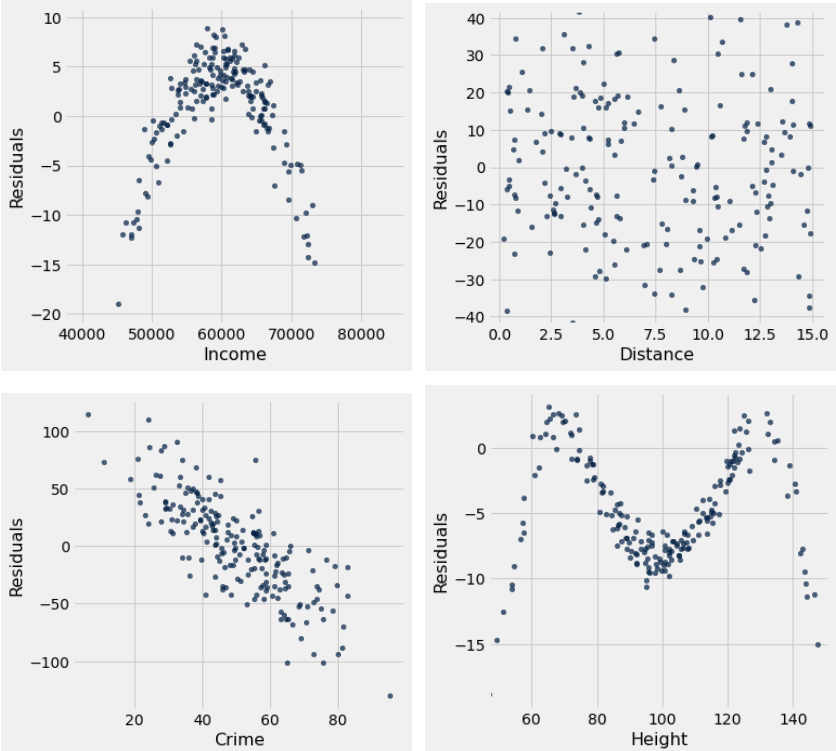

# Tutoring 10 Data C8 Spring 2026

## Page 1

## Residuals & Regression Inference

Tutoring 10

Data C8: Foundations of Data Science UC Berkeley, Spring 2026

### 1. Regression Inference

You take a sample of Data 8 students and ask them about their daily consumption of coffee and their midterm exam scores. Assume you are given a table students with the columns cups and score. The column cups contains the daily consumption of coffee and score contains the midterm exam score for each student from the sample. You perform linear regression and find a slope of 0.13 points per cup of coffee. Katy is considering buying coffee for her discussion to increase their scores but is not sure if this will work.

- State a null and alternative hypothesis to see whether this slope was due to randomness in your sample.

#### Null Hypothesis:

#### Alternative Hypothesis:

#### Null Hypothesis: The slope of the true line is 0.

#### Alternative Hypothesis: The slope of the true line is not 0.

- Write a function slope that takes in a table, tbl, and returns the slope of the least-squares line using the first column to

predict values of the second column.

def slope(tbl):

x = ________________________________________________________

y = ________________________________________________________

zx = _______________________________________________________

zy = _______________________________________________________

r = ________________________________________________________

____________________________________________________________

def slope(tbl): x = tbl.column(0) y = tbl.column(1) zx = (x - np.mean(x)) / np.std(x) zy = (y - np.mean(y)) / np.std(y) r = np.mean(zx * zy) return r * np.std(y) / np.std(x)

- Complete the code to generate 5000 bootstrap resample slopes and then calculate a 95% confidence interval for the slope.

Assume the function slope(tbl) has been implemented correctly.

slopes = ________________________

for i in ________________________:

resample_slope = ________________________________________________ ________________________________________________________________________

## Page 2

left_end = ________________________

right_end = ________________________

interval = make_array(left_end, right_end)

slopes = make_array()

for i in np.arange(5000): resample_slope = slope(students.sample()) slopes = np.append(slopes, resample_slope) left_end = percentile(2.5, slopes) right_end = percentile(97.5, slopes)

interval = make_array(left_end, right_end)

#### Data C8 Spring 2026 Tutoring 10 | 2

## Page 3

#### (d) Suppose you find the confidence interval [0.02, 0.24].

#### i. What do you conclude about your hypotheses at a p-value cutoff of 5%?

We observe that our 95% confidence interval does not contain 0. Therefore, at a p-value cutoff of 5%, we know we can reject the null hypothesis.

#### ii. What about at a p-value cutoff of 10%?

At 10%, we can still reject the null hypothesis because we know that a 90% confidence interval would be narrower than a 95% confidence interval and would therefore still exclude 0.

#### iii. What about at a p-value cutoff of 1%?

At a 1% cutoff, we would not be able to say anything about rejecting or failing to reject the null hypothesis – this is because the confidence interval is wider, meaning we would not be able to tell if 0 is in the 99% confidence interval.

- Your friend who has not taken Data 8 looks at your result and asks you what the confidence interval means. Which one of

the following is a correct response?

For 95% of students, there is a relationship between coffee consumption and midterm score.

There is a 95% probability that the true slope is between 0.02 and 0.24.

There is a 95% probability that our sampling process will produce an interval that contains the true slope.

By definition of confidence intervals.

Data C8 Spring 2026 Tutoring 10 | 3

## Page 4

### 2. Residuals

Suppose Kimiko tries to predict the emergency response time of Superheroes from each of the following four different variables:

- Income (float): the average income in the emergency location’s neighborhood.
- Distance (float): the distance in miles from the emergency location to their headquarters.
- Crimes (float): the average weekly number of crimes reported in the emergency location’s neighborhood last year.
- Height (float): the average building height (in feet) in the emergency location’s neighborhood.

To assess her predictions from each variable, she creates the following residual plots.

- Which of the above is a valid residual plot that indicates a linear relationship between the variable and response time?

Income

Distance

Crimes

Height

None

The only valid residual plot that indicates the variable is linearly associated with response time is Distance. This is because the residual plot for Distance showcases no pattern (neither linear nor non-linear) and the residuals seem to add up to 0.

- Kimiko suspects she may have made a mistake in her code when plotting the residuals. Which of the plots above are

impossible residual plots?

Income

Distance

Crimes

Height

None

Crimes, Height. The Crimes residual plot is impossible because no residual plot for linear regression can ever show a linear trend. If you see that, it is an indication that the line you used for predictions is not the best fit line, but that is not possible because the regression line is supposed to be the best possible line that minimizes the RMSE! The Height residual plot is impossible because the majority of the residuals are negative, and the residuals seemingly do not add up to 0.

Data C8 Spring 2026 Tutoring 10 | 4

## Page 5

#### (c) For which of the above plots should Kimiko try a quadratic equation for regression?

Income

Distance

Crimes

Height

None

Income, since the residual plot for Income shows a quadratic pattern. This indicates that the original plot likely exhibits a quadratic relationship, and using a quadratic equation for regression may be ideal.

Data C8 Spring 2026 Tutoring 10 | 5
