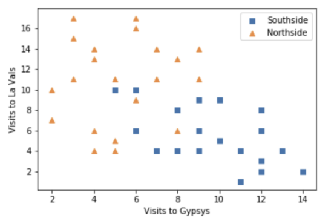
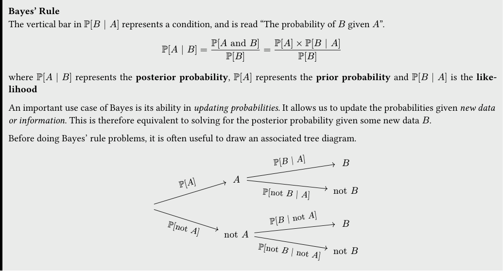
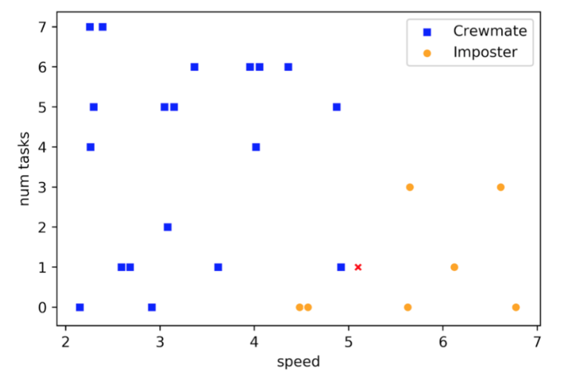

# Tutoring 11 Data C8 Spring 2026

## Page 1

## Classification & Bayes

Tutoring 11

Data C8: Foundations of Data Science UC Berkeley, Spring 2026

### 1. Classification

- Thomas and Ramisha are deciding on which kind of nearest neighbors classifier they want to use. Ramisha says that using

a larger number of neighbors will always result in more accurate predictions. Thomas disagrees. Who is right, and why?

Hint: Think about what happens when we have a dataset with 𝑛 points and we use an n-nearest neighbors classifier.

- Thomas instead proposes they use 𝑘= 1 nearest neighbor instead because he dislikes large 𝑘. What is a potential issue with

this approach?

Hint: Think about the case where we have two groups, label A and label B, completely separated from each other, except for 1 label A point that lies in the B region.

- A student is trying to build a classifier that classifies Berkeley students as residents of Northside or Southside. The student

has a random sample of Berkeley students all of whom live on Northside or Southside. For each student she records whether the student lives on Northside or Southside, the number of times the student went to La Val’s (on Northside) in the last 6 months, and the number of times the student went to Gypsy’s (on Southside) in the last 6 months.

Draw a decision boundary for a 5-nearest neighbor classifier on the scatter plot below.

## Page 2

### 2. Basketball Bayes

Bayes’ Rule The vertical bar in ℙ[𝐵| 𝐴] represents a condition, and is read “The probability of 𝐵 given 𝐴”.

ℙ[𝐴| 𝐵] = ℙ[𝐴and 𝐵]

ℙ[𝐵] = ℙ[𝐴] × ℙ[𝐵| 𝐴]

ℙ[𝐵]

where ℙ[𝐴| 𝐵] represents the posterior probability, ℙ[𝐴] represents the prior probability and ℙ[𝐵| 𝐴] is the like­ lihood

An important use case of Bayes is its ability in updating probabilities. It allows us to update the probabilities given new data or information. This is therefore equivalent to solving for the posterior probability given some new data 𝐵.

Before doing Bayes’ rule problems, it is often useful to draw an associated tree diagram.

ℙ[𝐵| 𝐴]

𝐵

𝐴

ℙ[𝐴]

not 𝐵

ℙ[not 𝐵| 𝐴]

ℙ[𝐵| not 𝐴]

𝐵

ℙ[not 𝐴]

not 𝐴

ℙ[not 𝐵| not 𝐴]

not 𝐵

During the 2022-2023 NBA regular season, the Golden State Warriors took a total of 3,540 3-point shots. 18% of those were shot by the Warriors’ star point guard Steph Curry, and the rest were shot by his teammates. During that season Steph Curry hit 42.7% of all the 3-point shots he took, while his teammates only made 37.6% of theirs.

#### (a) Draw a tree diagram for the problem.

- What is the probability that any given 3-point shot taken by the Warriors was taken by Steph Curry in the 2022-2023 season?

- What is the probability that two random 3-point shots are made if we do not know who shot it on the Warriors?

- Josh was watching a warriors game last season when he walked away to talk to a friend. When he got back to his seat his

friend told him the Warriors had made a 3-point shot. What is the probability that the 3-point shot was made by Steph Curry?

- Angus was watching highlights of a recent warriors game and was told that in highlights, Steph Curry makes 90% of his 3-

point shots and the rest of the team makes 50% of their 3-point shots. Given that a shot was made, what was the probability the highlight was from one of Steph Curry’s shots? You may assume that the prior probabilities stay the same.

Data C8 Spring 2026 Tutoring 11 | 2

## Page 3

### 3. Rick and Morty

(Fall 2020 Final Question 4)

Rick and Morty have been aboard a spaceship for 3 weeks among a crew of 100 people. Rick learns that there is an imposter among them, trying to sabotage their mission. Rick remembers that other space missions recently have had imposters sabotaging their crew. He thinks he might be able to make some predictions about his mission based on how those other missions concluded.

Rick samples flight logs of 26 crew members from across various missions in the last year and notes down a couple of attributes about each sampled person, including the following three columns: speed, num tasks and outcome.

Rick is suspicious of Morty’s sister, Beth. He visualizes this sample data along with Beth’s attributes (the X) in the following chart:

Suppose Rick now wants to use a k-nearest neighbor classifier to predict whether Beth is an imposter based on just her speed and num tasks.

- Which of the following values of 𝑘 would be appropriate for Rick to use for his classifier? Select all that are correct:

1

2

4

7

10

29

- If Rick uses 𝑘= 3 for his classifier, what will his prediction for Beth be? What if he uses 𝑘= 5?

Data C8 Spring 2026 Tutoring 11 | 3

## Page 4

- Rick now decides to try his classifier on Morty. Suppose Morty has a speed of 5.2 and num tasks of 4. The closest neighbor

to Morty in the training set has a speed of 5.6 and num tasks of 3. Write a Python expression that evaluates to the Euclidean distance between Morty and his closest neighbor in the training set.

- Morty is suspicious of Rick’s classifier and decides to create his own classifier. He conducts a random sample of 100 crew

members from various space missions in the past year, observing the same attributes like speed and num tasks. Before using his classifier to make predictions, Morty would like to estimate its accuracy. Which of the following are appropriate ways to do this? Select all that are correct:

Train the classifier on all 100 crew members in the sample, use the classifier to predict the outcome of each of the 100 members, and measure how often the classifier is correct.

Train the classifier on 55 randomly selected crew members from the sample, use the classifier to predict the outcome of each of the remaining 45 members, and measure how often the classifier is correct.

Train the classifier on 70 randomly selected crew members from the sample, use the classifier to predict the outcome of each of the remaining 30 members, and measure how often the classifier is correct.

Train the classifier on all 100 crew members in the sample, use the classifier to predict the outcome of 50 randomly selected members in the sample, and measure how often the classifier is correct.

Train the classifier on all 100 crew members in the sample, use the classifier to predict the outcome of just the imposters in the sample, and measure how often the classifier is correct.

- Morty is worried that his classifier is going to perform very well on his training set but won’t be very accurate when making

predictions on new crew members in the population. What is the name of this phenomenon?

Data C8 Spring 2026 Tutoring 11 | 4
