# Tutoring Worksheets

## Tutoring 01 — Student

### Page 1

### Expressions, Data Types & Arrays

Tutoring 01

Data C8: Foundations of Data Science UC Berkeley, Spring 2026

#### 1. Expressions and Data Types

Function Calls Functions are called by writing the name of the function and passing in arguments in the parentheses. Functions can have any number of arguments, including 0.

- Example: min(4, 5, 6)

Assignment Statements Assigns the value of the expression on the right-hand side of the equal sign to the variable on the left-hand side.

- Example: var = max(1, 3) first evaluates the right-hand side to 3, then assigns it to the variable var.

Arithmetic Operations - +, -, *, and / - % for remainder - ** for exponents - >, <, ==, !=, >=, <= for comparison

Data Type Conversion Functions - str(...) - converts the argument to a string - int(...) - converts the argument to an integer - float(...) - converts the argument to a float

##### Practice Problems

##### (a) Evaluate the following lines of code. What would Python output?

##### i. str(8) + str(24)

##### ii. abs(1 - (4 ** 2))

##### iii. min(10 * 2, 10 - 3, 10 / 10)

##### iv. int('4') * 6

##### v. (7 % 3) > 1

- Assume the variable name eight has been assigned to the string '8'. Using only this string, any string methods, arithmetic,

and any type conversion functions (int, str, etc.), print the square of 88.

### Page 2

#### 2. Arrays

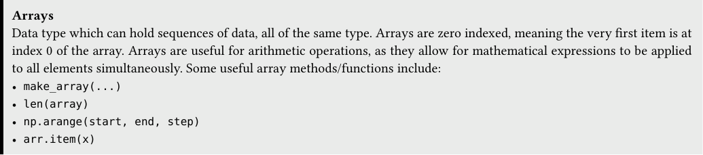

Arrays Data type which can hold sequences of data, all of the same type. Arrays are zero indexed, meaning the very first item is at index 0 of the array. Arrays are useful for arithmetic operations, as they allow for mathematical expressions to be applied to all elements simultaneously. Some useful array methods/functions include: - make_array(...) - len(array) - np.arange(start, end, step) - arr.item(x)

##### Practice Problems

- Write a line of code that creates an array of the first 10 multiples of 3 (starting at 3). There may be more than one way to

achieve this.

- Assume shopping is an array of dollar amounts spent in a store (before tax) by 5 different customers at the Cal student store.

Write a line of code to answer the following questions.

##### i. What is the total amount spent by all five customers?

##### ii. What was the largest amount spent by any one customer?

##### iii. Assume tax is 10 percent on all items. How much did each customer spend after tax?

iv. What was the absolute difference between Person 1’s spending before tax, and Person 5’s spending after tax?

##### (c) Suppose we have an array of strings called str_arr.

##### i. Find the length of the array.

##### ii. Find the length of the third string in this array.

Data C8 Spring 2026 Tutoring 01 | 2

### Page 3

#### 3. Tables

Table Manipulation Table methods can be applied to manipulate a given table in order to filter rows and columns or extract data. This is done by writing tbl.method() – where tbl is a placeholder for the table name and method is a placeholder for the method name – and passing in the necessary arguments. When using table methods, the result is a copy of the table with the specific method applied. Make sure to assign this copy to a variable name in order to use it!

Example methods: where, select, sort, drop, column (full list of methods can be found on the Python Reference).

We can also stack table methods, but this only works when the order of the methods makes sense. Some common examples are: - tbl.sort(...).column(...) - tbl.where(...).select(...)

##### Practice Problems Assume all imports are completed. Pay close attention to all the syntax, as it is difficult to learn at first. Feel free to ask your tutor any questions you have!

For the first part, we are just going to focus on the actors table. A random subset of rows is shown below:

##### Actor Total Gross Number of Movies Average per Movie #1 Movie Gross

Harrison Ford 4871.7 41 118.8 Star Wars: The Force Awak­ ens

936.7

Samuel L. Jackson 4772.8 69 69.2 The Avengers 623.4

Morgan Freeman 4468.3 61 73.3 The Dark Knight 534.9

Tom Hanks 4340.8 44 98.7 Toy Story 3 415

Robert Downey, Jr. 3947.3 53 74.5 The Avengers 623.4

Eddie Murphy 3810.4 38 100.3 Shrek 2 441.2

- Write a line of code that evaluates to a copy of the actors table sorted from highest to lowest number of movies.

- Now, write a line of code to find the actor who has made the most movies. The line should evaluate to just the name as a

string, not a table. Hint: Use your answer to the previous problem!

- What is Henry Cavill’s #1 movie? Write a line of code that evaluates to the name of the movie as a string. You may assume

that Henry Cavill is in the actors table.

- Write a line of code that evaluates to a table consisting of only the Actor column where the elements in the Actor column

are the names of actors who have at least 40 movies and have a total gross below 3000.

Data C8 Spring 2026 Tutoring 01 | 3

## Tutoring 01 — Solution

### Page 1

### Expressions, Data Types & Arrays

Tutoring 01

Data C8: Foundations of Data Science UC Berkeley, Spring 2026

#### 1. Expressions and Data Types

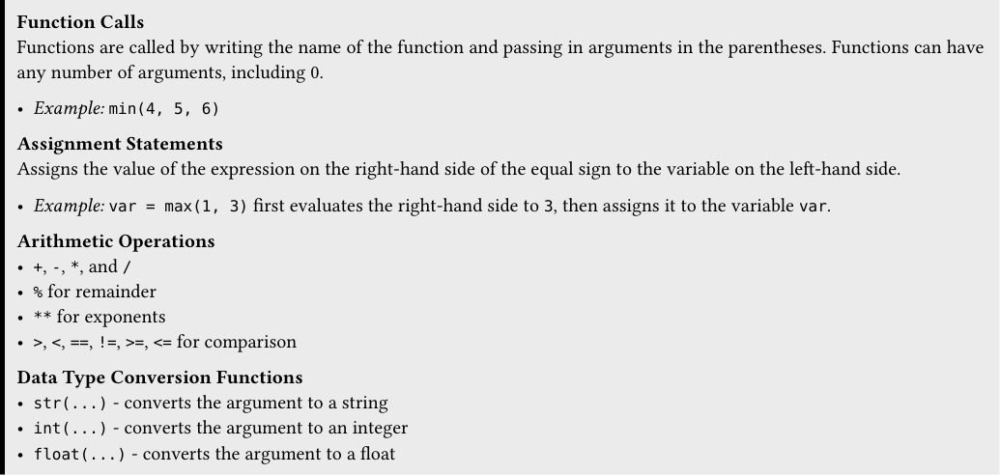

Function Calls Functions are called by writing the name of the function and passing in arguments in the parentheses. Functions can have any number of arguments, including 0.

- Example: min(4, 5, 6)

Assignment Statements Assigns the value of the expression on the right-hand side of the equal sign to the variable on the left-hand side.

- Example: var = max(1, 3) first evaluates the right-hand side to 3, then assigns it to the variable var.

Arithmetic Operations - +, -, *, and / - % for remainder - ** for exponents - >, <, ==, !=, >=, <= for comparison

Data Type Conversion Functions - str(...) - converts the argument to a string - int(...) - converts the argument to an integer - float(...) - converts the argument to a float

##### Practice Problems

##### (a) Evaluate the following lines of code. What would Python output?

##### i. str(8) + str(24)

'824'

##### ii. abs(1 - (4 ** 2))

15

##### iii. min(10 * 2, 10 - 3, 10 / 10)

1.0 (Note that the output will be 1.0 as the / operator will produce floats rather than integers)

##### iv. int('4') * 6

24

##### v. (7 % 3) > 1

False

- Assume the variable name eight has been assigned to the string '8'. Using only this string, any string methods, arithmetic,

and any type conversion functions (int, str, etc.), print the square of 88.

eighty_eight = int(eight + eight) print(eighty_eight * eighty_eight)

### Page 2

#### 2. Arrays

Arrays Data type which can hold sequences of data, all of the same type. Arrays are zero indexed, meaning the very first item is at index 0 of the array. Arrays are useful for arithmetic operations, as they allow for mathematical expressions to be applied to all elements simultaneously. Some useful array methods/functions include: - make_array(...) - len(array) - np.arange(start, end, step) - arr.item(x)

##### Practice Problems

- Write a line of code that creates an array of the first 10 multiples of 3 (starting at 3). There may be more than one way to

achieve this.

##### np.arange(1, 11, 1) * 3 or np.arange(3, 31, 3)

- Assume shopping is an array of dollar amounts spent in a store (before tax) by 5 different customers at the Cal student store.

Write a line of code to answer the following questions.

##### i. What is the total amount spent by all five customers?

sum(shopping)

##### ii. What was the largest amount spent by any one customer?

max(shopping)

##### iii. Assume tax is 10 percent on all items. How much did each customer spend after tax?

shopping * 1.10

iv. What was the absolute difference between Person 1’s spending before tax, and Person 5’s spending after tax?

abs(shopping.item(0) - (shopping * 1.10).item(4))

##### or

abs(shopping.item(0) - shopping.item(4) * 1.10)

##### (c) Suppose we have an array of strings called str_arr.

##### i. Find the length of the array.

len(str_arr)

##### ii. Find the length of the third string in this array.

len(str_arr.item(2))

Data C8 Spring 2026 Tutoring 01 | 2

### Page 3

#### 3. Tables

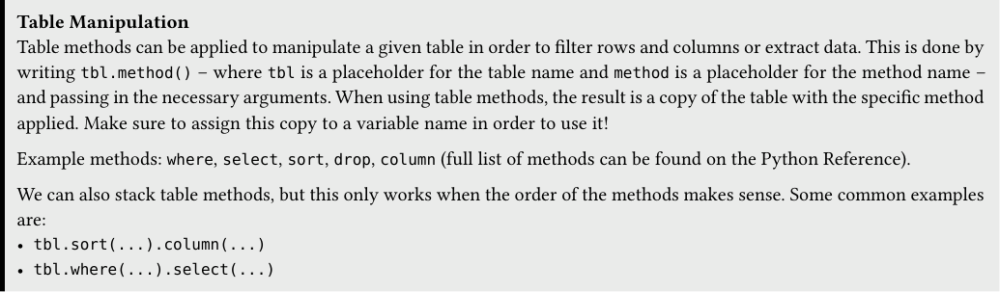

Table Manipulation Table methods can be applied to manipulate a given table in order to filter rows and columns or extract data. This is done by writing tbl.method() – where tbl is a placeholder for the table name and method is a placeholder for the method name – and passing in the necessary arguments. When using table methods, the result is a copy of the table with the specific method applied. Make sure to assign this copy to a variable name in order to use it!

Example methods: where, select, sort, drop, column (full list of methods can be found on the Python Reference).

We can also stack table methods, but this only works when the order of the methods makes sense. Some common examples are: - tbl.sort(...).column(...) - tbl.where(...).select(...)

##### Practice Problems Assume all imports are completed. Pay close attention to all the syntax, as it is difficult to learn at first. Feel free to ask your tutor any questions you have!

For the first part, we are just going to focus on the actors table. A random subset of rows is shown below:

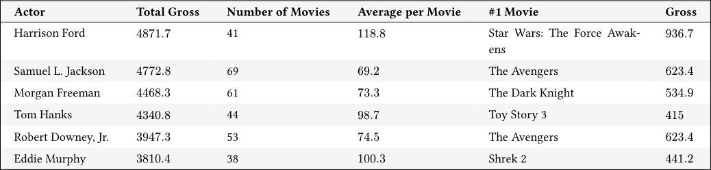

##### Actor Total Gross Number of Movies Average per Movie #1 Movie Gross

Harrison Ford 4871.7 41 118.8 Star Wars: The Force Awak­ ens

936.7

Samuel L. Jackson 4772.8 69 69.2 The Avengers 623.4

Morgan Freeman 4468.3 61 73.3 The Dark Knight 534.9

Tom Hanks 4340.8 44 98.7 Toy Story 3 415

Robert Downey, Jr. 3947.3 53 74.5 The Avengers 623.4

Eddie Murphy 3810.4 38 100.3 Shrek 2 441.2

- Write a line of code that evaluates to a copy of the actors table sorted from highest to lowest number of movies.

actors.sort("Number of Movies", descending = True)

- Now, write a line of code to find the actor who has made the most movies. The line should evaluate to just the name as a

string, not a table. Hint: Use your answer to the previous problem!

actors.sort("Number of Movies", descending = True).column("Actor").item(0)

- What is Henry Cavill’s #1 movie? Write a line of code that evaluates to the name of the movie as a string. You may assume

that Henry Cavill is in the actors table.

actors.where("Actor", are.equal_to("Henry Cavill")).column("#1 Movie").item(0)

- Write a line of code that evaluates to a table consisting of only the Actor column where the elements in the Actor column

are the names of actors who have at least 40 movies and have a total gross below 3000.

actors.where("Number of Movies", are.above_or_equal_to(40)) .where("Total Gross", are.below(3000)) .select("Actor")

Data C8 Spring 2026 Tutoring 01 | 3

## Tutoring 02 — Student

### Page 1

### Visualizations

Tutoring 02

Data C8: Foundations of Data Science UC Berkeley, Spring 2026

#### 1. Nutrition

Line Plot: A line plot is often used to study chronological trends and patterns. - The x-values have a clear, sequential order (for example time). - tbl.plot(x_column, y_column) and tbl.plot(x_column)

Scatter Plot: A scatter plot visualizes the relation between two numerical variables, helping us identify associations. - The data does not need to be sequential. - tbl.scatter(x_column, y_column)

Bar Chart: A bar chart is a way of visualizing categorical distributions. - It displays a bar for each category, equally spaced and equally wide. - tbl.barh(categories) and tbl.barh(categories, values)

Practice Problems Aditya, a Nutrition Science major, is studying the nutrition in the campus dining halls. He randomly samples 500 items served at Crossroads and makes a table menu that contains one row for each sampled item. Here are the first few rows:

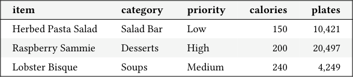

##### item category priority calories plates

Herbed Pasta Salad Salad Bar Low 150 10,421

Raspberry Sammie Desserts High 200 20,497

Lobster Bisque Soups Medium 240 4,249

The menu table contains five columns:

- item (string): name of the item on the menu
- category (string): the food category of the item
- priority (string): the priority that Cal Dining puts on making the item ('Low', 'Medium' or 'High')
- calories (int): number of calories per plate
- plates (int): number of plates served to students in the month

Aditya wants to answer the following questions. Choose which kind of visualization would be the best choice to answer it.

##### (a) Are there more soup items than salad bar items?

Line Graph

Histogram

Bar Chart

Scatterplot

##### (b) Do dessert items tend to be of high priority or low priority?

Line Graph

Histogram

Bar Chart

Scatterplot

### Page 2

- How do the distributions of calories per plate vary between the high priority and low priority desserts?

Line Graph

Histogram

Bar Chart

Scatterplot

##### (d) Is there an association between calories per plate and the number of plates served?

Line Graph

Histogram

Bar Chart

Scatterplot

Data C8 Spring 2026 Tutoring 02 | 2

### Page 3

#### 2. Histograms

Histograms are an important visualization for understanding the distribution of a single numerical variable. While they appear similar to bar charts, histograms have important differences that make them powerful visualizations for data science.

tbl.hist(column, unit, bins, group)

Bins: We use bins to group the numerical variable into intervals. They are inclusive of their lower bounds but exclusive of their upper bounds, which are often expressed as [lower, upper). Bins do not have to be the same size. Note that the rightmost bin is inclusive of both endpoints.

Area Principle: The area of a bin is equal to the percentage of data in the bin. The larger the area, the more data lies in that bin.

area of a bar = % of values in a bin = width of the bin × height of the bin

Axes: The x-axis takes the units of the numerical variable we are investigating. The y-axis measures the percent of data in the bin relative to the size of the bin and takes on the units “percent per <unit of x-axis>”.

##### Practice Problems (a) Suppose you are interested in the number of hours, on average, that UC Berkeley students spend studying a day. You survey

300 random UC Berkeley students, record the number of hours they spend studying, and plot a histogram with the data. The histogram is shown below:

##### i. What percentage of students studied between two and three hours a day?

##### ii. How many students studied between three and four hours a day?

iii. Suppose you created a new bin for students who studied between three and five hours a day. What would be the height

of the new bar?

Data C8 Spring 2026 Tutoring 02 | 3

### Page 4

Throughout this section, we will focus on the following table: wnba. It describes the total statistics of 88 of the highest-paid WNBA players for the 2023 regular season. Salary and age data were sourced from spotrac and the statistics from basketball- reference. We have provided all the data, but we will only use the “Age” column for now. There is one row for each player, and the first few rows of the table look like this:

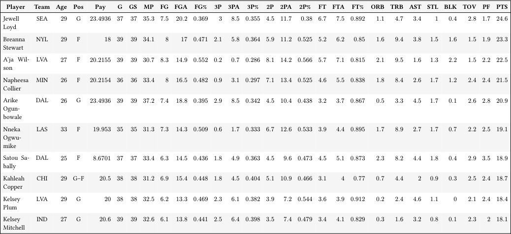

Player Team Age Pos Pay G GS MP FG FGA FG% 3P 3PA 3P% 2P 2PA 2P% FT FTA FT% ORB TRB AST STL BLK TOV PF PTS

Jewell Loyd

SEA 29 G 23.4936 37 37 35.3 7.5 20.2 0.369 3 8.5 0.355 4.5 11.7 0.38 6.7 7.5 0.892 1.1 4.7 3.4 1 0.4 2.8 1.7 24.6

Breanna Stewart

NYL 29 F 18 39 39 34.1 8 17 0.471 2.1 5.8 0.364 5.9 11.2 0.525 5.2 6.2 0.85 1.6 9.4 3.8 1.5 1.6 1.5 1.9 23.3

A’ja Wil­ son

LVA 27 F 20.2155 39 39 30.7 8.3 14.9 0.552 0.2 0.7 0.286 8.1 14.2 0.566 5.7 7.1 0.815 2.1 9.5 1.6 1.3 2.2 1.5 2.2 22.5

Napheesa Collier

MIN 26 F 20.2154 36 36 33.4 8 16.5 0.482 0.9 3.1 0.297 7.1 13.4 0.525 4.6 5.5 0.838 1.8 8.4 2.6 1.7 1.2 2.4 2.4 21.5

Arike Ogun­ bowale

DAL 26 G 23.4936 39 39 37.2 7.4 18.8 0.395 2.9 8.5 0.342 4.5 10.4 0.438 3.2 3.7 0.867 0.5 3.3 4.5 1.7 0.1 2.6 2.8 20.9

Nneka Ogwu­ mike

LAS 33 F 19.953 35 35 31.3 7.3 14.3 0.509 0.6 1.7 0.333 6.7 12.6 0.533 3.9 4.4 0.895 1.7 8.9 2.7 1.7 0.7 2.2 2.5 19.1

Satou Sa­ bally

DAL 25 F 8.6701 37 37 33.4 6.3 14.5 0.436 1.8 4.9 0.363 4.5 9.6 0.473 4.5 5.1 0.873 2.3 8.2 4.4 1.8 0.4 2.9 3.5 18.9

Kahleah Copper

CHI 29 G–F 20.5 38 38 31.2 6.9 15.4 0.448 1.8 4.5 0.404 5.1 10.9 0.466 3.1 4 0.77 0.7 4.4 2 0.9 0.3 2.5 2.4 18.7

Kelsey Plum

LVA 29 G 20 38 38 32.5 6.2 13.3 0.469 2.3 6.1 0.382 3.9 7.2 0.544 3.6 3.9 0.912 0.2 2.4 4.6 1.1 0 2.1 2.4 18.4

Kelsey Mitchell

IND 27 G 20.6 39 39 32.6 6.1 13.8 0.441 2.5 6.4 0.398 3.5 7.4 0.479 3.4 4.1 0.829 0.3 1.6 3.2 0.8 0.1 2.3 2 18.1

#### (b) i. The youngest WNBA player in the 2023 season was 21 years old. The oldest player that season was 41 years old. Create

#### age_bins and assign it to an array of equally spaced bin values that cover all ages of WNBA players with a bin width of 2.

#### ii. Write a line of code to create a histogram of the Age column using the age_bins array and the wnba table.

#### Question Continues ⟶

#### Data C8 Spring 2026 Tutoring 02 | 4

### Page 5

##### (c) Let’s now view the histogram below generated from the wnba table with the following code

wnba.hist("Pay", bins = make_array(5, 8, 10, 13, 15, 20, 25))

Assume that all the players are represented in the histogram and that the units for the salary data are in 10s of thousands of dollars. Answer the following questions or write “Cannot answer”. If you cannot answer the question, explain why.

##### i. Can we find the total number of players who make 150 000 dollars or more?

##### ii. How many players make between 140 000 and 150 000 dollars?

- Assume we have this second histogram generated using different bins bins = make_array(5, 8, 10, 14, 15, 20, 25). If

you wrote “Cannot answer” for anything above, are you able to answer it now? If you are able to answer it, how would you do so?

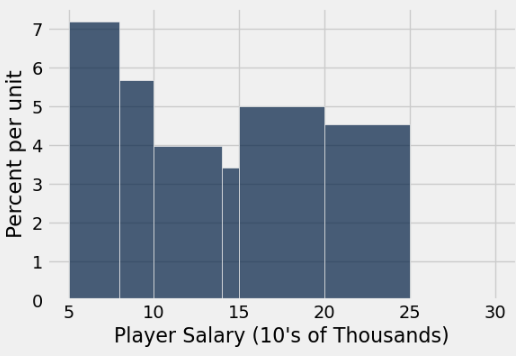

Data C8 Spring 2026 Tutoring 02 | 5

## Tutoring 02 — Solution

### Page 1

### Visualizations

Tutoring 02

Data C8: Foundations of Data Science UC Berkeley, Spring 2026

#### 1. Nutrition

Line Plot: A line plot is often used to study chronological trends and patterns. - The x-values have a clear, sequential order (for example time). - tbl.plot(x_column, y_column) and tbl.plot(x_column)

Scatter Plot: A scatter plot visualizes the relation between two numerical variables, helping us identify associations. - The data does not need to be sequential. - tbl.scatter(x_column, y_column)

Bar Chart: A bar chart is a way of visualizing categorical distributions. - It displays a bar for each category, equally spaced and equally wide. - tbl.barh(categories) and tbl.barh(categories, values)

Practice Problems Aditya, a Nutrition Science major, is studying the nutrition in the campus dining halls. He randomly samples 500 items served at Crossroads and makes a table menu that contains one row for each sampled item. Here are the first few rows:

##### item category priority calories plates

Herbed Pasta Salad Salad Bar Low 150 10,421

Raspberry Sammie Desserts High 200 20,497

Lobster Bisque Soups Medium 240 4,249

The menu table contains five columns:

- item (string): name of the item on the menu
- category (string): the food category of the item
- priority (string): the priority that Cal Dining puts on making the item ('Low', 'Medium' or 'High')
- calories (int): number of calories per plate
- plates (int): number of plates served to students in the month

Aditya wants to answer the following questions. Choose which kind of visualization would be the best choice to answer it.

##### (a) Are there more soup items than salad bar items?

Line Graph

Histogram

Bar Chart

Scatterplot

##### (b) Do dessert items tend to be of high priority or low priority?

Line Graph

Histogram

Bar Chart

Scatterplot

### Page 2

- How do the distributions of calories per plate vary between the high priority and low priority desserts?

Line Graph

Histogram

Bar Chart

Scatterplot

##### (d) Is there an association between calories per plate and the number of plates served?

Line Graph

Histogram

Bar Chart

Scatterplot

Data C8 Spring 2026 Tutoring 02 | 2

### Page 3

#### 2. Histograms

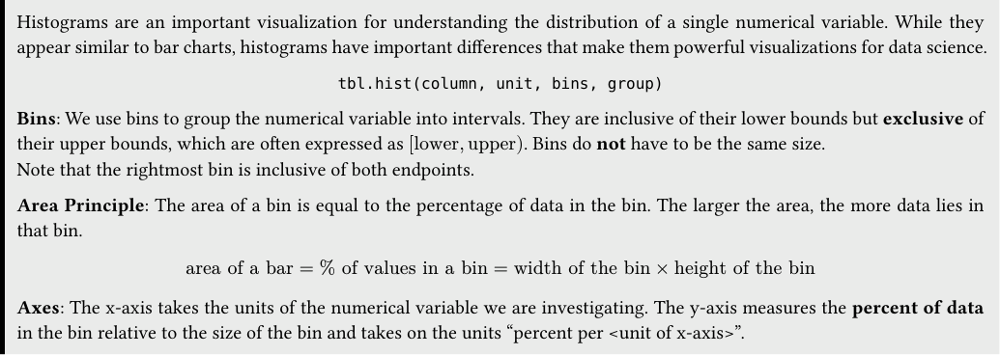

Histograms are an important visualization for understanding the distribution of a single numerical variable. While they appear similar to bar charts, histograms have important differences that make them powerful visualizations for data science.

tbl.hist(column, unit, bins, group)

Bins: We use bins to group the numerical variable into intervals. They are inclusive of their lower bounds but exclusive of their upper bounds, which are often expressed as [lower, upper). Bins do not have to be the same size. Note that the rightmost bin is inclusive of both endpoints.

Area Principle: The area of a bin is equal to the percentage of data in the bin. The larger the area, the more data lies in that bin.

area of a bar = % of values in a bin = width of the bin × height of the bin

Axes: The x-axis takes the units of the numerical variable we are investigating. The y-axis measures the percent of data in the bin relative to the size of the bin and takes on the units “percent per <unit of x-axis>”.

##### Practice Problems (a) Suppose you are interested in the number of hours, on average, that UC Berkeley students spend studying a day. You survey

300 random UC Berkeley students, record the number of hours they spend studying, and plot a histogram with the data. The histogram is shown below:

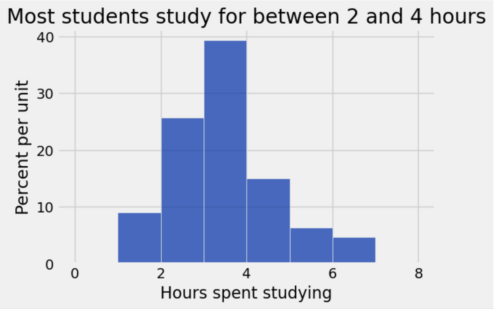

##### i. What percentage of students studied between two and three hours a day?

(3 −2) hours × 25 percent per hour = 25%

##### ii. How many students studied between three and four hours a day?

(4 −3) hours × 40 percent per hour × 300 students = 120 students

iii. Suppose you created a new bin for students who studied between three and five hours a day. What would be the height

of the new bar?

(Units omitted.) 1 5−3((40 × 1) + (15 × 1)) = 27.5 percent per hour

Data C8 Spring 2026 Tutoring 02 | 3

### Page 4

Throughout this section, we will focus on the following table: wnba. It describes the total statistics of 88 of the highest-paid WNBA players for the 2023 regular season. Salary and age data were sourced from spotrac and the statistics from basketball- reference. We have provided all the data, but we will only use the “Age” column for now. There is one row for each player, and the first few rows of the table look like this:

Player Team Age Pos Pay G GS MP FG FGA FG% 3P 3PA 3P% 2P 2PA 2P% FT FTA FT% ORB TRB AST STL BLK TOV PF PTS

Jewell Loyd

SEA 29 G 23.4936 37 37 35.3 7.5 20.2 0.369 3 8.5 0.355 4.5 11.7 0.38 6.7 7.5 0.892 1.1 4.7 3.4 1 0.4 2.8 1.7 24.6

Breanna Stewart

NYL 29 F 18 39 39 34.1 8 17 0.471 2.1 5.8 0.364 5.9 11.2 0.525 5.2 6.2 0.85 1.6 9.4 3.8 1.5 1.6 1.5 1.9 23.3

A’ja Wil­ son

LVA 27 F 20.2155 39 39 30.7 8.3 14.9 0.552 0.2 0.7 0.286 8.1 14.2 0.566 5.7 7.1 0.815 2.1 9.5 1.6 1.3 2.2 1.5 2.2 22.5

Napheesa Collier

MIN 26 F 20.2154 36 36 33.4 8 16.5 0.482 0.9 3.1 0.297 7.1 13.4 0.525 4.6 5.5 0.838 1.8 8.4 2.6 1.7 1.2 2.4 2.4 21.5

Arike Ogun­ bowale

DAL 26 G 23.4936 39 39 37.2 7.4 18.8 0.395 2.9 8.5 0.342 4.5 10.4 0.438 3.2 3.7 0.867 0.5 3.3 4.5 1.7 0.1 2.6 2.8 20.9

Nneka Ogwu­ mike

LAS 33 F 19.953 35 35 31.3 7.3 14.3 0.509 0.6 1.7 0.333 6.7 12.6 0.533 3.9 4.4 0.895 1.7 8.9 2.7 1.7 0.7 2.2 2.5 19.1

Satou Sa­ bally

DAL 25 F 8.6701 37 37 33.4 6.3 14.5 0.436 1.8 4.9 0.363 4.5 9.6 0.473 4.5 5.1 0.873 2.3 8.2 4.4 1.8 0.4 2.9 3.5 18.9

Kahleah Copper

CHI 29 G–F 20.5 38 38 31.2 6.9 15.4 0.448 1.8 4.5 0.404 5.1 10.9 0.466 3.1 4 0.77 0.7 4.4 2 0.9 0.3 2.5 2.4 18.7

Kelsey Plum

LVA 29 G 20 38 38 32.5 6.2 13.3 0.469 2.3 6.1 0.382 3.9 7.2 0.544 3.6 3.9 0.912 0.2 2.4 4.6 1.1 0 2.1 2.4 18.4

Kelsey Mitchell

IND 27 G 20.6 39 39 32.6 6.1 13.8 0.441 2.5 6.4 0.398 3.5 7.4 0.479 3.4 4.1 0.829 0.3 1.6 3.2 0.8 0.1 2.3 2 18.1

#### (b) i. The youngest WNBA player in the 2023 season was 21 years old. The oldest player that season was 41 years old. Create

#### age_bins and assign it to an array of equally spaced bin values that cover all ages of WNBA players with a bin width of 2.

##### age_bins = np.arange(21, 42, 2)

#### ii. Write a line of code to create a histogram of the Age column using the age_bins array and the wnba table.

##### wnba.hist("Age", bins=age_bins)

#### Question Continues ⟶

#### Data C8 Spring 2026 Tutoring 02 | 4

### Page 5

##### (c) Let’s now view the histogram below generated from the wnba table with the following code

wnba.hist("Pay", bins = make_array(5, 8, 10, 13, 15, 20, 25))

Assume that all the players are represented in the histogram and that the units for the salary data are in 10s of thousands of dollars. Answer the following questions or write “Cannot answer”. If you cannot answer the question, explain why.

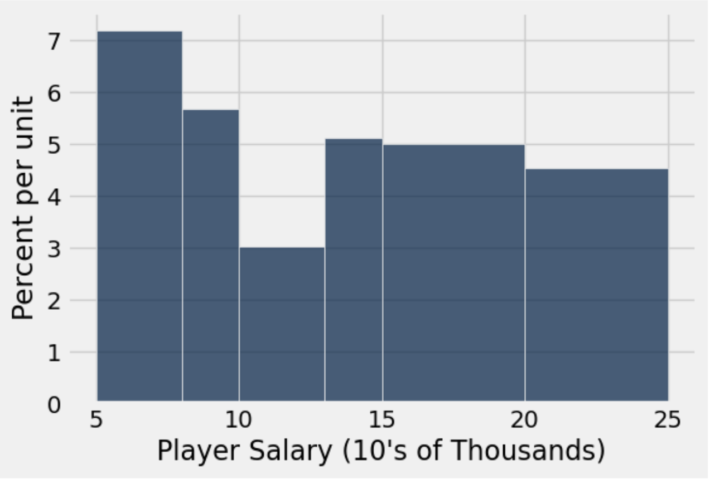

##### i. Can we find the total number of players who make 150 000 dollars or more?

We are able to find the percentage of players whose salaries are above 150 000. We can then multiply this percentage by the number of players given, which is 88 players.

##### ii. How many players make between 140 000 and 150 000 dollars?

Cannot find; we have no information about the [140 000, 150 000) region since we do not know the distribution within the [130 000, 150 000) bin.

- Assume we have this second histogram generated using different bins bins = make_array(5, 8, 10, 14, 15, 20, 25). If

you wrote “Cannot answer” for anything above, are you able to answer it now? If you are able to answer it, how would you do so?

Yes, since we now have a histogram made on the same data with a 140,000-150,000 bin.

Additionally, we would be able to find the number of players who make between 130,000 and 140,000, by taking the number of players who make between 130,000 and 150,000 and subtracting away the number of players who make between 140,000 and 150,000.

Data C8 Spring 2026 Tutoring 02 | 5

## Tutoring 03 — Student

### Page 1

### Functions & Conditionals

Tutoring 03

Data C8: Foundations of Data Science UC Berkeley, Spring 2026

#### 1. Statistical Functions

Functions Functions allow us to give a name to a computational process that may be applied multiple times.

The def marks the start of a function definition, num is the name of the argument being passed in, and the last

return num + five is the return statement, where that value is given back to where the function was called.

def plus_five( num ):

five = 5

} body return num + five

##### Practice Problems

- Saleh is trying to define a function called calculate_mean, but he is not sure how to get started. Help him out by filling in

the following code. It should take in an array of numbers and return the average of the numbers in the array. Do not use the

np.mean or np.average functions!

def calculate_mean(array):

sum_of_array = ______________________________________________ num_elements = ______________________________________________ return ______________________________________________________

- He also defined calculate_statistics. Think about what the function does, and answer the questions below.

def calculate_statistics(array, multiplier): largest_num = max(array) smallest_num = min(array) array_average = calculate_mean(array) stats_array = make_array(largest_num, smallest_num, array_average) final_array = stats_array * multiplier return final_array

Suppose you execute the line of code below in a blank cell. Answer the questions below.

statistics = calculate_statistics(make_array(5, 10, 15, 20), 2)

- Trace through the function call. What are the variables largest_num, array_average and stats_array assigned to?

ii. What does the function return? What is its type? What is the value of statistics.item(1)? What is its type?

iii. After the line of code is executed, what would happen if we tried to print out the value of largest_num by calling

print(largest_num)?

### Page 2

#### 2. Tiered Tires

Conditional Statements Conditional statements allow us to write code that performs different operations based on certain conditions. The code takes a different path depending on the conditions that we specify.

As a reference, here is an example of a conditional statement:

if x > 10: # executes if x > 10 elif x > 5: # executes if x > 5, but x <= 10 else: # executes if above conditions fail

##### Practice Problems Alex got a flat tire. He wants to use data to inform his purchase of a new one. He has access to the tires table which contains the following data:

- name (string): The name of the tire
- width (int): The width of the tire in inches
- efficient (string): Indicates whether a tire is efficient (Yes), not efficient (No), or has uncertain efficiency (Maybe)
- price (int): Pre-tax price in dollars

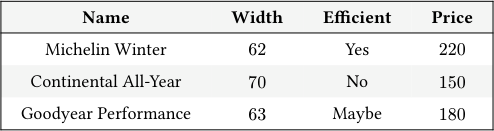

##### Name Width Efficient Price

Michelin Winter 62 Yes 220

Continental All-Year 70 No 150

Goodyear Performance 63 Maybe 180

... (147 rows omitted)

- The tax rate on tires is 9%. To encourage the purchase of efficient tires, the government implemented a tax policy:

- efficient tires (“Yes”) are fully tax-exempt (0% tax);
- uncertain efficiency tires (“Maybe”) are partially taxed at 5%;
- non-efficient tires (“No”) are fully taxed at 9%.

Write a function tax_calc(price, efficiency) that applies the correct tax rate based on the efficiency category.

def tax_calc(price, efficiency):

- Alex now wants to compute the post-tax price for each tire and update the Price column in the tires table. Help him

complete the code below.

post_tax = tires.________________(_____________________, ______________________, ______________________)

tires = tires.with_column(_______________________, _______________________)

Data C8 Spring 2026 Tutoring 03 | 2

### Page 3

#### 3. Musical Groups

John is trying to broaden his music knowledge so he collects his TA’s favorite songs in a table songs that contains one row for each TA. A sample of the table is below:

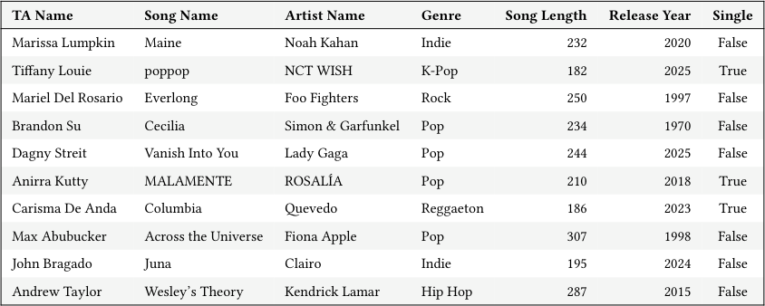

##### TA Name Song Name Artist Name Genre Song Length Release Year Single

Marissa Lumpkin Maine Noah Kahan Indie 232 2020 False

Tiffany Louie poppop NCT WISH K-Pop 182 2025 True

Mariel Del Rosario Everlong Foo Fighters Rock 250 1997 False

Brandon Su Cecilia Simon & Garfunkel Pop 234 1970 False

Dagny Streit Vanish Into You Lady Gaga Pop 244 2025 False

Anirra Kutty MALAMENTE ROSALÍA Pop 210 2018 True

Carisma De Anda Columbia Quevedo Reggaeton 186 2023 True

Max Abubucker Across the Universe Fiona Apple Pop 307 1998 False

John Bragado Juna Clairo Indie 195 2024 False

Andrew Taylor Wesley’s Theory Kendrick Lamar Hip Hop 287 2015 False

The table contains 7 columns. A few columns are described below:

- Song Length (int): the length of the song in seconds.
- Single (boolean): True if the song was a single and False otherwise.

##### Practice Problems

- John is curious if there are more singles or songs that were released as part of albums in the data set. Help John by computing

a new table that contains two columns: Single, which indicates if a song is a single or not, and count, which counts the number of songs in the table that fit that category.

___________________________________________

- John realized that to learn songs as fast as possible, he should prioritize genres that have shorter songs on average.

Compute the number of genres in the data set that have an average song length less than 250 seconds. Note: Pay attention to the column name Song Length average.

genre_group = songs.__________________(_____________________________, _________________________________)

genre_group.__________________("Song Length average", ________________________________).________________

- John now wants to analyze how song lengths vary between singles and non-singles for each genre. Help him create a new

##### table showing the average song length for each combination of Single and Genre.

Write two separate lines of code that are two separate ways to create such a table.

- ______________________________________________________________________________________________________

ii. ______________________________________________________________________________________________________

Data C8 Spring 2026 Tutoring 03 | 3

## Tutoring 03 — Solution

### Page 1

### Functions & Conditionals

Tutoring 03

Data C8: Foundations of Data Science UC Berkeley, Spring 2026

#### 1. Statistical Functions

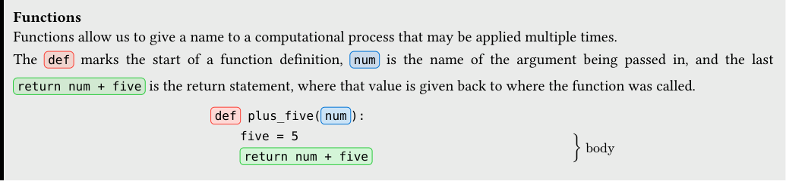

Functions Functions allow us to give a name to a computational process that may be applied multiple times.

The def marks the start of a function definition, num is the name of the argument being passed in, and the last

return num + five is the return statement, where that value is given back to where the function was called.

def plus_five( num ):

five = 5

} body return num + five

##### Practice Problems

- Saleh is trying to define a function called calculate_mean, but he is not sure how to get started. Help him out by filling in

the following code. It should take in an array of numbers and return the average of the numbers in the array. Do not use the

np.mean or np.average functions!

def calculate_mean(array):

sum_of_array = ______________________________________________ num_elements = ______________________________________________ return ______________________________________________________

def calculate_mean(array): sum_of_array = sum(array) num_elements = len(array) return sum_of_array / num_elements

- He also defined calculate_statistics. Think about what the function does, and answer the questions below.

def calculate_statistics(array, multiplier): largest_num = max(array) smallest_num = min(array) array_average = calculate_mean(array) stats_array = make_array(largest_num, smallest_num, array_average) final_array = stats_array * multiplier return final_array

Suppose you execute the line of code below in a blank cell. Answer the questions below.

statistics = calculate_statistics(make_array(5, 10, 15, 20), 2)

- Trace through the function call. What are the variables largest_num, array_average and stats_array assigned to?

### Page 2

largest_num: 20

array_average: 50

4 or 12.5

stats_array: array([20.0, 5.0, 12.5]). Note: all of the elements in the array are now floats. This is because arrays can only contain one type of data, and so by creating an array that includes array_average (a float) the other integers turn into floats as well.

ii. What does the function return? What is its type? What is the value of statistics.item(1)? What is its type?

array([40.0, 10.0, 25.0]). It is an array.

10.0. It is a float.

iii. After the line of code is executed, what would happen if we tried to print out the value of largest_num by calling

print(largest_num)?

We would get an error telling us that largest_num is not defined. The variable largest_num is only defined within the scope of the function, so after the code has been executed, largest_num no longer has any value.

Data C8 Spring 2026 Tutoring 03 | 2

### Page 3

#### 2. Tiered Tires

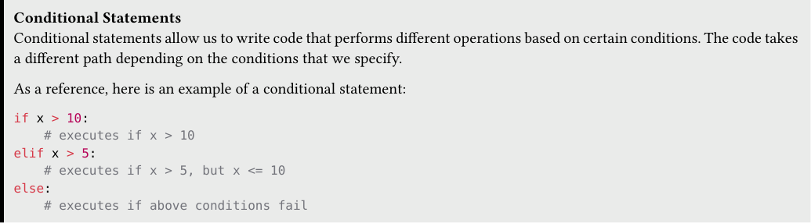

Conditional Statements Conditional statements allow us to write code that performs different operations based on certain conditions. The code takes a different path depending on the conditions that we specify.

As a reference, here is an example of a conditional statement:

if x > 10: # executes if x > 10 elif x > 5: # executes if x > 5, but x <= 10 else: # executes if above conditions fail

##### Practice Problems Alex got a flat tire. He wants to use data to inform his purchase of a new one. He has access to the tires table which contains the following data:

- name (string): The name of the tire
- width (int): The width of the tire in inches
- efficient (string): Indicates whether a tire is efficient (Yes), not efficient (No), or has uncertain efficiency (Maybe)
- price (int): Pre-tax price in dollars

##### Name Width Efficient Price

Michelin Winter 62 Yes 220

Continental All-Year 70 No 150

Goodyear Performance 63 Maybe 180

... (147 rows omitted)

- The tax rate on tires is 9%. To encourage the purchase of efficient tires, the government implemented a tax policy:

- efficient tires (“Yes”) are fully tax-exempt (0% tax);
- uncertain efficiency tires (“Maybe”) are partially taxed at 5%;
- non-efficient tires (“No”) are fully taxed at 9%.

Write a function tax_calc(price, efficiency) that applies the correct tax rate based on the efficiency category.

def tax_calc(price, efficiency):

if efficiency == 'Yes': return price elif efficiency == 'Maybe': return 1.05 * price else: return 1.09 * price

- Alex now wants to compute the post-tax price for each tire and update the Price column in the tires table. Help him

complete the code below.

post_tax = tires.________________(_____________________, ______________________, ______________________)

tires = tires.with_column(_______________________, _______________________)

post_tax = tires.apply(tax_calc, 'Price', 'Efficient') tires = tires.with_column('Price', post_tax)

Data C8 Spring 2026 Tutoring 03 | 3

### Page 4

#### 3. Musical Groups

John is trying to broaden his music knowledge so he collects his TA’s favorite songs in a table songs that contains one row for each TA. A sample of the table is below:

##### TA Name Song Name Artist Name Genre Song Length Release Year Single

Marissa Lumpkin Maine Noah Kahan Indie 232 2020 False

Tiffany Louie poppop NCT WISH K-Pop 182 2025 True

Mariel Del Rosario Everlong Foo Fighters Rock 250 1997 False

Brandon Su Cecilia Simon & Garfunkel Pop 234 1970 False

Dagny Streit Vanish Into You Lady Gaga Pop 244 2025 False

Anirra Kutty MALAMENTE ROSALÍA Pop 210 2018 True

Carisma De Anda Columbia Quevedo Reggaeton 186 2023 True

Max Abubucker Across the Universe Fiona Apple Pop 307 1998 False

John Bragado Juna Clairo Indie 195 2024 False

Andrew Taylor Wesley’s Theory Kendrick Lamar Hip Hop 287 2015 False

The table contains 7 columns. A few columns are described below:

- Song Length (int): the length of the song in seconds.
- Single (boolean): True if the song was a single and False otherwise.

##### Practice Problems

- John is curious if there are more singles or songs that were released as part of albums in the data set. Help John by computing

a new table that contains two columns: Single, which indicates if a song is a single or not, and count, which counts the number of songs in the table that fit that category.

___________________________________________

songs.group("Single")

- John realized that to learn songs as fast as possible, he should prioritize genres that have shorter songs on average.

Compute the number of genres in the data set that have an average song length less than 250 seconds. Note: Pay attention to the column name Song Length average.

genre_group = songs.__________________(_____________________________, _________________________________)

genre_group.__________________("Song Length average", ________________________________).________________

genre_group = songs.group("Genre", np.average) genre_group.where("Song Length average", are.below(250)).num_rows

- John now wants to analyze how song lengths vary between singles and non-singles for each genre. Help him create a new

##### table showing the average song length for each combination of Single and Genre.

Write two separate lines of code that are two separate ways to create such a table.

- ______________________________________________________________________________________________________

Data C8 Spring 2026 Tutoring 03 | 4

### Page 5

songs.pivot("Single", "Genre", "Song Length", np.average)

##### or

songs.pivot("Genre", "Single", "Song Length", np.average)

##### ii. ______________________________________________________________________________________________________

songs.select("Genre", "Single", "Song Length").group(make_array("Genre", "Single"), np.average)

##### or

songs.select("Genre", "Single", "Song Length").group(make_array("Single", "Genre"), np.average)

##### Data C8 Spring 2026 Tutoring 03 | 5

## Tutoring 04 — Student

### Page 1

### Iteration & Probability

Tutoring 04

Data C8: Foundations of Data Science UC Berkeley, Spring 2026

#### 1. Iteration

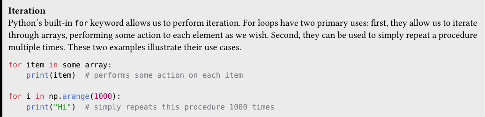

Iteration Python’s built-in for keyword allows us to perform iteration. For loops have two primary uses: first, they allow us to iterate through arrays, performing some action to each element as we wish. Second, they can be used to simply repeat a procedure multiple times. These two examples illustrate their use cases.

for item in some_array: print(item) # performs some action on each item

for i in np.arange(1000): print("Hi") # simply repeats this procedure 1000 times

##### Practice Problems (a) The for loop statement below stores the length of each name in names in a new array called lengths.

lengths = make_array() names = make_array("Anirra", "Chase", "Aralyn", "Dan")

for name in names: lengths = np.append(lengths, len(name))

- For each iteration of the for loop below, fill in the value of name as well as what the array lengths looks like after that

iteration is fully executed.

Iteration 1: name = ________________ lengths = ______________________________

Iteration 2: name = ________________ lengths = ______________________________

Iteration 3: name = ________________ lengths = ______________________________

Iteration 4: name = ________________ lengths = ______________________________

ii. We now decide to only store the name if the length of that name is greater than 5. Fill in the following for loop statement.

What does longer evaluate to after the loop executes?

longer = make_array()

for name in __________________________:

if ____________________________________:

longer = _________________________________

iii. Finally, look at this last for loop below. What values does i take on throughout? How is i used differently to the way

name is used in the previous for loops? What is the value of counter after the for loop stops running?

counter = 0 for i in np.arange(1000): counter = counter + 1

### Page 2

- Some people on the Data 8 staff love to go get tacos on Tuesdays! Suppose that a group of five staff members go to get

tacos on a random Tuesday. Although they usually order separately, this time they decide to order together and split the bill afterwards. The tacos array contains the number of tacos each staff member ordered. In order to make splitting the bill easier, we would like to calculate an array called proportions, which is the proportion of tacos that each staff member ordered relative to the total amount.

Example: If the tacos array looked like array([1, 2, 3, 2, 2]), then proportions would look like array([0.1, 0.2,

0.3, 0.2, 0.2]). This is found by dividing each of the elements in tacos by the total number of tacos ordered, or the sum of tacos.

- Your friend Prakrat recently learned about for loops, and decides to use one to calculate the proportions array. However,

there are some issues with his code! Find all the errors that Prakrat made (Hint: there are 3). What would the code output if executed as is, and how would you fix it?

tacos = make_array(1, 3, 4, 4, 2) total = sum(tacos)

for num_tacos in tacos: proportions = make_array() prop = taco / total np.append(proportions, prop)

print(proportions)

##### ii. Now, fill in the blank to repeat the same process, this time only using array arithmetic.

proportions = __________________________________________________ print(proportions)

Notice how much shorter the code is using array arithmetic! Although for loops are extremely powerful, they do not always provide the easiest or most appropriate solution to a given problem. Just because you can use a for loop doesn’t always mean you should use one. This also goes to show how useful arrays can be!

Data C8 Spring 2026 Tutoring 04 | 2

### Page 3

#### 2. Probability

##### Addition Rule: ℙ[Either Event A or Event B happens] = ℙ[Event A happens] + ℙ[Event B happens]

Multiplication Rule: ℙ[Event A and Event B both happen] = ℙ[Event A happens] × ℙ[Event B happens, given Event A happened]

##### Complement Rule: ℙ[Event A happens] = 1 −ℙ[Event A does not happen]

##### Practice Problems (a) Marissa loves collecting stickers from Berkeley Data Science classes to decorate her computer and water bottle! She finds a

stash of 8 Data 8 stickers, 4 Data 100 stickers, and 2 Data 140 stickers in a box in Evans B6! She can take 1 sticker out of the box at a time, each with an equal probability of being chosen.

- Marissa picks 2 stickers without replacement. What is the probability that she draws a Data 8 and a Data 100 sticker?

Marissa leaves all of those stickers in Evans B6 and goes to Evans 458. She finds a new stash of only four stickers, including one Data 8 sticker, one Data 100 sticker, one Data 102 sticker, and one Data 140 sticker!

ii. Suppose Marissa randomly picks 4 stickers with replacement. What is the probability that Marissa picks four unique

stickers?

iii. Suppose this time Marissa picks without replacement. What is the probability that Marissa picks four unique stickers?

Write down the explicit probabilities, then interpret this probability intuitively.

iv. Suppose Marissa randomly picks 4 stickers with replacement. What is the probability that Marissa picks the Data 8 sticker

at least once?

Data C8 Spring 2026 Tutoring 04 | 3

## Tutoring 04 — Solution

### Page 1

### Iteration & Probability

Tutoring 04

Data C8: Foundations of Data Science UC Berkeley, Spring 2026

#### 1. Iteration

Iteration Python’s built-in for keyword allows us to perform iteration. For loops have two primary uses: first, they allow us to iterate through arrays, performing some action to each element as we wish. Second, they can be used to simply repeat a procedure multiple times. These two examples illustrate their use cases.

for item in some_array: print(item) # performs some action on each item

for i in np.arange(1000): print("Hi") # simply repeats this procedure 1000 times

##### Practice Problems (a) The for loop statement below stores the length of each name in names in a new array called lengths.

lengths = make_array() names = make_array("Anirra", "Chase", "Aralyn", "Dan")

for name in names: lengths = np.append(lengths, len(name))

- For each iteration of the for loop below, fill in the value of name as well as what the array lengths looks like after that

iteration is fully executed.

Iteration 1: name = ________________ lengths = ______________________________

Iteration 2: name = ________________ lengths = ______________________________

Iteration 3: name = ________________ lengths = ______________________________

Iteration 4: name = ________________ lengths = ______________________________

Iteration 1: name = "Anirra" lengths = array([6.]) Iteration 2: name = "Chase" lengths = array([6., 5.]) Iteration 3: name = "Aralyn" lengths = array([6., 5., 6.]) Iteration 4: name = "Dan" lengths = array([6., 5., 6., 3.])

Note: Appending integers to an empty array converts them to floats.

ii. We now decide to only store the name if the length of that name is greater than 5. Fill in the following for loop statement.

What does longer evaluate to after the loop executes?

longer = make_array()

for name in __________________________:

if ____________________________________:

longer = _________________________________

### Page 2

longer = make_array() for name in names: if len(name) > 5: longer = np.append(longer, name)

longer would contain the names Anirra and Aralyn. longer = array(["Anirra", "Aralyn"])

iii. Finally, look at this last for loop below. What values does i take on throughout? How is i used differently to the way

name is used in the previous for loops? What is the value of counter after the for loop stops running?

counter = 0 for i in np.arange(1000): counter = counter + 1

i takes on values that go from 0 to 999. In the first iteration, i takes on the value of 0, in the second, it takes on the value of 1, and so on. The way i is used here is different than the way name was used in the previous for loop, since we cared about the value that name took on throughout the for loop. For this for loop, we do not really care about i — we simply want to repeat a line of code 1000 times. After the for loop stops running, counter has the value 1000. We’ll use for loops like the one above many times throughout this course for the purpose of simulating!

Data C8 Spring 2026 Tutoring 04 | 2

### Page 3

- Some people on the Data 8 staff love to go get tacos on Tuesdays! Suppose that a group of five staff members go to get

tacos on a random Tuesday. Although they usually order separately, this time they decide to order together and split the bill afterwards. The tacos array contains the number of tacos each staff member ordered. In order to make splitting the bill easier, we would like to calculate an array called proportions, which is the proportion of tacos that each staff member ordered relative to the total amount.

Example: If the tacos array looked like array([1, 2, 3, 2, 2]), then proportions would look like array([0.1, 0.2,

0.3, 0.2, 0.2]). This is found by dividing each of the elements in tacos by the total number of tacos ordered, or the sum of tacos.

- Your friend Prakrat recently learned about for loops, and decides to use one to calculate the proportions array. However,

there are some issues with his code! Find all the errors that Prakrat made (Hint: there are 3). What would the code output if executed as is, and how would you fix it?

tacos = make_array(1, 3, 4, 4, 2) total = sum(tacos)

for num_tacos in tacos: proportions = make_array() prop = taco / total np.append(proportions, prop)

print(proportions)

Error 1: The code creates a new proportions array for each iteration of the for loop, instead of appending to the same

proportions array! In order to keep appending to the same array, the proportions = make_array() line will need to come before (or above) the for loop.

Error 2: For each iteration of the for loop, the placeholder num_tacos is taking on a single value in the tacos array. However, in the body of the for loop we don’t use num_tacos; instead, we are using taco which is not defined. Be consistent with variable and placeholder names! In this case, we need to either make them both num_tacos or both taco.

Error 3: This code appends to the proportions array for each iteration of the for loop, but does not re-assign it back to the proportions array. Therefore, it will not keep track of values that were previously appended to it. After the for loop is done running, the proportions array will be empty.

The correct code would be as follows:

tacos = make_array(1, 3, 4, 4, 2) total = sum(tacos) proportions = make_array()

for num_tacos in tacos: prop = num_tacos / total proportions = np.append(proportions, prop)

print(proportions)

##### ii. Now, fill in the blank to repeat the same process, this time only using array arithmetic.

proportions = __________________________________________________ print(proportions)

proportions = tacos / sum(tacos) print(proportions)

Data C8 Spring 2026 Tutoring 04 | 3

### Page 4

Notice how much shorter the code is using array arithmetic! Although for loops are extremely powerful, they do not always provide the easiest or most appropriate solution to a given problem. Just because you can use a for loop doesn’t always mean you should use one. This also goes to show how useful arrays can be!

Data C8 Spring 2026 Tutoring 04 | 4

### Page 5

#### 2. Probability

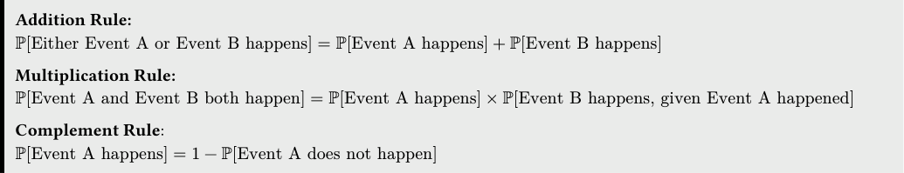

##### Addition Rule: ℙ[Either Event A or Event B happens] = ℙ[Event A happens] + ℙ[Event B happens]

Multiplication Rule: ℙ[Event A and Event B both happen] = ℙ[Event A happens] × ℙ[Event B happens, given Event A happened]

##### Complement Rule: ℙ[Event A happens] = 1 −ℙ[Event A does not happen]

##### Practice Problems (a) Marissa loves collecting stickers from Berkeley Data Science classes to decorate her computer and water bottle! She finds a

stash of 8 Data 8 stickers, 4 Data 100 stickers, and 2 Data 140 stickers in a box in Evans B6! She can take 1 sticker out of the box at a time, each with an equal probability of being chosen.

- Marissa picks 2 stickers without replacement. What is the probability that she draws a Data 8 and a Data 100 sticker?

( 8

14 ⋅4 1. + ( 4 14 ⋅8 1. = 2 ⋅8 14 ⋅4 13 = 32 91

Marissa leaves all of those stickers in Evans B6 and goes to Evans 458. She finds a new stash of only four stickers, including one Data 8 sticker, one Data 100 sticker, one Data 102 sticker, and one Data 140 sticker!

ii. Suppose Marissa randomly picks 4 stickers with replacement. What is the probability that Marissa picks four unique

stickers?

On the first draw, you can pick any of the four stickers. On the second pick you can only pick 3 of the 4 stickers to get a unique sticker, and so on. Therefore,

ℙ[Picking four unique stickers, with replacement] = 4

4 ⋅3 4 ⋅2 4 ⋅1 4 = 9.375%.

iii. Suppose this time Marissa picks without replacement. What is the probability that Marissa picks four unique stickers?

Write down the explicit probabilities, then interpret this probability intuitively.

ℙ[Picking four unique stickers, without replacement] = 4

4 ⋅3 3 ⋅2 2 ⋅1 1 = 1

Intuitively, since we have one of each sticker, and we do not put the stickers back, every new sticker will be unique, and hence this event is certain to occur (w.p. 1).

iv. Suppose Marissa randomly picks 4 stickers with replacement. What is the probability that Marissa picks the Data 8 sticker

at least once?

We can use the complement rule to calculate the chance by calculating

1 −ℙ[Data 8 sticker is not picked]

In order to not pick the Data 8 sticker, you have to pick either the Data 100 sticker, the Data 102 sticker, or the Data 140 sticker on all four draws. This probability is equivalent for all draws since you are sampling with replacement. Therefore,

ℙ[Data 8 sticker is not picked] = 3

4 ⋅3 4 ⋅3 4 ⋅3 4

4 = 68.36%

⟹ℙ[at least one Data 8 sticker is picked] = 1 −(3

4)

Data C8 Spring 2026 Tutoring 04 | 5

## Tutoring 05 — Student

### Page 1

### Sampling & Hypothesis Testing

Tutoring 05

Data C8: Foundations of Data Science UC Berkeley, Spring 2026

#### 1. Sampling

Population and Samples Due to time and resource constraints, it is typically only feasible to analyze samples rather than entire populations. Our goal is to infer some characteristics of the population, called population parameters, by studying our samples. In many cases, we are interested in estimating these parameters using sample statistics, values we compute from a sample of the population.

For example, you may be interested in knowing the percentage of all eligible voters who are planning on voting for Candidate - Since asking everyone in the U.S. who they plan to vote for is clearly infeasible, what we can do is take a sample.

Here are the different methods we use to take samples: - If you are sampling from a pre-existing table: tbl.sample(sample_size) - If you are sampling from a defined probabilistic model: sample_proportions(sample_size, model_proportions) - If you are sampling from an array: np.random.choice(array, sample_size)

##### Practice Problems

- Let’s use the example of rolling a fair die. Is rolling a die sampling with replacement or without replacement?

- Calculate the probability of rolling a 5. Is this an empirical or a theoretical probability? Is there a relationship between

the two?

- Suppose that we have a table called dice, which has one column Side and contains the values 1 through 6. Complete the

function roll_die, which takes in no arguments and uses the dice table to simulate rolling a fair die once. Hint: the function should return an integer between 1 and 6.

def roll_die():

_____________________________________

- Simulate rolling a fair die 10 times and store the results in an array called simulated_rolls, using roll_die().

simulated_rolls = make_array()

for i in ____________________________:

face = ________________________________ simulated_rolls = ______________________________

### Page 2

- We have generated histograms of simulated rolls for samples of size 10, 100, 1000, and 10,000. Which histograms correspond

to which sample sizes, and why? Do these histograms show a theoretical or empirical distribution?

##### A B C D

Data C8 Spring 2026 Tutoring 05 | 2

### Page 3

### 2. Hypothesis Testing

##### (a) Suppose your friend Lena is into bottle flipping, and she lets you try out the best bottle in her collection. According to Lena,

##### her best bottle lands right side up with a 2/3 chance and lands on its side with a 1/3 chance. You flip the bottle 60 times and observe a successful bottle flip 45 times.

##### Does the bottle that you are flipping seem consistent with Lena’s model? Why or why not?

##### (b) Complete the function flip_bottle, which takes in no arguments and randomly flips the bottle described above 60 times.

##### The function should return the number of successful bottle flips out of the 60 flips. Refer to the Reference Sheet if you need a refresher on sample_proportions!

def flip_bottle():

probabilities = ____________________________________________________________________________________ empirical_props = __________________________________________________________________________________ prop_flipped = _____________________________________________________________________________________ return _____________________________________________________________________________________________

##### (c) Complete the code below to simulate the experiment described above 10000 times, and record the number of bottles flipped

##### in each of these experiments in an array called bottles_flipped.

trials = ________________________________________

bottles_flipped = _______________________________

for i in _________________________________________________________:

one_experiment = _______________________________________________________ _________________ = ____________________(_________________________________________________________) Table().with_column("Successful Flips", bottles_flipped) .hist("Successful Flips", bins=np.arange(25, 60, 1))

##### (d) Suppose you performed the simulation and plotted a histogram of bottles_flipped. The histogram is shown below. Was

##### observing 45 successful bottle flips consistent with the model you simulated under?

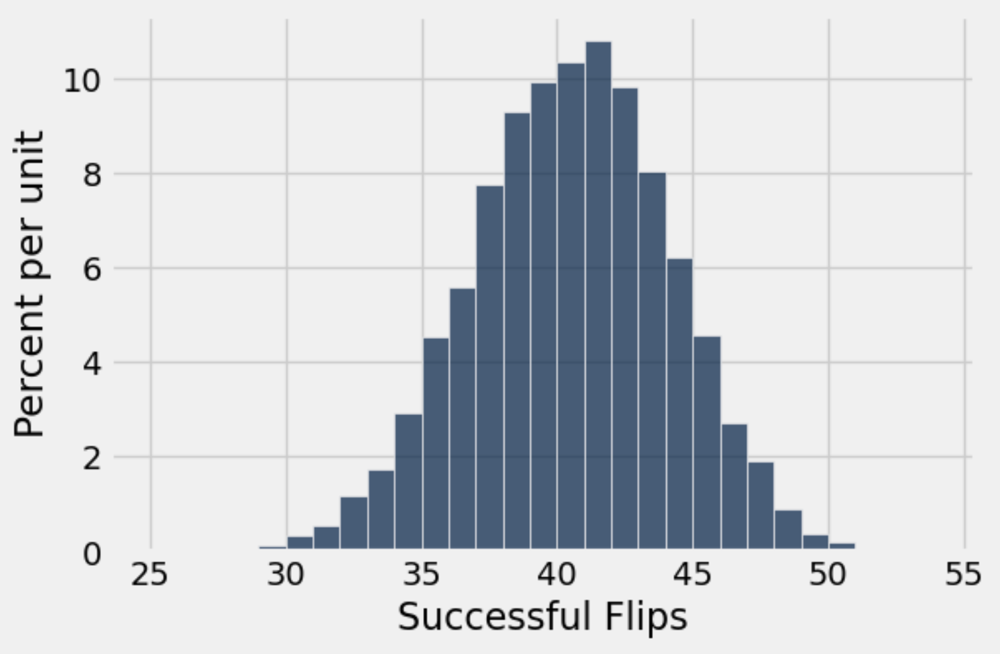

##### Data C8 Spring 2026 Tutoring 05 | 3

### Page 4

#### 3. Welcome

The table welcome_tbl contains the results of the Fall 2021 Data 8 welcome survey. The first two rows are shown below. Each row corresponds to a student. In the column Extroversion, each student scored themselves on a scale of 1 (not extroverted) to 10 (extremely extroverted).

(Fall 2021 Midterm Question 8)

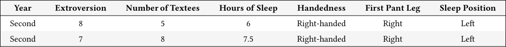

##### Year Extroversion Number of Textees Hours of Sleep Handedness First Pant Leg Sleep Position

Second 8 5 6 Right-handed Right Left

Second 7 8 7.5 Right-handed Right Left

- Complete the code below to define a function max_extroversion that takes sample_size as its argument. The function

should sample sample_size many times at random without replacement from all the students, and return the maximum extroversion score among the sampled students.

def max_extroversion(________________________):

sampled_students = ______________________________________________

_________________________________________________________________

- We decide to simulate 10,000 values of maximum extroversion score, drawing random samples of size 25 without replacement.

Complete the code below so the last line evaluates to an array of 10,000 simulated values from all students. Your code should use the max_extroversion function that you defined above.

repetitions = ______________________

sim_vals = _________________________

for ______________________ in ______________________:

________________________________________________________________ ________________________________________________________________

- A student mistypes the sample size in the previous question to be 55 instead of 25. One of the histograms below shows the

distribution of the maximum values simulated by this student. The other shows the distribution of the maximum values that you simulated using a sample size of 25. Which is which? Why?

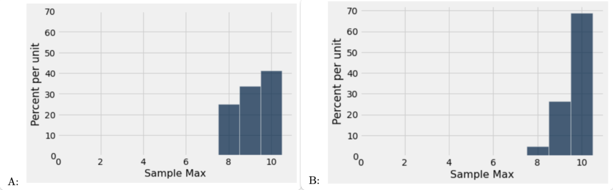

Data C8 Spring 2026 Tutoring 05 | 4

## Tutoring 05 — Solution

### Page 1

### Sampling & Hypothesis Testing

Tutoring 05

Data C8: Foundations of Data Science UC Berkeley, Spring 2026

#### 1. Sampling

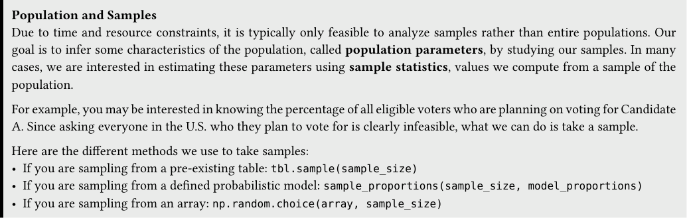

Population and Samples Due to time and resource constraints, it is typically only feasible to analyze samples rather than entire populations. Our goal is to infer some characteristics of the population, called population parameters, by studying our samples. In many cases, we are interested in estimating these parameters using sample statistics, values we compute from a sample of the population.

For example, you may be interested in knowing the percentage of all eligible voters who are planning on voting for Candidate - Since asking everyone in the U.S. who they plan to vote for is clearly infeasible, what we can do is take a sample.

Here are the different methods we use to take samples: - If you are sampling from a pre-existing table: tbl.sample(sample_size) - If you are sampling from a defined probabilistic model: sample_proportions(sample_size, model_proportions) - If you are sampling from an array: np.random.choice(array, sample_size)

##### Practice Problems

- Let’s use the example of rolling a fair die. Is rolling a die sampling with replacement or without replacement?

With replacement.

- Calculate the probability of rolling a 5. Is this an empirical or a theoretical probability? Is there a relationship between

the two?

The probability that we roll a 5 is 1

6.

This is a theoretical probability. We could get an empirical probability by rolling the die over and over again and estimating the theoretical probability of rolling a 5 based on the frequency of 5′s we observe. We expect that the more times we simulate our experiment (rolling the die), the better we will be able to estimate the theoretical probability (hence our empirical probability will converge to the theoretical one). This is often referred to as the Law of Large Numbers.

- Suppose that we have a table called dice, which has one column Side and contains the values 1 through 6. Complete the

function roll_die, which takes in no arguments and uses the dice table to simulate rolling a fair die once. Hint: the function should return an integer between 1 and 6.

def roll_die():

_____________________________________

return np.random.choice(dice.column("Side"))

##### or

return dice.sample(...).column(0).item(0)

Note: Since we are doing .item(0) on the result of .sample(), the sample size (as long as it’s valid) actually does not matter. Additional note: If we specified a sample size in np.random.choice(), we would actually need a .item(0) at the end! Specifying a sample size in np.random.choice() actually returns an array, even if the sample size is just 1.

- Simulate rolling a fair die 10 times and store the results in an array called simulated_rolls, using roll_die().

### Page 2

simulated_rolls = make_array()

for i in ____________________________:

face = ________________________________ simulated_rolls = ______________________________

simulated_rolls = make_array() for i in np.arange(10): face = roll_die() simulated_rolls = np.append(simulated_rolls, face)

- We have generated histograms of simulated rolls for samples of size 10, 100, 1000, and 10,000. Which histograms correspond

to which sample sizes, and why? Do these histograms show a theoretical or empirical distribution?

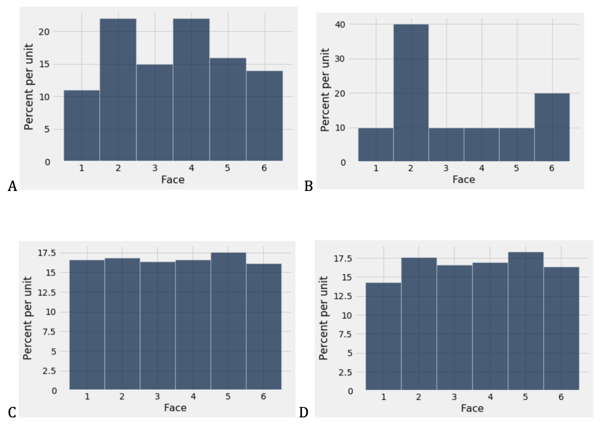

##### A B C D

##### (A, 100), (B, 10), (C, 10000), (D, 1000)

As the number of trials increases, the empirical distribution (which these histograms are) should converge to the theoretical probability distribution. Intuitively, you can think that in a small number of trials, there is a lot of randomness that might make the distribution diverge from what we would predict. Additionally, you can think about it this way: getting five 6′s in ten rolls is a lot more likely to happen than getting 50 6′s in 100 rolls.

Data C8 Spring 2026 Tutoring 05 | 2

### Page 3

### 2. Hypothesis Testing

##### (a) Suppose your friend Lena is into bottle flipping, and she lets you try out the best bottle in her collection. According to Lena,

##### her best bottle lands right side up with a 2/3 chance and lands on its side with a 1/3 chance. You flip the bottle 60 times and observe a successful bottle flip 45 times.

##### Does the bottle that you are flipping seem consistent with Lena’s model? Why or why not?

Yes, the water bottle you are flipping seems consistent with your friend’s model. The model stated a probability of 2/3 landing right side up, which would mean that we expect 40 flips to land right side up. We observed 45 flips landing right side up, which is not too different from the expected amount. Though simply being “consistent” is not currently well defined, we will soon see how was can make this more concrete.

##### (b) Complete the function flip_bottle, which takes in no arguments and randomly flips the bottle described above 60 times.

##### The function should return the number of successful bottle flips out of the 60 flips. Refer to the Reference Sheet if you need a refresher on sample_proportions!

def flip_bottle():

probabilities = ____________________________________________________________________________________ empirical_props = __________________________________________________________________________________ prop_flipped = _____________________________________________________________________________________ return _____________________________________________________________________________________________

def flip_bottle(): probabilities = make_array(2/3, 1/3) empirical_props = sample_proportions(60, probabilities) prop_flipped = empirical_props.item(0) return prop_flipped * 60

##### (c) Complete the code below to simulate the experiment described above 10000 times, and record the number of bottles flipped

##### in each of these experiments in an array called bottles_flipped.

trials = ________________________________________

bottles_flipped = _______________________________

for i in _________________________________________________________:

one_experiment = _______________________________________________________ _________________ = ____________________(_________________________________________________________) Table().with_column("Successful Flips", bottles_flipped) .hist("Successful Flips", bins=np.arange(25, 60, 1))

trials = 10000 bottles_flipped = make_array() for i in np.arange(trials): one_experiment = flip_bottle() bottles_flipped = np.append(bottles_flipped, one_experiment) Table().with_column("Successful Flips", bottles_flipped).hist("Successful Flips", bins = np.arange(25, 60, 1))

##### (d) Suppose you performed the simulation and plotted a histogram of bottles_flipped. The histogram is shown below. Was

##### observing 45 successful bottle flips consistent with the model you simulated under?

##### Data C8 Spring 2026 Tutoring 05 | 3

### Page 4

Yes, 45 successful bottle flips is consistent with the model we simulated under. If we look for 45, we will see that it still occurred a reasonable number of times (it was not rare in our simulation). Therefore, it is consistent with the model we simulated under.

Data C8 Spring 2026 Tutoring 05 | 4

### Page 5

#### 3. Welcome

The table welcome_tbl contains the results of the Fall 2021 Data 8 welcome survey. The first two rows are shown below. Each row corresponds to a student. In the column Extroversion, each student scored themselves on a scale of 1 (not extroverted) to 10 (extremely extroverted).

(Fall 2021 Midterm Question 8)

##### Year Extroversion Number of Textees Hours of Sleep Handedness First Pant Leg Sleep Position

Second 8 5 6 Right-handed Right Left

Second 7 8 7.5 Right-handed Right Left

- Complete the code below to define a function max_extroversion that takes sample_size as its argument. The function

should sample sample_size many times at random without replacement from all the students, and return the maximum extroversion score among the sampled students.

def max_extroversion(________________________):

sampled_students = ______________________________________________

_________________________________________________________________

def max_extroversion(sample_size): sampled_students = welcome_tbl.sample(sample_size, with_replacement = False) return max(sampled_students.column("Extroversion"))

- We decide to simulate 10,000 values of maximum extroversion score, drawing random samples of size 25 without replacement.

Complete the code below so the last line evaluates to an array of 10,000 simulated values from all students. Your code should use the max_extroversion function that you defined above.

repetitions = ______________________

sim_vals = _________________________

for ______________________ in ______________________:

________________________________________________________________ ________________________________________________________________

repetitions = 10000 sim_vals = make_array() for i in np.arange(repetitions): one_sim_max = max_extroversion(25) sim_vals = np.append(sim_vals, one_sim_max)

- A student mistypes the sample size in the previous question to be 55 instead of 25. One of the histograms below shows the

distribution of the maximum values simulated by this student. The other shows the distribution of the maximum values that you simulated using a sample size of 25. Which is which? Why?

Data C8 Spring 2026 Tutoring 05 | 5

### Page 6

A is sample of 25, B is sample of 55. The probability of containing 10 (the population maximum) in a given sample is larger for a larger sample size!

You can also think about it this way: are you more likely to get a 6 in one roll of a die, or 10 rolls of a die? A similar principle applies here in this question!

Data C8 Spring 2026 Tutoring 05 | 6

## Tutoring 06 — Student

### Page 1

### Midterm Review

Tutoring 06

Data C8: Foundations of Data Science UC Berkeley, Spring 2026

This midterm review worksheet has 75 total points, and you may treat it as a practice exam. Your tutor will not cover all questions, so we suggest you attempt the rest of the questions after section to review all topics on the worksheet. 1. [15.0 points] Table Manipulation

The nba table contains data from the 2017-2018 season for every active player. Each row represents a subset of one player’s statistics over the whole season. In this table, percentages are expressed as decimals. Some rows of the table are shown below:

##### Player Age Team FG FGA 3P Points

Alex Abrines 24 OKC 115 291 84 353

Quincy Acy 27 BRK 130 365 102 411

Steven Adams 24 OKC 448 712 0 1056

Bam Adebayo 20 MIA 174 349 0 477

Arron Afflalo 32 ORL 65 162 27 179

... (535 rows omitted)

- [6.0 pts] Effective field goal percentage, or eFG%, is a basketball statistic commonly used to measure a player’s shooting skill.

Calculate eFG% using the formula

FG + 0.5 ⋅3𝑃

FGA

and add it as a new column to the nba table, assigning the result to nba_efg.

numerator = nba.________________(________________) + __________ * nba.________________(________________)

denominator = _________________._________________(_________________)

nba_efg = nba.___________________________(__________, numerator / denominator)

- [4.0 pts] Find the name of the team with the lowest average eFG%. Your final expression should evaluate to a string.

by_team = nba_efg.___________(__________________, __________________)

by_team.sort("eFG% mean")._________________(_________________).__________________(________)

- [3.0 pts] What proportion of points were scored by players who had an eFG% above 60%? The variable prop should be

assigned to your final proportion.

above60 = ________________(nba_efg.________________(____________________).________________)

prop = above60 / ____________________________________

- [2.0 pts] Assign age_vs_team to a table where the rows are unique values of the Age column and the columns are unique

values of the Team column. The values of the table should correspond to the average eFG% for each age, team pair.

age_vs_team = nba_efg.________________________________________________________________

### Page 2

#### 2. [10.0 points] Functions

Suppose you have a table called dinners, which contains a row for every dinner eaten at a given restaurant for a week. The

dinners table contains the following columns:

- Day (string): Which day of the week the dinner was eaten
- Subtotal (float): Cost of the dinner without tips.

- [2.0 pts] Assume that every customer at the restaurant tips 20% for their bill. Define a function called compute_tip that

takes in a total bill and calculates the corresponding amount in tips.

- [4.0 pts] Add a new column to the table called Tip that is the 20% tip for each bill in the Subtotal column. Then, name the

resulting table dinners_with_tip. Use the function you defined above.

tips = dinners.______________________________(_________________________________________)

dinners_with_tip = dinners.________________________________(____________________________________)

- [4.0 pts] Write code to calculate the day of the week with the lowest average subtotal (not including tip).

by_day = dinners.____________________________(______________________________________)

by_day.sort(_______________________________).__________________(____________________________).item(0)

Data C8 Spring 2026 Tutoring 06 | 2

### Page 3

#### 3. [10.0 points] Histograms

The following is a histogram of the number of home runs hit by MLB players in the 2019 season.

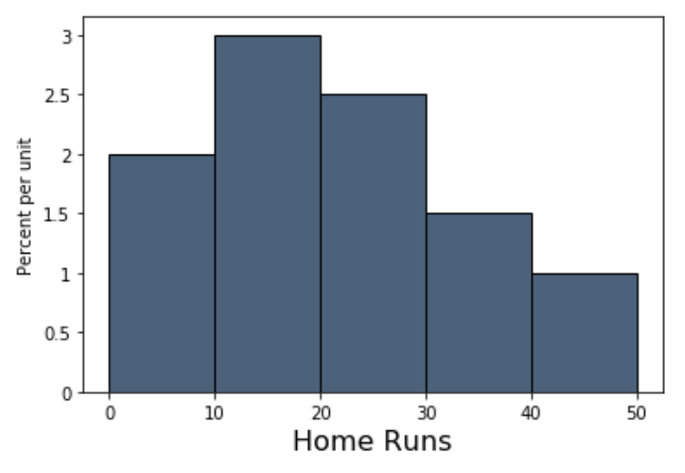

Answer the following questions using the histogram above. If it is not possible to compute the answer, write “Not Possible” and explain why you cannot calculate the answer.

- [2.0 pts] Find the percent of players who hit between 10 and 20 (not inclusive) home runs in 2019.

##### (b) [2.0 pts] Find the number of players who hit 30 or more home runs in 2019.

##### (c) [2.0 pts] What percent of players hit at least 20 home runs?

##### (d) [2.0 pts] What percent of players hit between 25 and 30 home runs?

- [2.0 pts] Suppose that we’re able to obtain more information, allowing us to split the [10, 20) bin into two bins: a [10, 15) bin

and a [15, 20) bin. We find that 20% of players hit between 10 and 15 home runs. What is the height of this new [15, 20) bin?

Data C8 Spring 2026 Tutoring 06 | 3

### Page 4

#### 4. [10.0 points] Simulation

- [6.0 pts] Suppose a broken candy machine dispenses sweet candy 99% of the time and sour candy otherwise. What is the

chance you find at least 1 sour candy in 50 candies dispensed randomly from the machine? We can estimate this probability by simulating asking the candy machine for 50 candies 5000 times, and calculating the proportion of times we get at least one sour candy.

Let candies be an array where the first element is the probability of picking a sweet candy, and the second element is the probability of picking sour candy. Fill in the following code to estimate the probability of finding at least 1 sour candy in 50 candies dispensed. The last line of code should evaluate to your estimate.

candies = make_array(0.99, 0.01)

sour = ______________________________

for i in ________________________________:

simulated_props = __________________________________________________ sour_prop = ________________________________________________ if ________________________________________: ________________________________________ ______________________________ / 5000

- [4.0 pts] What is the exact probability of finding at least 1 sour candy in 50 candies dispensed from the broken candy

machine?

Data C8 Spring 2026 Tutoring 06 | 4

### Page 5

#### 5. [10.0 points] Probability

Your good friend Max is playing with a fair 6-sided die.

- [2.5 pts] Max rolls the die 10 times and rolls a 6 every time. What is the probability of that event occurring?

- [2.5 pts] Max rolls the die twice. What is the probability he rolls a 1 on the first roll and a 2 on the second roll?

##### (c) [2.5 pts] Max rolls the die twice again. What is the probability he rolls a 1 and a 2?

- [2.5 pts] Suppose Max rolls the die 5 times. What is the probability that he rolls at least one 3?

Data C8 Spring 2026 Tutoring 06 | 5

### Page 6

#### 6. [20.0 points] Hypothesis Testing

Your friend Simone rolls a die 10 times and rolls 7 sixes, 2 fours, and 1 two. You suspect that Simone is using an unfair die and want to conduct a hypothesis test to check this.

##### (a) [3.0 pts] Specify the null and alternative hypotheses.

- [3.0 pts] What test statistic would you choose? What is the difference between the observed test statistic and the simulated

test statistic? What do we use the test statistic for? Explain your answers.

##### (c) [3.0 pts] Calculate the observed test statistic and assign it to observed_stat.

fair_die = make_array(____________________________________________________________)

simone_die = ______________________________________________________________________

observed_stat = ___________________________________________________________________

- [2.0 pts] Fill in the code below to define a function that simulates rolling the fair die 10 times and returns its simulated

statistic.

def calculate_stat(): fair_die = make_array(1/6, 1/6, 1/6, 1/6, 1/6, 1/6) simulated_dist = ________________________________ stat = _________________________________________ return stat

- [5.0 pts] Fill in the code below to simulate 10000 test statistics and generate the following histogram.

test_stats = ________________________________________

for i in __________________________________________:

one_stat = __________________________________________________ _____________________ = ____________________________________________________________ Table().with_columns(________________________________________________).hist(__________________________)

##### (f) [2.0 pts] Fill in the code below to calculate the p-value.

p_value = _________________________(_______________________________________________) / _______________

- [2.0 pts] If the p-value turns out to be 0.004 and we’ve set a 𝑝-value cutoff of 5%, what conclusion would we draw from

this test?

Data C8 Spring 2026 Tutoring 06 | 6

## Tutoring 06 — Solution

### Page 1

### Midterm Review

##### Tutoring 06

##### Data C8: Foundations of Data Science UC Berkeley, Spring 2026

This midterm review worksheet has 75 total points, and you may treat it as a practice exam. Your tutor will not cover all questions, so we suggest you attempt the rest of the questions after section to review all topics on the worksheet. 1. [15.0 points] Table Manipulation

The nba table contains data from the 2017-2018 season for every active player. Each row represents a subset of one player’s statistics over the whole season. In this table, percentages are expressed as decimals. Some rows of the table are shown below:

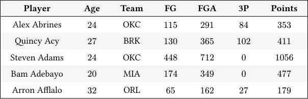

##### Player Age Team FG FGA 3P Points

Alex Abrines 24 OKC 115 291 84 353

Quincy Acy 27 BRK 130 365 102 411

Steven Adams 24 OKC 448 712 0 1056

Bam Adebayo 20 MIA 174 349 0 477

Arron Afflalo 32 ORL 65 162 27 179

... (535 rows omitted)

- [6.0 pts] Effective field goal percentage, or eFG%, is a basketball statistic commonly used to measure a player’s shooting skill.

Calculate eFG% using the formula

FG + 0.5 ⋅3𝑃

FGA

and add it as a new column to the nba table, assigning the result to nba_efg.

numerator = nba.________________(________________) + __________ * nba.________________(________________)

denominator = _________________._________________(_________________)

nba_efg = nba.___________________________(__________, numerator / denominator)

numerator = nba.column("FG") + 0.5 * nba.column("3P") denominator = nba.column("FGA") nba_efg = nba.with_column("eFG%", numerator / denominator)

- [4.0 pts] Find the name of the team with the lowest average eFG%. Your final expression should evaluate to a string.

by_team = nba_efg.___________(__________________, __________________)

by_team.sort("eFG% mean")._________________(_________________).__________________(________)

by_team = nba_efg.group("Team", np.mean) by_team.sort("eFG% mean").column("Team").item(0)

- [3.0 pts] What proportion of points were scored by players who had an eFG% above 60%? The variable prop should be

assigned to your final proportion.

above60 = ________________(nba_efg.________________(____________________).________________)

prop = above60 / ____________________________________

### Page 2

above60 = sum(nba_efg.where("eFG%", are.above(0.6)).column("Points")) prop = above60 / sum(nba_efg.column("Points"))

##### (d) [2.0 pts] Assign age_vs_team to a table where the rows are unique values of the Age column and the columns are unique

##### values of the Team column. The values of the table should correspond to the average eFG% for each age, team pair.

age_vs_team = nba_efg.________________________________________________________________

age_vs_team = nba_efg.pivot("Team", "Age", "eFG%", collect=np.mean)

##### We could also use np.average instead of np.mean.

##### Data C8 Spring 2026 Tutoring 06 | 2

### Page 3

#### 2. [10.0 points] Functions

Suppose you have a table called dinners, which contains a row for every dinner eaten at a given restaurant for a week. The

dinners table contains the following columns:

- Day (string): Which day of the week the dinner was eaten
- Subtotal (float): Cost of the dinner without tips.

- [2.0 pts] Assume that every customer at the restaurant tips 20% for their bill. Define a function called compute_tip that

takes in a total bill and calculates the corresponding amount in tips.

def compute_tip(bill): return bill * 0.2

- [4.0 pts] Add a new column to the table called Tip that is the 20% tip for each bill in the Subtotal column. Then, name the

resulting table dinners_with_tip. Use the function you defined above.

tips = dinners.______________________________(_________________________________________)

dinners_with_tip = dinners.________________________________(____________________________________)

tips = dinners.apply(compute_tip, "Subtotal") dinners_with_tip = dinners.with_columns("Tip", tips)

- [4.0 pts] Write code to calculate the day of the week with the lowest average subtotal (not including tip).

by_day = dinners.____________________________(______________________________________)

by_day.sort(_______________________________).__________________(____________________________).item(0)

by_day = dinners.group("Day", np.mean) by_day.sort("Subtotal mean").column("Day").item(0)

Data C8 Spring 2026 Tutoring 06 | 3

### Page 4

#### 3. [10.0 points] Histograms

The following is a histogram of the number of home runs hit by MLB players in the 2019 season.

Answer the following questions using the histogram above. If it is not possible to compute the answer, write “Not Possible” and explain why you cannot calculate the answer.

- [2.0 pts] Find the percent of players who hit between 10 and 20 (not inclusive) home runs in 2019.

(20 −10) ⋅3% = 30%.

##### (b) [2.0 pts] Find the number of players who hit 30 or more home runs in 2019.

Not possible since we do not know the number of players.

##### (c) [2.0 pts] What percent of players hit at least 20 home runs?

The complement rule can also be used for histograms!

Percent of players who hit less than 20 home runs = (10 −0) ⋅2% + (20 −10) ⋅3% = 50%

Percent at least 20 home runs = 100% −50% = 50%

##### (d) [2.0 pts] What percent of players hit between 25 and 30 home runs?

Not possible since we do not know the distribution of home runs within a bin (we cannot assume it is uniform).

- [2.0 pts] Suppose that we’re able to obtain more information, allowing us to split the [10, 20) bin into two bins: a [10, 15) bin

and a [15, 20) bin. We find that 20% of players hit between 10 and 15 home runs. What is the height of this new [15, 20) bin?

We know that the total area of the [10, 20) bin is 30% (found in part a). This means that the area of the [15, 20) bin is 30% − 20% = 10%.

Using the Area principle:

Area = height ⋅width

⟹height = 10% 5 home run ⟹height = 2% per homerun

Note the unit is “% per homerun” as the height represents density.

Data C8 Spring 2026 Tutoring 06 | 4

### Page 5

#### 4. [10.0 points] Simulation

- [6.0 pts] Suppose a broken candy machine dispenses sweet candy 99% of the time and sour candy otherwise. What is the

chance you find at least 1 sour candy in 50 candies dispensed randomly from the machine? We can estimate this probability by simulating asking the candy machine for 50 candies 5000 times, and calculating the proportion of times we get at least one sour candy.

Let candies be an array where the first element is the probability of picking a sweet candy, and the second element is the probability of picking sour candy. Fill in the following code to estimate the probability of finding at least 1 sour candy in 50 candies dispensed. The last line of code should evaluate to your estimate.

candies = make_array(0.99, 0.01)

sour = ______________________________

for i in ________________________________:

simulated_props = __________________________________________________ sour_prop = ________________________________________________ if ________________________________________: ________________________________________ ______________________________ / 5000

candies = make_array(0.99, 0.01) sour = 0

for i in np.arange(5000): simulated_props = sample_proportions(50, candies) sour_prop = simulated_props.item(1) if sour_prop > 0: sour = sour + 1 sour / 5000

- [4.0 pts] What is the exact probability of finding at least 1 sour candy in 50 candies dispensed from the broken candy

machine?

By the complement rule:

ℙ[at least 1 sour in 50] = 1 −ℙ[no sour in 50] = 1 −(0.99)50

Data C8 Spring 2026 Tutoring 06 | 5

### Page 6

#### 5. [10.0 points] Probability

Your good friend Max is playing with a fair 6-sided die.

- [2.5 pts] Max rolls the die 10 times and rolls a 6 every time. What is the probability of that event occurring?

10

ℙ[10 sixes in 10 rolls] = (1

6)

- [2.5 pts] Max rolls the die twice. What is the probability he rolls a 1 on the first roll and a 2 on the second roll?

ℙ[1 then 2] = (1

1. ⋅(1 6)

##### (c) [2.5 pts] Max rolls the die twice again. What is the probability he rolls a 1 and a 2?

2

ℙ[one 1 and one 2, any order] = 2 ⋅(1

6)

- [2.5 pts] Suppose Max rolls the die 5 times. What is the probability that he rolls at least one 3?

5

ℙ[at least one 3] = 1 −ℙ[no 3 in 5] = 1 −(5

6)

Data C8 Spring 2026 Tutoring 06 | 6

### Page 7

#### 6. [20.0 points] Hypothesis Testing

Your friend Simone rolls a die 10 times and rolls 7 sixes, 2 fours, and 1 two. You suspect that Simone is using an unfair die and want to conduct a hypothesis test to check this.

##### (a) [3.0 pts] Specify the null and alternative hypotheses.

##### Null Hypothesis: The die is fair and each face has a 1

6 chance of landing. Any observed difference is due to random chance.

##### Alternative Hypothesis: The die is not fair. Any observed difference is not due to random chance.

- [3.0 pts] What test statistic would you choose? What is the difference between the observed test statistic and the simulated

test statistic? What do we use the test statistic for? Explain your answers.

We could use Total Variation Distance (TVD) as a test statistic since we are comparing two categorical distributions. In this case, we compare the simulated distribution (proportions of each face rolled) vs. the expected distribution if the die were fair.

The observed test statistic is obtained by applying our chosen test statistic to the data we actually observed (Simone’s 10 rolls). A simulated test statistic is obtained by applying the test statistic to the results of each simulation under the null; we have one simulated value per trial.

We use the distribution of test statistics under the null to calculate the p-value. This distribution you see is the distribution of test statistics.

##### (c) [3.0 pts] Calculate the observed test statistic and assign it to observed_stat.

fair_die = make_array(____________________________________________________________)

simone_die = ______________________________________________________________________

observed_stat = ___________________________________________________________________

fair_die = make_array(1/6, 1/6, 1/6, 1/6, 1/6, 1/6) simone_die = make_array(0/10, 1/10, 0/10, 2/10, 0/10, 7/10) observed_stat = 0.5 * sum(np.abs(fair_die - simone_die))

- [2.0 pts] Fill in the code below to define a function that simulates rolling the fair die 10 times and returns its simulated

statistic.

def calculate_stat(): fair_die = make_array(1/6, 1/6, 1/6, 1/6, 1/6, 1/6) simulated_dist = ________________________________ stat = _________________________________________ return stat

def calculate_stat(): fair_die = make_array(1/6, 1/6, 1/6, 1/6, 1/6, 1/6) simulated_dist = sample_proportions(10, fair_die) stat = 0.5 * sum(np.abs(fair_die - simulated_dist)) return stat

- [5.0 pts] Fill in the code below to simulate 10000 test statistics and generate the following histogram.

test_stats = ________________________________________

for i in __________________________________________:

one_stat = __________________________________________________

Data C8 Spring 2026 Tutoring 06 | 7

### Page 8

_____________________ = ____________________________________________________________ Table().with_columns(________________________________________________).hist(__________________________)

test_stats = make_array()

for i in np.arange(10000): one_stat = calculate_stat() test_stats = np.append(test_stats, one_stat) Table().with_column("TVD", test_stats).hist("TVD")

##### (f) [2.0 pts] Fill in the code below to calculate the p-value.

p_value = _________________________(_______________________________________________) / _______________ p_value = np.count_nonzero(test_stats >= observed_stat) / 10000

##### (g) [2.0 pts] If the p-value turns out to be 0.004 and we’ve set a 𝑝-value cutoff of 5%, what conclusion would we draw from

##### this test?

##### Since the 𝑝-value is less than the cutoff, we would reject the null hypothesis in favor of the alternative hypothesis.

##### Data C8 Spring 2026 Tutoring 06 | 8

## Tutoring 07 — Student

### Page 1

### Confidence Intervals & The Bootstrap

Tutoring 07

Data C8: Foundations of Data Science UC Berkeley, Spring 2026

#### 1. Bootstrap

Practice Problems Suppose we have a sample of the heights of 100 UC Berkeley students contained in a table heights, drawn as a simple random sample from all UC Berkeley students. We would like to estimate the median height of the UC Berkeley student population. To do so, we will use the median height in our sample as our estimate.

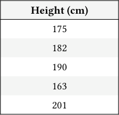

##### Height (cm)

175

182

190

163

201

... (95 rows omitted)

- Identify the parameter and statistic for this particular experiment. Which of these two quantities is random?

- We would like to use the bootstrap method to generate an empirical distribution of our statistic. Fill in the code such that

estimates contains 10,000 bootstrapped sample statistics after the code is run.

estimates = ________________________________

for i in ________________________________:

bootstrap_heights = ________________________________ bootstrap_estimate = ________________________________ estimates = ________________________________

### Page 2

#### 2. Confidence Intervals

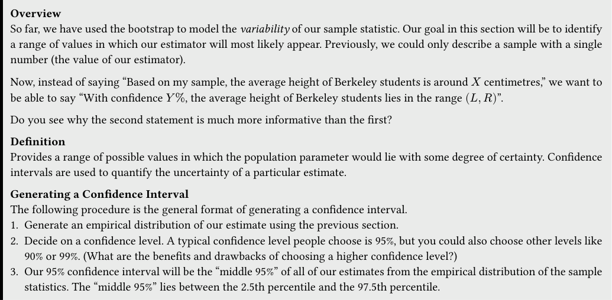

Overview So far, we have used the bootstrap to model the variability of our sample statistic. Our goal in this section will be to identify a range of values in which our estimator will most likely appear. Previously, we could only describe a sample with a single number (the value of our estimator).

Now, instead of saying “Based on my sample, the average height of Berkeley students is around 𝑋 centimetres,” we want to be able to say “With confidence 𝑌%, the average height of Berkeley students lies in the range (𝐿, 𝑅)”.

Do you see why the second statement is much more informative than the first?

Definition Provides a range of possible values in which the population parameter would lie with some degree of certainty. Confidence intervals are used to quantify the uncertainty of a particular estimate.

Generating a Confidence Interval The following procedure is the general format of generating a confidence interval. 1. Generate an empirical distribution of our estimate using the previous section. 1. Decide on a confidence level. A typical confidence level people choose is 95%, but you could also choose other levels like 90% or 99%. (What are the benefits and drawbacks of choosing a higher confidence level?) 1. Our 95% confidence interval will be the “middle 95%” of all of our estimates from the empirical distribution of the sample statistics. The “middle 95%” lies between the 2.5th percentile and the 97.5th percentile.

##### Practice Problems

- Suppose that we picked our confidence level to be 80%. What would the lower and upper bounds of the confidence interval

be in terms of percentiles? Derive a formula to calculate the lower and upper bounds for a general 𝑛% confidence interval.

- Tonight is the Monster Mash. We’re trying to determine the median spookiness level of ghosts. We are given a sample of

ghosts in the form of a one column table called spooky_sample that contains 200 numbers. Each number describes how spooky a ghost is on a scale from 0 to 10. You can assume that the sample is a large simple random sample from the population of all ghosts. Fill in the code below to create a function that returns a 95% confidence interval as a 2-item array for the median spookiness level in the population of ghosts. Note that reps is the number of iterations we would like to use for making the confidence interval.

def spooky_ci(spooky_sample, reps):

medians = ________________________________ for i in ________________________________: resample = ________________________________ resample_median = ________________________________ medians = ________________________________ left_end = ________________________________ right_end = ________________________________

Data C8 Spring 2026 Tutoring 07 | 2

### Page 3

return ________________________________

##### (c) If we were to run the above function once, how many confidence intervals do we generate?

- If we run the function you wrote above multiple times, will it always return the same interval? Why or why not?

##### (e) Answer the following questions or explain why they cannot be answered.

##### i. What percent of the population will be contained in the confidence interval?

ii. What is the probability that the interval we have calculated already contains the population median spookiness level?

iii. If we were to draw 1000 new samples from the population and generate a 95% CI for each sample, how many intervals

would we expect to contain the population parameter?

Data C8 Spring 2026 Tutoring 07 | 3

### Page 4

#### 3. Mean and Median

Mean/Average (of a collection of elements): sum of all the elements divided by the total number of elements in the collection. Note that proportions are a special case of means.

𝜇= mean = sum of elements number of elements

##### Median: the 50th percentile of a collection of numbers. It is the “middle” element.

Mean vs. Median The median is always the midpoint of the data, while the mean is affected by the magnitude of the data points. For example, if the data is concentrated to the right with fewer values on the left, the mean is dragged to the left by those tail values.

##### Skew: how asymmetric the distribution is. A left-skew means the tail skews to the left.

##### Practice Problems

- Suppose a set of numbers has a mean value of 15 and a median value of 20. Is the distribution of the values in the data skewed

left or skewed right?

##### (b) Suppose you have an array containing three 18s, seven 11s, and a 74.

##### i. Write a Python expression to calculate the mean of the array. How does the 74 affect the mean?

##### ii. Now, suppose we replace the 74 with 350. How does this affect the mean? How about the median?

Data C8 Spring 2026 Tutoring 07 | 4

### Page 5

#### 4. Variability

![Reference panel deriving standard deviation for data \[2, 4, 6, 8, 10\]: mean 6, deviations \[-4, -2, 0, 2, 4\], squared deviations \[16, 4, 0, 4, 16\], variance 8, and SD sqrt(8). It also defines standard units as z = (value - mean) / SD.](images/tut07_page005_vector001.png)

##### Standard Deviation: Root mean squared deviation from the average

Assume we have an array of numbers:

data = make_array(2, 4, 6, 8, 10)

1. Find the average of the distribution.

average = np.mean(data) # 6

1. Find the difference (i.e. the deviation) between each number in the distribution and the average.

differences = data - average # array([-4, -2, 0, 2, 4])

1. Square each difference (so there are no negatives).

squared_differences = differences ** 2 # array([16, 4, 0, 4, 16])

1. Take the mean of all the squared differences. (Variance)

mean_squared_differences = np.mean(squared_differences) # 8

1. Take the square root of that mean. (Standard Deviation)

root_mean_squared_differences = np.sqrt(mean_squared_differences) # sqrt(8)

If it is clearer, here’s the compact form (pay attention to parentheses!):

np.sqrt(np.mean((data - np.mean(data)) ** 2))

Alternatively, you can also use np.std(array) to calculate the standard deviation!

##### Standard Units: Number of Standard Deviations Above the Mean

To convert a value to standard units (a unitless measure), first find how far it is from the average of the distribution, and then compare that deviation with the standard deviation of the distribution.

𝑧= value −mean standard deviation = 𝑥−𝜇

𝜎

##### Practice Problems (a) Write code to convert the delay times in column Delay from the united table to standard units. Name the array of converted

times delay_standard.

##### Date Flight Number Destination Delay

6/21/15 1964 SEA 580

6/22/15 300 HNL 537

6/21/15 1149 IAD 508

... (many rows omitted)

________________________________________________________________________________________________________

________________________________________________________________________________________________________

________________________________________________________________________________________________________

________________________________________________________________________________________________________

Data C8 Spring 2026 Tutoring 07 | 5

## Tutoring 07 — Solution

### Page 1

### Confidence Intervals & The Bootstrap

Tutoring 07

Data C8: Foundations of Data Science UC Berkeley, Spring 2026

#### 1. Bootstrap

Practice Problems Suppose we have a sample of the heights of 100 UC Berkeley students contained in a table heights, drawn as a simple random sample from all UC Berkeley students. We would like to estimate the median height of the UC Berkeley student population. To do so, we will use the median height in our sample as our estimate.

##### Height (cm)

175

182

190

163

201

... (95 rows omitted)

- Identify the parameter and statistic for this particular experiment. Which of these two quantities is random?

- Parameter: the median height of all Berkeley students (the population), this is not random. - Statistic: the median height of the 100 students in our sample, which is random because it is a function of the sample that is itself random.

- We would like to use the bootstrap method to generate an empirical distribution of our statistic. Fill in the code such that

estimates contains 10,000 bootstrapped sample statistics after the code is run.

estimates = ________________________________

for i in ________________________________:

bootstrap_heights = ________________________________ bootstrap_estimate = ________________________________ estimates = ________________________________

estimates = make_array()

for i in np.arange(10000): bootstrap_heights = heights.sample(100, with_replacement=True).column("Height (cm)") bootstrap_estimate = percentile(50, bootstrap_heights) estimates = np.append(estimates, bootstrap_estimate)

### Page 2

#### 2. Confidence Intervals

Overview So far, we have used the bootstrap to model the variability of our sample statistic. Our goal in this section will be to identify a range of values in which our estimator will most likely appear. Previously, we could only describe a sample with a single number (the value of our estimator).

Now, instead of saying “Based on my sample, the average height of Berkeley students is around 𝑋 centimetres,” we want to be able to say “With confidence 𝑌%, the average height of Berkeley students lies in the range (𝐿, 𝑅)”.

Do you see why the second statement is much more informative than the first?

Definition Provides a range of possible values in which the population parameter would lie with some degree of certainty. Confidence intervals are used to quantify the uncertainty of a particular estimate.

Generating a Confidence Interval The following procedure is the general format of generating a confidence interval. 1. Generate an empirical distribution of our estimate using the previous section. 1. Decide on a confidence level. A typical confidence level people choose is 95%, but you could also choose other levels like 90% or 99%. (What are the benefits and drawbacks of choosing a higher confidence level?) 1. Our 95% confidence interval will be the “middle 95%” of all of our estimates from the empirical distribution of the sample statistics. The “middle 95%” lies between the 2.5th percentile and the 97.5th percentile.

##### Practice Problems

- Suppose that we picked our confidence level to be 80%. What would the lower and upper bounds of the confidence interval

be in terms of percentiles? Derive a formula to calculate the lower and upper bounds for a general 𝑛% confidence interval.

We would want to capture the middle 80% of the data, so the lower bound would be the 10th percentile and the upper bound would be the 90th percentile.

More generally, for an n% confidence interval the bounds in terms of percentiles would be:

(100 −𝑛

2 th percentile, 100 −(100 −𝑛 2 )th percentile)

- Tonight is the Monster Mash. We’re trying to determine the median spookiness level of ghosts. We are given a sample of

ghosts in the form of a one column table called spooky_sample that contains 200 numbers. Each number describes how spooky a ghost is on a scale from 0 to 10. You can assume that the sample is a large simple random sample from the population of all ghosts. Fill in the code below to create a function that returns a 95% confidence interval as a 2-item array for the median spookiness level in the population of ghosts. Note that reps is the number of iterations we would like to use for making the confidence interval.

def spooky_ci(spooky_sample, reps):

medians = ________________________________ for i in ________________________________: resample = ________________________________ resample_median = ________________________________ medians = ________________________________ left_end = ________________________________

Data C8 Spring 2026 Tutoring 07 | 2

### Page 3

right_end = ________________________________ return ________________________________

def spooky_ci(spooky_sample, reps): medians = make_array() for i in np.arange(reps): resample = spooky_sample.sample() resample_median = percentile(50, resample.column(0)) medians = np.append(medians, resample_median) left_end = percentile(2.5, medians) right_end = percentile(97.5, medians) return make_array(left_end, right_end)

##### (c) If we were to run the above function once, how many confidence intervals do we generate?

1.

Though we use a for loop to iterate through reps number of times, this is only to construct one single confidence interval. To produce many different confidence intervals, we would need different samples from the original population, and not bootstraps.

- If we run the function you wrote above multiple times, will it always return the same interval? Why or why not?

The intervals will probably be similar but will not necessarily be the same! The reason is that the empirical distribution we generate every time is random (comprised of many random samples) and as a result, the interval calculated is itself random!

##### (e) Answer the following questions or explain why they cannot be answered.

##### i. What percent of the population will be contained in the confidence interval?

We cannot make an assessment on the amount of the population in the confidence interval. We use our confidence interval to estimate a population parameter, not to make any other statements about the individuals in the population.

ii. What is the probability that the interval we have calculated already contains the population median spookiness level?

We cannot say anything about the probability that the interval contains the population median. The parameter is fixed, and once we calculate the confidence interval that is fixed as well. At that point, there is no randomness involved, and the confidence interval either contains or doesn’t contain the parameter. We have confidence in the process of constructing a confidence interval, not the interval itself once it has been created.

iii. If we were to draw 1000 new samples from the population and generate a 95% CI for each sample, how many intervals

would we expect to contain the population parameter?

We would expect around 95 percent (or 950) of them to contain the parameter. Remember that the confidence level has to do with the process of creating a confidence interval that contains the population parameter. If we repeat the same procedure for creating a 95% CI many times, we would expect around 95% of them to contain the parameter!

Data C8 Spring 2026 Tutoring 07 | 3

### Page 4

#### 3. Mean and Median

Mean/Average (of a collection of elements): sum of all the elements divided by the total number of elements in the collection. Note that proportions are a special case of means.

𝜇= mean = sum of elements number of elements

##### Median: the 50th percentile of a collection of numbers. It is the “middle” element.

Mean vs. Median The median is always the midpoint of the data, while the mean is affected by the magnitude of the data points. For example, if the data is concentrated to the right with fewer values on the left, the mean is dragged to the left by those tail values.

##### Skew: how asymmetric the distribution is. A left-skew means the tail skews to the left.

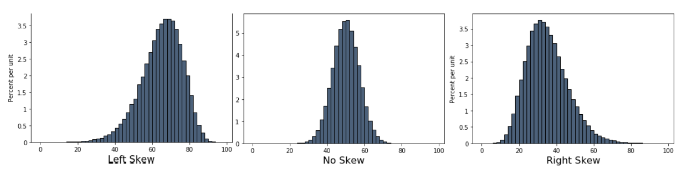

##### Practice Problems

- Suppose a set of numbers has a mean value of 15 and a median value of 20. Is the distribution of the values in the data skewed

left or skewed right?

The data are skewed left because the low values in the data (at left) pull the mean below the median.

##### (b) Suppose you have an array containing three 18s, seven 11s, and a 74.

##### i. Write a Python expression to calculate the mean of the array. How does the 74 affect the mean?

mean = (3*18 + 7*11 + 74) / (3 + 7 + 1).

Since it is much greater than the other numbers in the array, it increases the mean.

##### ii. Now, suppose we replace the 74 with 350. How does this affect the mean? How about the median?

The mean increases further, since 350 is extremely large compared to the rest of the values. However, the median stays the same since it still remained as the largest number in the array.

Data C8 Spring 2026 Tutoring 07 | 4

### Page 5

#### 4. Variability

![Reference panel deriving standard deviation for data \[2, 4, 6, 8, 10\]: mean 6, deviations \[-4, -2, 0, 2, 4\], squared deviations \[16, 4, 0, 4, 16\], variance 8, and SD sqrt(8). It also defines standard units as z = (value - mean) / SD.](images/tut07-sol_page005_vector001.png)

##### Standard Deviation: Root mean squared deviation from the average

Assume we have an array of numbers:

data = make_array(2, 4, 6, 8, 10)

1. Find the average of the distribution.

average = np.mean(data) # 6

1. Find the difference (i.e. the deviation) between each number in the distribution and the average.

differences = data - average # array([-4, -2, 0, 2, 4])

1. Square each difference (so there are no negatives).

squared_differences = differences ** 2 # array([16, 4, 0, 4, 16])

1. Take the mean of all the squared differences. (Variance)

mean_squared_differences = np.mean(squared_differences) # 8

1. Take the square root of that mean. (Standard Deviation)

root_mean_squared_differences = np.sqrt(mean_squared_differences) # sqrt(8)

If it is clearer, here’s the compact form (pay attention to parentheses!):

np.sqrt(np.mean((data - np.mean(data)) ** 2))

Alternatively, you can also use np.std(array) to calculate the standard deviation!

##### Standard Units: Number of Standard Deviations Above the Mean

To convert a value to standard units (a unitless measure), first find how far it is from the average of the distribution, and then compare that deviation with the standard deviation of the distribution.

𝑧= value −mean standard deviation = 𝑥−𝜇

𝜎

##### Practice Problems (a) Write code to convert the delay times in column Delay from the united table to standard units. Name the array of converted

times delay_standard.

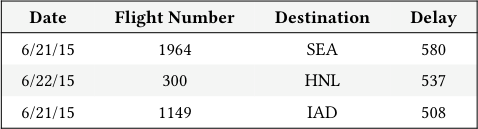

##### Date Flight Number Destination Delay

6/21/15 1964 SEA 580

6/22/15 300 HNL 537

6/21/15 1149 IAD 508

... (many rows omitted)

delays = united.column("Delay")

________________________________________________________________________________________________________

avg = np.mean(delays)

________________________________________________________________________________________________________

sd = np.std(delays)

________________________________________________________________________________________________________

delay_standard = (delays - avg) / sd

________________________________________________________________________________________________________

Data C8 Spring 2026 Tutoring 07 | 5

## Tutoring 08 — Student

### Page 1

### The Normal Distribution

Tutoring 08

Data C8: Foundations of Data Science UC Berkeley, Spring 2026

#### 1. The Normal Distribution

This is a normal distribution curve, with a few important properties: - The total area under the curve is 100% - The curve is symmetric about the mean. The mean and median are equal - The points of inflection of the curve are at ±1 standard deviations away from the mean

A standard normal distribution curve has mean 0 and standard deviation 1.

##### Chebyshev and Normal Bounds

The left table uses Chebyshev’s inequality to calculate the proportion of values that fall within 𝑘 SDs of the mean. Chebyshev’s bound works for all distributions, which is why it is a weaker bound, since it does not assume any properties of the underlying distribution.

The right shows more specific bounds for the normal distribution. It provides much more information than the Chebyshev bounds, since it assumes knowledge of the underlying distribution.

##### Range Proportion in Range [Chebyshev]

##### Range Proportion in Range [Normal]

mean ± 1 SDs ≥1 −1 (0%)

mean ± 1 SDs ≈68%

mean ± 2 SDs ≥1 − 1

4 (75%)

mean ± 2 SDs ≈95%

mean ± 3 SDs ≥1 − 1

9 (88.8%)

mean ± 3 SDs ≈99.7%

mean ± 4 SDs ≥1 − 1

16 (93.75%)

mean ± 4 SDs ≈99.99%

##### Practice Problems

##### (a) Discuss what it means for the Chebyshev bound for mean ± 1 SDs to be greater than or equal to 0.

- Suppose vehicle speeds on a highway are normally distributed with mean 90 mph and SD 10 mph. Using the table above,

what is the approximate probability that a randomly chosen car is going more than 100 mph?

### Page 2

#### 2. The Central Limit Theorem

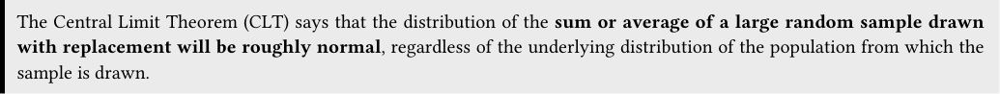

The Central Limit Theorem (CLT) says that the distribution of the sum or average of a large random sample drawn with replacement will be roughly normal, regardless of the underlying distribution of the population from which the sample is drawn.

Practice Problems Suppose you simulate the proportion of purple-flowered plants in a sample of 200 plants (from Mendel’s 75% purple- and 25% white-flower plant population) using sample_proportions 1000 times. Then, you plotted the distribution of the proportion of purple-flowered plants from each of the 1000 trials.

##### (a) What would this distribution look like? Where would the distribution be centered?

##### (b) What would it look like if we conducted 10000 trials instead?

- Does the initial distribution of the population have an effect on the shape of the distribution of the sample mean? If yes,

what is its effect? If no, explain why not.

Data C8 Spring 2026 Tutoring 08 | 2

### Page 3

#### 3. Variability of the Sample Mean

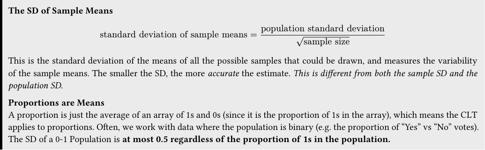

##### The SD of Sample Means

standard deviation of sample means = population standard deviation √sample size

This is the standard deviation of the means of all the possible samples that could be drawn, and measures the variability of the sample means. The smaller the SD, the more accurate the estimate. This is different from both the sample SD and the population SD.

Proportions are Means A proportion is just the average of an array of 1s and 0s (since it is the proportion of 1s in the array), which means the CLT applies to proportions. Often, we work with data where the population is binary (e.g. the proportion of “Yes” vs “No” votes). The SD of a 0-1 Population is at most 0.5 regardless of the proportion of 1s in the population.

##### Practice Problems

- Suppose we sample repeatedly from the population. If we increase the sample size, what happens to the distribution of the

sample mean? Does it become narrower or wider? Where is it centered?

- If you had a sample size of 100, but wanted to increase accuracy by a factor of 4, what should the new sample size be?

- Briefly state the difference between the sample SD and the SD of sample means. Which one of these is affected by the

sample size?

- Suppose we have a sample with a mean of 40 and an SD of 10. Which one of the histograms below is more likely an empirical

distribution of the means of 10000 bootstrap resamples, each of size 100, from the sample?

- Fill in the blank: Based on the sample from the previous question, there is a ________% chance that the next resampled

mean (i.e., resample from the sample and compute the mean) lies within the range [38, 42].

- Suppose a redwood forest has trees whose average height is 200 feet with an SD of 30 feet. A random sample with replacement

of 400 trees is taken. Fill in the blank: There is roughly a 68% chance that the average height of the sample lies within the range 200 plus or minus ___________.

Data C8 Spring 2026 Tutoring 08 | 3

### Page 4

#### 4. Designing Experiments

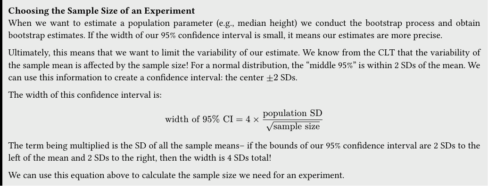

Choosing the Sample Size of an Experiment When we want to estimate a population parameter (e.g., median height) we conduct the bootstrap process and obtain bootstrap estimates. If the width of our 95% confidence interval is small, it means our estimates are more precise.

Ultimately, this means that we want to limit the variability of our estimate. We know from the CLT that the variability of the sample mean is affected by the sample size! For a normal distribution, the “middle 95%” is within 2 SDs of the mean. We can use this information to create a confidence interval: the center ±2 SDs.

The width of this confidence interval is:

width of 95% CI = 4 × population SD √sample size

The term being multiplied is the SD of all the sample means– if the bounds of our 95% confidence interval are 2 SDs to the left of the mean and 2 SDs to the right, then the width is 4 SDs total!

We can use this equation above to calculate the sample size we need for an experiment.

Practice Problems Let’s say you want to poll the population of UC Berkeley students to ask whether they like pineapple on pizza. You can only take a sample, but you want to estimate the population proportion of students who like pineapple on their pizza. Let’s say you need your estimate to have a confidence interval width of at most 0.05.

- Suppose the population SD of the proportion of students who like pineapple on pizza is 0.1. What sample size do you need

##### to achieve a 95% confidence interval width of at most 0.05?

- Suppose you do not know the population SD of the students who like pineapple on their pizza. Would it still be possible to

calculate the minimum sample size needed? If so, what sample size would you need to obtain a 95% confidence interval of width at most 0.05?

Data C8 Spring 2026 Tutoring 08 | 4

## Tutoring 08 — Solution

### Page 1

### The Normal Distribution

Tutoring 08

Data C8: Foundations of Data Science UC Berkeley, Spring 2026

#### 1. The Normal Distribution

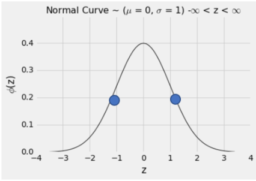

This is a normal distribution curve, with a few important properties: - The total area under the curve is 100% - The curve is symmetric about the mean. The mean and median are equal - The points of inflection of the curve are at ±1 standard deviations away from the mean

A standard normal distribution curve has mean 0 and standard deviation 1.

##### Chebyshev and Normal Bounds

The left table uses Chebyshev’s inequality to calculate the proportion of values that fall within 𝑘 SDs of the mean. Chebyshev’s bound works for all distributions, which is why it is a weaker bound, since it does not assume any properties of the underlying distribution.

The right shows more specific bounds for the normal distribution. It provides much more information than the Chebyshev bounds, since it assumes knowledge of the underlying distribution.

##### Range Proportion in Range [Chebyshev]

##### Range Proportion in Range [Normal]

mean ± 1 SDs ≥1 −1 (0%)

mean ± 1 SDs ≈68%

mean ± 2 SDs ≥1 − 1

4 (75%)

mean ± 2 SDs ≈95%

mean ± 3 SDs ≥1 − 1

9 (88.8%)

mean ± 3 SDs ≈99.7%

mean ± 4 SDs ≥1 − 1

16 (93.75%)

mean ± 4 SDs ≈99.99%

##### Practice Problems

##### (a) Discuss what it means for the Chebyshev bound for mean ± 1 SDs to be greater than or equal to 0.

The bound is so weak it tells us no information!

- Suppose vehicle speeds on a highway are normally distributed with mean 90 mph and SD 10 mph. Using the table above,

what is the approximate probability that a randomly chosen car is going more than 100 mph?

### Page 2

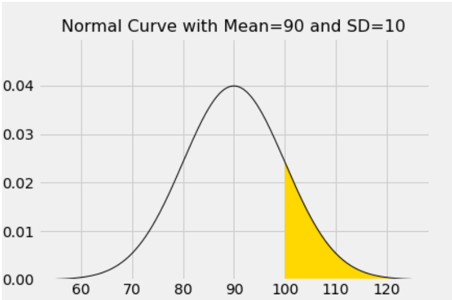

We know that: - The normal distribution is symmetric about 90 (its mean). - The total area under the curve is 100%. - About 68% of the data is within 1 SD of the mean.

Using these facts we know that 50% of the data is below 90, and 34% (half of 68%) is between the mean and 1 SD above the mean. Thus, the region not highlighted adds up to 84% (50% below 90 and 34% between 90 and 100), and so the highlighted region must be 100% - 84% = 16% or 0.16.

Data C8 Spring 2026 Tutoring 08 | 2

### Page 3

#### 2. The Central Limit Theorem

The Central Limit Theorem (CLT) says that the distribution of the sum or average of a large random sample drawn with replacement will be roughly normal, regardless of the underlying distribution of the population from which the sample is drawn.

Practice Problems Suppose you simulate the proportion of purple-flowered plants in a sample of 200 plants (from Mendel’s 75% purple- and 25% white-flower plant population) using sample_proportions 1000 times. Then, you plotted the distribution of the proportion of purple-flowered plants from each of the 1000 trials.

##### (a) What would this distribution look like? Where would the distribution be centered?

A bell curve resembling the normal distribution, centered approximately at the expected proportion of 3/4. Notice that a proportion is basically just an average of a bunch of 0′s and 1′s!

##### (b) What would it look like if we conducted 10000 trials instead?

Compared to 2.1, this bell curve will still be centered approximately at the expected proportion of 3/4, but the empirical distribution will be “smoother” and more closely resemble a normal distribution.

- Does the initial distribution of the population have an effect on the shape of the distribution of the sample mean? If yes,

what is its effect? If no, explain why not.

No, the CLT states that regardless of the distribution of the population, the distribution of sample means will be approxi­ mately normal. How the population is distributed will have no effect on the shape.

Data C8 Spring 2026 Tutoring 08 | 3

### Page 4

#### 3. Variability of the Sample Mean

##### The SD of Sample Means

standard deviation of sample means = population standard deviation √sample size

This is the standard deviation of the means of all the possible samples that could be drawn, and measures the variability of the sample means. The smaller the SD, the more accurate the estimate. This is different from both the sample SD and the population SD.

Proportions are Means A proportion is just the average of an array of 1s and 0s (since it is the proportion of 1s in the array), which means the CLT applies to proportions. Often, we work with data where the population is binary (e.g. the proportion of “Yes” vs “No” votes). The SD of a 0-1 Population is at most 0.5 regardless of the proportion of 1s in the population.

##### Practice Problems

- Suppose we sample repeatedly from the population. If we increase the sample size, what happens to the distribution of the

sample mean? Does it become narrower or wider? Where is it centered?

The distribution of the sample mean will become narrower as the sample size increases. As the sample size increases (or decreases, for that matter), the distribution of the sample mean will stay centered at the population mean.

- If you had a sample size of 100, but wanted to increase accuracy by a factor of 4, what should the new sample size be?

In order to decrease the SD of possible sample means by a factor of 4, we would need to increase the denominator on the right hand side of the equation by a factor of 4. However, since we are taking the square root of the sample size, we must increase the sample size by a factor of 16.

SD of sample means = population SD √sample size

new SD of sample means = population SD √new sample size = 1

4 ⋅SD of sample means = 1 4 ⋅population SD √

100

⟹ 1 √new sample size = 1

4 ⋅ 1 √

100

⟹new sample size = 16 ⋅100 = 1600

- Briefly state the difference between the sample SD and the SD of sample means. Which one of these is affected by the

sample size?

The sample SD is the standard deviation of the data in a sample. For a good sample, the sample SD is expected to be fairly close to the population SD (since a good sample is representative of the population). On the other hand, the SD of sample means is the standard deviation of the distribution of all possible sample means, a distribution that describes how the sample mean can turn out when you obtain a sample and calculate its mean. The SD of sample means has a much more clearly defined relationship with the sample size as opposed to the sample SD.

- Suppose we have a sample with a mean of 40 and an SD of 10. Which one of the histograms below is more likely an empirical

distribution of the means of 10000 bootstrap resamples, each of size 100, from the sample?

Data C8 Spring 2026 Tutoring 08 | 4

### Page 5

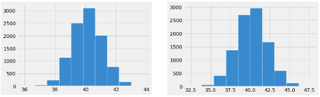

The left one. We know that these distributions are approximately normal because they are distributions of sample means. The SD of the sample mean, based on the information given about the population, should be 10 √

100 = 1. The left one seems to have an SD of 1. Note that we do not have access to the population SD, so we use the next best thing — the sample SD — when calculating the SD of the sample mean.

- Fill in the blank: Based on the sample from the previous question, there is a ________% chance that the next resampled

mean (i.e., resample from the sample and compute the mean) lies within the range [38, 42].

Approximately 95%. We know for a normal distribution, roughly 95% of the data lies within 2 SDs of the mean. In this case, the distribution we are referring to is the distribution of all possible sample means.

- Suppose a redwood forest has trees whose average height is 200 feet with an SD of 30 feet. A random sample with replacement

of 400 trees is taken. Fill in the blank: There is roughly a 68% chance that the average height of the sample lies within the range 200 plus or minus ___________.

This is just the SD of the sample means, 30 √

400 = 30 20 or 1.5 feet. This is because 68% of the data is contained within 1 SD of the mean for a normal distribution.

Data C8 Spring 2026 Tutoring 08 | 5

### Page 6

#### 4. Designing Experiments

Choosing the Sample Size of an Experiment When we want to estimate a population parameter (e.g., median height) we conduct the bootstrap process and obtain bootstrap estimates. If the width of our 95% confidence interval is small, it means our estimates are more precise.

Ultimately, this means that we want to limit the variability of our estimate. We know from the CLT that the variability of the sample mean is affected by the sample size! For a normal distribution, the “middle 95%” is within 2 SDs of the mean. We can use this information to create a confidence interval: the center ±2 SDs.

The width of this confidence interval is:

width of 95% CI = 4 × population SD √sample size

The term being multiplied is the SD of all the sample means– if the bounds of our 95% confidence interval are 2 SDs to the left of the mean and 2 SDs to the right, then the width is 4 SDs total!

We can use this equation above to calculate the sample size we need for an experiment.

Practice Problems Let’s say you want to poll the population of UC Berkeley students to ask whether they like pineapple on pizza. You can only take a sample, but you want to estimate the population proportion of students who like pineapple on their pizza. Let’s say you need your estimate to have a confidence interval width of at most 0.05.

- Suppose the population SD of the proportion of students who like pineapple on pizza is 0.1. What sample size do you need

##### to achieve a 95% confidence interval width of at most 0.05?

width of 95% CI = 4 ⋅ population SD √sample size ≤0.05

⟹√sample size ≥ 4 ⋅0.1

0.05

⟹√sample size ≥8

sample size = 64

- Suppose you do not know the population SD of the students who like pineapple on their pizza. Would it still be possible to

calculate the minimum sample size needed? If so, what sample size would you need to obtain a 95% confidence interval of width at most 0.05?

We can replace the population SD with the maximum SD possible in a population of 1s and 0s, which is 0.5.

Substituting in 0.5 for the population SD:

4 ⋅ 0.5 √sample size ≤0.05

⟹√sample size ≥ 2 0.05

⟹√sample size ≥40

sample size = 1600

##### Notice that the sample size we got here is significantly larger than the one in part (a).

Data C8 Spring 2026 Tutoring 08 | 6

## Tutoring 09 — Student

### Page 1

### Correlation & Regression

Tutoring 09

Data C8: Foundations of Data Science UC Berkeley, Spring 2026

#### 1. Correlation

Association Refers to any relationship between two variables. It does not have to be linear. For instance, in the plots below, all of them show an association, but only the first graph demonstrates a linear association.

Correlation Denotes a linear association between two variables. The correlation coefficient 𝑟, is a number between −1 and 1 that measures the strength and direction of the linear relationship between two variables.

- Strength: how clustered the scatter plot is around a straight line. If the plot is highly clustered, the absolute value of 𝑟is closer to 1. - Direction: if 𝑦 tends to increase as 𝑥 increases, 𝑟 is positive. If 𝑦 tends to decrease as 𝑥 increases, 𝑟 is negative.

Formula for 𝑟 - The average of the product of 𝑥 and 𝑦 when both variables are measured in standard units. - 𝑟 is a number without units because it is computed with standard units, which also has no units. - Remember, standard units allow us to quantify the relationship between two variables on different units and scales. - 𝑟 is unaffected by switching the axes. This is because it is the average of products of standard units; 𝑥⋅𝑦= 𝑦⋅𝑥. More intuitively, since correlation is a measure of spread around a line, switching the axes won’t change the spread around the line.

Practice Problems The following table, taters, depicts the number of tater tots a person has eaten, along with a number that quantifies their satisfaction, which is a number that goes from 0 to 10.

##### Tater Tots Consumed Satisfaction

10 8

3 4

8 6

5 5

16 9

1 3

(...94 rows omitted)

### Page 2

- First, complete the function su that takes in an array of numbers and outputs the array in standard units. Then, calculate the

##### correlation coefficient between Tater Tots Consumed and Satisfaction and assign it to r.

def su(array):

return ____________________________________________

consumed_su = __________________________________________

satisfaction_su = __________________________________________

r = __________________________________________

- Suppose that we find the correlation coefficient, 𝑟, to be equal to 0.743. What can you conclude about the association between

the number of tater tots consumed and a person’s satisfaction?

##### (c) A high value of 𝑟 shows that a change in 𝑥 causes a change in 𝑦.

True

False

##### (d) If we switch the axes of a plot, the correlation coefficient will not change.

True

False

##### (e) Answer the following questions about the plots below.

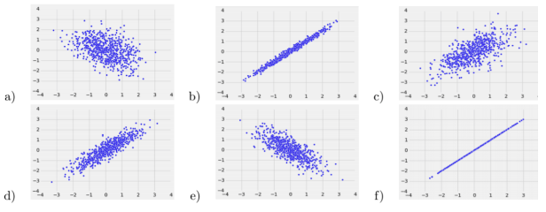

- Order the scatter plots above from least correlated to most correlated (in terms of the absolute value of 𝑟).

(Least) _________________________________________________________________________________________ (Most)

##### ii. Which plots show positive correlation? Which show negative correlation?

Positive: ________________________________________ Negative: ________________________________________

Data C8 Spring 2026 Tutoring 09 | 2

### Page 3

#### 2. Regression

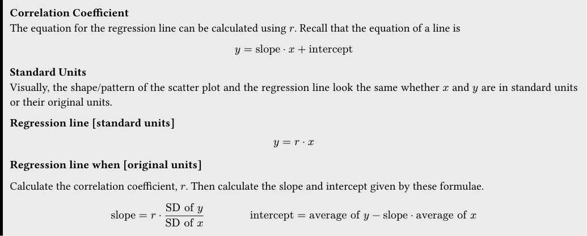

Correlation Coefficient The equation for the regression line can be calculated using 𝑟. Recall that the equation of a line is

𝑦= slope ⋅𝑥+ intercept

Standard Units Visually, the shape/pattern of the scatter plot and the regression line look the same whether 𝑥 and 𝑦 are in standard units or their original units.

##### Regression line [standard units]

𝑦= 𝑟⋅𝑥

##### Regression line when [original units]

Calculate the correlation coefficient, 𝑟. Then calculate the slope and intercept given by these formulae.

slope = 𝑟⋅ SD of 𝑦

SD of 𝑥 intercept = average of 𝑦−slope ⋅average of 𝑥

Practice Problems The top100 table contains the 100 most streamed songs on Spotify in 2023. The energy column represents the song’s perceived energy level as a percentage, and the danceability column represents (as a percentage) how suitable the song is for dancing.

Here are some statistics regarding the two columns: - The energy column has: - a mean of 64 - a standard deviation of 16. - The danceability column has: - a mean of 66 - a standard deviation of 14.5. - The correlation between energy and danceability is 0.3.

- Write an equation for the regression line of the data in the top100 table, with the intention of predicting an unseen

##### danceability percentage given an observed energy percentage. Feel free to use a calculator!

- Using the regression line, what would we predict the danceability to be for a song that had an energy of 90?

- Suppose that we also calculate our regression line in standard units. Would it be appropriate to use this regression line to

##### predict a danceabillity for which our observed energy (in standard units) is −2? Explain.

Data C8 Spring 2026 Tutoring 09 | 3

### Page 4

#### 3. Root Mean Squared Errors (RMSE)

Root Mean Squared Error (RMSE) RMSE is the square root (R) of the mean (M) of the squared errors (SE). We take the square root of the MSE (mean squared error) such that the RMSE is comparable and of the same units as the original data.

Let 𝑒𝑖 be the residuals and 𝑛 be the number of points in the dataset.

RMSE = √𝑒2

1 + 𝑒2 2 + … + 𝑒2𝑛 𝑛

##### Practice Problems

- Write a function that takes in an array of observed values, an array of predictions, and returns the RMSE. You may assume

that the two arrays have the same length.

def rmse(observed, predicted):

______________________________________________________

______________________________________________________

______________________________________________________

______________________________________________________

- In the calculation of root mean squared error, why is it important for us to square the residuals before taking the mean?

##### (c) While both valid, why do we tend to use and look at the RMSE over the MSE (mean squared error)?

Data C8 Spring 2026 Tutoring 09 | 4

## Tutoring 09 — Solution

### Page 1

### Correlation & Regression

Tutoring 09

Data C8: Foundations of Data Science UC Berkeley, Spring 2026

#### 1. Correlation

Association Refers to any relationship between two variables. It does not have to be linear. For instance, in the plots below, all of them show an association, but only the first graph demonstrates a linear association.

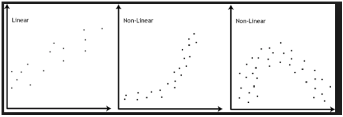

Correlation Denotes a linear association between two variables. The correlation coefficient 𝑟, is a number between −1 and 1 that measures the strength and direction of the linear relationship between two variables.

- Strength: how clustered the scatter plot is around a straight line. If the plot is highly clustered, the absolute value of 𝑟is closer to 1. - Direction: if 𝑦 tends to increase as 𝑥 increases, 𝑟 is positive. If 𝑦 tends to decrease as 𝑥 increases, 𝑟 is negative.

Formula for 𝑟 - The average of the product of 𝑥 and 𝑦 when both variables are measured in standard units. - 𝑟 is a number without units because it is computed with standard units, which also has no units. - Remember, standard units allow us to quantify the relationship between two variables on different units and scales. - 𝑟 is unaffected by switching the axes. This is because it is the average of products of standard units; 𝑥⋅𝑦= 𝑦⋅𝑥. More intuitively, since correlation is a measure of spread around a line, switching the axes won’t change the spread around the line.

Practice Problems The following table, taters, depicts the number of tater tots a person has eaten, along with a number that quantifies their satisfaction, which is a number that goes from 0 to 10.

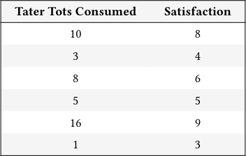

##### Tater Tots Consumed Satisfaction

10 8

3 4

8 6

5 5

16 9

1 3

(...94 rows omitted)

### Page 2

- First, complete the function su that takes in an array of numbers and outputs the array in standard units. Then, calculate the

##### correlation coefficient between Tater Tots Consumed and Satisfaction and assign it to r.

def su(array):

return ____________________________________________

consumed_su = __________________________________________

satisfaction_su = __________________________________________

r = __________________________________________

def su(array): return (array - np.mean(array)) / np.std(array)

consumed_su = su(taters.column("Tater Tots Consumed")) satisfaction_su = su(taters.column("Satisfaction")) r = np.mean(consumed_su * satisfaction_su)

- Suppose that we find the correlation coefficient, 𝑟, to be equal to 0.743. What can you conclude about the association between

the number of tater tots consumed and a person’s satisfaction?

The value of 𝑟 suggests that Tater Tots Consumed and Satisfaction has a fairly strong positive linear relationship. More tater tots consumed is associated with a greater satisfaction, but consuming more tots does not necessarily cause increased levels of satisfaction. From 𝑟 alone we are not able to determine the existence or absence of a causal relationship. Correlation is not causation!

##### (c) A high value of 𝑟 shows that a change in 𝑥 causes a change in 𝑦.

True

False

False. Correlation only measures the strength and direction of a linear relationship between two variables, and it alone does not imply causation. There could be confounding factors — other variables influencing both 𝑥 and 𝑦 — that may be affecting what we see in our data and the value of 𝑟.

##### (d) If we switch the axes of a plot, the correlation coefficient will not change.

True

False

True, the correlation coefficient is not affected by which variable is deemed 𝑥 and which one is 𝑦. We can swap the axes of the plot, and the correlation coefficient would remain the same.

##### (e) Answer the following questions about the plots below.

Data C8 Spring 2026 Tutoring 09 | 2

### Page 3

- Order the scatter plots above from least correlated to most correlated (in terms of the absolute value of 𝑟).

(Least) _________________________________________________________________________________________ (Most)

A, C, E, D, B, F

##### ii. Which plots show positive correlation? Which show negative correlation?

Positive: ________________________________________ Negative: ________________________________________

Positive: B, C, D, and F.

Negative: A and E.

#### 2. Regression

Correlation Coefficient The equation for the regression line can be calculated using 𝑟. Recall that the equation of a line is

𝑦= slope ⋅𝑥+ intercept

Standard Units Visually, the shape/pattern of the scatter plot and the regression line look the same whether 𝑥 and 𝑦 are in standard units or their original units.

##### Regression line [standard units]

𝑦= 𝑟⋅𝑥

##### Regression line when [original units]

Calculate the correlation coefficient, 𝑟. Then calculate the slope and intercept given by these formulae.

slope = 𝑟⋅ SD of 𝑦

SD of 𝑥 intercept = average of 𝑦−slope ⋅average of 𝑥

Practice Problems The top100 table contains the 100 most streamed songs on Spotify in 2023. The energy column represents the song’s perceived energy level as a percentage, and the danceability column represents (as a percentage) how suitable the song is for dancing.

Data C8 Spring 2026 Tutoring 09 | 3

### Page 4

Here are some statistics regarding the two columns: - The energy column has: - a mean of 64 - a standard deviation of 16. - The danceability column has: - a mean of 66 - a standard deviation of 14.5. - The correlation between energy and danceability is 0.3.

- Write an equation for the regression line of the data in the top100 table, with the intention of predicting an unseen

##### danceability percentage given an observed energy percentage. Feel free to use a calculator!

slope = 𝑟⋅ SD of danceability

SD of energy = 0.3 ⋅(14.5

16 ) ≈0.272

intercept = average of danceability −slope ⋅average of energy = 66 −0.272 ⋅64 ≈48.59

y = 0.272x + 48.59

- Using the regression line, what would we predict the danceability to be for a song that had an energy of 90?

0.272 ⋅90 + 48.59 = 73.07

- Suppose that we also calculate our regression line in standard units. Would it be appropriate to use this regression line to

##### predict a danceabillity for which our observed energy (in standard units) is −2? Explain.

Yes! Although it would not be possible to observe a negative value for energy in original units (since it is a percentage), it is definitely possible to observe a value of −2 in standard units. Remember, standard units simply expresses each data point according to the number of standard deviations it is above its mean! If we convert −2 back to original units, we get

64 −2 ⋅(16) = 32

which is completely valid to use the regression line to make a prediction for.

Data C8 Spring 2026 Tutoring 09 | 4

### Page 5

#### 3. Root Mean Squared Errors (RMSE)

Root Mean Squared Error (RMSE) RMSE is the square root (R) of the mean (M) of the squared errors (SE). We take the square root of the MSE (mean squared error) such that the RMSE is comparable and of the same units as the original data.

Let 𝑒𝑖 be the residuals and 𝑛 be the number of points in the dataset.

RMSE = √𝑒2

1 + 𝑒2 2 + … + 𝑒2𝑛 𝑛

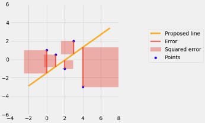

##### Practice Problems

- Write a function that takes in an array of observed values, an array of predictions, and returns the RMSE. You may assume

that the two arrays have the same length.

def rmse(observed, predicted):

______________________________________________________

______________________________________________________

______________________________________________________

______________________________________________________

def rmse(observed, predicted): residuals = observed - predicted squared_residuals = residuals ** 2 mean_squared_residuals = np.mean(squared_residuals) return np.sqrt(mean_squared_residuals)

- In the calculation of root mean squared error, why is it important for us to square the residuals before taking the mean?

If we do not square the residuals, then we will always get 0 because the sum (and thus mean) of the residuals is always 0. The positive and negative residuals will cancel each other out. Squaring our residuals gets rid of the negatives, allowing us to effectively quantify the accuracy of our predictions.

##### (c) While both valid, why do we tend to use and look at the RMSE over the MSE (mean squared error)?

Data C8 Spring 2026 Tutoring 09 | 5

### Page 6

Both RMSE and MSE calculate the average error of our predictions. However, RMSE is in the same units and scale as our original data, making it easier to interpret the accuracy of our predictions.

Data C8 Spring 2026 Tutoring 09 | 6

## Tutoring 10 — Student

### Page 1

### Residuals & Regression Inference

Tutoring 10

Data C8: Foundations of Data Science UC Berkeley, Spring 2026

#### 1. Regression Inference

You take a sample of Data 8 students and ask them about their daily consumption of coffee and their midterm exam scores. Assume you are given a table students with the columns cups and score. The column cups contains the daily consumption of coffee and score contains the midterm exam score for each student from the sample. You perform linear regression and find a slope of 0.13 points per cup of coffee. Katy is considering buying coffee for her discussion to increase their scores but is not sure if this will work.

- State a null and alternative hypothesis to see whether this slope was due to randomness in your sample.

##### Null Hypothesis:

##### Alternative Hypothesis:

- Write a function slope that takes in a table, tbl, and returns the slope of the least-squares line using the first column to

predict values of the second column.

def slope(tbl):

x = ________________________________________________________

y = ________________________________________________________

zx = _______________________________________________________

zy = _______________________________________________________

r = ________________________________________________________

____________________________________________________________

- Complete the code to generate 5000 bootstrap resample slopes and then calculate a 95% confidence interval for the slope.

Assume the function slope(tbl) has been implemented correctly.

slopes = ________________________

for i in ________________________:

resample_slope = ________________________________________________ ________________________________________________________________________ left_end = ________________________

right_end = ________________________

interval = make_array(left_end, right_end)

### Page 2

##### (d) Suppose you find the confidence interval [0.02, 0.24].

##### i. What do you conclude about your hypotheses at a p-value cutoff of 5%?

##### ii. What about at a p-value cutoff of 10%?

##### iii. What about at a p-value cutoff of 1%?

- Your friend who has not taken Data 8 looks at your result and asks you what the confidence interval means. Which one of

the following is a correct response?

For 95% of students, there is a relationship between coffee consumption and midterm score.

There is a 95% probability that the true slope is between 0.02 and 0.24.

There is a 95% probability that our sampling process will produce an interval that contains the true slope.

#### 2. Residuals

Suppose Kimiko tries to predict the emergency response time of Superheroes from each of the following four different variables:

- Income (float): the average income in the emergency location’s neighborhood.
- Distance (float): the distance in miles from the emergency location to their headquarters.
- Crimes (float): the average weekly number of crimes reported in the emergency location’s neighborhood last year.
- Height (float): the average building height (in feet) in the emergency location’s neighborhood.

To assess her predictions from each variable, she creates the following residual plots.

##### (a) Which of the above is a valid residual plot that indicates a linear

relationship between the variable and response time?

Income Distance

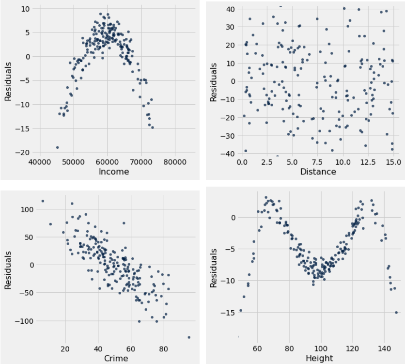

Crimes Height

None

##### (b) Kimiko suspects she may have made a mistake in her code when

plotting the residuals. Which of the plots above are impossible residual plots?

Income Distance

Crimes Height

None

##### (c) For which of the above plots should Kimiko try a quadratic

equation for regression?

Income Distance

Crimes Height

None

Data C8 Spring 2026 Tutoring 10 | 2

## Tutoring 10 — Solution

### Page 1

### Residuals & Regression Inference

Tutoring 10

Data C8: Foundations of Data Science UC Berkeley, Spring 2026

#### 1. Regression Inference

You take a sample of Data 8 students and ask them about their daily consumption of coffee and their midterm exam scores. Assume you are given a table students with the columns cups and score. The column cups contains the daily consumption of coffee and score contains the midterm exam score for each student from the sample. You perform linear regression and find a slope of 0.13 points per cup of coffee. Katy is considering buying coffee for her discussion to increase their scores but is not sure if this will work.

- State a null and alternative hypothesis to see whether this slope was due to randomness in your sample.

##### Null Hypothesis:

##### Alternative Hypothesis:

##### Null Hypothesis: The slope of the true line is 0.

##### Alternative Hypothesis: The slope of the true line is not 0.

- Write a function slope that takes in a table, tbl, and returns the slope of the least-squares line using the first column to

predict values of the second column.

def slope(tbl):

x = ________________________________________________________

y = ________________________________________________________

zx = _______________________________________________________

zy = _______________________________________________________

r = ________________________________________________________

____________________________________________________________

def slope(tbl): x = tbl.column(0) y = tbl.column(1) zx = (x - np.mean(x)) / np.std(x) zy = (y - np.mean(y)) / np.std(y) r = np.mean(zx * zy) return r * np.std(y) / np.std(x)

- Complete the code to generate 5000 bootstrap resample slopes and then calculate a 95% confidence interval for the slope.

Assume the function slope(tbl) has been implemented correctly.

slopes = ________________________

for i in ________________________:

resample_slope = ________________________________________________ ________________________________________________________________________

### Page 2

left_end = ________________________

right_end = ________________________

interval = make_array(left_end, right_end)

slopes = make_array()

for i in np.arange(5000): resample_slope = slope(students.sample()) slopes = np.append(slopes, resample_slope) left_end = percentile(2.5, slopes) right_end = percentile(97.5, slopes)

interval = make_array(left_end, right_end)

##### Data C8 Spring 2026 Tutoring 10 | 2

### Page 3

##### (d) Suppose you find the confidence interval [0.02, 0.24].

##### i. What do you conclude about your hypotheses at a p-value cutoff of 5%?

We observe that our 95% confidence interval does not contain 0. Therefore, at a p-value cutoff of 5%, we know we can reject the null hypothesis.

##### ii. What about at a p-value cutoff of 10%?

At 10%, we can still reject the null hypothesis because we know that a 90% confidence interval would be narrower than a 95% confidence interval and would therefore still exclude 0.

##### iii. What about at a p-value cutoff of 1%?

At a 1% cutoff, we would not be able to say anything about rejecting or failing to reject the null hypothesis – this is because the confidence interval is wider, meaning we would not be able to tell if 0 is in the 99% confidence interval.

- Your friend who has not taken Data 8 looks at your result and asks you what the confidence interval means. Which one of

the following is a correct response?

For 95% of students, there is a relationship between coffee consumption and midterm score.

There is a 95% probability that the true slope is between 0.02 and 0.24.

There is a 95% probability that our sampling process will produce an interval that contains the true slope.

By definition of confidence intervals.

Data C8 Spring 2026 Tutoring 10 | 3

### Page 4

#### 2. Residuals

Suppose Kimiko tries to predict the emergency response time of Superheroes from each of the following four different variables:

- Income (float): the average income in the emergency location’s neighborhood.
- Distance (float): the distance in miles from the emergency location to their headquarters.
- Crimes (float): the average weekly number of crimes reported in the emergency location’s neighborhood last year.
- Height (float): the average building height (in feet) in the emergency location’s neighborhood.

To assess her predictions from each variable, she creates the following residual plots.

- Which of the above is a valid residual plot that indicates a linear relationship between the variable and response time?

Income

Distance

Crimes

Height

None

The only valid residual plot that indicates the variable is linearly associated with response time is Distance. This is because the residual plot for Distance showcases no pattern (neither linear nor non-linear) and the residuals seem to add up to 0.

- Kimiko suspects she may have made a mistake in her code when plotting the residuals. Which of the plots above are

impossible residual plots?

Income

Distance

Crimes

Height

None

Crimes, Height. The Crimes residual plot is impossible because no residual plot for linear regression can ever show a linear trend. If you see that, it is an indication that the line you used for predictions is not the best fit line, but that is not possible because the regression line is supposed to be the best possible line that minimizes the RMSE! The Height residual plot is impossible because the majority of the residuals are negative, and the residuals seemingly do not add up to 0.

Data C8 Spring 2026 Tutoring 10 | 4

### Page 5

##### (c) For which of the above plots should Kimiko try a quadratic equation for regression?

Income

Distance

Crimes

Height

None

Income, since the residual plot for Income shows a quadratic pattern. This indicates that the original plot likely exhibits a quadratic relationship, and using a quadratic equation for regression may be ideal.

Data C8 Spring 2026 Tutoring 10 | 5

## Tutoring 11 — Student

### Page 1

### Classification & Bayes

Tutoring 11

Data C8: Foundations of Data Science UC Berkeley, Spring 2026

#### 1. Classification

- Thomas and Ramisha are deciding on which kind of nearest neighbors classifier they want to use. Ramisha says that using

a larger number of neighbors will always result in more accurate predictions. Thomas disagrees. Who is right, and why?

Hint: Think about what happens when we have a dataset with 𝑛 points and we use an n-nearest neighbors classifier.

- Thomas instead proposes they use 𝑘= 1 nearest neighbor instead because he dislikes large 𝑘. What is a potential issue with

this approach?

Hint: Think about the case where we have two groups, label A and label B, completely separated from each other, except for 1 label A point that lies in the B region.

- A student is trying to build a classifier that classifies Berkeley students as residents of Northside or Southside. The student

has a random sample of Berkeley students all of whom live on Northside or Southside. For each student she records whether the student lives on Northside or Southside, the number of times the student went to La Val’s (on Northside) in the last 6 months, and the number of times the student went to Gypsy’s (on Southside) in the last 6 months.

Draw a decision boundary for a 5-nearest neighbor classifier on the scatter plot below.

### Page 2

#### 2. Basketball Bayes

Bayes’ Rule The vertical bar in ℙ[𝐵| 𝐴] represents a condition, and is read “The probability of 𝐵 given 𝐴”.

ℙ[𝐴| 𝐵] = ℙ[𝐴and 𝐵]

ℙ[𝐵] = ℙ[𝐴] × ℙ[𝐵| 𝐴]

ℙ[𝐵]

where ℙ[𝐴| 𝐵] represents the posterior probability, ℙ[𝐴] represents the prior probability and ℙ[𝐵| 𝐴] is the like­ lihood

An important use case of Bayes is its ability in updating probabilities. It allows us to update the probabilities given new data or information. This is therefore equivalent to solving for the posterior probability given some new data 𝐵.

Before doing Bayes’ rule problems, it is often useful to draw an associated tree diagram.

ℙ[𝐵| 𝐴]

𝐵

𝐴

ℙ[𝐴]

not 𝐵

ℙ[not 𝐵| 𝐴]

ℙ[𝐵| not 𝐴]

𝐵

ℙ[not 𝐴]

not 𝐴

ℙ[not 𝐵| not 𝐴]

not 𝐵

During the 2022-2023 NBA regular season, the Golden State Warriors took a total of 3,540 3-point shots. 18% of those were shot by the Warriors’ star point guard Steph Curry, and the rest were shot by his teammates. During that season Steph Curry hit 42.7% of all the 3-point shots he took, while his teammates only made 37.6% of theirs.

##### (a) Draw a tree diagram for the problem.

- What is the probability that any given 3-point shot taken by the Warriors was taken by Steph Curry in the 2022-2023 season?

- What is the probability that two random 3-point shots are made if we do not know who shot it on the Warriors?

- Josh was watching a warriors game last season when he walked away to talk to a friend. When he got back to his seat his

friend told him the Warriors had made a 3-point shot. What is the probability that the 3-point shot was made by Steph Curry?

- Angus was watching highlights of a recent warriors game and was told that in highlights, Steph Curry makes 90% of his 3-

point shots and the rest of the team makes 50% of their 3-point shots. Given that a shot was made, what was the probability the highlight was from one of Steph Curry’s shots? You may assume that the prior probabilities stay the same.

Data C8 Spring 2026 Tutoring 11 | 2

### Page 3

#### 3. Rick and Morty

(Fall 2020 Final Question 4)

Rick and Morty have been aboard a spaceship for 3 weeks among a crew of 100 people. Rick learns that there is an imposter among them, trying to sabotage their mission. Rick remembers that other space missions recently have had imposters sabotaging their crew. He thinks he might be able to make some predictions about his mission based on how those other missions concluded.

Rick samples flight logs of 26 crew members from across various missions in the last year and notes down a couple of attributes about each sampled person, including the following three columns: speed, num tasks and outcome.

Rick is suspicious of Morty’s sister, Beth. He visualizes this sample data along with Beth’s attributes (the X) in the following chart:

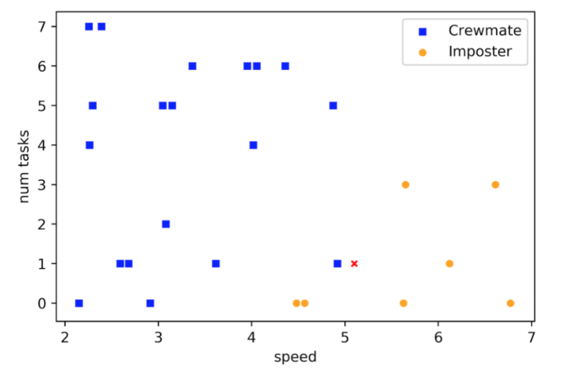

Suppose Rick now wants to use a k-nearest neighbor classifier to predict whether Beth is an imposter based on just her speed and num tasks.

- Which of the following values of 𝑘 would be appropriate for Rick to use for his classifier? Select all that are correct:

1

2

4

7

10

29

- If Rick uses 𝑘= 3 for his classifier, what will his prediction for Beth be? What if he uses 𝑘= 5?

Data C8 Spring 2026 Tutoring 11 | 3

### Page 4

- Rick now decides to try his classifier on Morty. Suppose Morty has a speed of 5.2 and num tasks of 4. The closest neighbor

to Morty in the training set has a speed of 5.6 and num tasks of 3. Write a Python expression that evaluates to the Euclidean distance between Morty and his closest neighbor in the training set.

- Morty is suspicious of Rick’s classifier and decides to create his own classifier. He conducts a random sample of 100 crew

members from various space missions in the past year, observing the same attributes like speed and num tasks. Before using his classifier to make predictions, Morty would like to estimate its accuracy. Which of the following are appropriate ways to do this? Select all that are correct:

Train the classifier on all 100 crew members in the sample, use the classifier to predict the outcome of each of the 100 members, and measure how often the classifier is correct.

Train the classifier on 55 randomly selected crew members from the sample, use the classifier to predict the outcome of each of the remaining 45 members, and measure how often the classifier is correct.

Train the classifier on 70 randomly selected crew members from the sample, use the classifier to predict the outcome of each of the remaining 30 members, and measure how often the classifier is correct.

Train the classifier on all 100 crew members in the sample, use the classifier to predict the outcome of 50 randomly selected members in the sample, and measure how often the classifier is correct.

Train the classifier on all 100 crew members in the sample, use the classifier to predict the outcome of just the imposters in the sample, and measure how often the classifier is correct.

- Morty is worried that his classifier is going to perform very well on his training set but won’t be very accurate when making

predictions on new crew members in the population. What is the name of this phenomenon?

Data C8 Spring 2026 Tutoring 11 | 4

## Tutoring 11 — Solution

### Page 1

### Classification & Bayes

Tutoring 11

Data C8: Foundations of Data Science UC Berkeley, Spring 2026

#### 1. Classification

- Thomas and Ramisha are deciding on which kind of nearest neighbors classifier they want to use. Ramisha says that using

a larger number of neighbors will always result in more accurate predictions. Thomas disagrees. Who is right, and why?

Hint: Think about what happens when we have a dataset with 𝑛 points and we use an n-nearest neighbors classifier.

Thomas is right. If we have 𝑛 points and use a 𝑛-nearest neighbors classifier, we will always get the same classification. Consider a data set of 13 points, 10 of which are blue and 3 of which are yellow. Using a 13-nearest neighbor classifier would always result in a blue classification, no matter where the unknown point is. Therefore, using a larger number of neighbors does not always result in more accurate predictions.

- Thomas instead proposes they use 𝑘= 1 nearest neighbor instead because he dislikes large 𝑘. What is a potential issue with

this approach?

Hint: Think about the case where we have two groups, label A and label B, completely separated from each other, except for 1 label A point that lies in the B region.

Using the scenario given in the hint, this classifier would do unexpectedly poorly when given a test point that ends up closer to the single label A point, despite being in the area completely surrounded by label B points. This is an example of overfitting, as we don’t generalize (the “big picture”) very well, as shown in the test set — we instead had just classified points exactly based on what we saw in the training set.

- A student is trying to build a classifier that classifies Berkeley students as residents of Northside or Southside. The student

has a random sample of Berkeley students all of whom live on Northside or Southside. For each student she records whether the student lives on Northside or Southside, the number of times the student went to La Val’s (on Northside) in the last 6 months, and the number of times the student went to Gypsy’s (on Southside) in the last 6 months.

Draw a decision boundary for a 5-nearest neighbor classifier on the scatter plot below.

### Page 2

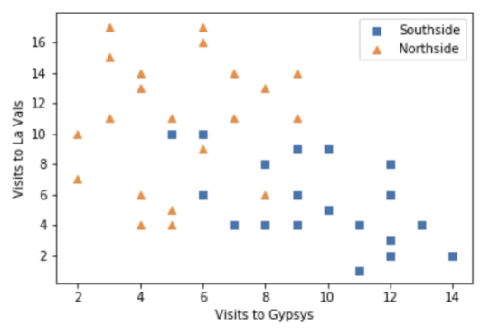

Solution:

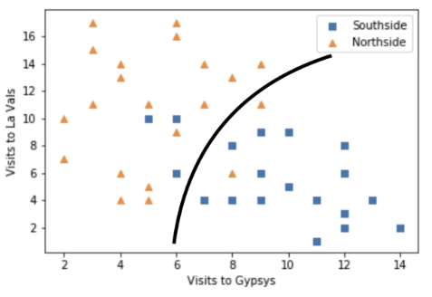

Data C8 Spring 2026 Tutoring 11 | 2

### Page 3

#### 2. Basketball Bayes

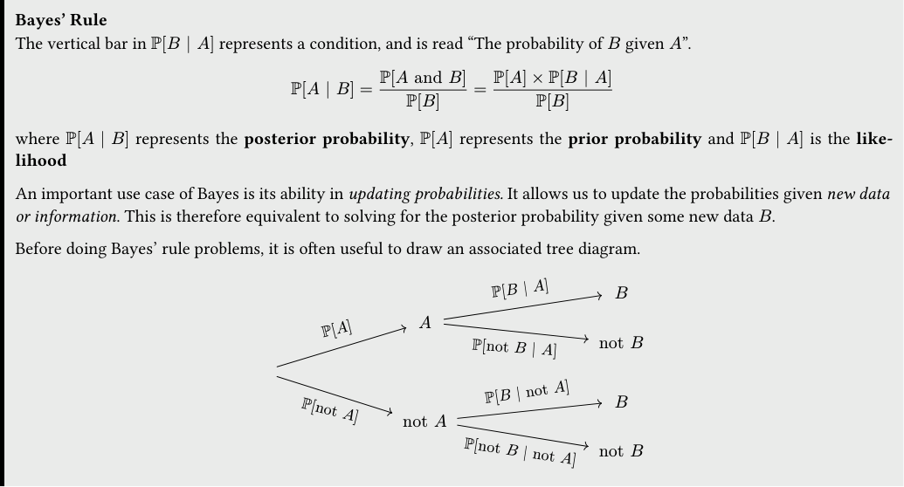

Bayes’ Rule The vertical bar in ℙ[𝐵| 𝐴] represents a condition, and is read “The probability of 𝐵 given 𝐴”.

ℙ[𝐴| 𝐵] = ℙ[𝐴and 𝐵]

ℙ[𝐵] = ℙ[𝐴] × ℙ[𝐵| 𝐴]

ℙ[𝐵]

where ℙ[𝐴| 𝐵] represents the posterior probability, ℙ[𝐴] represents the prior probability and ℙ[𝐵| 𝐴] is the like­ lihood

An important use case of Bayes is its ability in updating probabilities. It allows us to update the probabilities given new data or information. This is therefore equivalent to solving for the posterior probability given some new data 𝐵.

Before doing Bayes’ rule problems, it is often useful to draw an associated tree diagram.

ℙ[𝐵| 𝐴]

𝐵

𝐴

ℙ[𝐴]

not 𝐵

ℙ[not 𝐵| 𝐴]

ℙ[𝐵| not 𝐴]

𝐵

ℙ[not 𝐴]

not 𝐴

ℙ[not 𝐵| not 𝐴]

not 𝐵

During the 2022-2023 NBA regular season, the Golden State Warriors took a total of 3,540 3-point shots. 18% of those were shot by the Warriors’ star point guard Steph Curry, and the rest were shot by his teammates. During that season Steph Curry hit 42.7% of all the 3-point shots he took, while his teammates only made 37.6% of theirs.

##### (a) Draw a tree diagram for the problem.

Note that all we really need to include are the events (i.e., Steph Curry, Not Steph Curry, etc.) and the probabilities on the branches (i.e., 0.82). The remaining labels are for extra clarity.

0.427

Make

Steph Curry

0.18

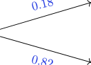

Miss

0.573

0.376

Make

0.82

Not Steph Curry

Miss

0.624

- What is the probability that any given 3-point shot taken by the Warriors was taken by Steph Curry in the 2022-2023 season?

We can read this directly from the problem introduction. The probability a random shot was taken by Steph Curry is 18%.

- What is the probability that two random 3-point shots are made if we do not know who shot it on the Warriors?

Data C8 Spring 2026 Tutoring 11 | 3

### Page 4

To find the probability that two random 3-point shots were made, we first have to find the total probability that one shot is made. Then, we can use the multiplication rule and solve.

ℙ[Make] = ℙ[Steph Curry and Make] + ℙ[Not Steph Curry and Make]

= 0.18 × 0.427 + 0.82 × 0.376 ≈0.385

⟹ℙ[two 3 point shots are made] = ℙ[Make] × ℙ[Make] = (0.385)2

- Josh was watching a warriors game last season when he walked away to talk to a friend. When he got back to his seat his

friend told him the Warriors had made a 3-point shot. What is the probability that the 3-point shot was made by Steph Curry?

To find the probability that a random 3 was made by Steph Curry we want

ℙ[Steph Curry | Make] = ℙ[Steph Curry and Make]

ℙ[Make]

⟹ℙ[Steph Curry and Make] = ℙ[Steph Curry] × ℙ[Make | Steph Curry] = 0.18 × 0.427

Then, we can use the addition rule,

ℙ[Make] = ℙ[Steph Curry and Make] + ℙ[Not Steph Curry and Make] = 0.18 × 0.427 + 0.82 × 0.376

⟹ℙ[Steph Curry | Make] = 0.18 × 0.427 0.18 × 0.427 + 0.82 × 0.376 ≈0.2

.

- Angus was watching highlights of a recent warriors game and was told that in highlights, Steph Curry makes 90% of his 3-

point shots and the rest of the team makes 50% of their 3-point shots. Given that a shot was made, what was the probability the highlight was from one of Steph Curry’s shots? You may assume that the prior probabilities stay the same.

The set up is the exact same except now we have different likelihoods so we get the following.

ℙ[Steph Curry | Make] = 0.18 × 0.9 0.18 × 0.9 + 0.82 × 0.5 ≈0.283

Data C8 Spring 2026 Tutoring 11 | 4

### Page 5

#### 3. Rick and Morty

(Fall 2020 Final Question 4)

Rick and Morty have been aboard a spaceship for 3 weeks among a crew of 100 people. Rick learns that there is an imposter among them, trying to sabotage their mission. Rick remembers that other space missions recently have had imposters sabotaging their crew. He thinks he might be able to make some predictions about his mission based on how those other missions concluded.

Rick samples flight logs of 26 crew members from across various missions in the last year and notes down a couple of attributes about each sampled person, including the following three columns: speed, num tasks and outcome.

Rick is suspicious of Morty’s sister, Beth. He visualizes this sample data along with Beth’s attributes (the X) in the following chart:

Suppose Rick now wants to use a k-nearest neighbor classifier to predict whether Beth is an imposter based on just her speed and num tasks.

- Which of the following values of 𝑘 would be appropriate for Rick to use for his classifier? Select all that are correct:

1

2

4

7

10

29

1 and 7. If we choose an even k value (2, 4, or 10), we risk that a tie will happen. If both classes get the same number of votes, it would be unclear how we should classify the new point. If we choose k=29, we are using more neighbors than data points as the dataset only has 26 points.

- If Rick uses 𝑘= 3 for his classifier, what will his prediction for Beth be? What if he uses 𝑘= 5?

Data C8 Spring 2026 Tutoring 11 | 5

### Page 6

Both predict imposter.

- Rick now decides to try his classifier on Morty. Suppose Morty has a speed of 5.2 and num tasks of 4. The closest neighbor

to Morty in the training set has a speed of 5.6 and num tasks of 3. Write a Python expression that evaluates to the Euclidean distance between Morty and his closest neighbor in the training set.

np.sqrt((5.2 - 5.6) ** 2 + (4 - 3) **2)

- Morty is suspicious of Rick’s classifier and decides to create his own classifier. He conducts a random sample of 100 crew

members from various space missions in the past year, observing the same attributes like speed and num tasks. Before using his classifier to make predictions, Morty would like to estimate its accuracy. Which of the following are appropriate ways to do this? Select all that are correct:

Train the classifier on all 100 crew members in the sample, use the classifier to predict the outcome of each of the 100 members, and measure how often the classifier is correct.

Train the classifier on 55 randomly selected crew members from the sample, use the classifier to predict the outcome of each of the remaining 45 members, and measure how often the classifier is correct.

Train the classifier on 70 randomly selected crew members from the sample, use the classifier to predict the outcome of each of the remaining 30 members, and measure how often the classifier is correct.

Train the classifier on all 100 crew members in the sample, use the classifier to predict the outcome of 50 randomly selected members in the sample, and measure how often the classifier is correct.

Train the classifier on all 100 crew members in the sample, use the classifier to predict the outcome of just the imposters in the sample, and measure how often the classifier is correct.

Options 2 and 3. We should randomly split the original dataset into two sets: a training set and a testing set. The training set is used to build the classifier, while the testing set helps us evaluate how well the classifier performs on unseen data. Therefore, we cannot train the classifier on all 100 crew members; we must reserve some crew members for the test set to simulate making predictions on new, unseen individuals.

- Morty is worried that his classifier is going to perform very well on his training set but won’t be very accurate when making

predictions on new crew members in the population. What is the name of this phenomenon?

Overfitting!

Data C8 Spring 2026 Tutoring 11 | 6

## Tutoring 12 — Student

### Page 1

### Final Review

Tutoring 12

Data C8: Foundations of Data Science UC Berkeley, Spring 2026

#### 1. Testing Chance Models

Roulette is a casino game in which a ball falls into one pocket in a spinning wheel, and players bet on the color of the pocket in which the ball falls. If the player correctly picks the color, they win. 18 of the 38 pockets in a roulette wheel are red. You play 30 games of roulette, bet on red every time, and win 20 of those games. You become suspicious about the fairness of this roulette game.

##### (a) State a null and alternative hypothesis to see whether the roulette game is biased towards red.

- With your alternative hypothesis in mind, choose a test statistic and calculate its observed value. Your test statistic should

be large for data favoring the alternative hypothesis.

- Complete the function prop_wins(), which takes in no arguments and simulates playing the game 30 times and returns the

proportion of wins when you guess red every time.

def prop_wins():

proportions = ____________________________________________________ thirty_games = ___________________________________________________ simulated_prop = _________________________________________________ return simulated_prop

- Complete the code below to simulate an empirical distribution of the test statistic using 10000 iterations, storing the statistics

in an array called simulated_stats.

simulated_stats = _________________________________________________

__________________________________________:

________________________________________________________ ________________________________________________________

##### (e) Write a line of code to calculate the p-value.

_____________________________________________________________________________

- Suppose you find a p-value of 0.0103. What do you conclude about the null hypothesis, at a p-value cutoff of 5%?

### Page 2

#### 2. A/B Testing Review

We are examining the weights of a population of cats and dogs. You are given a random sample from this population, stored in the table pets, which has two columns. The first column "Animal" contains a string, either "Cat" or "Dog". The second column

"Weight" contains the weights of each of the animals in pounds as floats. You notice that the average weight of dogs in your sample is 3 pounds heavier than the average weight of cats in your sample.

- State a null and alternative hypothesis to see if dogs weigh more than cats on average in the population.

- With your alternative hypothesis in mind, choose a test statistic and calculate its observed value. Your test statistic should

be large for data favoring the alternative hypothesis.

- Complete the function one_stat() which takes in no arguments and returns one value of the test statistic.

def one_stat():

shuffled_animals = ________________________________________________________________________ shuffled_table = pets.with_columns("Animal", shuffled_animals) means_table = _____________________________________________________________________________ means_arr = _______________________________________________________________________________ ___________________________________________________________________________________________

- Complete the below code to simulate an empirical distribution of 5000 test statistics under the assumptions of the null

hypothesis.

diffs = __________________________________________________________________

__________________________________________________________________:

stat = _____________________________________________ ____________________________________________________

##### (e) Write a line of code to calculate your p-value.

_____________________________________________________________________________

##### (f) Suppose you find a p-value of 0.0013. What do you conclude, at a p-value cutoff of 5%?

Data C8 Spring 2026 Tutoring 12 | 2

### Page 3

#### 3. Probability Review

Max and Saleh are playing squash in the RSF. Before each game, they draw their rackets from a bucket. Max gets a boost from playing with his favorite racket, the lucky blue racket, while Saleh is unaffected by which racket he draws. Assume that Max has a 25% chance of drawing the lucky blue racket.

Additionally, assume that: - If Max has the lucky blue racket for a game, he has a 90% chance of winning. - If Max does not have the lucky blue racket for a game, he has a 65% chance of winning.

Please leave your answers in a mathematical expression.

##### (a) What is the probability that Max draws the lucky blue racket 4 times in a row?

##### (b) What is the probability that Max draws the lucky blue racket but loses?

##### (c) What is the probability that Saleh wins a randomly chosen game? Assume that there are no ties.

##### (d) If Max wins a game, what is the probability that he was playing with the lucky blue racket?

- Suppose Max and Saleh play 9 games in a row, redrawing their rackets each time. What is the chance that Max draws the

lucky blue racket at least once?

- To increase his advantage, Max buys a second lucky blue racket and places it into the bucket. Fed up, Saleh counts all of the

rackets in the bucket and finds that there are now 5 rackets. He insists on rackets being drawn randomly and getting to draw first. What is the new probability of Max receiving a lucky blue racket?

Data C8 Spring 2026 Tutoring 12 | 3

## Tutoring 12 — Solution

### Page 1

### Final Review

Tutoring 12

Data C8: Foundations of Data Science UC Berkeley, Spring 2026

#### 1. Testing Chance Models

Roulette is a casino game in which a ball falls into one pocket in a spinning wheel, and players bet on the color of the pocket in which the ball falls. If the player correctly picks the color, they win. 18 of the 38 pockets in a roulette wheel are red. You play 30 games of roulette, bet on red every time, and win 20 of those games. You become suspicious about the fairness of this roulette game.

##### (a) State a null and alternative hypothesis to see whether the roulette game is biased towards red.

Null Hypothesis:

The roulette game is fair, with an 18/38 chance of the ball falling into a red pocket. The observed number of wins on red is simply due to chance.

Alternative Hypothesis:

The ball is more likely to fall into red pockets. The observed number of wins on red is not just due to chance.

- With your alternative hypothesis in mind, choose a test statistic and calculate its observed value. Your test statistic should

be large for data favoring the alternative hypothesis.

Test Statistic:

The proportion of wins on red in 30 games. You can similarly do: “The proportion of wins on red in 30 games - The expected proportion of wins on red in 30 games”, though the expression will be rather nasty so we will stick to the first test statistic.

Observed Value:

20/30 = 2/3.

- Complete the function prop_wins(), which takes in no arguments and simulates playing the game 30 times and returns the

proportion of wins when you guess red every time.

def prop_wins():

proportions = ____________________________________________________ thirty_games = ___________________________________________________ simulated_prop = _________________________________________________ return simulated_prop

def prop_wins(): proportions = make_array(18/38, 20/38) thirty_games = sample_proportions(30, proportions) simulated_prop = thirty_games.item(0) return simulated_prop

- Complete the code below to simulate an empirical distribution of the test statistic using 10000 iterations, storing the statistics

in an array called simulated_stats.

simulated_stats = _________________________________________________

### Page 2

__________________________________________:

________________________________________________________ ________________________________________________________

simulated_stats = make_array() for i in np.arange(10000): one_sim = prop_wins() simulated_stats = np.append(simulated_stats, one_sim)

##### (e) Write a line of code to calculate the p-value.

_____________________________________________________________________________

p_value = np.count_nonzero(simulated_stats >= (2/3)) / 10000

##### (f) Suppose you find a p-value of 0.0103. What do you conclude about the null hypothesis, at a p-value cutoff of 5%?

##### We should reject the null hypothesis, as the empirical p-value (0.0103) is below the cutoff of 5% or 0.05.

##### Data C8 Spring 2026 Tutoring 12 | 2

### Page 3

#### 2. A/B Testing Review

We are examining the weights of a population of cats and dogs. You are given a random sample from this population, stored in the table pets, which has two columns. The first column "Animal" contains a string, either "Cat" or "Dog". The second column

"Weight" contains the weights of each of the animals in pounds as floats. You notice that the average weight of dogs in your sample is 3 pounds heavier than the average weight of cats in your sample.

- State a null and alternative hypothesis to see if dogs weigh more than cats on average in the population.

Null Hypothesis:

The distributions of the weights of dogs and the distribution of the weights of cats is the same. The difference observed in the sample is purely due to chance.

Alternative Hypothesis:

The weights of dogs, on average, are greater than the weights of cats in the population. The difference observed in the sample is not just due to chance.

- With your alternative hypothesis in mind, choose a test statistic and calculate its observed value. Your test statistic should

be large for data favoring the alternative hypothesis.

Test Statistic: The difference between the mean dog weight and the mean cat weight.

Observed Value: 3

- Complete the function one_stat() which takes in no arguments and returns one value of the test statistic.

def one_stat():

shuffled_animals = ________________________________________________________________________ shuffled_table = pets.with_columns("Animal", shuffled_animals) means_table = _____________________________________________________________________________ means_arr = _______________________________________________________________________________ ___________________________________________________________________________________________

def one_stat(): shuffled_animals = pets.sample(with_replacement=False).column("Animal") shuffled_table = pets.with_columns("Animal", shuffled_animals) means_table = shuffled_table.group("Animal", np.mean) means_arr = means_table.column(1) return means_arr.item(1) - means_arr.item(0)

- Complete the below code to simulate an empirical distribution of 5000 test statistics under the assumptions of the null

hypothesis.

diffs = __________________________________________________________________

__________________________________________________________________:

stat = _____________________________________________ ____________________________________________________

diffs = make_array() for i in np.arange(5000): stat = one_stat() diffs = np.append(diffs, stat)

Data C8 Spring 2026 Tutoring 12 | 3

### Page 4

##### (e) Write a line of code to calculate your p-value.

_____________________________________________________________________________

p_value = np.count_nonzero(diffs >= 3) / 5000

##### (f) Suppose you find a p-value of 0.0013. What do you conclude, at a p-value cutoff of 5%?

The empirical p-value of 0.0013 is less than our p-value cutoff of 5%, so we will reject the null hypothesis in favor of the alternative hypothesis.

Data C8 Spring 2026 Tutoring 12 | 4

### Page 5

#### 3. Probability Review

Max and Saleh are playing squash in the RSF. Before each game, they draw their rackets from a bucket. Max gets a boost from playing with his favorite racket, the lucky blue racket, while Saleh is unaffected by which racket he draws. Assume that Max has a 25% chance of drawing the lucky blue racket.

Additionally, assume that: - If Max has the lucky blue racket for a game, he has a 90% chance of winning. - If Max does not have the lucky blue racket for a game, he has a 65% chance of winning.

Please leave your answers in a mathematical expression.

##### (a) What is the probability that Max draws the lucky blue racket 4 times in a row?

0.254

##### (b) What is the probability that Max draws the lucky blue racket but loses?

0.25 ∗0.10

##### (c) What is the probability that Saleh wins a randomly chosen game? Assume that there are no ties.

1 −(0.25 ∗0.90 + 0.75 ∗0.65)

##### (d) If Max wins a game, what is the probability that he was playing with the lucky blue racket?

0.25∗0.90 0.25∗0.90+0.75∗0.65

- Suppose Max and Saleh play 9 games in a row, redrawing their rackets each time. What is the chance that Max draws the

lucky blue racket at least once?

1 −0.759

- To increase his advantage, Max buys a second lucky blue racket and places it into the bucket. Fed up, Saleh counts all of the

rackets in the bucket and finds that there are now 5 rackets. He insists on rackets being drawn randomly and getting to draw first. What is the new probability of Max receiving a lucky blue racket?

2 5 ∗ 1 4 + 3 5 ∗ 2 4

Data C8 Spring 2026 Tutoring 12 | 5
